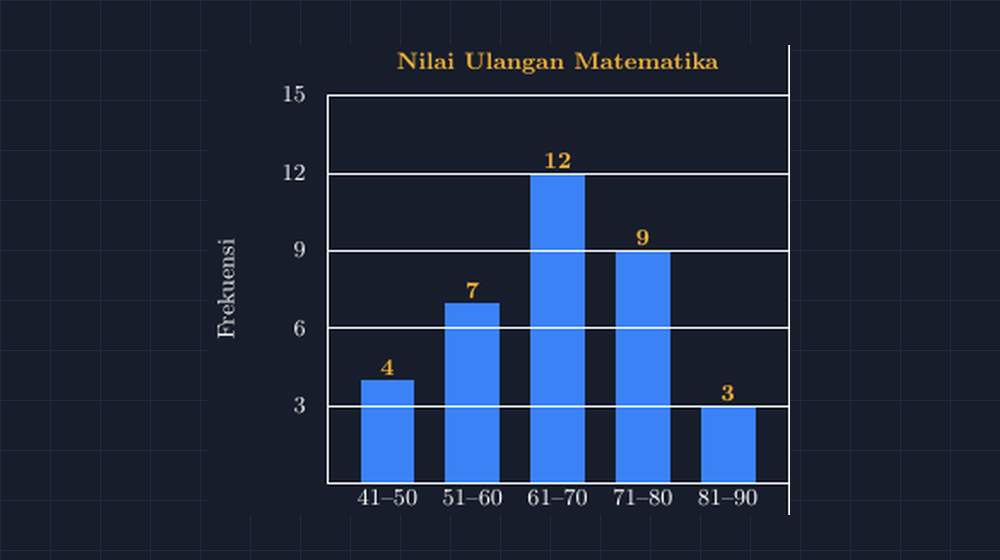

Materi statistika di kelas delapan selalu saya buka dengan kegiatan sederhana: mengumpulkan data dari siswa sendiri. Semester lalu saya meminta mereka mengumpulkan data tinggi seluruh anggota kelompok, lalu kita rangkum jadi tabel frekuensi. Tahun ini saya pakai data yang lebih dekat dengan keseharian mereka: nilai ulangan harian kelas VII-B. Datanya saya kelompokkan ke interval 41--50 sampai 81--90, dan frekuensinya jadi: 4, 7, 12, 9, dan 3.

Masalah muncul saat saya minta mereka menggambar diagram batangnya di buku. Yang pertama sumbu tegaknya dibuat "kira-kira" — frekuensi 12 digambar dua kali lebih tinggi dari frekuensi 4, padahal seharusnya tiga kali. Yang kedua jarak antarbatangnya tidak seragam: batang pertama dan kedua berdempetan, batang ketiga dan keempat terpisah jauh. Yang ketiga justru paling menarik: dia menggambar batangnya bagus dan rapi, tapi lupa memberi skala pada sumbu tegak sama sekali. Ketika saya tanya berapa tinggi batang ketiga, dia jawab, "Dua belas, Pak. Kan tulis di atasnya."

<!--more-->

Jawaban itu yang membuat saya berpikir sepanjang jalan pulang. Diagram batang tanpa skala yang benar sebenarnya bukan diagram batang — dia hanya gambar berbentuk balok. Anak itu tidak salah menghitung; dia salah memahami untuk apa sumbu itu ada. Frekuensi 12 harus *terlihat* sebagai 12 dari panjang batangnya, bukan hanya dibacakan di atasnya. Kalau esok hari batangnya digambar setengah tinggi, pembaca diagram harus bisa mendeteksi ada yang tidak konsisten.

## Dimensi yang tidak boleh dilanggar

Di sinilah TikZ membantu saya, terutama ketika saya menyiapkan soal latihan dan media cetak. Kuncinya satu: saya *mendeklarasikan* skala, bukan mengukur dengan mata. Di TikZ, saya bisa menulis `y=0.35cm` — artinya satu satuan frekuensi sama dengan 0,35 sentimeter. Setelah itu semua panjang mengikuti matematika, bukan perkiraan tangan.

Pola dasarnya seperti ini:

```latex
\begin{tikzpicture}[y=0.35cm, x=1.15cm]
  \fill[blue!70] (2-0.32,0) rectangle (2+0.32,12);
\end{tikzpicture}
```

Perhatikan bahwa tinggi batang ditulis langsung sebagai `12` — satu kotak koordinat TikZ untuk satu frekuensi. Kalau besok saya ingin mengganti data (misalnya pakai hasil ulangan kelas VII-C yang frekuensinya 5, 8, 10, 10, 2), saya cukup mengganti angka-angkanya, dan semua batang otomatis menyesuaikan proporsinya. Tidak ada satu pun panjang yang saya "perkirakan".

Diagram hasilnya seperti ini:


*Diagram batang nilai ulangan Matematika — frekuensi 4, 7, 12, 9, 3 pada interval 41--50 sampai 81--90. Tinggi setiap batang benar-benar sebanding dengan frekuensinya, karena semua tinggi digambar langsung dalam satuan sumbu tegak.*

Label nilai di atas tiap batang, garis bantu pada setiap kelipatan 3, dan nama interval di bawah sumbu datar semuanya ditempatkan dengan koordinat yang sama pula. Lebar batang saya kunci 0,64 satuan (dari $x-0{,}32$ sampai $x+0{,}32$), sehingga jarak antarbatang seragam tanpa saya hitung manual satu per satu.

## Kenapa jarak antar batang juga penting

Ada satu hal yang sering terlewat di pembahasan kelas: diagram batang itu batangnya *terpisah*. Ini beda dengan histogram, yang batangnya sengaja menempel karena datanya kontinu berinterval. Saya pernah melihat buku latihan yang menyebut gambar histogram sebagai diagram batang, dan siswa pun bingung ketika di soal berikutnya keduanya dibedakan.

Dengan TikZ, pembeda ini justru terasa alami. Kalau batangnya saya gambar dari $x-0{,}5$ sampai $x+0{,}5$ dan pusatnya di $x = 0, 1, 2, \dots$, maka batang-batang itu otomatis menempel — jadilah histogram. Cukup ubah setengah-lebar dari 0,32 menjadi 0,5. Satu perubahan angka, dua jenis diagram. Siswa yang melihat saya mendemokan ini di layar langsung paham bahwa yang membedakan histogram dari diagram batang bukan "bentuknya", melainkan sifat datanya — dan pilihan penggambaran mengikuti sifat itu.

## Garis bantu yang jujur

Satu trik kecil lain yang saya suka: garis bantu horizontal di setiap kelipatan skala. Di diagram di atas, garis putih tipis ada di frekuensi 3, 6, 9, 12, dan 15. Fungsinya bukan hiasan. Ketika siswa membaca diagram, garis bantu itu memberi jangkar: "batang kedua nyaris menyentuh garis 7, ya berarti frekuensinya 7." Tanpa garis bantu, mata mereka harus menjangkau dari ujung batang ke angka di sumbu — dan jangkauan mata itu sering meleset, apalagi kalau diagramnya diproyeksikan di layar kelas yang kurang tajam.

Di TikZ garis bantu ini cuma satu perulangan:

```latex
\foreach \y in {3,6,9,12,15} {
  \draw[white!40] (-0.7,\y) -- (4.7,\y);
  \node[anchor=east] at (-0.85,\y) {\y};
}
```

Angka maksimum 15 sengaja saya pilih sedikit di atas frekuensi tertinggi (12), supaya batang tertinggi tidak "menyentuh langit-langit" diagram dan ada ruang untuk label nilainya. Detail kecil, tapi diagram yang punya ruang napas jauh lebih enak dibaca.

## Dari gambar ke pemahaman

Yang paling saya syukuri dari usaha membuat diagram yang presisi ini justru terjadi di luar rencana. Ketika saya menampilkan diagram TikZ di kelas dan membandingkannya dengan salah satu gambar tangan siswa yang skalanya melenceng, ada siswa yang bertanya, "Pak, kalau skalanya salah begini, apakah kesimpulannya juga bisa salah?" Kami lalu bicara sebentar tentang bagaimana diagram yang menyesatkan bisa membuat orang menarik kesimpulan yang keliru — misalnya merasa bahwa "mayoritas anak nilainya jelek" padahal sebaran datanya normal saja, hanya batang tertingginya digambar berlebihan.

Itu pelajaran literasi data yang tidak ada di halaman buku paket, lahir dari perbandingan dua gambar. Dan saya percaya ini inti dari semua kerja menggambar ulang soal dan media dengan TikZ: bukan sekadar kerapian, tapi kejujuran. Gambar yang presisi membuat matematika di baliknya terlihat, dan matematika yang terlihat jauh lebih sulit dipalsukan — termasuk oleh siswa itu sendiri.

Kalau Bapak/Ibu ingin mencoba, berkas lengkapnya bisa langsung dikompilasi dan tinggal diganti datanya.

> 📎 **Berkas TikZ lengkap:** [tikz-diagram-batang-data-kelas.tex](tex/tikz-diagram-batang-data-kelas.tex) — siap kompilasi (butuh paket `tikz`).
