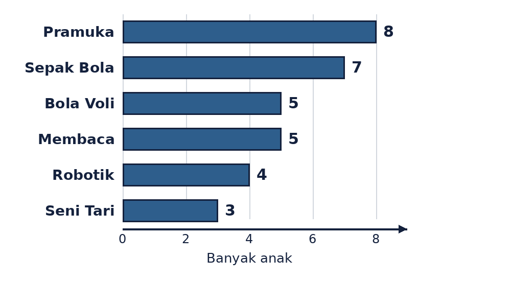

Minggu lalu saya menyurvei kelas VIII.A: ekstrakurikuler apa yang paling mereka minati. Jawabannya enam: Pramuka 8 anak, Sepak Bola 7, Bola Voli 5, Membaca 5, Robotik 4, dan Seni Tari 3. Total 32 anak, pas satu kelas. Saya ingin menampilkannya sebagai diagram batang di lembar kerja — dan di situlah masalah kecil muncul.

Labelnya panjang. "Sepak Bola" dan "Seni Tari" tidak muat di bawah batang yang sempit, sehingga tulisannya saling bertumpuk. Saya mencoba memiringkan labelnya 45 derajat, seperti yang biasa saya lihat di buku. Hasilnya? Murid di bangku belakang memiringkan kepala untuk membacanya, dan seorang anak bertanya, "Pak, ini tulisannya kenapa miring?" Diagram yang seharusnya membantu membaca data justru meminta pembacanya bekerja lebih keras. Akhirnya saya membaringkan batangnya: kategori di kiri, batang memanjang ke kanan. Seketika semua label terbaca normal, dan Pramuka — yang paling panjang batangnya — langsung terlihat tanpa perlu mencari angka.


*Gambar 1. Diagram batang mendatar: Pramuka 8, Sepak Bola 7, Bola Voli 5, Membaca 5, Robotik 4, Seni Tari 3. Label terbaca mendatar, batang terpanjang di atas.*

<!--more-->

## Kapan Batang Harus Berbaring

Aturan praktis saya sederhana: kalau label kategori lebih panjang daripada lebar batang yang tersedia, baringkan diagramnya. Nama ekstrakurikuler, nama mata pelajaran, nama daerah, nama kegiatan — semuanya label panjang yang menderita di bawah batang tegak. Begitu batangnya berbaring, sumbu nilai pindah ke bawah dan berjalan mendatar, sedangkan kategori berderet di sumbu tegak, satu baris satu nama, dengan ruang selebar apa pun yang dibutuhkan.

Ada dua keuntungan lain yang saya rasakan di kelas. Pertama, membandingkan panjang batang menjadi lebih mudah: mata kita membandingkan panjang mendatar lebih cepat daripada tinggi tegak, apalagi kalau batangnya berdekatan. Kedua, kategori yang banyak tetap muat — sepuluh atau dua belas kategori tinggal menambah baris ke bawah, tanpa memeras lebar halaman. Sebaliknya, kalau kategorinya hanya dua atau tiga dan labelnya pendek — misalnya "Laki-laki" dan "Perempuan" — diagram tegak biasa sudah cukup, tidak perlu dibaringkan. Memilih arah batang adalah keputusan membaca, bukan selera.

## Menggambarnya dengan TikZ: Label di Kiri, Batang ke Kanan

Inti gambarnya adalah satu putaran `\foreach`. Setiap baris berisi nama kategori, nilainya, dan ketinggiannya. Saya mengurutkan dari yang terbesar ke yang terkecil sebelum menulis daftar — Pramuka di atas, Seni Tari di bawah — supaya pembaca menemukan yang terbesar tanpa memindai seluruh diagram.

```latex
\foreach \kat/\nilai/\y in
  {Pramuka/8/6, Sepak Bola/7/5, Bola Voli/5/4,
   Membaca/5/3, Robotik/4/2, Seni Tari/3/1} {
  % Label kategori di kiri, rata kanan
  \node[anchor=east, font=\large\bfseries, navy]
    at (-0.2,\y) {\kat};
  % Batang: 1 anak = 0,9 cm
  \draw[fill=batangbiru, draw=navy, thick]
    (0,\y-0.35) rectangle ({\nilai*0.9},\y+0.35);
  % Nilai di ujung batang
  \node[anchor=west, font=\large, navy]
    at ({\nilai*0.9+0.15},\y) {\nilai};
}
```

Perhatikan tiga hal. Label memakai `anchor=east`, sehingga ujung kanan semua label sejajar di garis yang sama, tepat di kiri batang. Batang digambar sebagai persegi panjang dari $x = 0$ sampai $x = \nilai \times 0{,}9$ — satu anak saya wakili dengan 0,9 cm, sehingga Pramuka yang 8 anak menjadi 7,2 cm. Dan angka nilainya saya tulis di ujung kanan batang dengan `anchor=west`, bukan di dalam batang, supaya tetap terbaca jelas meski batangnya pendek seperti Seni Tari.

Satu warna untuk semua batang saya pertahankan dengan sengaja. Warna yang berbeda-beda untuk tiap batang menggoda untuk dipakai, tetapi warna itu tidak membawa makna apa-apa di sini — tidak ada kelompok yang dibedakan. Kalau setiap batang beda warna, pembaca akan mencari arti perbedaan itu, dan tidak menemukannya. Satu warna berarti satu pesan: yang dibandingkan hanyalah panjangnya.

## Sumbu dan Skala: Selalu Mulai dari Nol

Batang yang berbaring tetap butuh sumbu. Saya menggambar garis sumbu mendatar di bawah, dengan tanda setiap 2 anak — 0, 2, 4, 6, 8 — plus garis grid putus-putus yang naik dari tiap tanda sampai ke baris teratas. Grid itu membantu mata menarik garis dari ujung batang ke bawah, sehingga nilai 7 dan 5 tidak perlu ditebak.

```latex
% Garis grid dan tanda sumbu, 0 sampai 8
\foreach \x in {0,2,4,6,8} {
  \draw[abu, thin, dashed] ({\x*0.9},0.4) -- ({\x*0.9},6.6);
  \node[anchor=north, font=\small, navy]
    at ({\x*0.9},0.3) {\x};
}
\draw[navy, thick, ->] (0,0.4) -- (8.4,0.4);
\node[anchor=north, font=\small, navy]
  at (4.2,-0.2) {Banyak anak};
```

Satu aturan yang tidak boleh dilanggar: sumbu harus mulai dari nol. Batang 8 anak dan batang 7 anak selisihnya hanya satu anak, tetapi kalau sumbunya dipotong mulai dari 5, batang Pramuka akan tampak hampir dua kali batang Sepak Bola — dan diagram itu berbohong. Godaan memotong sumbu muncul karena ingin "menghemat tempat", tetapi pada diagram batang, panjang batang adalah datanya. Memotong sumbu sama dengan memotong data.

## Tiga Kesalahan yang Sering Saya Lihat

Pertama, batang tidak diurutkan. Data ditulis sesuai urutan survei — Pramuka, Bola Voli, Seni Tari, lalu Sepak Bola — sehingga mata harus melompat ke sana kemari untuk menemukan yang terbesar. Mengurutkan dari besar ke kecil bukan hiasan; itu adalah cara diagram menjawab pertanyaan pertama yang selalu ditanyakan pembaca: mana yang paling banyak?

Kedua, skala tidak mulai dari nol, seperti yang baru saya singgung. Kesalahan ini paling berbahaya karena diagramnya tetap terlihat rapi — hanya saja perbandingannya salah. Saya selalu memeriksa angka nol di ujung kiri sumbu sebelum mencetak lembar kerja.

Ketiga, memiringkan label di diagram tegak alih-alih membaringkan batangnya. Tulisan miring 45 derajat bukan solusi, melainkan pengakuan bahwa diagramnya sudah sesak. Kalau labelnya panjang, ubah arah batangnya. Diagram batang mendatar ada justru untuk masalah ini, dan menggambarnya dengan TikZ tidak lebih sulit daripada versi tegaknya: yang berubah hanya sumbu mana yang menampung kategori dan sumbu mana yang menampung nilai.

Diagram batang mendatar mungkin tampak seperti diagram batang biasa yang diputar 90 derajat, tetapi di kelas saya ia mengubah satu hal penting: murid tidak lagi memiringkan kepala untuk membaca label. Dan kalau labelnya terbaca tanpa usaha, barulah mereka punya tenaga untuk pertanyaan yang sebenarnya: mengapa Pramuka paling banyak diminati, dan apa yang membuat Seni Tari paling sedikit? Di situlah pelajaran statistika dimulai — bukan pada batang-batangnya, melainkan pada cerita di balik panjangnya.

> 📎 **Berkas TikZ lengkap:** [diagram-batang-mendatar.tex](tex/diagram-batang-mendatar.tex) — dokumen siap kompilasi (butuh paket `tikz`). Silakan ganti angka-angkanya untuk dokumen Anda sendiri.
