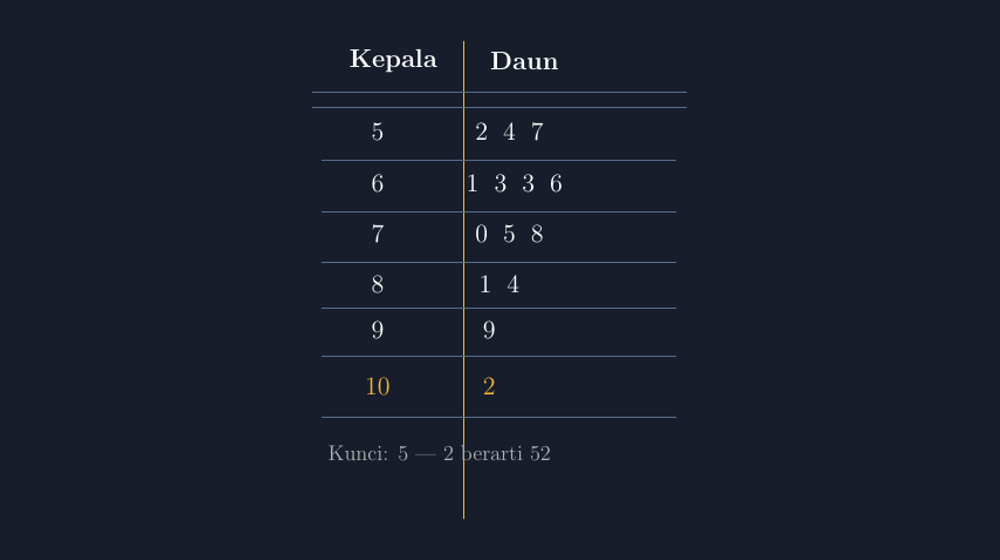

Hampir setiap akhir semester saya menghadapi musuh yang sama: tumpukan nilai ulangan harian yang harus saya ceritakan ke siswa. Rata-rata saja tidak cukup — siswa ingin tahu di mana posisi mereka, apakah kelas cenderung tinggi atau rendah, dan ada berapa teman yang nilainya dekat dengan punya mereka. Kalau saya hanya menulis daftar angka di papan, daftar itu terasa seperti kunci jawaban yang disandera: berisi, tapi tidak mau bercerita.

Pekan lalu saya mencoba sesuatu yang sederhana di kelas VIII.A. Setelah ulangan statistika, saya menulis satu garis vertikal di papan. Di sebelah kirinya saya tulis angka 5, 6, 7, 8, 9. Lalu saya minta setiap siswa menyebutkan nilainya satu per satu, dan nilai itu saya pecah: angka puluhan tulis di kiri garis, angka satuannya di kanan. Nilai 52 berarti 5 di kiri dan 2 di kanan. Tanpa sadar, kami sedang membangun diagram daun-kepala — stem-and-leaf plot — langsung dari suara kelas.

Efeknya langsung terasa. Sebelum bel terbunyi, siswa sudah menemukan sendiri bahwa nilai tertinggi kelas adalah 92, nilai terendah 52, dan bahwa "daun" paling rimbun tumbuh di kepala 7. Satu gambar, dan seluruh keadaan kelas terbaca dalam beberapa detik.


*Gambar 1. Diagram daun-kepala yang kami bangun bersama di papan, digambar ulang dengan TikZ. Kepala 10 diberi warna berbeda karena pertanyaan Raina nanti.*

## Diagram yang Menyimpan Data Aslinya

Ada satu hal yang membuat diagram daun-kepala berbeda dari histogram atau diagram batang: ia tidak membuang data aslinya. Histogram mengelompokkan nilai ke dalam interval, dan setelah itu tidak ada yang tahu persis angka apa yang masuk ke tiap batang. Diagram daun-kepala tidak. Setiap daun adalah satu angka asli milik satu siswa.

Ketika saya tunjukkan diagram di papan, saya bisa bertanya, "Berapa banyak siswa yang nilainya 70 atau lebih?" dan siswa menghitung daun, bukan menebak tinggi batang. Saya juga bisa bertanya, "Adakah yang mendapat tepat 83?" — dan jawabannya langsung terlihat ada atau tidak. Pertanyaan seperti ini mustahil dijawab dari histogram. Di sinilah diagram daun-kepala mengajarkan sesuatu yang lebih dalam daripada sekadar "cara menyajikan data": bahwa cara menyajikan selalu menawarkan dan menyembunyikan hal yang berbeda-beda.

<!--more-->

## Kuncinya Satu: Pemisahan Angka

Sebelum menggambar, siswa perlu paham satu trik kecil: memecah angka menjadi kepala dan daun. Untuk nilai ulangan dua digit, kepala adalah digit puluhan dan daun adalah digit satuan. Nilai 64 berarti kepala 6 dan daun 4; nilai 71 berarti kepala 7 dan daun 1. Kunci pembacaannya ditulis di bawah diagram: $5 \mid 2$ berarti 52. Tanpa kunci ini, diagram bisa ditafsirkan salah — dan saya pernah melihat siswa membaca 5 | 2 sebagai "lima koma dua".

Latihan pemecahan angka ini saya buat cepat saja, lima menit di awal. Yang menarik, justru siswa yang biasanya kewalahan di bab statistika lancar di bagian ini — karena pada dasarnya ini hanya soal tempat bilangan, sesuatu yang mereka latih sejak kelas empat lewat garis bilangan dan tabel nilai tempat.

## Menggambarnya dengan TikZ

Setelah diagram selesai di papan, saya foto dengan ponsel, dan sore harinya saya gambar ulang dengan TikZ supaya bisa masuk ke modul ajar dan lembar latihan tahun depan. Gambar hasil komputer itu penting: papan tulis terhapus, foto bisa buram, tetapi berkas TikZ tetap utuh dan bisa dicetak ulang kapan saja.

Inti menggambar diagram daun-kepala di TikZ hanyalah satu garis vertikal tebal dan dua kolom teks yang selaras. Ini potongan kodenya:

```latex
\draw[aksen, very thick] (0,5.2) -- (0,-4.2);
\node[anchor=east] at (-0.4,4.8) {Kepala};
\node[anchor=west] at (0.4,4.8) {Daun};
\foreach \i/\k/\l in {
  0/5/{2~~4~~7},
  1/6/{1~~3~~3~~6},
  2/7/{0~~5~~8},
  3/8/{1~~4},
  4/9/{9}}{
  \node[anchor=east] at (-0.4,3.4-\i) {\k};
  \node[anchor=west] at (0.4,3.4-\i) {\l};
}
```

Perhatikan bahwa setiap kepala dan daun adalah node terpisah dengan anchor yang berbeda: kepala diratakan ke kanan (`anchor=east`) supaya semua angka kepalanya lurus vertikal, daun diratakan ke kiri (`anchor=west`) supaya daunnya mulai rapi tepat setelah garis. Keselarasan inilah yang membuat diagram terbaca: kalau kepala tidak lurus, mata pembaca tersandung di baris pertama saja.

Jarak antar baris saya buat sama — satu satuan — karena dalam diagram daun-kepala, jarak antar baris tidak membawa makna apa pun. Ini beda dengan diagram batang, di mana tinggi batang justru adalah datanya. Kalau saya memperbesar jarak baris untuk kepala yang daunnya banyak, itu berarti mengarang informasi yang tidak ada. Diagram yang jujur pada datanya adalah diagram yang jaraknya seragam.

Untuk garis pemisah antar baris di kolom daun, saya pakai garis tipis warna redup, jauh lebih tipis dari garis vertikal utama. Hirarki visualnya harus jelas: garis vertikal kuning adalah "jantung" diagram, garis-garis horizontal hanya alat bantu mata.

## Satu Jam yang Saya Ingat

Yang paling saya senangi dari kegiatan di kelas VIII.A minggu itu bukan diagramnya, melainkan percakapan yang muncul setelah diagram jadi. Seorang siswa, Raina, bertanya, "Pak, kalau ada yang nilainya 100, daunnya di mana?" Pertanyaan bagus — karena 100 punya tiga digit, dan kepala-daun dua digit kita tidak bisa menampungnya. Kami bahas sebentar: kepala 10, daun 0, dan kepala dua digit ditulis dengan spasi lebih lebar supaya garis pemisah tidak diterobos. Detail kecil, tetapi pertanyaan seperti itu menunjukkan siswa benar-benar memikirkan struktur diagram, bukan hanya menyalinnya.

Ada juga siswa yang menyadari bahwa diagram daun-kepala bisa "dibaca terbalik": kalau diputar, dia menyerupai diagram batang horizontal yang setiap batangnya terbuat dari angka-angka asli. Saya tidak berencana mengajarkan itu hari itu, tetapi penemuan siswa lebih berharga daripada rencana saya.

## Penutup: Data yang Tetap Hidup

Diagram daun-kepala mungkin terlihat kuno dibanding grafik komputer yang berkilau. Tetapi justru karena kesederhanaannya dia mengajarkan dua hal yang tidak selalu didapat siswa dari perangkat lunak: bahwa setiap data punya pemiliknya — setiap daun adalah nilai seorang siswa yang benar-benar duduk di kelas — dan bahwa cara kita menyajikan data menentukan apa yang bisa dilihat darinya.

Kalau Bapak/Ibu ingin memakai gambar yang sama di lembar kerja, berkas TikZ lengkapnya bisa diunduh di bawah. Tinggal ganti angka-angkanya dengan data kelas Bapak/Ibu sendiri — dan biarkan daun-daunnya tumbuh dari suara kelas, bukan dari data buatan.

> 📎 **Berkas TikZ lengkap:** [tikz-diagram-daun-kepala.tex](tex/tikz-diagram-daun-kepala.tex) — siap kompilasi (butuh paket `tikz`).
