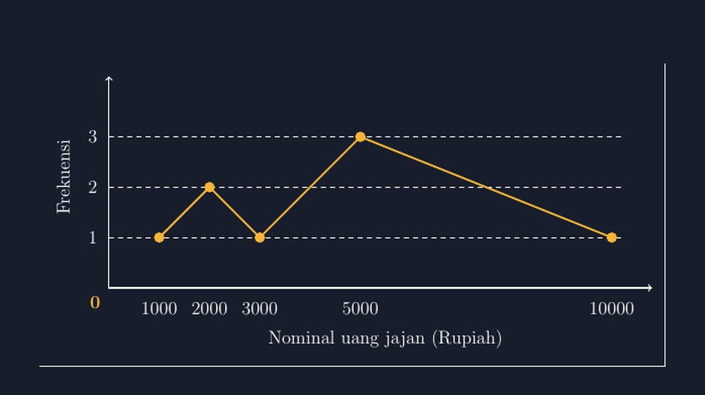

Minggu lalu saya memberi tugas kecil di kelas sembilan: catat nominal uang jajan kalian hari ini, kelompokkan, lalu sajikan dalam bentuk apa pun yang menurut kelompok kalian paling jujur. Salah satu kelompok memilih diagram garis. Ketika mereka memresentasikan, ada satu garis yang membuat saya tidak bisa diam: garis dari nominal dua ribu ke nominal lima ribu digambar lurus, dan di tengahnya — tepat di atas nominal tiga ribu setengah — mereka menaruh titik.

"Pak, ini titiknya artinya apa?"

Mereka saling pandang. Tidak ada yang bisa menjawab. Titik itu memang tidak artinya apa-apa, karena tidak ada satu pun anak di kelas itu yang jajan tiga ribu lima ratus rupiah. Titik itu lahir dari kebiasaan menggambar, bukan dari data.

<!--more-->

## Diagram Garis untuk Data yang Tidak Mulus

Diagram garis punya tempat yang pantas di statistika SMP, khususnya di materi yang bicara tentang data yang berubah terhadap waktu — suhu harian, jumlah siswa yang hadir, panjang tanaman yang diukur tiap dua hari. Di situ garis punya makna: perubahan itu terjadi terus-menerus, dan kemiringan garis menceritakan laju perubahan.

Masalahnya, diagram garis juga sering dipakai untuk data yang sama sekali tidak mengalir. Nominal uang jajan, ukuran sepatu, jumlah saudara, nilai ujian yang dibulatkan. Datanya diskret: hanya nilai-nilai tertentu yang mungkin muncul, dan di antara dua nilai itu tidak ada apa-apa. Ketika kita menyambung dua titik data dengan garis lurus, kita diam-diam mengklaim bahwa semua nilai di antaranya juga ada — padahal tidak.

Ini miskonsepsi yang halus, karena gambarnya sendiri tidak "salah" secara teknis. Garisnya rapi, titiknya pas di grid. Yang salah adalah pesan yang diam-diam disampaikan gambar itu. Seorang anak yang membaca diagram uang jajan lalu ditanya "berapa banyak anak yang jajan 4000 rupiah?" bisa saja menjawab dengan menunjuk titik tengah garis — padahal tidak ada satu pun.

## Data Kelas yang Saya Pakai

Supaya diskusinya tidak di udara, saya pakai satu set data sederhana dari hasil jajak pendek tadi. Delapan anak, nominal uang jajan hari itu:

$$1000;\ 2000;\ 2000;\ 3000;\ 5000;\ 5000;\ 5000;\ 10000$$

Frekuensinya: nominal 1000 muncul 1 kali, 2000 muncul 2 kali, 3000 muncul 1 kali, 5000 muncul 3 kali, dan 10000 muncul 1 kali. Diagram garisnya begini:



Gambar ini saya buat dengan TikZ, dan sekali lagi TikZ memaksa saya jujur. Bukan pada bentuk garisnya — itu mudah — melainkan pada dua hal yang sering longgar kalau saya menggambar tangan: posisi titik dan skala sumbu.

## Yang TikZ Paksa Saya Perhatikan

Pertama, jarak antar nilai di sumbu mendatar. Kalau saya menggambar manual, godaan terbesar adalah menaruh label 1000, 2000, 3000, 5000, 10000 dengan jarak yang sama — supaya rapi. Padahal jarak antara 5000 dan 10000 harus lima kali jarak antara 1000 dan 2000. Kalau skalanya dipalsukan biar muat di papan, garis yang menurun dari 5000 ke 10000 akan terlihat jauh lebih curam daripada seharusnya, dan kesan "anak yang jajan 10000 itu sangat jarang" ikut terdistorsi.

Di TikZ, skala itu tidak bisa dipalsukan secara tidak sengaja. Setiap titik diletakkan pada koordinat yang eksplisit:

```latex
\draw[aksen, very thick] (1,1) -- (2,2) -- (3,1) -- (5,3) -- (10,1);
```

Koordinat pertama adalah nominal (satu satuan = 1000 rupiah), yang kedua frekuensinya. Perhatikan bahwa nominal 5000 memang duduk di $x=5$ dan 10000 di $x=10$ — bukan di posisi yang "kebetulan muat". Jika ada anak yang mengukur jarak di gambar dengan penggaris, dia akan menemukan proporsi yang benar.

Kedua, perhatikan bahwa antara $(3,1)$ dan $(5,3)$ garis melompat dua satuan mendatar tanpa titik di $x=4$. Dan memang tidak ada: tidak ada anak yang jajan 4000 rupiah, jadi tidak ada data yang boleh duduk di situ. Segmen garis itu tetap harus dilalui untuk menyambung titik-titik yang ada, tapi kesadarannya penting — garis itu penyambung, bukan jejak data.

Ketiga, label sumbu. Nominal saya tulis lengkap — 1000, 2000, dan seterusnya — bukan 1, 2, 3 dengan keterangan "(x 1000)". Untuk kelas SMP, dua langkah penerjemahan itu sering kali satu langkah kelebihan; anak yang sedang belajar membaca diagram sebaiknya tidak perlu menerjemahkan sambil membaca.

## Potongan Kode yang Sering Saya Pakai Ulang

Bagian yang paling sering saya salin dari file ke file adalah garis bantunya. Untuk data diskret, garis bantu horizontal di tiap nilai frekuensi bulat sangat membantu mata:

```latex
\foreach \y in {1,2,3} {
  \draw[white!25, dashed, thin] (0,\y) -- (10.2,\y);
  \node[label putih, left=4pt] at (0,\y) {\y};
}
```

Dengan garis bantu ini, pertanyaan kelas seperti "frekuensi mana yang paling tinggi?" bisa dijawab tanpa menebak: titik tertinggi jelas menempel pada garis bantu angka 3. Kalau diagram digambar asal tanpa garis bantu, anak-anak mulai memperkirakan — dan perkiraan di diagram yang seharusnya presisi adalah awal dari kebiasaan membaca data secara longgar.

## Kapan Diagram Garis, Kapan Bukan

Diskusi kelas itu akhirnya kami tutup dengan kesepakatan sederhana yang saya tulis di papan: diagram garis dipakai kalau sumbu mendatarnya benar-benar menyimpan urutan yang bermakna dan berkesinambungan — waktu, suhu, hari. Kalau sumbu mendatarnya kategori atau nilai diskret, diagram batang lebih jujur, karena batang berdiri sendiri-sendiri dan tidak mengklaim ada data di sela-selanya.

Menariknya, bukan berarti diagram garis untuk uang jajan itu haram. Dalam buku teks pun ada latihan seperti itu. Tapi kalau memang dipakai, konsekuensinya harus dijelaskan: garisnya hanya penyambung, dan pembaca tidak boleh menaruh arti pada titik-titik di antaranya. Anak yang paham perbedaan ini sedang belajar sesuatu yang lebih besar dari statistika — dia belajar bahwa setiap jenis gambar punya batas kejujurannya masing-masing.

## Penutup: Titik yang Tidak Pernah Ada

Kembali ke titik di nominal tiga ribu lima ratus itu. Dia tidak pernah ada di data, dan seharusnya tidak pernah ada di gambar. Yang mengkhawatirkan bukan titik itu sendiri, tapi betapa mudah dia lahir dari kebiasaan menggambar tanpa ditanya.

TikZ tidak membuat saya jadi guru yang lebih teliti. Dia hanya membuat lalai saya jadi terlihat — karena koordinat yang salah tidak bisa bersembunyi di balik tulisan tangan yang bagus. Dan buat saya, itu cukup: setiap lembar soal yang keluar dari printer saya sekarang tidak membawa titik-titik yang tidak pernah ada.

Kalau Bapak/Ibu mau mencoba, mulailah dari data kecil seperti contoh di atas — lima nilai, frekuensi satu digit. Yang penting bukan keruwetan datanya, tapi kebiasaan baru: setiap titik yang ditaruh di gambar harus bisa menjawab "data siapa yang membuatmu berdiri di sana?"

> 📎 **Berkas TikZ lengkap:** [tikz-diagram-garis-frekuensi.tex](tex/tikz-diagram-garis-frekuensi.tex) — siap kompilasi (butuh paket `tikz`).
