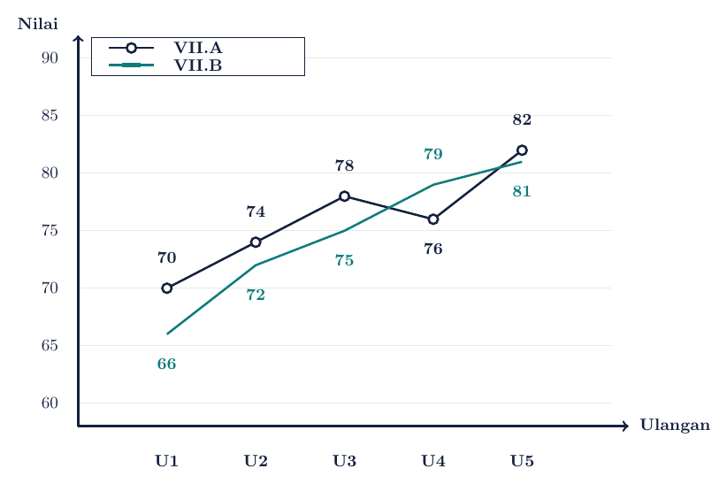

Semester ini saya mengajar dua kelas tujuh yang jadwalnya berurutan. Materinya sama, soalnya sama, dan setiap selesai ulangan harian saya menulis rata-rata kedua kelas itu di sudut papan. Setelah ulangan kelima, seorang murid VII.B bertanya, "Pak, kelas kami sudah menyalip VII.A belum?" Saya menatap deretan angka itu — A: 70, 74, 78, 76, 82; B: 66, 72, 75, 79, 81 — dan sadar satu kolom angka tidak bisa menjawab pertanyaan itu dengan cepat.

Maka saya menggambar satu diagram garis untuk kedua kelas sekaligus. Begitu garisnya jadi, jawabannya terlihat sendiri: VII.B menyalip di ulangan keempat, VII.A merebut kembali di ulangan kelima. Itulah diagram garis ganda: dua garis, satu gambar, satu cerita yang tidak bisa diceritakan satu garis saja.


*Gambar 1. Rata-rata nilai ulangan harian VII.A dan VII.B selama lima ulangan — VII.B menyalip di U4, VII.A kembali memimpin di U5.*

<!--more-->

## Dua Garis dalam Satu Gambar

Diagram garis ganda memuat dua kelompok data sekaligus dalam satu sumbu, dengan satu syarat: keduanya memakai satuan dan skala yang sama. Nilai ulangan VII.A dan VII.B memenuhi syarat itu — rata-rata kelas dari soal yang sama, pada ulangan yang sama.

Kapan diagram ini lebih baik daripada dua diagram terpisah? Setiap kali pertanyaannya memakai kata "dibandingkan". Siapa yang naik lebih cepat, siapa yang sempat memimpin, kapan keduanya bersilangan — semua itu hanya bisa dijawab kalau kedua garisnya berada dalam satu gambar. Dua diagram terpisah memaksa mata bolak-balik, dan selisih kecil seperti satu poin di ulangan kelima hampir pasti terlewat.

Sebaliknya, kalau datanya tidak sebanding — misalnya nilai ulangan lawan jumlah murid yang hadir — jangan dipaksakan dalam satu gambar: memaksakan dua skala ke satu sumbu hanya menghasilkan diagram yang menipu.

## Membaca Persilangan

Ada tiga hal yang saya ajak murid membaca dari Gambar 1.

Pertama, arahnya. Kedua garis sama-sama naik dari kiri ke kanan. VII.A naik dari 70 ke 82, VII.B dari 66 ke 81. Artinya kedua kelas sama-sama berkembang; yang berubah hanyalah siapa yang memimpin.

Kedua, persilangannya. Di tiga ulangan pertama VII.A selalu di atas: selisihnya 4, 2, lalu 3 poin. Di ulangan keempat garisnya bersilangan — VII.B 79, VII.A 76 — dan di ulangan kelima VII.A kembali di atas dengan 82 lawan 81. Persilangan adalah momen yang paling berharga: ia menandai kejadian yang layak diceritakan. Saya bertanya ke kelas, "Apa yang terjadi di antara ulangan ketiga dan keempat?" dan tiba-tiba mereka berdiskusi tentang cara belajar, bukan tentang angka.

Ketiga, rata-ratanya. Kalau dijumlahkan, total VII.A adalah $70 + 74 + 78 + 76 + 82 = 380$, rata-ratanya 76. Total VII.B adalah $66 + 72 + 75 + 79 + 81 = 373$, rata-ratanya 74,6. Jadi VII.A memang sedikit di atas sepanjang semester — tetapi rata-rata itu menyembunyikan bahwa VII.B sempat memimpin. Satu angka ringkasan tidak pernah menggantikan gambar.

## Menggambarnya dengan TikZ: Dua Kali \draw, Dua Kali \foreach

Pola kodenya sama seperti diagram garis tunggal, hanya dikerjakan dua kali. Saya mulai dari grid dan sumbu: sumbu tegak 60 sampai 90, garis grid tiap 5 poin.

```latex
\foreach \nilai in {60,65,70,75,80,85,90} {
  \draw[abu, thin] (0,\nilai) -- (6,\nilai);
  \node[anchor=east, font=\small, navy] at (-0.15,\nilai) {\nilai};
}
\draw[navy, very thick, ->] (0,58) -- (0,92);
\draw[navy, very thick, ->] (0,58) -- (6.2,58);
```

Lalu garis pertama, VII.A, dengan warna navy dan penanda lingkaran. Garis kedua, VII.B, dengan warna teal dan penanda persegi. Penandanya saya bedakan — lingkaran lawan persegi — supaya tetap terbaca saat diagram dicetak hitam-putih.

```latex
% Garis VII.A: navy, penanda lingkaran
\draw[navy, very thick]
  (1,70) -- (2,74) -- (3,78) -- (4,76) -- (5,82);
\foreach \x/\nilai in {1/70, 2/74, 3/78, 5/82} {
  \draw[fill=white, draw=navy, very thick] (\x,\nilai) circle (0.09cm);
  \node[anchor=south, font=\small\bfseries, navy]
    at (\x,\nilai+1.6) {\nilai};
}

% Garis VII.B: teal, penanda persegi
\draw[teal, very thick]
  (1,66) -- (2,72) -- (3,75) -- (4,79) -- (5,81);
\foreach \x/\nilai in {1/66, 2/72, 3/75, 5/81} {
  \draw[fill=white, draw=teal, very thick]
    (\x-0.09cm,\nilai-0.09cm) rectangle (\x+0.09cm,\nilai+0.09cm);
  \node[anchor=north, font=\small\bfseries, teal]
    at (\x,\nilai-1.6) {\nilai};
}
```

Label nilai VII.A saya letakkan di atas titik, label VII.B di bawah titik, supaya kedua baris angka tidak saling menutupi — kecuali di satu tempat, yang saya bahas di bawah.

## Legenda dan Satu Titik yang Harus Ditukar

Diagram garis ganda tanpa legenda adalah tebak-tebakan. Saya meletakkan legenda di pojok kiri atas, di dalam kotak putih, lengkap dengan contoh garis dan penandanya — bukan sekadar nama warna. Kotak putih itu penting: tanpa itu, garis grid akan mengotori contoh garisnya.

```latex
\draw[fill=white, draw=navy] (0.15,88.5) rectangle (2.55,91.8);
\draw[navy, very thick] (0.35,90.9) -- (0.85,90.9);
\draw[fill=white, draw=navy, very thick] (0.6,90.9) circle (0.09cm);
\node[anchor=west, font=\small\bfseries, navy] at (1.0,90.9) {VII.A};
\draw[teal, very thick] (0.35,89.4) -- (0.85,89.4);
\draw[fill=white, draw=teal, very thick]
  (0.51,89.31) rectangle (0.69,89.49);
\node[anchor=west, font=\small\bfseries, navy] at (1.0,89.4) {VII.B};
```

Lalu satu titik yang harus ditukar: ulangan keempat. Di sana VII.A bernilai 76 dan VII.B 79 — hanya selisih tiga poin, sehingga label 76 di atas dan label 79 di bawah akan bertabrakan. Maka untuk titik itu saja saya membalik posisinya: label VII.A pindah ke bawah, label VII.B pindah ke atas, dengan mengeluarkan titik keempat dari `\foreach` dan menggambarnya sendiri.

```latex
% Ulangan 4: label VII.A di bawah, VII.B di atas
\draw[fill=white, draw=navy, very thick] (4,76) circle (0.09cm);
\node[anchor=north, font=\small\bfseries, navy] at (4,76-1.6) {76};
\draw[fill=white, draw=teal, very thick]
  (4-0.09cm,79-0.09cm) rectangle (4+0.09cm,79+0.09cm);
\node[anchor=south, font=\small\bfseries, teal] at (4,79+1.6) {79};
```

Ini pelajaran kecil yang sering saya ulang ke murid: label yang bertumpuk membuat pembaca salah baca — dan salah baca adalah awal dari salah simpul.

## Tiga Kesalahan yang Sering Saya Lihat

Pertama, kedua garis digambar dengan warna yang sama — atau lebih parah, tanpa penanda sama sekali. Begitu garisnya bersilangan, tidak ada yang tahu lagi garis mana yang meneruskan ke mana.

Kedua, sumbu tegak dimulai dari angka yang tidak jujur tanpa keterangan. Sumbu saya di Gambar 1 mulai dari 60, bukan dari nol — dan itu saya sampaikan terus terang di sini. Kalau sumbu dimulai dari 60 tanpa disadari pembaca, selisih 4 poin akan terlihat seperti jurang. Memotong sumbu boleh, asal diakui, bukan disembunyikan.

Ketiga, menggambar garis ganda untuk data yang tidak sebanding. Nilai ulangan lawan jumlah murid, rupiah lawan persen — keduanya dipaksakan ke satu sumbu hanya karena "biar hemat tempat". Kalau skalanya tidak sama, buat dua diagram — lebih jujur daripada satu diagram yang berbohong.

Di kelas saya, diagram ini mengubah pertanyaan murid dari "kelas mana yang menang" menjadi "apa yang terjadi di antara ulangan ketiga dan keempat" — dan itu pertanyaan yang jauh lebih baik. Kalau Bapak dan Ibu punya dua kelompok data yang layak dibandingkan, coba gambar keduanya dalam satu diagram; siapa tahu persilangannya menyimpan cerita yang tidak terlihat dari tabel.

> 📎 **Berkas TikZ lengkap:** [diagram-garis-ganda.tex](tex/diagram-garis-ganda.tex) — dokumen siap kompilasi (butuh paket `tikz`). Silakan ganti angka-angkanya untuk dokumen Anda sendiri.
