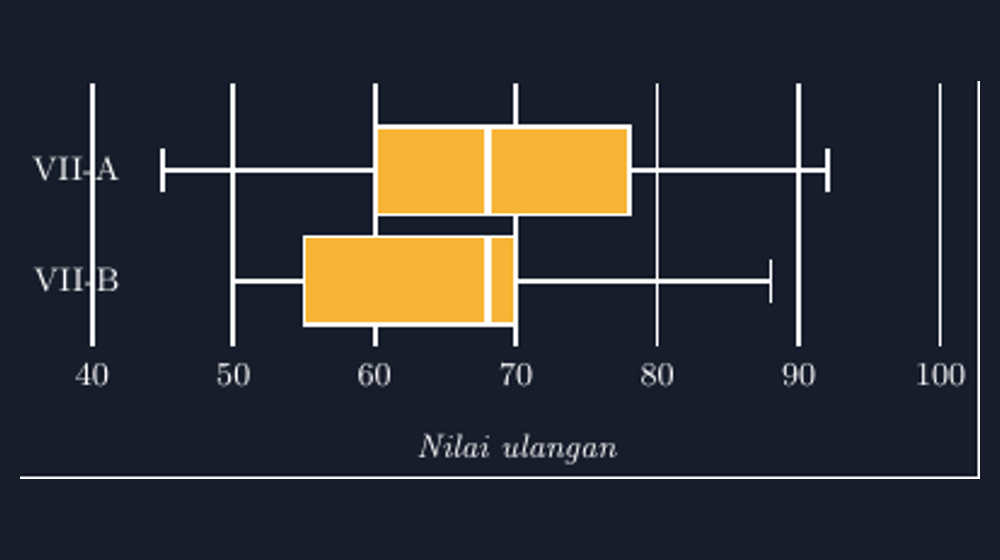

Materi statistika di kelas delapan punya satu diagram yang selalu bikin saya deg-degan setiap harus mengajarkannya: boxplot. Di buku, dia disebut diagram kotak-garis, dan saya paham kenapa. Diagram ini memang cuma kotak dengan dua garis kumis di kirinya dan kanannya. Tapi di balik bentuk yang sederhana itu, ada lima angka yang harus dihitung dulu: nilai minimum, kuartil bawah $Q_1$, median, kuartil atas $Q_3$, dan nilai maksimum. Siswa yang menggambar kotaknya tanpa menghitung lima angka itu sebenarnya sedang menggambar sesuatu yang tidak bercerita apa-apa.

<!--more-->

Pengalaman yang membuat saya serius menyiapkan gambar yang benar terjadi dua tahun lalu. Saya meminta siswa menggambar boxplot dari data nilai ulangan dua kelas: VII-A dengan lima ringkasan 45, 60, 68, 78, 92, dan VII-B dengan 50, 55, 68, 70, 88. Satu kelompok menggambar kotak VII-B lebih panjang dari kotak VII-A. Ketika saya tanya alasannya, jawabannya polos: "Karena kotaknya VII-B lebih jelek, Pak." Mereka mengira panjang kotak menggambarkan sesuatu tentang kualitas, bukan rentang antarkuartil.

Padahal kalau dihitung, justru sebaliknya. Panjang kotak VII-A adalah $78-60 = 18$, sedangkan kotak VII-B hanya $70-55 = 15$. Kelas VII-A yang nilainya "lebih bagus" itu justru sebarannya lebih lebar di tengah. Tapi karena gambar tangan mereka tidak proporsional, kesimpulan dari gambar jadi berlawanan dengan kesimpulan dari angka. Di situ saya sadar: boxplot yang digambar asal adalah diagram yang paling mudah menipu, justru karena bentuknya sederhana dan tidak ada yang curiga.

## Lima angka yang menentukan segalanya

Sebelum bicara TikZ, saya selalu memaksa satu kebiasaan: tulis dulu lima angkanya di tabel, baru menggambar. Untuk data VII-A, lima ringkasannya:

$$\text{min} = 45,\quad Q_1 = 60,\quad \text{median} = 68,\quad Q_3 = 78,\quad \text{max} = 92$$

Dari lima angka itu kita bisa baca banyak hal. Rentang antarkuartil, atau IQR, adalah $Q_3 - Q_1 = 18$: separuh siswa tengah kelas itu nilainya tersebar selebar 18 poin. Median 68 lebih dekat ke $Q_1$ (jarak 8) daripada ke $Q_3$ (jarak 10), jadi sebaran separuh bawah sedikit lebih rapat. Kumis kiri dari 45 ke 60 sepanjang 15 dan kumis kanan dari 78 ke 92 sepanjang 14, jadi ekor kedua arah cukup seimbang. Semua cerita ini tidak akan terbaca kalau kotaknya digambar "kira-kira".

## Deklarasi skala, bukan perkiraan mata

Sama seperti diagram batang yang pernah saya tulis, kunci TikZ di sini adalah mendeklarasikan skala terlebih dahulu. Nilai ulangan berkisar 40 sampai 100, jadi saya set $x=0.135\text{cm}$ — artinya satu poin nilai sama dengan 0,135 sentimeter. Setelah itu setiap angka langsung jadi koordinat:

```latex
\begin{tikzpicture}[x=0.135cm, y=1.05cm]
  % VII-A : min 45, Q1 60, median 68, Q3 78, max 92
  \draw (45,2) -- (60,2);          % kumis kiri
  \draw (78,2) -- (92,2);          % kumis kanan
  \draw (45,1.8) -- (45,2.2);      % garis min
  \draw (92,1.8) -- (92,2.2);      % garis maks
  \filldraw[fill=yellow!85] (60,1.6) rectangle (78,2.4);
  \draw[line width=1.6pt] (68,1.6) -- (68,2.4);   % median
\end{tikzpicture}
```

Perhatikan bahwa tidak ada satu pun panjang yang saya ukur tangan. Ujung kotak kiri benar-benar berada di $x=60$, garis median benar-benar di $x=68$, kumis kanan benar-benar berhenti di $x=92$. Kalau besok datanya berubah, saya tinggal mengganti angka-angkanya dan semua proporsi menyesuaikan sendiri. Tidak ada ruang untuk kotak yang "kira-kira sepanjang itu".

Hasil lengkap untuk dua kelas sekaligus seperti ini:


*Boxplot nilai ulangan VII-A (45, 60, 68, 78, 92) dan VII-B (50, 55, 68, 70, 88). Kedua kotak berada pada sumbu yang sama, jadi panjang kotak, posisi median, dan lebar kumis bisa dibandingkan secara jujur. Terlihat median keduanya sama-sama 68, tapi kotak VII-A lebih lebar — sebaran tengahnya lebih beragam.*

Yang membuat gambar ini lebih bercerita daripada dua gambar terpisah adalah sumbu yang dipakai bersama. Ketika kotak VII-A dan VII-B diletakkan di baris yang berbeda tapi di atas sumbu yang sama, mata siswa langsung melakukan perbandingan yang benar: sama-sama median 68, tapi sebaran tengah VII-A lebih lebar, dan kumis VII-B lebih panjang di sisi kanan (70 sampai 88, sepanjang 18). Perbandingan dua kelas inilah pekerjaan rumah boxplot di buku yang selama ini cuma jadi dua gambar kecil tanpa konteks.

## Garis bantu yang menahan mata

Detail kecil lain yang saya selipkan: garis bantu vertikal di setiap kelipatan 10, dari 40 sampai 100. Fungsinya sama seperti garis bantu di diagram batang — jangkar bagi mata. Ketika siswa mencoba membaca di mana letak $Q_1$ VII-B, mereka bisa menempelkan pandangan ke garis 55 tanpa menebak dari jarak kosong.

```latex
\foreach \v in {40,50,60,70,80,90,100} {
  \draw[gray!50] (\v,0.4) -- (\v,2.8);
  \node[below] at (\v,0.35) {\v};
}
```

Satu perulangan, dan diagram langsung punya rangka. Saya juga sengaja membiarkan ada ruang kosong di kiri (sebelum 40) supaya label nama kelas punya tempat, dan ruang di kanan (sesudah 100) supaya kumis terpanjang tidak menyentuh tepi gambar. Diagram yang sesak itu tidak enak dibaca, apalagi diproyeksikan ke layar kelas.

## Dari gambar ke pertanyaan yang lebih dalam

Yang paling saya sukai dari boxplot justru setelah gambar berhasil. Karena lima angkanya sudah jelas di layar, diskusi kelas bisa naik satu tingkat. Kemarin kami berhenti lama di satu pertanyaan: "Pak, kalau ada satu anak yang nilainya 100, boxplotnya ikut berubah besar tidak?" Kami coba bersama. Median tidak bergeser, kotak tidak berubah — hanya kumis kanan yang memanjang. Lalu saya balik pertanyaannya: kalau nilainya bukan 100 tapi 200 (kan tidak mungkin, tapi hipotesis boleh), mana yang berubah?

Dari situ mereka menemukan sendiri sifat yang selama ini hanya mereka hafalkan: median dan kuartil itu tahan terhadap nilai ekstrem. Sifat yang kalau hanya dijelaskan dengan kata-kata di papan, biasanya masuk dari telinga kiri keluar telinga kanan. Tapi ketika mereka *melihat* kotaknya diam sementara kumisnya memanjang, sifat itu jadi milik mereka.

Ini yang membuat saya terus repot menggambar ulang media dengan TikZ. Diagram yang presisi bukan cuma soal kerapian lembar soal. Diagram yang presisi membolehkan kelas bertanya lebih jauh, karena angka dan gambar tidak saling membantah. Kalau Bapak/Ibu ingin mencoba, berkas lengkapnya siap dikompilasi dan tinggal diganti dengan lima angka data kelas Bapak/Ibu sendiri.

> 📎 **Berkas TikZ lengkap:** [tikz-diagram-kotak-garis-boxplot.tex](tex/tikz-diagram-kotak-garis-boxplot.tex) — siap kompilasi (butuh paket `tikz`).
