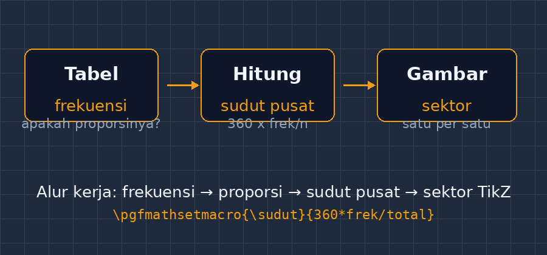
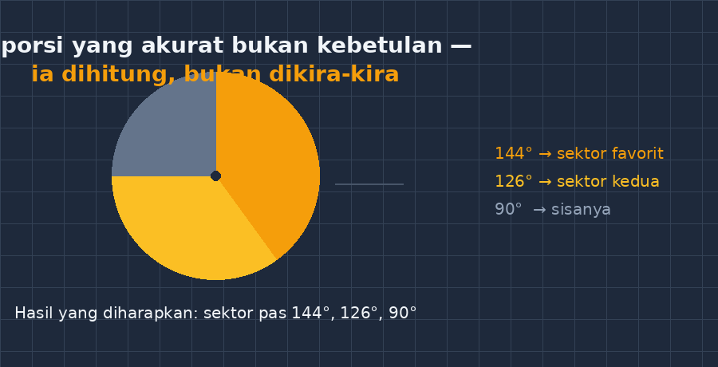

Minggu lalu saya memeriksa tugas statistika kelas VII dan berhenti di satu lembar jawaban. Anak itu menggambar diagram lingkaran untuk data hobi teman-temannya: sepertiga lingkaran untuk "bola", sepertiga lagi untuk "membaca", sisanya dibagi asal untuk tiga hobi lain. Masalahnya, datanya jelas tidak merata — ada satu kategori yang frekuensinya dua kali lipat kategori lain. Diagramnya rapi, warnainya cantik, tetapi bohong. Bentuknya bilang "semua hobi sama-sama disukai", padahal tidak.

<!--more-->

## Diagram yang bohong sambil tersenyum

Ini jebakan klasik diagram lingkaran. Berbeda dengan diagram batang — yang tinggi batangnya mudah dicek mata — diagram lingkaran menuntut pembaca menilai *sudut*, dan mata kita ternyata buruk dalam hal itu. Selisih 15 derajat itu nyaris tak terlihat, padahal bisa berarti selisih frekuensi yang lumayan besar. Makanya diagram lingkaran yang digambar asal-asalan bukan sekadar kurang rapi; ia bisa menyesatkan kesimpulan.

Justru karena itu materi diagram lingkaran di SMP sangat penting: di sinilah anak belajar bahwa sektor itu *dihitung*, bukan dikira-kira. Proporsi kategori terhadap total dikalikan 360 derajat, dan angka itu adalah sudut pusat sektor yang seharusnya digambar.


*Alur kerja yang saya tekankan ke siswa: dari tabel frekuensi, hitung sudut pusatnya, baru menggambar sektor satu per satu.*

## Masalah lama: menggambar dengan busur itu susah

Dulu, ketika saya menyiapkan soal atau bahan ajar, saya menggambar diagram lingkaran dengan dua cara: tangan di kertas, atau alat gambar di komputer yang semacam "klik dan tarik". Keduanya punya masalah yang sama — sudutnya tidak pernah persis. Busur derajat di tangan saya sendiri saja bisa meleset dua-tiga derajat, apalagi di tangan siswa. Untuk latihan siswa mungkin tidak apa-apa, mereka justru perlu pengalaman menggambar dan merasakan sulitnya membagi sudut. Tetapi untuk soal yang saya buat, gambar harus jujur: kalau soal bilang sektor "olahraga" menempati 40% data, gambarnya harus benar-benar 40%.

Di sinilah TikZ masuk. Saya sudah bercerita tentang bidang koordinat, bangun datar, dan grafik fungsi kuadrat di tulisan-tulisan sebelumnya; diagram lingkaran ternyata lanjutan yang paling "menohok" karena di sini ketelitian TikZ paling terasa.

## Cara saya menggambar: sudut dulu, estetika belakangan

Langkah pertama selalu di luar LaTeX: dari tabel frekuensi, hitung sudut setiap kategori. Kalau totalnya $n$ dan frekuensi kategori itu $f$, sudut pusatnya:

$$\theta = \frac{f}{n} \times 360^\circ$$

Katakanlah datanya distribusi hobi: bola 18 siswa, bulu tangkis 12, catur 9, renang 6. Total 45 siswa. Sudutnya masing-masing:

$$\frac{18}{45} \times 360^\circ = 144^\circ, \quad \frac{12}{45} \times 360^\circ = 96^\circ, \quad \frac{9}{45} \times 360^\circ = 72^\circ, \quad \frac{6}{45} \times 360^\circ = 48^\circ$$

Perhatikan: jumlahnya harus 360 derajat. Saya selalu mengecek penjumlahan ini dulu sebelum menyentuh komputer — kalau tidak genap, ada hitungan yang salah, dan lebih baik ketahuan sekarang daripada setelah gambar jadi.

Barulah di TikZ saya gambar sektornya. Pola yang saya pakai sederhana: setiap sektor adalah jalur dari pusat, garis ke sudut awal, busur ke sudut akhir, lalu tutup kembali ke pusat. Saya biasa menuliskannya begini:

```latex
\documentclass[tikz,border=10pt]{standalone}
\begin{document}
\begin{tikzpicture}[scale=1.1]
  % hitung sudut dengan pgfmath supaya presisi
  \newcommand{\total}{45}
  \pgfmathsetmacro{\a}{360*18/\total}  % bola: 144
  \pgfmathsetmacro{\b}{360*12/\total}  % bulu tangkis: 96
  \pgfmathsetmacro{\c}{360*9/\total}   % catur: 72
  % sisanya renang: 48

  \fill[yellow!80!orange] (0,0) -- (90:{2}) arc (90:90-\a:{2}) -- cycle;
  \fill[teal!60]          (0,0) -- (90-\a:{2}) arc (90-\a:90-\a-\b:{2}) -- cycle;
  \fill[blue!40]          (0,0) -- (90-\a-\b:{2}) arc (90-\a-\b:90-\a-\b-\c:{2}) -- cycle;
  \fill[red!40]           (0,0) -- (90-\a-\b-\c:{2}) arc (90-\a-\b-\c:-270:{2}) -- cycle;

  \draw (0,0) circle (2);
  \node at (90-\a/2:2.6) {Bola (18)};
  \node at (90-\a-\b/2:2.6) {Bulu tangkis (12)};
  \node at (90-\a-\b-\c/2:2.6) {Catur (9)};
  \node at (270:2.6) {Renang (6)};
\end{tikzpicture}
\end{document}
```

Beberapa hal yang saya suka dari pendekatan ini. Pertama, sudutnya *dihitung oleh komputer* lewat `\pgfmathsetmacro` — saya tidak menuliskan 144 secara manual melainkan menuliskan rumusnya, sehingga kalau data berubah, saya cukup mengganti frekuensinya. Kedua, arah busurnya konsisten (searah jarum jam dari titik atas), jadi sektor-sektor tidak pernah tumpang tindih. Ketiga, label ditempatkan di tengah-tengah setiap sektor dengan mudah: sudut tengah sektor pertama adalah $90 - \frac{144}{2} = 18$ derajat, dan seterusnya.


*Hasil yang diharapkan: 144°, 96°, 72°, dan 48° — setiap sektor persis sebesar data yang mewakilinya.*

## Membawa TikZ ke kelas, pelan-pelan

Saya tidak mengajarkan TikZ ke siswa — itu bukan kompetensi kurikulum dan akan menambah beban. Tetapi gambar-gambar hasil TikZ ini saya pakai di tiga tempat. Di soal ulangan, supaya sektor yang saya klaim "40%" memang benar-benar 40%. Di bahan ajar, supaya diagram untuk membandingkan dua data punya skala sudut yang konsisten. Dan yang paling seru: di pembahasan, saya proyeksikan diagram yang *salah* (yang pernah digambar asal-asalan, termasuk milik anak di lembar pertama tadi — dengan izin dia, tanpa nama) di sebelah diagram yang benar, lalu kelas menebak mana yang bohong.

Mereka selalu bisa menebaknya — bukan karena mengukur sudut, tetapi karena membandingkan dengan tabelnya. "Pak, yang ini kok bulu tangkisnya kelihatan lebih besar padahal frekuensinya lebih kecil?" Nah, kalimat seperti itu adalah tujuan pembelajaran sesungguhnya dari bab statistika: kemampuan kritis terhadap representasi data. Diagram lingkaran bukan hanya tentang menghitung sudut, tetapi tentang membaca klaim yang tersimpan dalam gambar.

## Penutup

Ada ironi yang saya nikmati: saya memakai alat super-presisi (TikZ) justru untuk mengajarkan sesuatu yang sederhana — bahwa gambar harus setia pada data. Siswa tidak perlu tahu `\pgfmathsetmacro`, tetapi mereka perlu tahu bahwa sektor 40% itu ada artinya, dan bahwa gambar yang tidak sesuai hitungan itu bukan gambar, melainkan klaim palsu.

Kalau Bapak/Ibu ingin mencoba, mulailah dari satu diagram saja: ambil data kecil dari kelas (cara siswa ke sekolah, misalnya), hitung sudutnya bersama-sama, baru gambar. Kalau bagian kode TikZ-nya terasa berat, silakan pakai pola di atas dan ganti angkanya — dan seperti biasa, kalau ada versi yang lebih sederhana atau trik label yang lebih rapi, saya menunggu di kolom komentar.
