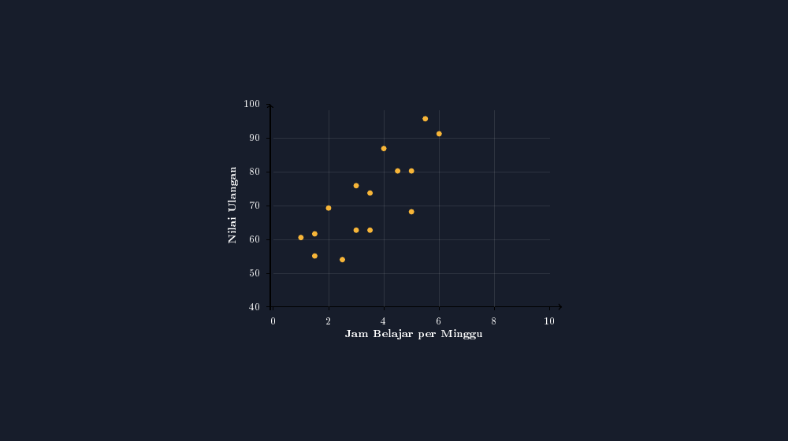
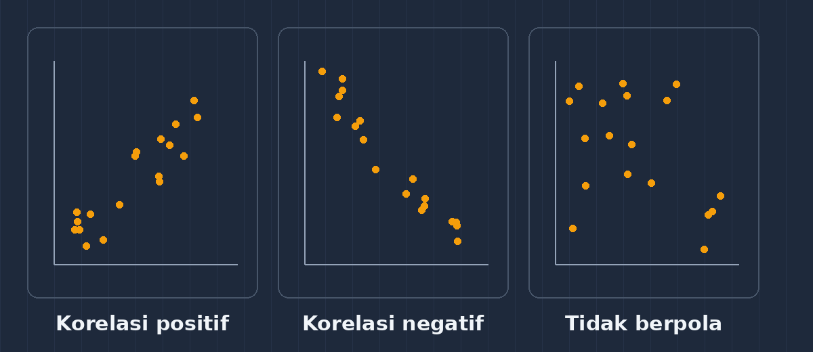

Ada satu pertanyaan yang setiap tahun muncul di kelas, biasanya dari anak yang duduk di barisan belakang, ketika saya baru selesai menggambar diagram batang nilai ulangan: "Pak Gun, kalau nilainya naik karena sering belajar, kok tidak digambar sekalian?" Saya dulu menjawabnya sambil beralasan — diagram batang kita memang hanya untuk satu kolom data. Tapi pertanyaan itu mengganjal. Anak itu, tanpa menyadarinya, sedang bertanya tentang sesuatu yang lebih dalam daripada frekuensi: ia bertanya tentang *hubungan*. Dan hubungan dua hal memang punya gambar tersendiri — diagram pencar, atau yang di beberapa buku disebut diagram dosir.

Tahun ini saya memutuskan tidak lagi mengelak. Kami mencobanya dengan data yang paling dekat dengan hidup mereka: jam belajar per minggu dan nilai ulangan harian.

<!--more-->

## Dua kolom yang akhirnya dipertemukan

Saya meminta lima belas anak dari kelas 8C mencatat dengan jujur berapa jam mereka belajar dalam seminggu — bukan jam di sekolah, tapi jam di rumah, di warung, di manapun. Lalu saya pasangkan jam itu dengan nilai ulangan harian mereka yang terakhir. Datanya begini:

| Anak | A | B | C | D | E | F | G | H | I | J | K | L | M | N | O |
|---|---|---|---|---|---|---|---|---|---|---|---|---|---|---|---|
| Jam belajar | 1 | 1,5 | 2 | 2,5 | 3 | 3,5 | 4 | 4,5 | 5 | 5,5 | 6 | 3,5 | 5 | 1,5 | 3 |
| Nilai | 60,5 | 61,6 | 69,3 | 54 | 75,9 | 73,7 | 86,9 | 80,3 | 80,3 | 95,7 | 91,3 | 62,7 | 68,2 | 55,1 | 62,7 |

Sebelum menggambar apa pun, saya minta anak membaca tabelnya dulu. Anak B belajar satu setengah jam dan dapat 61,6; anak J belajar lima setengah jam dan dapat 95,7. Terlihat ada kecenderungan — tapi "terlihat" di tabel itu lelah: lima belas pasangan angka harus dibandingkan dua-dua. Di situlah gambar berkerja. Tabel yang memaksa mata berpindah-pindah, gambar membiarkan pola datang sendiri ke mata.

## Menggambarnya: satu titik untuk satu anak

Ide dasarnya sederhana sekali, dan justru kesederhanaan itulah yang membuat anak cepat percaya: setiap anak menjadi satu titik. Sumbu mendatar untuk jam belajar, sumbu tegak untuk nilai. Anak B yang belajar 1,5 jam dan dapat 61,6 akan duduk sebagai satu titik di posisi itu — dan begitu juga empat belas temannya.

Saya gambar dengan TikZ, memakai skala yang sama seperti seri statistika kita sebelumnya: tiap jam belajar saya beri 0,9 satuan koordinat (jadi anak yang belajar 10 jam masih muat di gambar), dan tiap satu poin nilai saya beri 0,11 satuan, dengan patokan bawah di nilai 40.

```latex
\begin{tikzpicture}[x=0.09cm, y=0.11cm]
  \draw[->] (-1,0) -- (94,0);   % sumbu jam belajar
  \draw[->] (-1,-1) -- (-1,66); % sumbu nilai, patokan 40
  \foreach \j in {0,2,4,6,8,10}
    { \draw (\j*9,0) -- (\j*9,-1.2);
      \node[below] at (\j*9,-2.2) {\j}; }
  \foreach \n in {40,50,60,70,80,90,100}
    { \draw (-1,(\n-40)*1.1) -- (-2.2,(\n-40)*1.1);
      \node[left] at (-2.8,(\n-40)*1.1) {\n}; }
  % satu titik per anak: (jam*9, (nilai-40)*1.1)
  \foreach \p in {(9,22.6),(13.5,23.8),(18,32.2),(22.5,15.4),(27,39.5),
                  (31.5,37.1),(36,51.6),(40.5,44.3),(45,44.3),(49.5,61.3),
                  (54,56.4),(31.5,25.0),(45,31.0),(13.5,16.6),(27,25.0)}
    { \fill[aksen] \p circle (0.9); }
\end{tikzpicture}
```

Hasilnya begini — inilah gambar yang saya tunjukkan di papan (atau slide, kalau proyektor sedang baik hati):



*Gambar: diagram pencar 15 titik data — sumbu mendatar jam belajar per minggu, sumbu tegak nilai ulangan. Setiap titik adalah satu anak.*

Yang saya suka dari momen ini di kelas: begitu gambarnya jadi, anak tidak lagi bertanya "kesimpulannya apa, Pak Gun?" — mereka langsung melihatnya. Titik-titik itu merambat naik dari kiri bawah ke kanan atas. Bukan rapi seperti tangga, bukan lurus seperti jalan tol, tapi arahnya jelas.



*Gambar: tiga bentuk sebaran yang paling sering ditemui — titik-titik yang naik bersama, turun bersama, dan yang tidak peduli satu sama lain.*

Gambar di atas saya pakai untuk memberi nama pada apa yang baru mereka lihat. Kalau titik-titik naik bersama seperti pada data kami, orang menyebutnya korelasi positif. Kalau satu naik yang lain turun — misalnya jam bermain dan sisa pulsa — itu korelasi negatif. Dan kalau titik-titiknya tersebar seperti hujan yang jatuh sembarangan, maka dua hal itu memang tidak berjalan bersama. Siswa perlu melihat ketiganya supaya "ada hubungan" tidak menjadi satu-satunya kemungkinan yang mereka kenal.

## Titik yang menentang: pelajaran terbaik dari anak M

Sebentar — jangan buru-buru menutup pelajaran. Ada satu titik dalam gambar kami yang selalu saya tunggu-tunggu untuk ditanyakan anak, dan tahun ini Reza — bukan nama sebenarnya, tapi karakternya persis — menanyakannya lebih cepat dari dugaan: "Pak Gun, kalau makin lama belajar makin pinter, kok anak M belajar tiga setengah jam tapi nilainya 62,7? Padahal anak C cuma belajar dua jam dapat 69,3."

Itu pertanyaan terbaik hari itu, dan saya tidak menjawabnya. Saya balik ke kelas. Jawaban yang muncul beragam: mungkin ia belajar sambil buka telepon, mungkin soalnya kebetulan bagian yang tidak ia pelajari, mungkin ia belajar malam sebelum ulangan padahal capek. Semua kemungkinan itu — dan inilah intinya — **tidak menggugurkan pola yang terlihat**. Sebagian besar titik tetap merambat naik. Tapi satu titik yang menentang mengingatkan kami bahwa korelasi bukan janji; ia hanya kecenderungan, bukan undang-undang yang mengikat setiap anak satu per satu.

Dua jebakan yang saya jaga sejak awal:

**Pertama, jangan menggambar garis terlalu cepat.** Anak senang sekali menarik garis lurus menembus titik-titik. Saya menahannya satu pertemuan: diagram pencar yang dulu hanya berisi titik, dulu juga bermakna tanpa garis. Garis itu — kalau nanti kita gambar, dan akan kita gambar di pertemuan berikutnya — adalah alat bantu membaca, bukan bagian dari data. Kalau garisnya didahulukan, anak belajar hal yang salah: bahwa datanya yang harus menyesuaikan garis.

**Kedua, korelasi bukan sebab-akibat.** Ini yang paling sulit, karena menggoda. Dari data kami memang terlihat jam belajar dan nilai berjalan bersama. Tapi "berjalan bersama" tidak sama dengan "satu menyebabkan yang lain" — bisa jadi anak yang rajin belajar juga rajin tidur cukup, dan tidur cukup itulah yang membantu nilainya. Saya memakai contoh yang lebih lucu supaya melekat: penjualan es krim dan kasus tenggelam di kolam renang berjalan bersama setiap musim panas di negeri empat musim — tapi es krim tidak menenggelamkan siapa pun. Anak ketawa, tapi kalimatnya mereka hafal lebih lama daripada definisi korelasi mana pun.

## Kenapa saya tetap menggambarnya dengan TikZ

Bisa saja saya minta anak memakai aplikasi lembar sebar dan mendapat gambar ini dalam tiga detik. Tapi tiga detik itu tidak meninggalkan jejak. Ketika anak menghitung sendiri bahwa anak J di $5{,}5 \times 9 = 49{,}5$ sepanjang sumbu mendatar dan $(95{,}7 - 40) \times 1{,}1 = 61{,}3$ di sumbu tegak, lalu menemukan titik kuningnya di sana — mereka *membangun* gambar itu, bukan menerima jadi. TikZ memaksa kita jujur: setiap titik adalah pasangan angka yang bisa ditelusuri balik ke tabel, setiap skala adalah keputusan yang bisa dibenarkan. Tidak ada grafik yang muncul seperti sulap.

Dan untuk saya sendiri, menyusun `foreach` berisi lima belas titik ini mengingatkan pada hal yang mudah terlupakan: di balik setiap gambar statistik yang rapi, ada anak-anak dengan jam-jam belajar mereka yang tidak selalu jujur, nilai-nilai yang tidak selalu adil, dan satu-dua titik yang menentang. Gambar yang baik tidak menyembunyikan mereka — justru membuat mereka terlihat, lalu memberi kelas sesuatu untuk diperdebatkan. Itu bukan kelemahan diagram pencar. Itu bagian terbaiknya.

Pertemuan depan, kalau proyektor dan listrik bersedia, kami coba menarik garis yang paling wajar menembus gerombolan titik itu — dan menyelidiki bersama apa artinya kemiringan garis bagi anak-anak yang duduk di kelas 8C. Sampai jumpa di catatan berikutnya.

---

> 📎 **Berkas TikZ lengkap:** [diagram-pencar.tex](tex/diagram-pencar.tex) — dokumen siap kompilasi (butuh paket `tikz`). Silakan ganti daftar titiknya dengan data kelas Anda sendiri.
