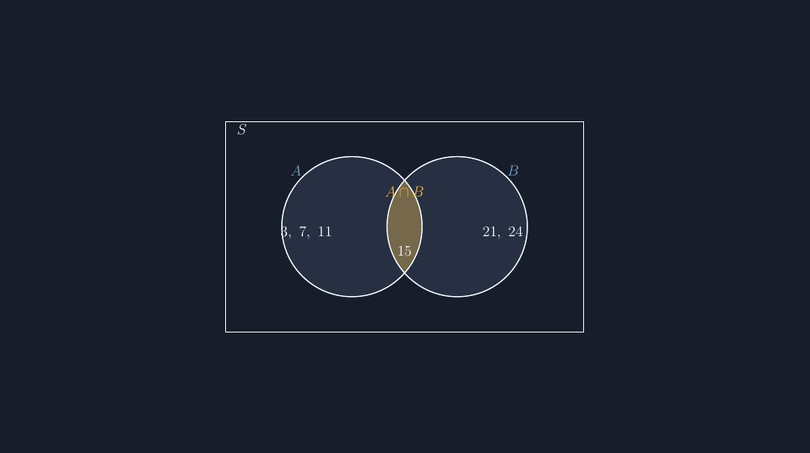

Materi himpunan di kelas VII punya satu momen yang selalu saya tunggu-tunggu: saat siswa diminta menggambar diagram Venn sendiri di buku. Di situlah terlihat jelas apa yang mereka paham dan apa yang hanya mereka hafal. Dan tahun ini, momen itu justru membuat saya tersipu — karena soal yang saya cetak, gambar diagram Venn-nya yang tidak jujur.

Dua lingkaran di soal itu saya gambar pakai aplikasi pengolah kata, asal diseret sampai kelihatan "bertumpuk". Masalahnya, irisan yang terlihat di gambar tidak sesuai dengan data soal. Soalnya berbunyi: dari 40 siswa, 25 suka matematika, 22 suka IPA, dan 9 suka keduanya. Kalau irisan berisi 9, maka wilayah hanya-matematika berisi 16 dan hanya-IPA berisi 13. Dengan ukuran lingkaran yang sama besar dan tumpang tindih yang asal, siswa yang teliti akan bingung: kok wilayah kiri dan kanan kelihatan sama padahal isinya beda jauh?

Salah satu siswa, Nadia, bahkan bertanya, "Pak, kalau yang suka matematika lebih banyak, kok lingkarannya sama besar?" Pertanyaan itu saya simpan. Itu pertanyaan yang seharusnya tidak perlu muncul — kalau saja gambar soalnya jujur sejak awal.

<!--more-->

## Kenapa diagram Venn gampang bohong

Diagram Venn berbeda dari bidang koordinat atau grafik fungsi yang pernah saya tulis di blog ini. Kalau sumbu koordinat salah skala, kesalahannya langsung kelihatan. Diagram Venn lebih licik: dia tetap terlihat "benar" meski geometrinya asal, karena bentuk dua lingkaran yang bertumpuk sudah jadi ikon yang melekat di kepala semua orang.

Tapi ada tiga kebohongan yang paling sering terjadi, dan semuanya pernah terjadi di soal buatan saya sendiri.

Pertama, irisan yang tidak berkata apa-apa. Kalau $n(A \cap B)$ kecil, tapi gambar menunjukkan irisan yang lebar, siswa perlahan belajar mengabaikan gambar — dan itu kerugian besar, karena justru gambar yang seharusnya membantu mereka. Kedua, label yang melayang: angka ditaruh asal, kadang bahkan menimpa garis lingkaran, sehingga tidak jelas angka itu milik wilayah mana. Ketiga, yang paling sering di lembar kerja: dua himpunan yang saling lepas digambar "hampir bertumpuk" padahal soalnya bilang $A \cap B = \emptyset$, atau sebaliknya, ada irisan tapi lingkarannya digambar terpisah.

Saat membahas himpunan saling lepas misalnya, dua lingkaran harus benar-benar terpisah. Bukan "terlihat terpisah" — tapi terpisah. Dan saat satu himpunan menjadi himpunan bagian yang lain, ada satu lingkaran yang harus benar-benar berada di dalam lingkaran satunya. Detail kecil inilah yang menentukan siswa percaya atau tidak percaya pada gambar kita.

## Trik irisan: clip dan fill

Berikut kode inti yang saya pakai untuk soal perbaikan itu. Dua lingkaran berjari-jari sama, terpisah 3 satuan sehingga benar-benar beririsan, dengan daerah irisan yang disorot:

```latex
\begin{tikzpicture}
  \draw[thick, fill=blue!15] (0,0) circle (2);
  \draw[thick, fill=blue!15] (3,0) circle (2);
  \begin{scope}
    \clip (0,0) circle (2);
    \fill[yellow!60] (3,0) circle (2);
  \end{scope}
  \draw[thick] (0,0) circle (2);
  \draw[thick] (3,0) circle (2);
  \draw[thick] (-3.6,-3) rectangle (6.6,3);
  \node[anchor=south west] at (-3.4,2.5) {$S$};
\end{tikzpicture}
```

Trik yang paling penting ada di pasangan `clip` dan `fill`. Lingkaran kiri dipakai sebagai "gunting": perintah `clip` membatasi semua gambar berikutnya hanya ke area lingkaran itu, lalu lingkaran kanan diwarnai. Hasilnya, hanya daerah irisan kedua lingkaran yang kena warna. Cara ini bersih — tidak perlu menghitung busur atau koordinat sudut yang rumit, cukup dua perintah. Lingkaran digambar ulang sekali lagi setelahnya supaya garis tepinya tidak tertutup warna.

Koordinat pusat lingkaran itu juga bukan angka asal. Jarak antarpusat 3 dengan jari-jari 2 memberi irisan yang lebar secukupnya. Kalau soalnya irisan kecil, saya geser jaraknya jadi 3,5 atau 4; kalau irisan besar, saya dekati 2,5. Dengan kata lain, tumpang tindihnya bisa saya atur sesuai cerita soal — sesuatu yang mustahil dilakukan dengan cara seret-tarik di pengolah kata.

Hasil kompilasinya begini — dua lingkaran, irisan tersorot, dan angka yang duduk di wilayahnya masing-masing:



*Diagram Venn dengan irisan tersorot. Perhatikan angka 15 di daerah irisan dan label $A \cap B$ yang ditaruh berjarak dari garis lingkaran — supaya tidak ada keraguan angka itu milik wilayah mana.*

## Menaruh angka di tempat yang benar

Bagian yang kelihatan sepele tapi paling sering bikin soal terlihat buruk: penempatan angka. Ada tiga wilayah yang selalu harus jelas rumahnya: hanya-$A$, irisan, dan hanya-$B$. Dalam kode lengkapnya, saya menaruh angka dengan koordinat yang sadar geometri:

```latex
\node at (-1.3,-0.2) {$3,\ 7,\ 11$};   % hanya A
\node at (1.5,-0.7) {$15$};            % irisan
\node at (4.3,-0.2) {$21,\ 24$};       % hanya B
```

Perhatikan: angka "hanya $A$" ditaruh di $x = -1{,}3$, cukup di dalam lingkaran kiri tapi jauh dari batas irisan yang mulai di $x = 1$. Kalau terlalu ke kanan, angkanya menempel pada batas dan siswa ragu. Angka irisan ditaruh dekat pusat irisan itu sendiri, sedikit ke bawah, supaya tidak berebut ruang dengan label $A \cap B$ yang saya letakkan di atas.

Aturan praktis yang sekarang saya pegang: **setiap teks harus jelas milik wilayah mana tanpa perlu menebak**. Kalau saya harus menjelaskan secara lisan, "yang 15 itu yang di tengah, ya", berarti gambarnya gagal — bukan siswanya yang gagal membaca.

## Lebih dari dua lingkaran

Untuk tiga himpunan, cara `clip`-nya tetap sama tapi jadi berlapis: warnai $A$, lalu gunting dengan $B$ untuk daerah $A \cap B$, gunting lagi dengan $C$ untuk daerah tiga-lingkaran, dan seterusnya untuk tiap kombinasi. Tapi saya jujur: untuk kelas VII, diagram tiga lingkaran sering lebih banyak mengajarkan ketelitian mengarsir daripada konsep himpunan itu sendiri. Justru karena itu, diagram tiga-himpunan di lembar kerja saya sekarang selalu hasil kompilasi — siswa cukup mengisi wilayahnya, dan gambar dijamin konsisten dari nomor satu sampai terakhir.

Satu bonus kecil dari perpindahan ke TikZ: begitu filenya ada, membuat variasi soal jadi murah. Ganti tiga angka, ganti konteks cerita, kompilasi ulang — selesai satu paket latihan yang gambarnya seragam. Dulu, membuat satu variasi saja berarti menggambar ulang dari nol.

## Penutup: gambar yang bisa diinterogasi

Yang berubah dari pengalaman ini bukan sekadar kualitas gambar soal. Saya jadi punya kebiasaan baru: sebelum soal dicetak, saya buka file `.tex`-nya dan menginterogasi gambarnya sendiri. Apakah lebar irisan mengatakan sesuatu yang benar tentang data? Apakah setiap angka jelas rumahnya? Apakah dua himpunan yang lepas benar-benar digambar lepas?

Soal diagram Venn yang saya cetak tahun ini untuk ulangan kelas VII akhirnya lolos interogasi itu. Dan menariknya, tidak ada lagi pertanyaan seperti punya Nadia — pertanyaan bagus yang sebenarnya menunjuk kesalahan saya, bukan kesulitan mereka. Kadang siswa kita tidak bingung dengan materi; mereka hanya jujur pada gambar yang tidak jujur pada mereka.

Sampai jumpa di artikel berikutnya. Kalau Bapak/Ibu ingin mencoba, berkas lengkapnya siap kompilasi di bawah — cukup pdflatex dan paket `tikz`.

> 📎 **Berkas TikZ lengkap:** [venn-irisan.tex](tex/venn-irisan.tex) — siap kompilasi (butuh paket `tikz`).
