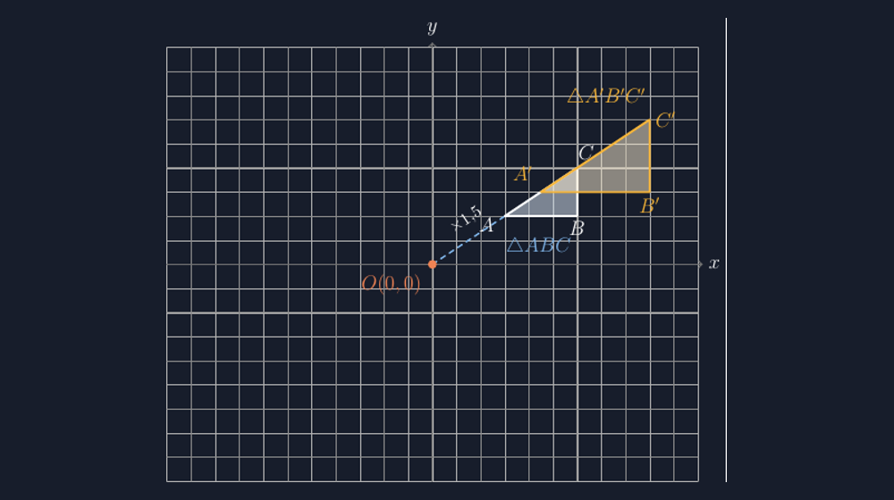

Dari keempat jenis transformasi yang diajarkan di SMP, dilatasi adalah materi yang paling sering saya gambarkan setengah-setengah. Pergeseran mudah — panah dari titik asal ke titik bayangan, jaraknya sama, selesai. Pencerminan pun masih bisa diselamatkan dengan penggaris: gambar garis cermin, ukur jaraknya, taruh titiknya. Rotasi butuh lebih banyak kerja, tapi setidaknya saya tahu persis apa yang harus dijaga. Dilatasi? Kalau ditanya murid, "Pak Gun, dikali berapa yang tadi?" — sering kali saya harus berhenti dan menghitung ulang dari gambar saya sendiri, karena gambar itu memang tidak menyimpan jawabannya. Segitiga saya gambar dua kali, yang kedua lebih besar, titik pusat saya taruh entah di mana, dan faktor skalanya ada di kepala saya saja, tidak pernah tampil di papan.

<!--more-->

## Masalahnya bukan gambar yang besar, tapi yang tidak bisa diukur

Konsep dilatasi di SMP sebenarnya sederhana: setiap titik digandakan jaraknya dari pusat dilatasi sebesar faktor skala $k$. Titik $A$ yang berjarak $2$ satuan dari pusat $O$ akan berjarak $2k$ satuan dari $O$ setelah didilatasi. Itu saja. Tapi ketika saya menuliskan di papan "$P(x,y)$ didilatasi dengan faktor skala $k$ terhadap $O$" lalu langsung menggambar segitiga besar di sebelah segitiga kecil, murid menerima tiga pesan sekaligus, dan dua di antaranya salah. Pesan pertama, yang benar, adalah ukurannya berubah. Pesan kedua adalah arahnya ikut berubah — karena segitiga besar saya sering saya gambar agak ke samping, seolah dia menggeliat saat membesar. Pesan ketiga adalah faktor skalanya tidak penting, karena tidak ada di gambar.

Tahun lalu saya memberi soal dilatasi di kelas VIII, dan salah satu jawaban yang tercatat di hasil CBT membuat saya diam cukup lama. Soalnya: segitiga dengan titik-titik sudut tertentu didilatasi terhadap titik asal dengan faktor skala $2$; tentukan bayangannya. Seorang siswa menjawab benar semua koordinatnya — lalu di bagian gambar, dia menggambar bayangan yang jaraknya dari pusat tidak dua kali jarak asalnya. Dia menggambar segitiga yang "kelihatan lebih besar", persis seperti yang selama ini saya tunjukkan di papan. Dia mengerjakan aljabarnya dengan benar, tetapi gambarnya mengulang kebiasaan yang dia lihat dari saya. Jawaban angkanya jujur; gambar yang saya contohkan tidak.

## Syarat yang membuat gambar dilatasi jujur

Gambar dilatasi yang bisa dipercaya harus menepati tiga hal sekaligus, dan ketiganya harus terlihat, bukan hanya disebut. Pertama, titik pusat dilatasi harus digambar dan diberi nama — bukan sekadar asal di pojok. Kedua, garis yang menghubungkan pusat ke setiap pasangan titik asal-bayangan harus digambar; kalau segitiganya kecil, cukup garis putus-putus untuk dua titik saja, yang penting garisnya ada dan murid bisa melihat bahwa $O$, $A$, dan $A'$ benar-benar segaris. Ketiga — dan ini yang paling sering hilang — perbandingan jaraknya harus benar: jarak $OA'$ memang $k$ kali jarak $OA$, terukur, bukan asal.



Gambar di atas saya buat dengan TikZ, dan inilah yang saya suka dari menggambar dilatasi secara terprogram: saya tidak boleh bohong. Ketika saya menuliskan koordinat $(3,2)$ sebagai $C$ dan ingin bayangannya pada faktor skala $1{,}5$, saya tidak punya pilihan selain menuliskan $(4.5,3)$ — TikZ tidak akan "mengira" untuk saya. Garis putus-putus dari pusat ke $C$ dan ke $C'$ adalah garis yang sama, karena keduanya digambar dari $(0,0)$ dengan gradien yang sama. Dan yang paling penting untuk murid: ketika dia mengukur dengan jari di layar, $OA'$ memang $1{,}5$ kali $OA$. Gambar itu memuat faktor skalanya, bukan menyebutnya.

Berikut inti kode yang menghasilkan gambar itu:

```latex
\begin{tikzpicture}[x=1cm,y=1cm]
  % garis penyinar: dari pusat ke titik bayangan
  \draw[dashed] (0,0) -- (4.5,3);
  % segitiga asal
  \draw[thick] (1.5,1) -- (3,1) -- (3,2) -- cycle;
  % segitiga bayangan, faktor skala 1,5 terhadap O
  \draw[very thick] (2.25,1.5) -- (4.5,1.5) -- (4.5,3) -- cycle;
  \fill (0,0) circle (2pt) node[below left] {$O$};
\end{tikzpicture}
```

Perhatikan bahwa segitiga bayangan tidak saya gambar dengan "menggambar lebih besar". Setiap titiknya saya tulis sebagai perkalian langsung: $(1.5,1)$ menjadi $(2.25,1.5)$, karena $1.5 \times 1.5 = 2.25$ dan $1.5 \times 1 = 1.5$. Ketika faktor skalanya berubah, saya cukup mengubah satu angka di setiap pasangan koordinat, dan seluruh gambar ikut berubah dengan jujur. Dengan tangan di papan, mengubah faktor skala berarti menggambar ulang semuanya — dan jujur saja, saya biasanya menyerah di tengah jalan.

> 📎 **Berkas TikZ lengkap:** [tikz-dilatasi-faktor-skala.tex](tex/tikz-dilatasi-faktor-skala.tex) — siap kompilasi (butuh paket `tikz`).

## Kapan bayangan mengecil, dan kenapa itu juga penting

Ada satu kasus yang hampir selalu membuat kelas bising setiap kali saya menyentuhnya: faktor skala $k = 0{,}5$. Sebagian murid menolak menyebutnya dilatasi — "Pak Gun, kan jadi kecil, berarti bukan dilatasi." Definisi di buku mereka memang bilang dilatasi itu "membesarkan", dan kata membesarkan sulit diubah tafsirnya setelah tertanam. Padahal justru kasus $0 < k < 1$ inilah yang paling sering mereka temukan di kehidupan: peta di buku, denah sekolah, foto yang dikecilkan untuk dikirim lewat pesan. Semua itu dilatasi dengan faktor skala di bawah satu.

Kasus $k$ negatif lebih rumit lagi, dan untuk kelas VIII biasanya saya cukup menyinggungnya saja — bayangan yang berpindah ke sisi lain pusat. Tapi meski hanya disinggung, saya sekarang berusaha menunjukkan gambarnya dengan benar, karena kalau tidak, murid akan membayangkannya dengan cara yang salah selama bertahun-tahun. Ada satu murid di kelas lalu yang bertanya, "Kalau dikali minus satu, apakah bayangannya jadi pencerminan sekaligus?" Pertanyaan itu membuat saya tersenyum — dan jujur, saya menjawab, "Pertanyaan bagus. Mari kita gambar dan lihat sendiri." Dan memang itulah manfaat gambar yang bisa dipercaya: pertanyaan seperti itu tidak perlu dijawab dengan otoritas, cukup digambar dan diukur.

## Dua gambar, satu standar

Sejak saya beralih ke TikZ untuk bahan ajar transformasi, ada satu aturan sederhana yang saya pegang: gambar yang saya tampilkan di kelas harus memuat semua informasi yang saya sebut secara lisan. Kalau saya menyebut faktor skala, faktor skala itu harus terukur di gambar. Kalau saya menyebut garis penyinar, garis itu harus terlihat. Kalau saya menyebut pusat dilatasi, pusat itu harus ada titiknya dan namanya.

Aturan itu terasa berat pertama kali, karena menggambar dengan tangan memang lebih cepat untuk satu pertemuan. Tapi kecepatan itu mahal harganya: setiap gambar yang setengah jujur akan dikopi puluhan kali ke buku catatan puluhan murid, dan kesalahan kecil di papan menjadi kesalahan yang menetap di kepala mereka sampai ulangan — kadang sampai kelas IX. Dengan TikZ, satu file yang benar bisa dipakai tahun ini dan tahun depan, dan yang berubah hanyalah angka-angka yang memang ingin saya ubah.

Dilatasi mengajarkan sesuatu yang lebih besar dari sekadar mengalikan koordinat. Dia mengajarkan bahwa perubahan ukuran punya pusat, punya arah, dan punya takaran — dan bahwa ketiga hal itu bisa digambar dengan jujur kalau kita mau sedikit lebih teliti. Murid saya mungkin tidak akan ingat rumusnya di usia dua puluh lima. Tapi kalau suatu saat dia melihat peta, atau denah, atau foto yang dikecilkan, dan dia berhenti sejenak berpikir, "ini sebenarnya cuma soal jarak yang dikalikan dari satu titik tertentu" — itu sudah cukup bagi saya.
