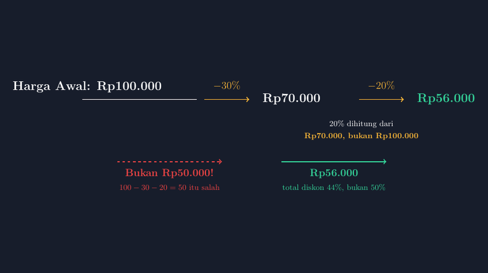

Sabtu lalu saya menemani istri belanja kebutuhan rumah di sebuah toko sembako dekat rumah. Di rak beras ada spanduk besar: **Diskon 30% + extra 20%!** Di samping saya, seorang ibu berkata pada anaknya, "Alhamdulillah, jadi setengah harga." Saya menahan diri untuk tidak ikut berkomentar — tetapi pikiran saya langsung terbang ke kelas VII, ke hari ketika saya memberikan soal serupa dan hampir seluruh kelas menjawab persis seperti kalimat ibu itu.

Diskon 30% ditambah diskon 20% bukanlah diskon 50%. Ini mungkin salah satu miskonsepsi persen yang paling awet di muka bumi, karena bukti kalimatnya terasa benar: tiga puluh ditambah dua puluh memang lima puluh. Masalahnya bukan pada kemampuan berhitung, melainkan pada satu hal yang jarang kita tegaskan di kelas: **persen selalu bekerja pada sebuah patokan, dan patokan itu berubah.**

<!--more-->

## Membuka dengan struk belanja

Seperti biasa, saya mencoba membuka pelajaran bukan dari definisi, melainkan dari cerita. Saya menampilkan foto struk belanja yang sengaja saya simpan: sembako Rp200.000, diskon 30%, jadi Rp140.000. Semua anak bisa menghitungnya dalam hitungan detik. Lalu saya tulis soal kedua di papan: toko memberi tambahan diskon 20% untuk member. Berapa harga akhirnya?

Jawaban yang muncul hampir serempak: Rp100.000. Tiga puluh persen ditambah dua puluh persen, kan, lima puluh persen. Saya tidak buru-buru mengoreksi. Saya hanya bertanya pelan, "Dua puluh persen itu dua puluh persen dari apa?" Kelas hening beberapa detik. Itu jeda yang paling saya tunggu, karena dari jeda itulah diskusi dimulai.

Seorang siswa di bangku belakang akhirnya bersuara, "Dari Rp140.000, Pak?" Ya, justru itu. Diskon kedua dihitung dari harga yang sudah dipotong, bukan dari harga awal. Dua puluh persen dari Rp140.000 adalah Rp28.000, sehingga harga akhirnya Rp112.000 — bukan Rp100.000.

## Menulis pembuktiannya

Biar tidak berhenti di satu contoh, kami mencobanya secara umum. Misalkan harga awal sebuah barang adalah $M$. Diskon pertama $p$ persen membuat harganya menjadi:

$$ H_1 = M \left(1 - \frac{p}{100}\right) $$

Diskon kedua $q$ persen dihitung dari $H_1$, bukan dari $M$:

$$ H_2 = H_1 \left(1 - \frac{q}{100}\right) = M \left(1 - \frac{p}{100}\right)\left(1 - \frac{q}{100}\right) $$

Perhatikan bahwa kedua faktor itu saling mengalikan, bukan saling menjumlahkan. Itulah sebabnya diskon bertingkat selalu menghasilkan potongan yang lebih kecil daripada jumlah persennya. Untuk $p = 30$ dan $q = 20$:

$$ H_2 = M \times 0{,}7 \times 0{,}8 = 0{,}56\,M $$

Total potongan yang benar adalah 44%, bukan 50%. Selisih enam persen itu terdengar kecil, tetapi untuk belanja Rp1.000.000 artinya Rp60.000 — dua minggu uang jaga sekolah seorang siswa saya.



*Tangga diskon 30% lalu 20%: patokan berpindah dari Rp100.000 ke Rp70.000, sehingga harga akhirnya Rp56.000 — total diskon 44%, bukan 50%.*

## Menggambar tangga diskon dengan TikZ

Banyak siswa paham di kelas, lalu lupa seminggu kemudian. Pengalaman saya, miskonsepsi seperti ini baru benar-benar lepas kalau anak **melihat** patokannya berpindah. Karena itu saya menggambar tangga diskon itu dengan TikZ, untuk ditempel di papan pengumuman dan disisipkan di modul ajar.

Gagasan gambarnya sederhana: harga dituliskan sebagai rangkaian titik-titik yang tersambung panah, dan setiap panah diberi label persen beserta patokannya. Bagian terpenting justru keterangan kecil di bawah panah kedua: *dihitung dari Rp70.000, bukan Rp100.000*. Kalimat itu yang membedakan gambar yang menjelaskan dari gambar yang sekadar menghias.

Potongan kode utamanya seperti ini:

```latex
\node[teks, font=\Large\bfseries] at (0,4.4) {Harga Awal: Rp100.000};
\draw[->, aksen, very thick] (4.7,3.9) -- (6.5,3.9);
\node[aksen] at (5.6,4.45) {$-30\%$};
\node[teks, font=\Large\bfseries] at (8.2,3.9) {Rp70.000};
\draw[->, aksen, very thick] (10.9,3.9) -- (12.7,3.9);
\node[aksen] at (11.8,4.45) {$-20\%$};
\node[hijau, font=\Large\bfseries] at (14.4,3.9) {Rp56.000};
```

Perhatikan bahwa label $-20\%$ saya letakkan di atas panah kedua, bukan menempel di harga Rp70.000. Penempatan kecil seperti ini penting: kalau label menempel pada angka, mata siswa bisa membacanya sebagai "20% dari Rp70.000 dikurangi Rp70.000" tanpa menyadari bahwa patokan itu sendiri adalah bagian dari informasi. Di gambar lengkapnya, saya juga menambahkan dua panah kontras di bawah: satu merah bertuliskan *bukan Rp50.000* (jawaban yang menganggap 100 dikurangi 30 lalu 20), dan satu hijau bertuliskan Rp56.000 sebagai jawaban yang benar.

Sengaja saya tidak menggambar diagram batang atau lingkaran persentase. Tangga yang bergerak dari kiri ke kanan itu memaksa mata mengikuti urutan waktu: potongan pertama dulu, baru potongan kedua — dan patokan kedua adalah hasil dari potongan pertama. Diagram yang benar-benar menjelaskan biasanya memang gambar yang paling sederhana bentuknya, tetapi paling teliti penempatannya.

## Menguji dengan satu pertanyaan sederhana

Setelah contoh dan rumus, saya biasanya menguji ulang dengan satu soal cepat yang persennya sengaja saya balik: diskon 20% dulu, lalu 30%. Kalau diskon dijumlahkan, hasilnya tetap 50% dan harga akhirnya Rp100.000. Tetapi hitungan yang benar memberi $M \\times 0{,}8 \\times 0{,}7 = 0{,}56\\,M$ — persis Rp56.000 dari Rp100.000, angka yang sama dengan urutan sebelumnya. Anak-anak menemukan sendiri sifat yang menarik: urutan diskon bertingkat tidak mengubah hasil akhirnya, sama seperti urutan membagi tidak mengubah hasil kali. Temuan kecil ini sering membuat mereka merasa seperti menemukan "rahasia" matematika, dan rasa itu yang membuat mereka ingat lebih lama daripada sekadar diingatkan "hati-hati dengan diskon".

## Dari kelas ke struk belanja

Kekuatan miskonsepsi ini justru datang dari pengalaman sehari-hari anak. Iklan "diskon 30% + 20%" memang dirancang supaya terdengar seperti 50%. Anak-anak kami akan hidup di tengah iklan seperti itu seumur hidup mereka, jadi kemampuan membaca persen bertingkat bukan sekadar materi ulangan bab aritmetika sosial — ia adalah bekal literasi finansial yang paling praktis.

Di akhir pertemuan, saya memberi tugas yang bukan soal latihan: cari satu iklan diskon bertingkat di toko atau di media sosial, hitung harga sebenarnya, dan tuliskan selisihnya dari anggaran "jika orang mengira diskonnya dijumlah". Besoknya anak-anak datang membawa tangkapan: promosi pulsa, paket data, sepatu, sampai baju lebaran. Satu siswa bahkan menghitung bahwa diskon "50% + 10%" ternyata hanya setara 55%, bukan 60% — dan ia memamerkan perhitungannya ke sekelas dengan bangga.

Bapak dan Ibu guru, kalau materi persen sedang berjalan, cobalah menyingkirkan soal-soal yang persennya tunggal untuk sesaat. Persis di lubang diskon bertingkat itulah anak-anak belajar bahwa persen bukan angka berdiri sendiri; ia selalu berdiri di atas sesuatu. Dan ketika patokannya berganti, semua hitungan ikut berganti.

Kalau Bapak/Ibu ingin memakai gambarnya, berkas TikZ lengkapnya siap kompilasi.

> 📎 **Berkas TikZ lengkap:** [tikz-diskon-bertingkat.tex](tex/tikz-diskon-bertingkat.tex) — siap kompilasi (butuh paket `tikz`).
