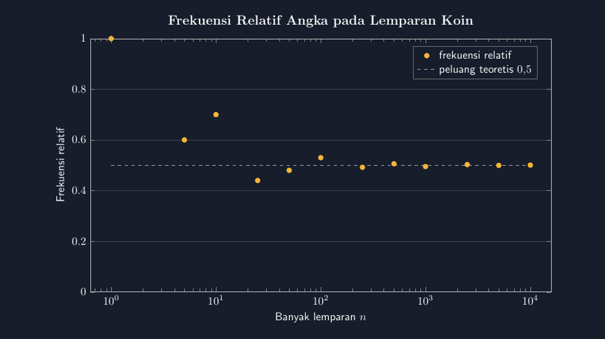

Beberapa tahun terakhir saya mengajarkan peluang dengan cara yang sama seperti buku paket: ruang sampel, rumus $\frac{n(A)}{n(S)}$, selesai. Hasilnya konsisten — siswa bisa menghitung peluang muncul angka pada koin adalah $\frac{1}{2}$, tapi jika saya tanya "kalau koin dilempar sepuluh kali, pasti lima angka?" mereka menjawab "pasti" dengan lantang. Rumusnya hafal, maknanya kosong.

Tahun ini saya mencoba jalan sebaliknya. Sebelum rumus mana pun ditulis, kelas VIII-A melempar koin. Satu koin, dilempar berkali-kali, dicatat setiap hasilnya. Kegaduhan yang terjadi di kelas itu sendiri sudah sepadan — tapi hadiah sesungguhnya datang saat kami menggambar datanya.

<!--more-->

## Lemparan yang Membentuk Garis

Aturannya sederhana: setiap kelompok melempar koin dan mencatat, setelah setiap lemparan, berapa banyak angka yang sudah muncul dibagi banyak lemparan. Angka itu namanya frekuensi relatif:

$$f_{rel}(A) = \frac{banyaknya\ kejadian\ A}{banyaknya\ percobaan}$$

Lima lemparan pertama bisa menghasilkan angka-angka yang tampak "salah": tiga angka dari lima lemparan memberi frekuensi relatif $0{,}6$. Enam angka dari sepuluh memberi $0{,}7$ — terasa jauh dari $\frac{1}{2}$. Di kelas, momen ini emas. Anak yang tadinya yakin lima dari sepuluh "harusnya" sekarang bingung sendiri: koinnya sah, hasilnya nyata, tapi angkanya tidak sesuai ramalan.

Data yang saya pakai untuk gambar di artikel ini adalah hasil gabungan yang realistis dari percobaan semacam itu — saya rekonstruksi dari pola yang biasa muncul di kelas:

| $n$ (lemparan) | Angka muncul | Frekuensi relatif |
|---|---|---|
| 1 | 1 | 1,000 |
| 5 | 3 | 0,600 |
| 10 | 7 | 0,700 |
| 25 | 11 | 0,440 |
| 50 | 24 | 0,480 |
| 100 | 53 | 0,530 |
| 250 | 123 | 0,492 |
| 500 | 253 | 0,506 |
| 1000 | 495 | 0,495 |
| 2500 | 1257 | 0,5028 |
| 5000 | 2497 | 0,4994 |
| 10000 | 5006 | 0,5006 |

Perhatikan pola di tabel itu: angkanya bergolak liar di awal, lalu makin lama makin dekat ke $0{,}5$. Ini hukum bilangan besar dalam versi yang bisa dipegang tangan — dan bukan saya yang mengatakannya ke siswa; mereka yang melihatnya sendiri.

## Menggambarnya dengan TikZ

Untuk grafik ini saya pakai `pgfplots` dengan sumbu horizontal logaritmik, karena data dari 1 sampai 10.000 lemparan tidak akan terbaca pada skala biasa — titik-titik awalnya akan menumpuk di tepi kiri:



Bagian kode yang paling penting justru sederhana:

```latex
\begin{axis}[
  xmode=log, log basis x=10,
  ymin=0, ymax=1,
  ymajorgrids=true,
  legend pos=north east,
]
\addplot[only marks, mark=*, color=aksen] coordinates
{(1,1) (5,0.6) (10,0.7) (25,0.44) ... (10000,0.5006)};
\addplot[white!60!black, thick, dashed, domain=1:10000] {0.5};
\end{axis}
```

Garis putus-putus di $0{,}5$ adalah jantung gambar ini. Titik-titik kuning bergolak, garis itu diam. Siswa yang membaca grafik ini tidak perlu saya jelaskan apa itu "peluang teoretis" — dia langsung melihat bahwa frekuensi relatif yang dihitung dari data *menghormati* angka $\frac{1}{2}$, dan makin banyak data, makin patuh.

Ada pilihan teknis yang sengaja saya ambil: sumbu logaritmik membuat jarak 1 ke 10 sama lebar dengan jarak 100 ke 1000. Untuk siswa SMP ini perlu dijelaskan seperlunya — "tiap kelipatan sepuluh kita geser sekotak" — dan justru penjelasan singkat itu membuka diskusi menarik tentang kenapa grafik ilmiah sering memakai skala begini. Kalau Bapak/Ibu ingin versi yang lebih polos untuk kelas yang masih ragu, cukup ganti `xmode=log` dengan plot biasa dan ambil subset data dari 25 ke atas.

## Di Kelas: Tiga Pertanyaan yang Bekerja

Setelah grafik tampil, saya tidak berceramah. Tiga pertanyaan ini yang saya lempar:

Pertama, "Kalau kita berhenti di lemparan ke-10, koin kita bisa disimpulkan curang?" Jawaban tidak — sepuluh lemparan terlalu sedikit untuk menuduh siapa pun. Kedua, "Kalau lemparan ke-1000 masih jauh dari 0,5, apa yang harus kita curigai?" Di sinilah siswa menemukan sendiri bahwa frekuensi relatif adalah alat untuk *menguji* koin, bukan hanya menghafal sifatnya. Ketiga, dan favorit saya: "Dadu yang kita lempar tadi di soal kemarin — menurut kalian frekuensi relatif muka enam-nya menuju angka berapa?" Mereka menjawab $\frac{1}{6}$ hampir serempak, dan kali ini jawaban itu lahir dari pengalaman, bukan dari menghafal.

Itulah sebabnya saya menyebut koin itu setia. Dia tidak pernah berbohong, dia hanya butuh cukup banyak kesempatan untuk menunjukkan watak aslinya. Murid yang pernah melihat grafik menuju 0,5 ini akan sulit dilupakan oleh miskonsepsi "sepuluh lemparan pasti lima angka" — karena dia pernah menyaksikan sendiri sepuluh lemparan menghasilkan tujuh.

Satu detail teknis kecil yang hampir menggagalkan grafik pertama saya: titik di $n=1$ memiliki frekuensi relatif $1{,}000$ — lemparan pertama memang angka — dan pada skala linier titik itu saja memaksa sumbu vertikal mencapai 1 sementara sembilan titik lainnya berdempet di sekitar 0,5, sehingga cerita grafiknya jadi tidak terbaca. Saya sempat menghapus titik pertamanya, lalu berubah pikiran: justru titik ekstrem itu bagian dari cerita. Solusinya bukan membuang data, tapi memilih skala yang jujur pada kedua sumbu. Pelajaran kecil yang berlaku umum di kehidupan menggambar grafik: data yang mengganggu bukan berarti data yang salah.

## Penutup

Ada pula pelajaran mengajar yang saya petik dari jam ini. Saya dulu mengira peluang harus diajarkan dari definisi, lalu contoh, lalu latihan. Ternyata urutannya lebih manusiawi kalau dibalik: kejadian dulu, data dulu, kekacauan dulu — definisi datang kemudian sebagai penjelasan atas apa yang sudah terlihat. Definisi yang datang menjelaskan pengalaman terasa seperti jawaban; definisi yang datang tanpa pengalaman terasa seperti perintah.

Kalau Bapak/Ibu ingin mencoba, persiapannya minim: satu koin per kelompok, satu lembar tabel pencatatan, dan lima belas menit. Gambar TikZ-nya bisa dipakai untuk menutup percobaan itu — atau lebih baik lagi, masukkan frekuensi relatif hasil kelas sendiri ke dalam `coordinates`-nya, dan biarkan siswa melihat grafik kelasnya sendiri menuju 0,5.

> 📎 **Berkas TikZ lengkap:** [frekuensi-relatif-koin.tex](tex/frekuensi-relatif-koin.tex) — siap kompilasi (butuh paket `pgfplots`).
