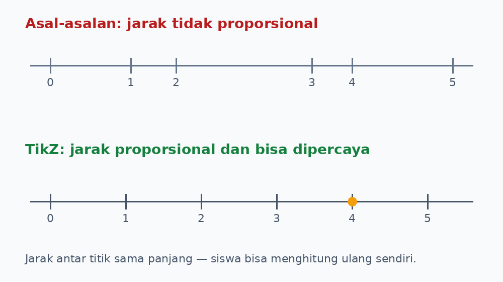
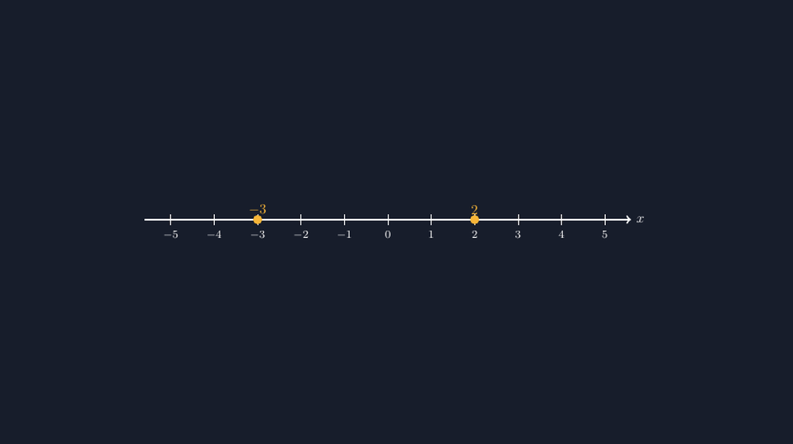

Ada satu gambar yang paling sering saya buat sepanjang tahun ajaran, dan bukan bangun datar, bukan juga grafik fungsi. Garis bilangan. Ia muncul di lembar kerja bilangan bulat, di pembahasan soal himpunan, di materi pertidaksamaan, bahkan menyelinap saat menjelaskan skala suhu di soal cerita. Kalau dihitung-hitung, mungkin ratusan kali saya menggambar satu garis lurus dengan deretan titik dan angka di bawahnya.

Dan justru karena begitu sering, gambar ini paling rawan dibuat asal-asalan. Termasuk oleh saya, dulu.

<!--more-->

## Garis yang Terlihat Benar tapi Salah

Suatu hari saya membagikan lembar latihan operasi bilangan bulat. Di salah satu soal, siswa diminta menunjukkan $-3 + 5$ pada garis bilangan. Ketika saya berkeliling, seorang siswa menunjuk gambar di lembar itu sambil mengernyit: "Pak, kok jarak dari nol ke satu lebih panjang daripada dari satu ke dua?"

Dia benar. Gambar di lembar itu saya buat cepat-cepat, titik-titiknya saya sebar "kira-kira pas". Jarak $0$ ke $1$ terlihat sedikit lebih lebar daripada jarak $1$ ke $2$, dan jarak ke bilangan negatif juga tidak konsisten. Saya pikir tidak ada yang akan memperhatikan. Ternyata justru siswa yang paling kritis-lah yang memperhatikan.

Kejadian itu mengganggu saya lebih lama dari yang saya kira. Bukan karena malu — sedikit saja, mungkin — tapi karena saya sadar sesuatu: garis bilangan adalah gambar yang **seluruh maknanya ada pada jarak**. Kalau bangun datar salah sedikit, siswa masih bisa memaklumi "ini hanya sketsa". Tapi garis bilangan yang jaraknya tidak proporsional bukan lagi sketsa, melainkan gambar yang mengajarkan hal yang salah. Jarak dua satuan harus terlihat dua kali lebih panjang dari jarak satu satuan. Titik.



Gambar di atas memperlihatkan dua versi yang sering saya hasilkan dulu. Yang atas adalah versi "kira-kira pas" — dan lihat betapa menyesatkan dia. Siswa yang terbiasa dengan gambar seperti itu akan mengira bahwa posisi bilangan di garis itu bebas, tinggal diberi label. Padahal inti garis bilangan justru sebaliknya: posisi adalah bilangannya.

## TikZ Tidak Mengizinkan Saya Berbohong

Ketika mulai serius memindahkan soal-soal saya ke LaTeX, garis bilangan menjadi salah satu gambar pertama yang saya buat ulang dengan TikZ. Dan di sinilah TikZ bersikap seperti guru yang galak tapi baik: dia tidak mengizinkan saya berbohong.

Cara paling sederhana menggambar garis bilangan adalah meletakkan titik satu per satu dengan koordinat manual:

```latex
\draw (-4,0) -- (4,0);
\foreach \x in {-4,...,4} {
  \draw (\x,-0.15) -- (\x,0.15);
  \node[below] at (\x,-0.15) {\x};
}
```

Perhatikan yang terjadi di sini. Saya tidak menaruh titik di posisi yang "terlihat pas". Saya meletakkan setiap tanda di koordinat $x$ yang sebenarnya, lalu menegakkan garis kecil dari titik itu. Jarak antar tanda **otomatis** sama, karena jarak antara $1$ dan $2$ di koordinat memang sama dengan jarak $2$ dan $3$. Kalau ada satu tanda yang saya taruh salah koordinat, TikZ tidak akan mengomprominya — gambarnya langsung kelihatan miring, dan saya langsung tahu ada yang keliru.

Inilah yang saya suka dari bekerja dengan TikZ untuk gambar matematika: kejujuran gambar bukan lagi tergantung kerapian tangan atau tingkat kelelahan saya malam itu. Jarak di koordinat adalah jarak di kertas. Tidak ada "kira-kira".

## Menandai Titik yang Sedang Dibicarakan

Dalam latihan operasi bilangan bulat, garis bilangan biasanya bukan tujuan akhir, melainkan panggung untuk menunjukkan gerakan. Misalnya $-3 + 5$: mulai dari $-3$, lalu melompat lima langkah ke kanan. Untuk itu saya perlu menandai titik mulai dan akhir dengan jelas:

```latex
\fill[orange] (-3,0) circle (0.12);
\fill[orange] (2,0) circle (0.12);
\node[above=2mm] at (-3,0.1) {mulai};
\node[above=2mm] at (2,0.1) {hasil};
```



*Render asli dari kode TikZ di atas — jarak antar titik persis sama.*


Sederhana, tapi efeknya di kelas nyata. Waktu itu saya menampilkan versi bertanda ini di proyektor, dan siswa yang biasanya diam di pojok belakang langsung berkomentar, "Pak, kalau dikurangi berarti lompat ke kiri ya?" Ya. Dan diskusi kecil itu terbuka justru karena gambarnya jelas — tidak ada siswa yang sibuk menebak titik mana sebenarnya maksud saya.

## Ketika Siswa Mulai Mencurigai Gambar

Ada efek samping yang menarik dari semua ini. Sejak gambar-gambar di kelas saya jadi lebih konsisten, siswa-siswa justru jadi lebih teliti. Mereka terbiasa melihat gambar yang jaraknya bisa dihitung ulang, sehingga ketika menemui gambar yang janggal — di buku lain, di soal latihan dari internet — mereka ikut mengernyit dan bertanya.

Bulan lalu, satu siswa membawa soal dari aplikasi belajar di ponselnya. Di soal itu ada garis bilangan bertanda untuk soal suhu: suhu pagi $-2^\circ$C, siang naik $7^\circ$C. Dia menunjukkan bahwa pada gambar aplikasi itu, jarak antar angka tidak sama, dan dia menghitung jawabannya dengan menghitung kotak di gambar — bukan dengan operasi — sehingga jawabannya meleset dua derajat. Dia tidak salah berhitung. Dia percaya pada gambar, dan gambarnya yang menipu.

Kasus seperti ini yang membuat saya makin yakin: kualitas gambar di bahan ajar bukan urusan estetika, tapi urusan kejujuran matematis. Siswa belajar membaca gambar seperti mereka belajar membaca kalimat. Kalimat yang salah hurufnya mengajarkan ejaan yang salah; gambar yang salah jaraknya mengajarkan bilangan yang salah.

## Satu Pembiasaan Kecil yang Menyelamatkan Banyak Soal

Kalau ada satu hal yang ingin saya pesankan ke rekan guru yang mulai membuat bahan ajar sendiri — entah dengan TikZ, GeoGebra, atau bahkan menggambar tangan di klip — itu ini: **ukur dulu, baru gambar**. Tentukan skala jelas, satu satuan = satu jarak tetap, dan pertahankan di seluruh gambar. Di TikZ, pembiasaan yang menyelamatkan saya adalah selalu pakai `\foreach` untuk deretan titik yang beraturan, bukan menaruhnya satu per satu. Sekali koordinatnya benar, seluruh deret ikut benar.

Dan ada bonus yang tidak saya duga sebelumnya. Karena gambar-gambar saya kini konsisten, saya bisa memakainya berulang di banyak soal dan materi berbeda. Garis bilangan yang sama untuk kelas tujuh belajar bilangan bulat, kelas delapan belajar pertidaksamaan linear satu variabel, dan bahkan untuk menunjukkan daerah solusi sederhana. Gambarnya tidak perlu digambar ulang dari nol — cukup saya ubah penanda yang sedang dibicarakan.

Bagi saya, TikZ bukan soal menghasilkan gambar yang "cantik". Cantik itu bonus. Yang utama adalah gambar yang bisa dipercaya — yang kalau ditanya siswa "Pak, kok begini?", jawabannya bukan "ah, hanya sketsa", melainkan "karena memang begitulah posisinya."

Itu standar yang saya mulai pegang sejak siswa saya mengernyit ke arah lembar kerja dan bertanya soal jarak antar titik. Pertanyaan yang mengernyitkan kening seperti itu biasanya bukan gangguan. Itu penilaian kualitas yang paling jujur.

> 📎 **Berkas TikZ lengkap:** [garis-bilangan-bulat.tex](tex/garis-bilangan-bulat.tex) — siap kompilasi (butuh paket `tikz`).
