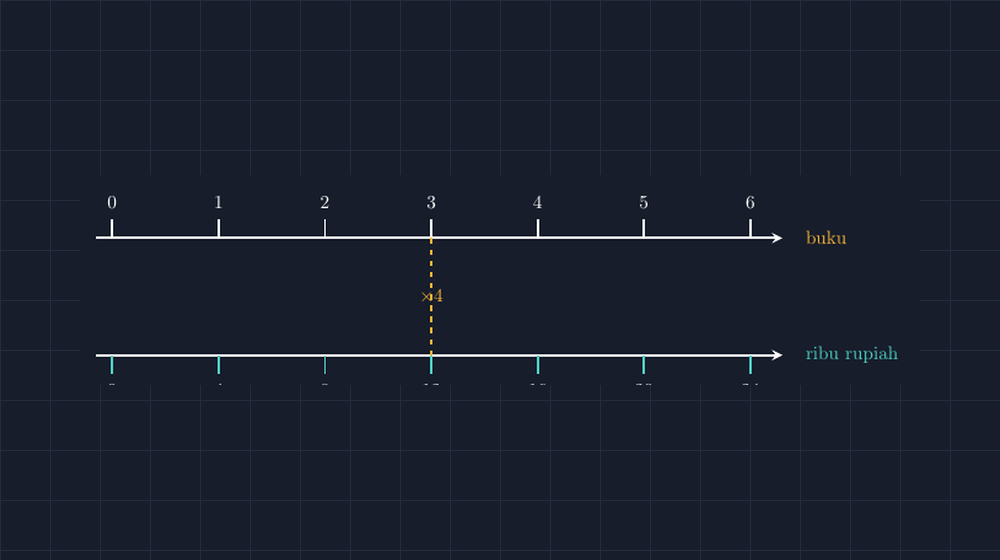

Ada satu kisi-kisi kecil yang saya tulis di pojok papan setiap kali masuk materi perbandingan di kelas VII: 3 buku tulis harganya Rp12.000, berapa harga 7 buku? Soal ini terasa terlalu mudah untuk dijadikan pembuka, dan justru di situlah masalahnya. Hampir seluruh kelas langsung menulis jawaban dengan benar, tetapi ketika saya ganti pertanyaannya — "yang Rp12.000 itu berapa banyak buku, kalau uangnya Rp28.000?" — separuh kelas tertahan. Mereka bisa memakai rumus perbandingan senilai ke arah yang satu, tetapi belum benar-benar melihat hubungan itu sebagai dua besaran yang berjalan berbarengan.

<!--more-->

## Dua garis yang berjalan bersama

Cara yang saya pegang sekarang untuk materi ini adalah garis bilangan ganda, atau *double number line*. Idenya sederhana: kita gambar dua garis bilangan yang sejajar, satu untuk banyaknya buku, satu untuk harganya, lalu kita pasangkan titik-titiknya lewat garis bantu yang ditarik lurus ke bawah. Titik 3 di garis atas harus benar-benar berada tepat di atas titik 12 di garis bawah. Pasangan itu bukan sekadar dituliskan "3 → 12"; posisinya di gambarlah yang menyimpan informasinya.

Yang membuat garis bilangan ganda berbeda dari tabel perbandingan adalah **jarak**. Di tabel, baris pertama dan kedua hanya bertumpuk; tidak ada yang mengikat 3 dengan 12 selain letaknya di kolom yang sama. Di garis bilangan ganda, jarak antar tick di kedua garis harus konsisten dengan besaran yang diwakilinya: satu kotak di garis atas selalu sama lebar dengan satu kotak di garis bawah, dan itulah yang menyimpan satuan perbandingannya — dalam soal buku itu, setiap satu kotak mewakili satu buku di atas dan empat ribu rupiah di bawah.

Begitu siswa terbiasa membaca gambar ini, soal terbalik yang tadinya menahan mereka jadi terasa alami. "Rp28.000 itu berapa buku?" tinggal dilacak di garis bawah sampai ketemu angka 28, lalu ditarik lurus ke atas. Tidak ada rumus yang perlu dipanggil; hubungannya terlihat.

## Menggambar dengan jujur pada faktor skala

Seperti kebiasaan saya menggambar bahan ajar, aturan utamanya satu: ukuran di gambar harus benar-benar mengikuti angka di soal. Kalau 3 buku digambar sama lebar dengan 5 buku, gambar itu berbohong, dan siswa yang teliti akan merasakan bohongnya tanpa selalu bisa menyebutnya. Maka saya menghitung dulu koordinatnya.

Untuk soal buku tadi, saya buat satu kotak di kanvas mewakili satu unit perbandingan. Titik 0 di kedua garis berada di koordinat yang sama, lalu setiap tambahan satu buku menggeser tick tepat 2 satuan ke kanan — dan di garis bawah, tick harga juga bergeser 2 satuan, karena 4 ribu rupiah adalah satu kotak yang sama. Keduanya memakai lebar kotak yang sama; yang berbeda hanya angkanya. Jarak antar tick di kedua garis identik, dan identitas jarak itulah yang mengatakan "perbandingan ini 3 : 12, yang sama dengan 1 : 4."



Kode TikZ-nya terasa hampir membosankan, dan justru itu bagusnya — keteraturan kode mencerminkan keteraturan perbandingannya:

```latex
\begin{tikzpicture}[line width=1.4pt]
  % Garis atas: banyak buku
  \draw[white, -stealth] (-0.3,2.2) -- (12.6,2.2);
  % Garis bawah: harga dalam ribu rupiah
  \draw[white, -stealth] (-0.3,0) -- (12.6,0);
  % Tanda garis atas: 0..6 buku
  \foreach \i in {0,...,6} {
    \draw (2*\i,2.2) -- (2*\i,2.55);
    \node[above=2pt] at (2*\i,2.55) {\i};
  }
  % Tanda garis bawah: harga, selalu 4 kali banyaknya buku
  \foreach \i in {0,...,6} {
    \pgfmathtruncatemacro{\h}{4*\i}
    \draw[teal] (2*\i,0) -- (2*\i,-0.35);
    \node[below=2pt] at (2*\i,-0.35) {\h};
  }
  % Garis putus di pasangan 3 buku = 12 ribu
  \draw[gold, dashed] (6,2.2) -- (6,0);
  \node[gold] at (6,1.1) {$\times 4$};
\end{tikzpicture}
```

Perhatikan dua hal di kode itu. Pertama, tick di kedua garis memakai posisi horizontal yang sama persis, $2 \times \i$ — itulah "janji" gambar ini: pasangan nilai harus benar-benar segaris, bukan ditulis berdekatan lalu berharap siswa percaya. Kedua, label harga dihitung dari $\pgfmathtruncatemacro{\h}{4*\i}$, bukan diketik manual satu per satu. Kalau suatu saat saya ganti soalnya jadi 5 pensil harganya Rp15.000, saya cukup mengganti angka 4 menjadi 3 dan seluruh garis bawah menyesuaikan diri dengan sendirinya, tetap jujur pada perbandingannya.

## Membaca rasio dari lebar kotak, bukan dari hafalan

Keuntungan yang paling saya rasakan bukan pada soal rutin, melainkan pada saat mengenalkan penyederhanaan rasio. Di gambar ini, rasio $3 : 12$ dan $1 : 4$ bukan dua hal yang "kebetulan sama nilainya"; keduanya terlihat sebagai pengambilan kotak yang berbeda jumlahnya dari gambar yang sama. Satu kotak mewakili 1 buku dan 4 ribu rupiah sekaligus — itulah satuan perbandingannya, dan siswa bisa menunjuknya dengan jarinya di gambar, bukan mengingatnya dari langkah "bagi keduanya dengan FPB".

Ini juga membantu saat membahas rasio yang tidak bulat. Ketika saya taruh garis putus di antara tick 2 dan tick 3 di garis atas, siswa harus memikirkan di mana garis putus itu jatuh di garis bawah. Jawabannya bukan "di antara 8 dan 12" yang ditebak, melainkan $2{,}5 \times 4 = 10$ ribu — dan di gambar, posisi 10 ribu memang benar-benar berada di tengah-tengah antara tick 8 dan tick 12, karena jaraknya konsisten. Perbandingan tak berumur bulat yang biasanya bikin ragu, di gambar ini tinggal soal membaca posisi.

> $$\frac{\text{harga}}{\text{banyak}} \;=\; \text{tetap} \qquad\text{untuk setiap pasangan yang segaris.}$$

Kalimat itu, yang di papan tulis sering terdengar abstrak, di gambar garis bilangan ganda jadi terlihat: setiap pasangan yang segaris memang punya selisih vertikal yang sama, karena satu kotak di garis atas selalu ditemani jumlah rupiah yang sama di garis bawah.

## Kapan garis bilangan ganda lebih baik daripada tabel?

Saya tidak mengganti semua tabel perbandingan di kelas saya dengan garis bilangan ganda. Tabel tetap berguna ketika datanya banyak dan tidak beraturan. Tetapi untuk membangun intuisi pertama — saat siswa belum percaya bahwa perbandingan itu "tetap", bukan kebetulan dua angka yang cocok — garis bilangan ganda jauh lebih jujur. Ia menunjukkan posisi, jarak, dan faktor skala sekaligus, dalam satu gambar yang bisa ditunjuk.

Kesalahan yang paling sering saya temui setelah pakai gambar ini justru menarik: siswa mulai protes kalau gambar di LKS tidak segaris. "Pak, di sini 3-nya nggak di atas 12-nya." Protes itu tanda bahwa mereka sudah punya alat untuk menilai gambar, bukan hanya menelan gambar apa pun yang dicetak. Bagi saya, itu justru tujuan akhirnya — murid yang berhak meragukan gambar yang bohong, dan tahu seperti apa wajah gambar yang benar.

Malam itu, ketika saya menyelesaikan berkas TikZ-nya, saya menyadari sesuatu yang kecil tetapi mengganjal: sebelumnya, di papan tulis, saya selalu menggambar garis atas dan garis bawah dengan spasi tick yang saya kira-kira sama. Hampir selalu tidak sama persis. Selisihnya tipis, tidak kelihatan mata — tetapi siswa yang menghitung lebar kotak dengan jantungnya bisa merasakan ada yang tidak pas. TikZ menutup celah kecil itu. Sekarang setiap kotak di kedua garis benar-benar sama lebar, dan perbandingannya tidak perlu dibela dengan kata-kata lagi.

> 📎 **Berkas TikZ lengkap:** [garis-bilangan-ganda.tex](tex/garis-bilangan-ganda.tex) — dokumen siap kompilasi (butuh paket `tikz`). Silakan ganti faktor pengali di `\pgfmathtruncatemacro` untuk membuat variasi soal Anda sendiri.
