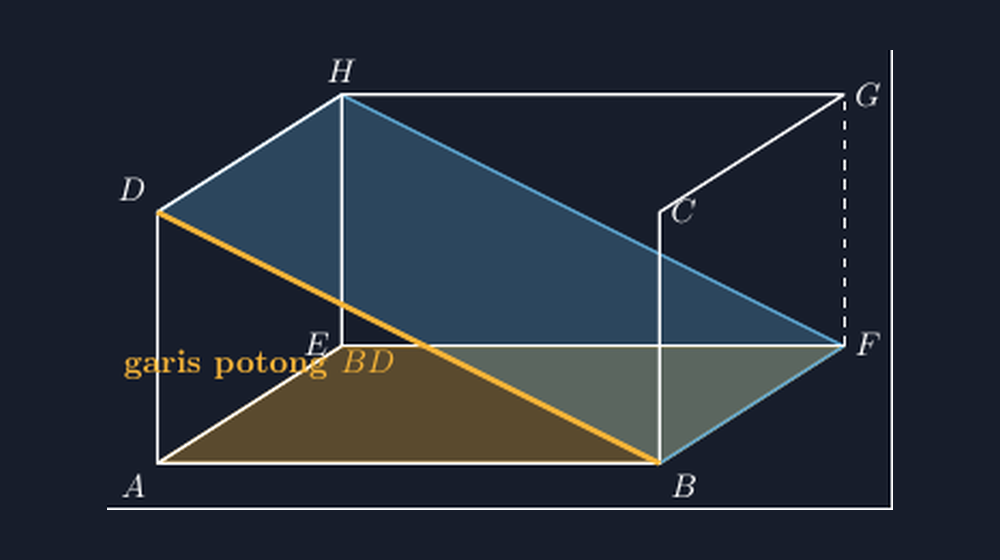

Minggu lalu saya memberikan satu soal sederhana di kelas IX: sebuah balok $ABCDEFGH$, bidang yang melewati tiga titik sudutnya, dan bidang sisi lainnya — lalu saya minta siswa menentukan di mana kedua bidang itu berpotongan. Jawaban yang saya harapkan cuma satu kalimat: "garisnya melewati dua titik ini." Yang muncul di lembar jawaban justru macam-macam. Ada yang menulis "mereka bertemu di satu titik." Ada yang menggambar dua garis silang di tengah balok seperti tanda plus. Dan satu anak menulis jujur di pinggir lembar, "Pak, bidang itu kan kayak lembaran kertas, lembaran kertas kalau ditempel pasti ketemu di satu titik doang."

<!--more-->

Anak itu tidak salah total — dia cuma membawa pengalaman dunia nyata ke dunia yang belum pernah dia masuki. Dua lembar kertas yang disilangkan memang bertemu di satu garis, tapi di tiga dimensi, dua bidang yang tidak sejajar **selalu** berpotongan di satu garis — dan garis itu bisa sangat panjang, tidak berhenti di dalam balok. Di titik itu saya sadar: soal garis potong dua bidang bukan soal menggambar, tapi soal cara berpikir. Kalau siswa tidak bisa melihat prosesnya, dia cuma bisa menghafal hasilnya.

## Masalahnya di papan tulis

Konvensi soal geometri ruang di SMP biasanya seperti ini: ada balok, ada dua bidang yang masing-masing "melewati" beberapa titik sudut, dan siswa diminta menentukan garis potongnya. Kesulitan pertama bukan pada garis potongnya, tapi pada bidangnya sendiri. Bidang di soal hanya disebut lewat titik-titiknya — "bidang yang melalui $A$, $D$, dan $H$" misalnya — dan siswa harus membayangkan lembaran tak terlihat itu sendiri sebelum bisa memikirkan di mana dia menembus lembaran lain.

Di papan tulis, saya dulu menggambar balok, lalu menggambar dua "lembar" transparan miring-miring dengan kapur. Hasilnya berantakan. Garis bidang yang saya gambar tidak pernah benar-benar melewati titik sudut yang saya sebut, sudut-sudut kembarannya tidak konsisten, dan siswa yang duduk di bangku belakang cuma melihat kumpulan garis miring yang tidak jelas mana bidang mana. Pernah satu siswa bertanya, "Pak, ini bidangnya yang mana yang sama dengan yang di soal?" — dan saya tidak bisa menjawab dengan meyakinkan.

## Dua bidang yang saya pilih

Untuk artikel ini saya pakai balok berukuran panjang 6, lebar 4, tinggi 3 (satuan apa saja, karena yang penting bentuknya jelas). Bidang pertama adalah bidang diagonal sisi depan: bidang yang melewati $A$, $B$, $F$, dan $E$ — keliling sisi depan balok itu sendiri. Bidang kedua saya pilih yang sedikit lebih menantang: bidang yang melewati $B$, $D$, dan $H$, yaitu bidang diagonal miring yang menembus isi balok. Pertanyaannya: di mana garis potong kedua bidang itu?

Kuncinya satu prinsip sederhana: **dua bidang yang berpotongan akan bertemu di garis, dan garis itu bisa ditemukan kalau kita menemukan dua titik yang jelas-jelas ada di kedua bidang sekaligus.** Titik $B$ jelas ada di kedua bidang — dia disebut di keduanya. Sekarang tinggal mencari satu titik lagi.

Di sinilah siswa biasanya tersendat. Beberapa langsung menebak, ada yang menggambar garis tambahan tanpa alasan. Yang saya ajarkan: **perpanjang sisi-sisi bidang sampai bertemu.** Sisi bidang pertama yang melewati $A$ dan $D$ — kalau diperpanjang ke arah kiri belakang — akan bertemu dengan sisi bidang kedua yang melewati $D$ dan $H$. Keduanya melewati $D$! Jadi titik $D$ itu sendiri sudah ada di kedua bidang.

Tunggu — kalau $B$ dan $D$ sama-sama ada di kedua bidang, garis potongnya adalah garis $BD$ sendiri? Saya menghentikan penurunan di sini dan membiarkan siswa merenungkan implikasinya: ya, jawabannya sebelumnya kelihatan rumit, tapi proses menemukannya yang perlu dibuktikan. Bukan semua pasangan bidang seaman ini — ada kasus di mana titik potong kedua bidang tidak langsung kelihatan dan harus dicari lewat perpanjangan rusuk yang lebih panjang.

## Menggambar di TikZ

Setiap langkah di atas saya gambar dengan TikZ supaya jujur pada koordinatnya. Bidang pertama saya beri warna semi-transparan dengan aksen kuning, bidang kedua dengan warna berbeda, dan garis potongnya ditebalkan. Ini inti gambar yang saya pakai:

```latex
\begin{tikzpicture}[scale=0.8, line join=round]
  % tiga sumbu proyeksi isometrik sederhana
  \coordinate (A) at (0,0);
  \coordinate (B) at (6,0);
  \coordinate (D) at (0,3);
  \coordinate (C) at (6,3);
  \coordinate (E) at (2.2,1.4);   % A digeser ke belakang-atas
  \coordinate (F) at (8.2,1.4);
  \coordinate (G) at (8.2,4.4);
  \coordinate (H) at (2.2,4.4);
  % rusuk balok
  \draw[thick] (A) -- (B) -- (C) -- (G) -- (H) -- (D) -- cycle;
  \draw[thick] (A) -- (E) -- (F) -- (B);
  \draw[thick] (E) -- (H);
  \draw[dashed] (F) -- (G);   % rusuk tersembunyi
  % bidang 1: sisi depan ABFE, diarsir semi-transparan
  \fill[opacity=0.25] (A) -- (B) -- (F) -- (E) -- cycle;
  \draw (A) -- (B) -- (F) -- (E) -- cycle;
  % bidang 2: bidang diagonal BDHF, warna lain
  \fill[opacity=0.2] (B) -- (D) -- (H) -- (F) -- cycle;
  \draw (B) -- (D) -- (H) -- (F) -- cycle;
  % garis potong = BD, ditebalkan
  \draw[ultra thick] (B) -- (D) node[midway, left] {\small $BD$};
  % label titik sudut
  \foreach \pt/\pos in {A/below left, B/below right, C/right, D/above left,
                        E/left, F/right, G/right, H/above}
    \node[\pos] at (\pt) {\small $\pt$};
\end{tikzpicture}
```

Kalau kode di atas dikompilasi, hasilnya persis seperti yang saya harapkan: dua bidang transparan bertumpuk di sekitar garis $BD$, garis potongnya jadi yang paling mencolok di gambar.


*Gambar 1. Bidang sisi depan $ABFE$ dan bidang diagonal $BDHF$ bertemu tepat di garis $BD$.*

Kode lengkapnya siap kompilasi saya lampirkan di bawah.

Satu hal yang saya suka dari TikZ di topik ini: saya bisa membuat **dua versi gambar** — satu dengan bidangnya ditampilkan, satu lagi kosong tanpa bidang — dan menyuruh siswa menebak dulu sebelum melihat jawabannya. Gambar kosong jadi soal, gambar berisi jadi kunci. Dengan menggambar manual, membuat dua versi yang konsisten seperti itu melelahkan; dengan TikZ, tinggal menghapus atau menambahkan empat baris kode.

## Kesalahan yang sering muncul

Dari lembar kerja siswa, ada tiga kesalahan yang paling sering saya temui:

**Pertama, mengira dua bidang bertemu di satu titik.** Ini pengalaman "lembaran kertas ditempel" yang tadi saya ceritakan. Perbaikannya bukan mengoreksi jawaban, tapi menyuruh siswa menahan dua kartu potongan kertas yang benar-benar disilangkan di tangan — meraba bahwa pertemuan mereka bukan satu noktah, tapi satu lipatan sepanjang kartu.

**Kedua, garis potong digambar berhenti di dalam balok.** Siswa menggambar segmen pendek di tengah balok, padahal garis potong adalah garis lurus yang tidak peduli baloknya habis di mana. Di TikZ ini mudah dikoreksi: garis potong saya gambar melewati seluruh panjang bidangnya, bukan hanya segmen di dalam. Dua versi gambar — yang pendek (salah) dan yang panjang (benar) — jadi bahan diskusi yang bagus.

**Ketiga, menggambar titik potong dengan menebak.** Ini yang paling sering. Solusinya menumbuhkan kebiasaan mencari **dua titik yang pasti**: mulai dari titik yang sudah disebut di kedua bidang, lalu cari titik kedua lewat perpanjangan rusuk. Kalau kedua titik itu sudah ketemu, garisnya tinggal dihubungkan — tidak perlu menebak sama sekali.

## Penutup

Ada rasa menarik dari topik ini: bidang tidak pernah benar-benar terlihat di dunia nyata — kita hanya melihat benda, bukan bidangnya. Siswa yang bisa menentukan garis potong dua bidang sebenarnya sedang berlatih memegang objek yang tidak bisa dilihat langsung, hanya bisa dibayangkan. Untuk itu gambar yang jujur sangat penting: kalau gambarnya tidak konsisten, bayangan siswa yang baru mulai terbentuk langsung runtuh.

Saya juga jadi berpikir, soal tipe ini sebaiknya masuk sebelum materi volume dan luas permukaan, bukan sesudahnya. Anak-anak yang sudah terbiasa membayangkan bidang yang menembus balok akan lebih siap menghadapi soal jarak titik ke garis, sudut antara garis dan bidang, sampai materi kesebangunan ruang di jenjang berikutnya. Yang mereka butuhkan bukan lebih banyak latihan hitung, tapi kebiasaan bertanya: "di mana dua lembar tak terlihat ini bertemu?"

Kalau Bapak/Ibu ingin mencoba soal serupa di kelas, mulailah dari pasangan bidang yang "murah hati" — yang punya dua titik sudut bersama seperti contoh di atas — lalu naik perlahan ke pasangan yang titik potongnya tersembunyi. Siswa tidak butuh banyak soal; mereka butuh satu soal yang mereka pahami sampai ke akarnya.

> 📎 **Berkas TikZ lengkap:** [tikz-garis-potong-dua-bidang.tex](tex/tikz-garis-potong-dua-bidang.tex) — siap kompilasi (butuh paket `tikz`).
