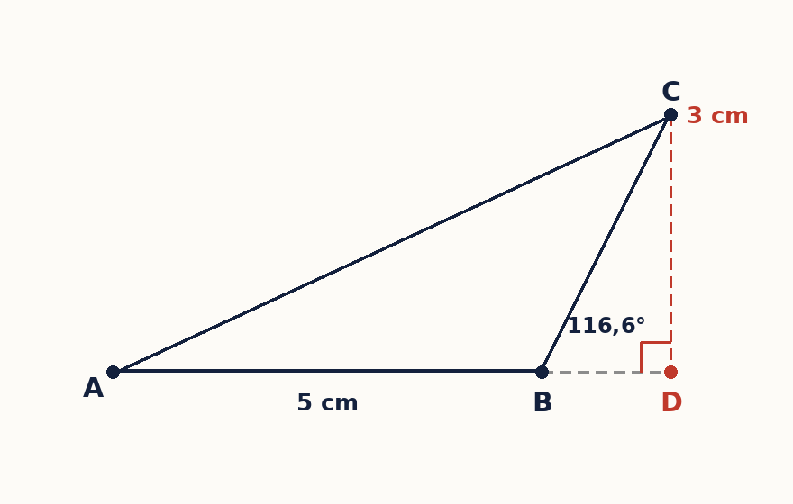
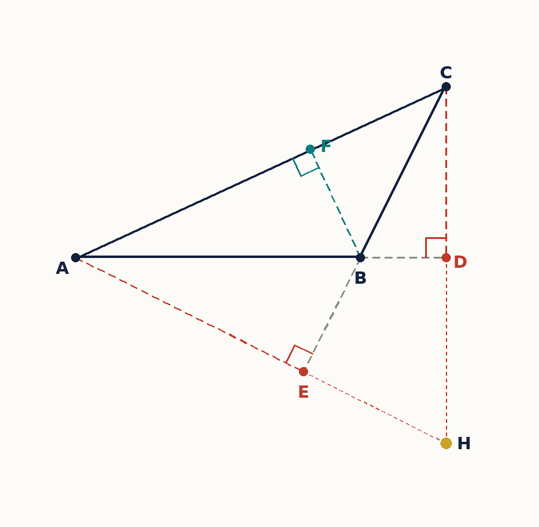

Pekan lalu, di tengah pelajaran garis-garis istimewa segitiga, saya menggambar sebuah segitiga tumpul di papan tulis, lalu menarik garis tinggi dari titik sudut atasnya tegak lurus ke alas. Belum selesai saya meletakkan kapur, seorang murid di bangku kedua sudah mengangkat tangan. "Pak, garisnya kok keluar segitiga? Itu salah gambar, ya?" Saya tersenyum. Justru di situlah pelajaran hari itu dimulai. Garis tinggi yang jatuh di luar segitiga bukan kesalahan gambar — ia sifat segitiga tumpul yang paling mudah dilihat, tetapi paling sering membuat murid ragu.

<!--more-->

## Segitiga tumpul yang saya pakai

Supaya gambarnya jujur, saya mulai dari koordinat yang sudah saya hitung, bukan dari gambar yang saya kira-kira. Segitiga yang saya pakai kali ini adalah $A = (0, 0)$, $B = (5, 0)$, dan $C = (6{,}5, 3)$. Alas $AB$ mendatar sepanjang $5$ cm, titik $C$ berada $3$ cm di atas garis alas, tetapi bergeser ke kanan melewati $B$. Akibatnya sudut di $B$ menjadi tumpul, sekitar $116{,}6^\circ$, sedangkan sudut di $A$ sekitar $24{,}8^\circ$ dan di $C$ sekitar $38{,}7^\circ$.

Koordinat ini saya pilih sengaja: alas dan tingginya bilangan bulat, luasnya langsung mudah dihitung, $L = \frac{1}{2} \times 5 \times 3 = 7{,}5$ cm$^2$. Angka-angka yang bersih membuat murid bisa memeriksa sendiri bahwa luasnya tetap sama, dari alas mana pun garis tinggi itu ditarik.

## Garis tinggi pertama: yang jatuh di luar alas

Garis tinggi dari $C$ adalah ruas garis dari $C$ yang tegak lurus terhadap garis alas. Karena alasnya mendatar, garis ini tinggal dijatuhkan lurus ke bawah. Masalahnya: kaki tingginya jatuh di $D = (6{,}5, 0)$ — setengah sentimeter di sebelah kanan $B$. Di luar segitiga.

Di sinilah banyak gambar menjadi salah. Ada yang memaksa kaki tingginya masuk ke dalam segitiga dengan menggeser $D$ ke kiri, ada pula yang menggambar garis $CD$ tanpa memperpanjang alas, sehingga garis tingginya seperti melayang tanpa kaki. Yang benar: perpanjang alas $AB$ melewati $B$ sampai $D$ dengan garis putus-putus, lalu tarik $CD$ putus-putus merah dan beri tanda siku kecil di $D$.



Kunci menggambarnya dengan TikZ adalah membedakan tiga macam garis: sisi segitiga tebal penuh, perpanjangan alas putus-putus abu-abu, dan garis tinggi putus-putus merah. Tanda siku di $D$ saya buat dengan pola `calc` yang sama untuk semua kaki tinggi, supaya tidak perlu menghitung sudut putarannya:

```latex
\coordinate (A) at (0,0);
\coordinate (B) at (5,0);
\coordinate (C) at (6.5,3);
\coordinate (D) at (6.5,0); % kaki tinggi dari C, di luar segitiga
\draw[thick, navy] (A) -- (B) -- (C) -- cycle;
\draw[dashed, gray, thick] (B) -- (D); % perpanjangan alas
\draw[dashed, red, thick] (C) -- (D); % garis tinggi, CD = 3 cm
% tanda siku di D (pola calc: berlaku di kaki mana pun)
\draw[red, thick] ($(D)!0.35cm!(C)$)
  -- ($($(D)!0.35cm!(C)$) + ($(D)!0.35cm!(B)$) - (D)$)
  -- ($(D)!0.35cm!(B)$);
\node[anchor=north, font=\small\bfseries, navy] at (2.5,-0.15) {5 cm};
\node[anchor=west, font=\small\bfseries, red] at (6.65,1.5) {3 cm};
```

Perhatikan bahwa tanda siku itu diletakkan di sebelah kiri garis $CD$, menghadap ke dalam perpanjangan alas. Kalau digambar di sisi kanan, ia justru menandai sudut dengan ruang kosong — murid akan bingung sudut mana yang siku-siku.

## Dua garis tinggi lainnya: satu di luar, satu di dalam

Segitiga punya tiga garis tinggi, dan pada segitiga tumpul nasib ketiganya tidak sama. Garis tinggi dari $A$ harus tegak lurus terhadap sisi $BC$. Sisi $BC$ berkemiringan $2$, jadi garis tinggi dari $A$ berkemiringan $-\frac{1}{2}$ — hasil kalinya $-1$. Kaki tingginya jatuh di $E = (4, -2)$, lagi-lagi di luar segitiga, kali ini di bawah alas, sehingga sisi $BC$ harus diperpanjang melewati $B$ sampai $E$.

Sebaliknya, garis tinggi dari $B$ tegak lurus terhadap sisi $AC$. Sisi $AC$ berkemiringan $\frac{6}{13}$, garis tingginya berkemiringan $-\frac{13}{6}$, dan kaki tingginya jatuh di $F = (4{,}12, 1{,}90)$ — di dalam ruas $AC$, di dalam segitiga. Inilah satu-satunya garis tinggi yang "berperilaku normal". Saya selalu menunjukkan ketiganya sekaligus, supaya murid melihat polanya: pada segitiga tumpul, dua garis tinggi jatuh di luar dan satu di dalam.



## Ketiga garis tinggi bertemu — di luar segitiga

Tiga garis tinggi segitiga selalu berpotongan di satu titik, yang disebut titik tinggi. Pada segitiga lancip, titik itu ada di dalam segitiga; pada segitiga siku-siku, ia tepat di titik sudut siku-sikunya. Pada segitiga tumpul ini, ia jatuh di luar: perpotongan garis tinggi dari $C$ (garis tegak $x = 6{,}5$) dengan garis tinggi dari $A$ (garis $y = -\frac{1}{2}x$) adalah $H = (6{,}5, -3{,}25)$. Murid bisa memeriksanya sendiri: garis tinggi dari $B$ juga lewat titik itu, jadi ketiganya memang bertemu di satu tempat — hanya saja di luar segitiga.

Fakta ini sering mengejutkan murid, padahal ia bisa dipakai untuk memeriksa gambar. Kalau ketiga garis tinggi yang digambar tidak bertemu di satu titik, pasti ada yang salah: entah kakinya bergeser, entah garisnya tidak tegak lurus.

## Tiga kesalahan yang sering saya lihat

Pertama, memaksa kaki tinggi masuk ke dalam segitiga. Ini yang paling sering terjadi: murid (dan guru yang terburu-buru) menggeser kaki tinggi ke tengah alas supaya gambarnya "rapi". Akibatnya garis itu tidak lagi tegak lurus, dan luas yang dihitung dari situ ikut salah. Kalau kakinya jatuh di luar, biarkan di luar — perpanjang alasnya.

Kedua, garis tinggi yang melayang. Garis $CD$ digambar, tetapi alasnya tidak diperpanjang, sehingga ujung bawah garis tinggi itu tidak menyentuh apa-apa. Kaki tinggi harus punya tempat berpijak, yaitu garis alas yang diperpanjang. Tanpa perpanjangan itu, gambarnya tidak lengkap.

Ketiga, lupa tanda siku. Pada gambar segitiga tumpul, garis tinggi yang jatuh di luar mudah dikira garis sembarang. Tanda siku kecil di kaki tinggi adalah satu-satunya penanda bahwa garis itu tegak lurus terhadap alas.

Sebagai penutup hitungan, luas segitiga ini tetap $7{,}5$ cm$^2$ dari alas mana pun: dari alas $AB = 5$ dengan tinggi $3$, dari alas $BC \approx 3{,}35$ dengan tinggi $AE \approx 4{,}47$, dan dari alas $AC \approx 7{,}16$ dengan tinggi $BF \approx 2{,}10$. Tiga pasang alas dan tinggi yang berbeda, satu luas yang sama. Kalau murid sudah berani menggambar garis tinggi yang jatuh di luar segitiga, ia tidak lagi takut pada gambar yang "kelihatan salah" — ia sudah tahu cara memeriksanya sendiri.

> 📎 **Berkas TikZ lengkap:** [garis-tinggi-segitiga-tumpul.tex](tex/garis-tinggi-segitiga-tumpul.tex) — dokumen siap kompilasi (butuh paket `tikz`). Silakan ganti angka-angkanya untuk dokumen Anda sendiri.
