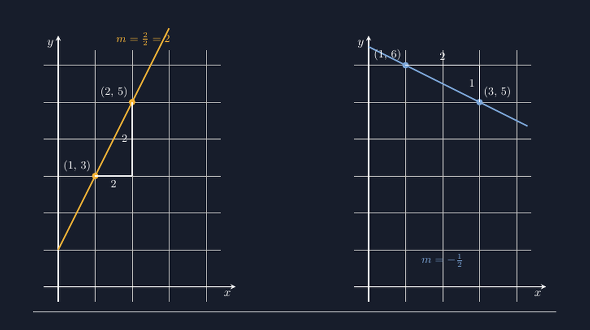

Minggu lalu saya memberikan soal pemanasan sederhana di kelas VIII: dua titik, $(1, 3)$ dan $(2, 5)$, ditanyakan kemiringan garis yang melalui keduanya. Jawaban yang masuk hampir seragam — dua per satu, dua. Benar. Lalu saya lempar pertanyaan lanjutan: "Garis itu naik atau turun?" Beberapa tangan terangkat dengan yakin menjawab turun. Ketika saya tanya alasannya, jawabannya jujur dan menampar: "Karena rumusnya ada minnya, Pak." Padahal rumusnya tidak ada tanda minus sama sekali. Mereka cuma ingat bahwa soal gradien biasanya "berbau" minus, jadi mereka menaruh minus di mana saja, seperti menebak cuaca dari warna langit sore.

<!--more-->

Kejadian itu bukan yang pertama. Hampir setiap tahun saya menemukan murid yang bisa menghitung gradien dengan lancar tapi tidak punya gambaran apa pun tentang garis yang sedang mereka hitung. Bagi mereka, $m$ adalah huruf yang muncul di rumus, bukan cerminan dari sesuatu yang bisa dilihat. Gradien mati sebagai angka sebelum sempat hidup sebagai kemiringan.

## Masalahnya Bukan Rumusnya, Tapi Yang Tidak Digambar

Rumus gradien sebenarnya sederhana:

$$m = \frac{y_2 - y_1}{x_2 - x_1}$$

Tapi rumus ini punya cacat penyajiannya: ia datang sebagai pembagian langsung, tanpa cerita. Murid tidak melihat bahwa pembilang itu adalah *seberapa jauh naik* dan penyebut itu *seberapa jauh menyamping*. Mereka melihat empat angka yang harus dites ke dalam rumus, lalu satu hasil yang dicoret.

Tahun ini saya coba jalannya sebaliknya. Sebelum rumus, kami gambar dulu. Titik $(1,3)$ dan $(2,5)$ saya letakkan di bidang koordinat di papan, lalu saya tarik segitiga siku-siku dari titik pertama ke titik kedua: menyamping dua kotak, naik dua kotak. "Kemiringan," kata saya, "adalah perbandingan antara naik dan menyamping ini. Itu saja." Baru setelah murid-murid bisa membaca segitiganya, saya tunjukkan bahwa yang mereka hitung tadi memang sama dengan rumus yang biasa mereka pakai.



Gambar seperti di atas sekarang jadi bahan ajar tetap saya. Dan karena saya orangnya suka repot-repot yang berfaedah, saya menggambarnya dengan TikZ supaya bisa dipakai ulang di lembar soal dan slide tanpa menggambar ulang dari nol setiap tahun ajaran.

## Kode TikZ yang Setia pada Segitiganya

Bagian penting dari gambar itu adalah segitiga gradien — segitiga siku-siku kecil yang kakinya menunjukkan perubahan $x$ dan perubahan $y$. Kuncinya: panjang kaki segitiga di kode harus *persis* sama dengan selisih koordinatnya. Kalau saya menulis titik $(1,3)$ dan $(2,5)$, maka kakinya harus dari $(1,3)$ ke $(2,3)$ lalu ke $(2,5)$. Tidak ada tempat untuk ngarang.

```latex
\begin{tikzpicture}[scale=1.05]
  \draw[gray!50, very thin] (-0.4,-0.4) grid (4.4,6.4);
  \draw[->, white, thick] (-0.4,0) -- (4.8,0) node[below left] {$x$};
  \draw[->, white, thick] (0,-0.4) -- (0,6.8) node[below left] {$y$};

  % garis naik melalui (1,3) dan (2,5)
  \draw[aksen, very thick] (0,1) -- (3,7);
  \fill[aksen] (1,3) circle (2.5pt) node[above left] {$(1,3)$};
  \fill[aksen] (2,5) circle (2.5pt) node[above left] {$(2,5)$};

  % segitiga gradien: menyamping 2, naik 2
  \draw[white, thick] (1,3) -- (2,3) node[midway, below] {$2$};
  \draw[white, thick] (2,3) -- (2,5) node[midway, left] {$2$};
\end{tikzpicture}
```

Perhatikan bahwa garis miringnya sendiri saya tarik dari $(0,1)$ ke $(3,7)$ — dua titik yang memang dilalui garis $y = 2x + 1$, meski tidak keduanya saya kasih label. Kalau saya asal menarik garis "kira-kira lewat situ", murid yang teliti akan menghitung ulang dan menemukan garis saya bohong. Dan sekali gambar kita ketahuan bohong, kepercayaan pada seluruh gambar soal ikut runtuh. Ini pelajaran yang sudah saya bayar mahal dulu.

Untuk garis kedua — yang menurun — prinsipnya sama, hanya selisih $y$-nya sekarang negatif. Dari $(1,6)$ ke $(3,5)$: menyamping dua kotak, turun satu kotak, sehingga $m = \frac{-1}{2}$. Di papan tulis, inilah momen favorit saya: meminta murid memegang penggaris di sepanjang garis dan merasakan bahwa "naiknya" justru ke bawah. Tanda minus di gradien bukan kutukan rumus; ia arah.

## Kenapa Tidak Cukup Gambar Tangan

Sebetulnya segitiga gradien bisa digambar tangan di papan. Saya juga masih sering begitu saat menjelaskan spontan. Tapi TikZ memberi tiga hal yang gambar tangan tidak konsisten berikan.

Pertama, **konsistensi antar kelas**. Kelas VIII-A pagi dan VIII-C siang mendapat gambar yang identik, dengan skala yang sama. Kalau di satu kelas segitiganya saya gambar agak semu, perbandingan "naik dua, menyamping dua" jadi kabur, dan justru miskonsepsi yang menular.

Kedua, **kemudahan membuat variasi**. Butuh soal latihan dengan gradien $-\frac{3}{2}$? Saya tinggal mengganti dua koordinat dan panjang kakinya, sisanya tata letak tetap. Untuk soal berjenjang, saya bisa membuat lima garis dengan kemiringan bertambah curam dan meminta murid mengurutkannya *sebelum* menghitung. Latihan mengurutkan kemiringan lewat mata ini ternyata lebih cepat menanamkan intuisi daripada sepuluh soal hitung.

Ketiga, **kejujuran yang bisa diverifikasi**. Karena koordinat di kode dan panjang segitiganya saling mengunci, kesalahan saya tidak bisa bersembunyi. Gambar menjadi dokumen yang bisa dipertanggungjawabkan, bukan ilustrasi yang kitakaharap-harap benar.

## Di Kelas, Gambar Itu Jadi Bahasa Bersama

Yang paling saya syukuri, segitiga gradien akhirnya jadi bahasa bersama di kelas. Saat murid menjawab soal dan saya tanya "kenapa $m$-nya negatif?", mereka tidak lagi menjawab "karena rumusnya". Mereka bilang, "kan garisnya turun, Pak." Jawaban itu terdengar sepele, tapi artinya gambar sudah masuk lebih dulu daripada rumus — dan rumus datang sebagai cara *menulis* sesuatu yang sudah mereka pahami, bukan sebagai aturan yang harus ditelan.

Minggu ini ada satu murid yang bertanya, "Pak, kalau garisnya mendatar, naiknya nol, berarti $m$-nya nol juga ya?" Saya tidak pernah menanyakan kasus itu lebih dulu. Ia menemukan sendiri dari gambar. Kalau sebagian pemahaman bisa lahir sendiri begitu alat yang dipakai jujur, menurut saya itu tanda media ajar kita bekerja dengan benar.

Gradien akan tetap jadi topik yang banyak murid temui sebagai rumus di buku. Tapi setidaknya di kelas saya, ia mulai dikenal lebih dulu sebagai kemiringan — sesuatu yang bisa dilihat, diukur dengan penggaris, dan digambar dengan jujur.

> 📎 **Berkas TikZ lengkap:** [gradien-garis.tex](tex/gradien-garis.tex) — siap kompilasi (butuh paket `tikz`).
