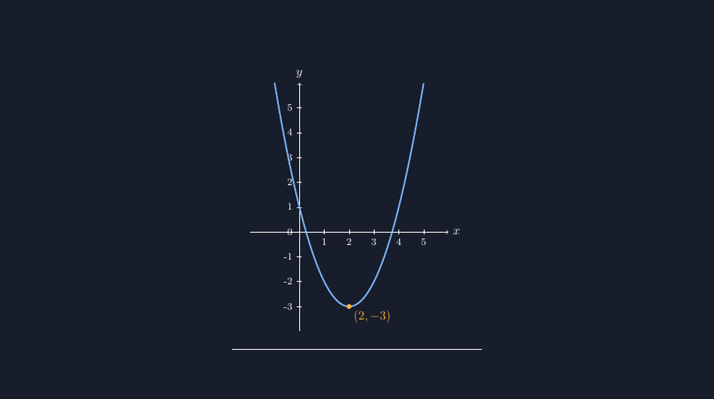
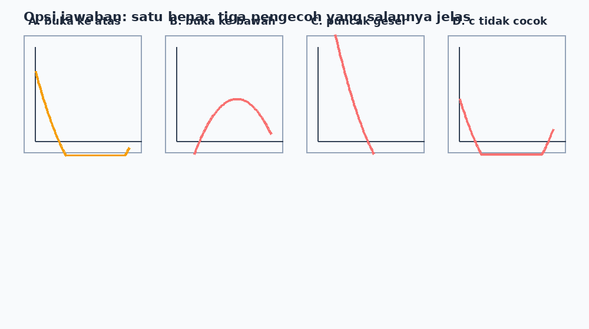

Kalau boleh memilih satu topik yang paling sering butuh gambar di kelas saya, jawabannya bukan geometri. Justru fungsi kuadrat. Hampir setiap tahun ajaran, di kelas delapan atau sembilan, saya menghadapi situasi yang sama: butuh grafik parabola untuk bahan ajar, untuk soal, untuk slide — dan setiap kali itu saya berhadapan dengan tangan saya sendiri yang tidak bisa menggambar kurva mulus.

<!--more-->

Dulu solusinya klasik: gambar tangan di kertas berpetak, foto, tempel di dokumen. Hasilnya bisa dipakai, tapi selalu ada sesuatu yang mengganjal. Kadang parabola saya kelihatan seperti gunung yang sedang dilanda gempa — puncaknya melompat, lengannya patah-patah. Dan siswa itu jeli. Ada yang bertanya, "Pak, kok puncaknya di tiga padahal rumusnya min dua?" Pertanyaan seperti itu bukan salah siswa; itu kejujuran gambar yang sedang membongkar kecerobohan saya.

Setelah dua artikel sebelumnya tentang bidang koordinat dan bangun datar, kali ini saya ceritakan pengalaman menggambar grafik fungsi kuadrat dengan TikZ. Ternyata ini level yang sedikit berbeda. Kalau bangun datar tinggal urusan garis dan sudut, grafik fungsi menuntut sesuatu yang lebih dalam: gambar harus benar-benar *dihitung*, bukan sekadar digambar.

## Titik puncak dulu, bukan bentuknya dulu

Kesalahan pertama saya saat mulai memakai TikZ untuk parabola: saya mencoba menggambar kurva seperti menggambar pensil di kertas — "nah, dari sini melengkung ke atas, puncaknya di sekitar sini..." Hasilnya selalu hampir benar. Dan *hampir* adalah kata yang berbahaya di matematika.

Sebentar sampai di titik ini. Kemudian belajar: jangan mulai dari bentuk kurva, mulai dari informasinya. Untuk fungsi $f(x) = x^2 - 4x + 1$, hal pertama yang saya tulis di kode TikZ justru bukan perintah menggambar, melainkan perhitungan:

$$x_{puncak} = -\frac{b}{2a} = \frac{4}{2} = 2, \quad y_{puncak} = 4 - 8 + 1 = -3$$

Baru setelah itu perintah menggambarnya:

```latex
\begin{tikzpicture}[scale=0.7]
  % sumbu
  \draw[->] (-2,0) -- (6,0) node[right] {$x$};
  \draw[->] (0,-4) -- (0,6) node[above] {$y$};
  \foreach \x in {1,...,5}
    \draw (\x,0.1) -- (\x,-0.1) node[below] {\footnotesize \x};
  \foreach \y in {-3,...,5}
    \draw (0.1,\y) -- (-0.1,\y) node[left] {\footnotesize \y};
  % parabola
  \draw[thick, blue, domain=-1:5, samples=100]
    plot (\x, {\x*\x - 4*\x + 1});
  % titik puncak
  \filldraw[red] (2,-3) circle (2pt)
    node[below right] {$(2, -3)$};
\end{tikzpicture}
```

Perhatikan dua hal yang dulu saya lewatkan bertahun-tahun tanpa sadar. Pertama, `domain=-1:5` — kurva hanya digambar dari $x = -1$ sampai $x = 5$, pas di dalam bidang. Tanpa ini, parabola bisa "kabur" keluar bidang dan TikZ diam-diam menggambar potongan raksasa yang merusak skala gambar. Kedua, `samples=100` — jumlah titik sampel. Saya dulu pakai nilai bawaan dan kurva saya kelihatan bergerigi kalau diperbesar. Ternyata parabola yang mulus itu soal sampel, bukan soal keberuntungan.


*Grafik $f(x) = x^2 - 4x + 1$ yang dihasilkan TikZ — puncak, titik potong sumbu, semua di tempatnya.*

## Ketika gambar berbohong dengan cara yang halus

Ada kejadian yang mengubah cara saya menulis soal. Tahun lalu saya membuat soal: "Perhatikan grafik fungsi $f(x) = x^2 - 2x - 3$ di samping. Tentukan titik potong dengan sumbu $x$." Gambar saya buat dengan domain yang kelewat sempit, jadi salah satu titik potong — yang di $x = 3$ — terpotong dan tidak tampak. Siswa yang teliti menanyakan di mana titik potong kedua, dan siswa yang tidak teliti menjawab cuma satu titik. Skor mereka terbelah bukan karena kemampuan matematika, tapi karena kelalaian gambar saya.

Sejak itu saya punya kebiasaan kecil sebelum menyimpan file: hitung dulu titik-titik penting di kertas kasar — puncak, titik potong sumbu, diskriminan — lalu pastikan domain di TikZ mencakup semuanya dengan lega. Untuk contoh di atas, $D = 4 + 12 = 16$ jadi titik potongnya $x = -1$ dan $x = 3$; domain saya buang sampai minimal $-2$ dan $4$ supaya kedua titik itu "bernafas".

Ini yang membuat saya makin yakin: TikZ bukan sekadar alat gambar, dia juga memaksa saya berpikir matematis. Komputer tidak mau menggambar parabola yang salah; kalau kodenya salah, dia menolak atau menghasilkan keanehan yang langsung ketahuan. Bandingkan dengan tangan saya dulu, yang dengan percaya diri menggambar puncak di titik yang salah dan tidak ada yang protes.

## Tiga titik bantu yang menyelamatkan soal pilihan ganda

Satu tantangan lain: soal pilihan ganda tentang grafik fungsi kuadrat biasanya menampilkan beberapa grafik sekaligus sebagai opsi jawaban, dan siswa harus membedakan mana yang benar. Di sinilah saya belajar bahwa parabola yang "asal benar bentuknya" bisa menyesatkan — dan sekaligus memanfaatkan hal itu untuk membuat pengecoh yang bagus.


*Empat grafik untuk satu soal: satu jawaban benar, tiga pengecoh yang masing-masing melanggar satu sifat (arah bukaan, posisi puncak, atau titik potong).*

Cara saya menyusunnya: satu parabola benar, lalu tiga pengecoh yang masing-masing "salah dengan cara yang bisa dianalisis siswa" — salah satu buka ke bawah padahal $a > 0$, salah satu puncaknya geser, salah satu titik potong sumbu $y$ tidak sesuai dengan konstanta $c$. Justru di titik ini TikZ paling terasa jasanya: karena setiap kurva digambar dari fungsi yang nyata, pengecoh saya pun punya dasar matematis yang jelas, bukan gambar yang saya bengkokkan asal-asalan. Kalau ada siswa protes di ruang guru — "Pak, opsi C itu tidak mungkin karena..." — saya bisa menunjukkan persis fungsi mana yang menghasilkan gambar itu.

## Penutup: gambar sebagai bagian dari berpikir

Saya kembali ke pertanyaan siswa di pembuka: "Pak, kok puncaknya di tiga padahal rumusnya min dua?" Dulu pertanyaan seperti itu membuat saya panik. Sekarang pertanyaan seperti itu justru saya rindukan — karena hanya muncul di kelas yang siswanya terbiasa membaca gambar secara kritis.

TikZ mengajarkan saya bahwa grafik fungsi kuadrat bukan ilustrasi yang menempel di luar matematika; dia adalah matematika itu sendiri, yang kebetulan berbentuk gambar. Puncaknya harus dihitung, bukannya ditaksir. Domainnya harus dirancang, bukan dibiarkan. Dan setiap titik potong adalah janji yang harus ditepati.

Untuk rekan guru yang mulai mencoba: jangan takut dengan kodenya yang kelihatan teknis. Mulailah dari satu parabola sederhana, salin pola di artikel ini, ganti angkanya, lihat apa yang berubah. Petualangan gambar saya masih panjang — berikutnya sepertinya saya berani-beraniin gambar transformasi geometri, tapi itu cerita untuk tulisan lain.

Sampai jumpa di artikel berikutnya. Selamat menggambar, dan biarkan komputernya yang menghitung — kita yang tetap yang berpikir.


---

> 📎 **Berkas TikZ lengkap:** [grafik-fungsi-kuadrat.tex](tex/grafik-fungsi-kuadrat.tex) — dokumen siap kompilasi (butuh paket `tikz`). Silakan ganti angka-angkanya untuk dokumen Anda sendiri.
