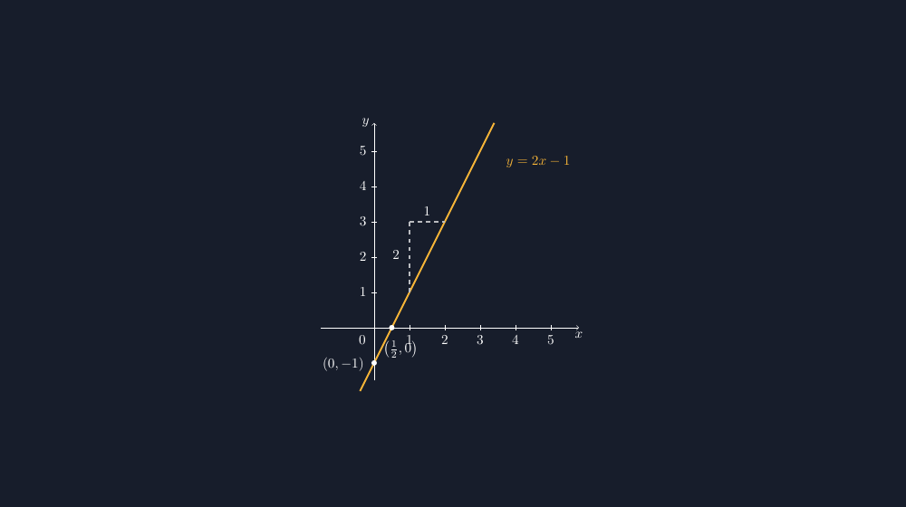

Bab fungsi linear di kelas delapan selalu saya buka dengan kalimat yang sama: grafik garis lurus itu cuma butuh dua titik. Kalimat ini benar secara matematika, tapi di lembar soal yang saya tulis tangan dulu, kalimat itu sering berbalas nolong dengan kenyataan. Garis yang saya gambar di papan kelihatan lurus, tapi saat saya fotokopi soalnya, garis itu miring sekadar asal menembus dua titik. Kadang titik potong sumbu y-nya bahkan tidak benar-benar menyentuh sumbu.

Masalah ini terasa sepele, tapi siswa melihat gambar itu lebih lama daripada kita kira. Ketika gambar soal menunjukkan garis yang melewati $(0,-1)$, tapi secara piksel garis itu lewat di $(0{,}2;-1)$, ada siswa yang mulai curiga pada gambar sebelum curiga pada hitungannya sendiri. Bagi saya, itu kerugian ganda: gambar yang seharusnya menjadi bukti justru menjadi sumber ketidakpercayaan.

## Dua titik potong, lalu garisnya

Cara saya menyusun grafik fungsi linear di TikZ sekarang berangkat dari hal yang paling bisa dipertanggungjawabkan: titik potong sumbu. Untuk $y = 2x - 1$, garis memotong sumbu $y$ di $(0,-1)$ dan memotong sumbu $x$ di $\left(\tfrac{1}{2},0\right)$. Kalau kedua titik ini sudah tepat di koordinatnya, garis yang ditarik melaluinya otomatis benar — matematika yang menjaga, bukan tangan saya.



Bagian yang paling saya suka dari gambar di atas justru bukan garisnya, tapi garis putus-putus tangganya. Dari titik $(1,1)$, saya gambar naik 2 satuan lalu ke kanan 1 satungan. Tangga ini adalah penampakan dari koefisien 2 pada $y = 2x - 1$: setiap kali $x$ bertambah 1, $y$ bertambah 2. Siswa yang dulu menghafal "gradien itu m di depan x" bisa melihat sendiri bahwa angka itu punya arti fisik di gambar: berapa tinggi anak tangga per satu langkah ke kanan.

Inti kode TikZ-nya sebenarnya pendek:

```latex
\draw[ak,very thick,domain=-0.4:3.4]
  plot (\x,{2*\x-1});
```

Fungsi `plot` dengan `domain` inilah yang mengubah pernyataan "garis lurus" dari janji menjadi perhitungan. TikZ yang menghitung setiap titik pada kurva dari rumusnya; saya tidak lagi menarik garis dari dua titik yang saya pilih sendiri. Kalau rumus di soal berubah jadi $y = -x + 3$, saya cukup mengganti ekspresinya, dan seluruh geometri mengikuti.

> 📎 **Berkas TikZ lengkap:** [grafik-fungsi-linear.tex](tex/grafik-fungsi-linear.tex) — siap kompilasi (butuh paket `tikz` dan `amsmath`).

## Skala yang tidak dibohongi

Satu hal yang dulu sering saya lewatkan: skala sumbu. Di papan tulis, sumbu x dan sumbu y saya gambar dengan jarak kira-kira sama, dan tidak ada yang protes. Tapi begitu grafik masuk ke buku paket atau lembar soal, siswa mulai membaca kemiringan secara visual. Garis $y = 2x - 1$ pada skala seimbang memang terlihat curam, dan itu jujur. Tapi kalau saya paksa memuaikan sumbu x supaya grafik "muat", kemiringan yang terlihat berubah, sementara rumusnya tidak.

Karena itu di kode saya memakai `scale=0.9` yang berlaku sama untuk kedua sumbu, dan saya menahan diri untuk tidak mengubah skala satu sumbu saja. Kalau satu hari saya butuh jendela gambar yang lebar (misalnya untuk garis yang hampir mendatar), saya akan menuliskan skala per sumbu secara eksplisit di caption soal, bukan diam-diam. Grafik yang dipalsukan skalanya sama berbahayanya dengan grafik yang titiknya melenceng.

## Titik potong yang diberi nama

Pada versi awal gambar ini, dua titik potong hanya saya beri tanda bulat tanpa label. Yang terjadi di kelas: siswa menebak koordinatnya dari posisi, dan tebakan itu tidak selalu sama dengan hitungan. Maka sekarang kedua titik saya tulis koordinatnya — $(0,-1)$ dan $\left(\tfrac{1}{2},0\right)$ — persis seperti yang akan mereka hitung dari persamaan.

Ada efek samping yang saya nikmati: titik potong sumbu $x$ yang berupa pecahan $	frac{1}{2}$ ternyata jadi bahan diskusi sendiri. Beberapa siswa pertama kali menyangka titik potong sumbu harus bilangan bulat, karena hampir semua gambar di buku yang pernah mereka lihat memang "kebetulan" demikian. Gambar yang jujur pada pecahan membuka percakapan yang dulu tidak pernah terjadi di kelas saya.

## Dari grafik ke makna

Setelah gambar benar, barulah pertanyaan di soal bisa jalan. "Berapa nilai $y$ ketika $x = 2$?" sekarang bisa dijawab dengan tiga cara yang saling menguatkan: dari rumus, dari bacaan pada grafik, dan dari tangga gradien yang terlihat. Kalau ketiganya tidak setuju, berarti ada yang perlu dicek — dan justru ketidakcocokan kecil semacam ini sering jadi momen belajar terbaik.

Bagi saya, TikZ untuk grafik fungsi linear bukan soal kecanggihan software. Semua ini bisa juga dilakukan di aplikasi grafik apa pun. Bedanya, TikZ memberi saya kendali penuh atas apa yang tampil dan apa yang tidak: saya bisa menyembunyikan kisi-kisi supaya siswa benar-benar membaca skala, atau menonjolkan tangga gradien saja. Grafik di lembar soal akhirnya bukan lagi hiasan, tapi bagian dari argumen matematika yang bisa dipertanggungjawabkan — sama seperti yang saya minta dari jawaban siswa-siswa saya.
