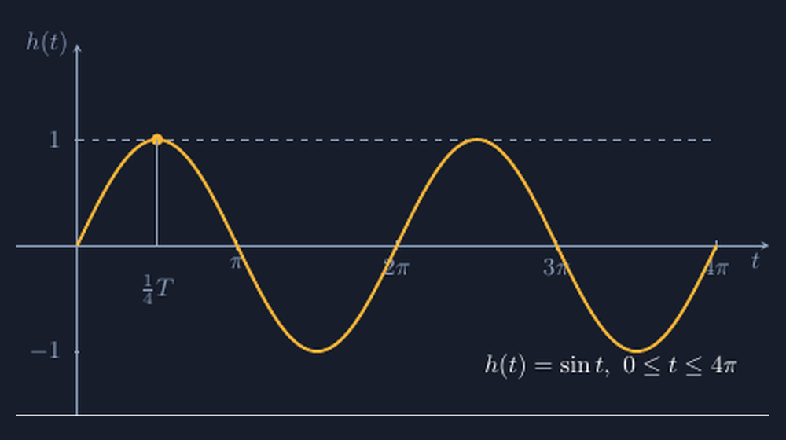

Mengajarkan grafik fungsi sinus itu selalu jadi titik balik di kelas VIII fase lanjut — atau kelas IX, tergantung ritme kelasku. Sebelum materi ini, segala sesuatu yang digambar siswa berupa garis, titik, dan bangun datar. Tiba-tiba saya meminta mereka menggambar sesuatu yang *naik-turun berulang*, dan di papan tulis, kurva yang muncul biasanya dua macam: seperti gerigi gergaji yang lancip-lancip, atau seperti bukit-bukan simetris yang bagus tapi tidak punya hubungan dengan angka apa pun di soal.

Tahun lalu saya mengalami momen yang menggelitik. Saya menggambar $y = \sin x$ dengan tangan di papan, cepat-cepat sebelum bel. Seorang siswa, sebut saja Bagas, berkomentar pelan, "Pak, bukitnya yang pertama kelihatannya lebih tinggi dari yang kedua." Saya menatap papan. Ia benar. Kurva yang saya tarik asal itu memang menurun tingginya dari kiri ke kanan, karena tangan saya lelah dan saya tidak menghitung apa pun. Padahal inti fungsi sinus justru di situ: *semua* puncaknya sama tinggi, *semua* lembahnya sama dalam. Gambar yang tidak jujur pada periodisitasnya justru menghancurkan konsep yang sedang diajarkan.

<!--more-->

## Mulai dari Roda Feris, Bukan dari Rumus

Sudah lama saya berhenti membuka materi ini dengan definisi $\sin$ dari segitiga siku-siku. Terlalu jauh lompatannya. Yang saya pakai sekarang lebih sederhana dan lebih hidup: bayangkan satu titik di tepi roda yang berputar, lalu kita amati *ketinggiannya* dari tanah seiring waktu.

Di kelas, saya peragakan dengan jangkar dan benang: lingkaran kardus dipasang di papan, satu titik ditandai di tepinya, lalu kami "memutar" lingkarannya perlahan sementara satu siswa menandai ketinggian titik itu setiap seperempat putaran. Ketinggian saat titik di paling atas: satu satuan. Saat kembali ke garis tengah: nol. Saat paling bawah: minus satu. Lalu naik lagi. Kami tuliskan tabelnya di samping, dan barisan angkanya mulai kelihatan berirama:

$$1,\ 0,\ -1,\ 0,\ 1,\ 0,\ -1,\ \dots$$

Dari tabel itu, kurvanya sendiri yang menuntut digambar: bukan gerigi lancip, bukan puncak runcing, tapi sesuatu yang *membulat* di puncaknya — karena titik di roda tidak pernah berhenti mendadak, ia melambat di puncak lalu kembali turun. Momen ketika siswa menyadari bahwa bentuk kurva itu bukan gaya-gayaan melainkan *jejak gerakan roda* adalah momen favorit saya di materi ini. Fungsi sinus tiba-tiba punya cerita: $h(t) = \sin t$ adalah ketinggian titik itu setelah roda berputar selama $t$.

## Kurva yang Jujur pada Puncak dan Periodenya

Dari peragaan roda, kami lanjut ke gambar yang presisi. Untuk lembar kerja, saya ingin grafik yang menunjukkan dua periode penuh, dari $0$ sampai $4\pi$, dengan puncak yang benar-benar sama tinggi dan periode yang benar-benar sama lebar. Di papan tulis, itu hampir mustahil saya capai dengan tangan. Di TikZ, keduanya dihitung:

```latex
\begin{tikzpicture}[x=0.72cm,y=1.5cm]
  \draw[->] (-1.2,0) -- (13.6,0) node[below left] {$t$};
  \draw[->] (0,-1.6) -- (0,1.9) node[left] {$h(t)$};
  \draw[very thick, domain=0:12.56637, samples=300, smooth]
    plot (\x, {sin(deg(\x))});
\end{tikzpicture}
```

Tiga hal di potongan kode itu yang selalu saya tekankan saat membahasnya bersama siswa atau rekan guru yang mulai tertarik TikZ:

Pertama, `domain=0:12.56637` — angka itu adalah $4\pi$ yang sudah dihitung, bukan ditaksir. Kalau saya tulis `domain=0:12`, kurvanya berhenti di tengah lembah dan siswa yang jeli akan bertanya kenapa "gelombangnya tidak selesai". Kedua, `samples=300` — jumlah titik yang dihitung TikZ untuk menyambung kurvanya. Kalau sampelnya terlalu sedikit, puncak yang seharusnya membulat jadi runcing, dan kita kembali ke masalah gerigi gergaji yang sama dengan gambar tangan. Ketiga, `sin(deg(\x))` — di TikZ, fungsi `sin` mengambil derajat, sedangkan sumbu kita adalah radian, jadi `deg()` wajib ada. Lupa fungsi ini menghasilkan kurva yang osilasinya *sangat* cepat dan pasti memancing pertanyaan, "Pak, ini grafik apa sih sebenarnya?"


*Dua periode fungsi $h(t) = \sin t$ untuk $0 \le t \le 4\pi$. Puncak pertama (titik kuning) berada pada $t = \tfrac{1}{4}T$ dengan tinggi tepat $1$ — puncak-puncak berikutnya sama tinggi karena koordinatnya dihitung, bukan ditarik.*

## Titik-Titik Kunci yang Digambar, Bukan Ditebak

Yang membuat grafik sinus bermakna bagi siswa bukan kurvanya utuh, tapi beberapa titik kunci yang bisa mereka *pertanggungjawabkan*. Karena itu di lembar kerja, saya tidak cukup dengan kurva jadi. Titik puncak pertama saya gambar dengan garis bantu turun ke sumbu:

```latex
\fill (1.5708,1) circle (2.4pt);
\draw[thin] (1.5708,0) -- (1.5708,1);
\node at (1.5708,-0.42) {$\tfrac{1}{4}T$};
```

Angka $1.5708$ itu $\tfrac{\pi}{2}$ — seperempat periode, saat titik di roda tepat berada di puncak. Dari situ siswa bisa membaca sendiri pola pentingnya: puncak di $\tfrac{1}{4}T$, kembali ke nol di $\tfrac{1}{2}T$, lembah di $\tfrac{3}{4}T$, selesai satu putaran di $T$. Grafik sinus tiba-tiba bisa *dikonstruksi* tanpa menghafal bentuknya: tandai lima titik itu, sambung dengan lekukan yang mulus, selesai. Beberapa siswa bahkan mulai menduga-duga sendiri, "Kalau rodanya lebih besar, puncaknya naik lagi dong, Pak?" — dan jawaban saya tinggal mengangguk: itu namanya amplitudo, dan kelak jadi bahan diskusi fungsi $a \sin t$.

Ini juga yang membuat grafik sinus berbeda dari materi gambar TikZ yang biasa saya tulis. Di geometri, ketepatan TikZ berarti garis dan sudut yang jujur. Di grafik fungsi, ketepatannya berarti *periodisitas yang jujur*: puncak yang sama tinggi, periode yang sama lebar, di mana pun kita memotong kurvanya. Gambar asal di papan tulis tidak selalu merusak materi segitiga — tapi di gelombang, gambar asal hampir selalu merusak, karena satu-satunya pesan visual dari fungsi sinus adalah *ia berulang dengan setia*.

## Penutup: Jejak Gerakan, Bukan Hafalan Bentuk

Roda feris, tabel ketinggian, titik kunci, lalu kurva. Urutan itu sudah saya pakai tiga tahun dan terus berjalan, terutama karena grafik yang dibagikan ke siswa dibuat dengan koordinat yang dihitung — jadi ketika ada siswa yang mengukur puncak kedua dengan penggaris dan menemukan tingginya sama dengan puncak pertama, ia menemukan konsep periodisitas dengan tangannya sendiri, bukan karena saya mengatakan "fungsi sinus itu periodik".

Bagi rekan guru yang ingin mencoba, berkas lengkapnya saya sertakan di bawah. Cukup paket `tikz` dan `amsmath`, dan grafiknya siap dicetak untuk lembar kerja atau dilap papan digital.

> 📎 **Berkas TikZ lengkap:** [tikz-grafik-fungsi-sinus.tex](tex/tikz-grafik-fungsi-sinus.tex) — siap kompilasi (butuh paket `tikz`).

Grafik fungsi mungkin terlihat seperti materi kecil di antara gunungan aljabar dan geometri. Tapi bagi saya, ia adalah satu-satunya momen dalam setahun ketika matematika di kelasku *bergerak*: ada roda yang berputar, ada titik yang naik dan turun, dan ada kurva yang mencatat semuanya dengan setia. Anak-anak tidak menghafal gelombang itu — mereka pernah melihatnya berputar.
