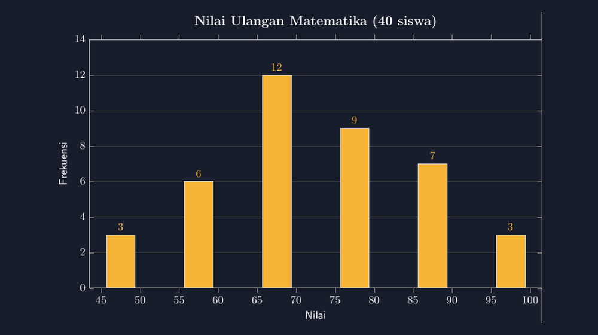

Ada satu momen di kelas VIII tahun lalu yang tidak bisa saya lupakan. Kami sedang membahas statistika, dan saya meminta siswa menggambar histogram dari data tinggi badan yang sudah dikelompokkan. Hasilnya? Tiga puluh siswa, tiga puluh bentuk histogram yang berbeda. Ada yang tinggi batangnya dibuat asal-asalan, ada yang lebar kelasnya berubah-ubah, dan ada satu siswa yang jujur berkata, "Pak, yang penting bentuknya naik-turun, kan?"

Kalimat itu menusuk. Karena di situlah saya sadar, soal di lembar kerja yang saya fotokopi tahun-tahun sebelumnya juga sering "tidak jujur": batang dengan frekuensi 8 digambar lebih tinggi daripada frekuensi 10, atau kelas interval yang lebarnya tidak seragam tapi tetap dipakai untuk membandingkan tinggi batang. Gambar statistik yang tidak jujur bukan sekadar jelek secara estetika — dia aktif menyesatkan.

<!--more-->

## Bedanya Histogram dengan Diagram Batang

Sebelum bicara kode, saya selalu koreksi satu miskonsepsi yang nyaris semua siswa alami: histogram bukan diagram batang biasa. Diagram batang menggambarkan data kategorikal — misalnya jumlah siswa per ekstrakurikuler. Batang-batangnya boleh diberi jarak, karena kategorinya tidak punya urutan atau jarak matematis.

Histogram menggambarkan data numerik yang dikelompokkan ke dalam kelas interval. Batangnya harus berdempetan, karena antara kelas 45–49 dan kelas 50–54 tidak ada celah — nilai 49,5 dan 50,1 sama-sama nyata dan harus punya "rumah". Lebar kelas harus seragam supaya tinggi batang bisa dibandingkan secara adil.

Ketika siswa paham ini, mereka mulai melihat kenapa histogram hasil gambar tangan yang asal sering berbohong. Dan di sinilah alat menggambar yang presisi bukan lagi soal kerapian, tapi soal kejujuran matematika.

## Data yang Saya Pakai

Untuk artikel ini saya pakai data nilai ulangan 40 siswa yang sudah dikelompokkan — kasus yang sangat khas di kelas saya:

| Kelas Interval | Titik Tengah | Frekuensi |
|---|---|---|
| 43–52 | 47,5 | 3 |
| 53–62 | 57,5 | 6 |
| 63–72 | 67,5 | 12 |
| 73–82 | 77,5 | 9 |
| 83–92 | 87,5 | 7 |
| 93–102 | 97,5 | 3 |

Sengaja saya buat sebarannya berbentuk lonceng yang agak condong: puncak di kelas 63–72 dengan 12 siswa, dan ekornya mengecil di kedua ujung. Kalau ada satu batang yang digambar tidak proporsional, mata yang terlatih akan langsung curiga.

Berikut hasil render TikZ-nya:



Perhatikan: batang berdempetan, lebar kelas seragam, dan label frekuensi muncul di atas tiap batang. Semua posisi dihitung dari data, bukan dihafal dari kebiasaan tangan.

## Kode Inti: ybar di pgfplots

Sebenarnya untuk histogram saya tidak menggambar tiap batang satu per satu dengan `\draw` — itu pekerjaan yang rentan tidak jujur, karena saya sendiri bisa salah menaksir tingginya. Saya serahkan pada `pgfplots`, yang menghitung skala sumbu otomatis dari data:

```latex
\begin{axis}[
  ybar=2pt, bar width=26pt,
  ymin=0, ymax=14,
  enlarge x limits=0.08,
  ymajorgrids=true,
  nodes near coords,
]
\addplot[fill=aksen] coordinates
{(47.5,3) (57.5,6) (67.5,12) (77.5,9) (87.5,7) (97.5,3)};
\end{axis}
```

Beberapa pilihan yang menurut saya penting:

- `ybar=2pt` memberi jarak tipis 2pt antar batang. Hmm, tunggu — bukankah histogram harus berdempetan penuh? Di praktik kelas SMP, saya memang memberi jarak sekecil ini supaya tiap batang tetap terbaca sebagai satu kelas, sambil tetap menjelaskan ke siswa bahwa histogram "murni" menempel tanpa jarak. Ini kompromi keterbacaan yang saya pilih sadar, dan layak didiskusikan dengan siswa.
- `nodes near coords` menuliskan frekuensi di atas batang. Untuk siswa yang sedang belajar membaca histogram, angka ini jembatan — nanti di latihan berikutnya saya hapus dan minta mereka membaca dari sumbu.
- `enlarge x limits=0.08` mencegah batang paling kiri dan paling kanan menempel tepi sumbu dan terpotong.

Satu hal yang sering ditanyakan rekan guru: kenapa koordinatnya 47,5, bukan 43? Karena yang saya plot adalah *titik tengah kelas* di sumbu horizontal, dan lebar batang (`bar width=26pt`) saya sesuaikan supaya batangnya kurang lebih menutupi rentang kelasnya. Kalau kelas intervalnya tidak seragam, pendekatan ini menyesatkan — dan untuk kasus itu saya pakai pendekatan berbeda dengan menggambar batang dari batas kelas eksplisit, yang akan saya bahas kalau ada kesempatan.

## Di Depan Kelas

Ada satu kebiasaan kecil yang saya ambil dari pengalaman ini: setiap kali saya membuat data latihan untuk histogram, saya menuliskan dulu tabel kelompoknya di kertas konsep, menghitung jumlah frekuensinya (harus sama dengan jumlah siswa yang mengerjakan — dulu pernah ada data latihan yang total frekuensinya 43 padahal siswanya 40, dan itu membingungkan siswa), baru mulai mengetik kode. Kode yang benar tidak bisa menyelamatkan data yang tidak konsisten. Pengalaman kecil itu juga mengingatkan saya bahwa presisi bukan urusan alat menggambar saja, tapi urusan seluruh rantai: dari data mentah, tabel kelompok, sampai gambar terakhir yang tampil di layar.

Cara saya memakai gambar ini di kelas sederhana. Gambar diproyeksikan, lalu saya tutup angka frekuensinya (cukup dengan tangan, atau versi tanpa `nodes near coords`). Tugas siswa: perkirakan frekuensi tiap batang dari sumbu vertikal, lalu bandingkan dengan data asli yang saya bagikan.

Pengalaman dua tahun terakhir menunjukkan siswa yang berlatih membaca gambar yang *proporsional* jauh lebih jarang salah membaca histogram di soal ujian. Mereka juga lebih peka ketika menemukan histogram "curang" di media sosial — dan di zaman infografis semata-mata, itu keterampilan literasi yang saya rasa jauh lebih berharga daripada hafal rumus mean.

Saya juga biasa menantang siswa: "Kalau satu siswa yang nilainya 68 tadi ternyata 71, batang mana yang berubah?" Pertanyaan kecil ini memaksa mereka berpikir tentang kelas interval sebagai wadah, bukan sekadar kotak berwarna.

## Penutup

Gambar statistik punya kekuatan persuasi yang besar, dan kekuatan itu tidak peduli gambarnya jujur atau tidak. Sebagai guru, saya merasa tanggung jawab saya dimulai dari gambar yang saya tunjukkan sendiri di kelas: kalau tinggi batangnya tidak sesuai data, maka tanpa sengaja saya sedang mengajarkan siswa bahwa gambar boleh bohong.

TikZ dengan pgfplots tidak membuat saya guru yang lebih pintar. Dia hanya membuat gambar saya jujur secara otomatis — dan itu sudah cukup untuk mengubah cara kelas saya membaca data.

> 📎 **Berkas TikZ lengkap:** [histogram-data-berkelompok.tex](tex/histogram-data-berkelompok.tex) — siap kompilasi (butuh paket `pgfplots`).
