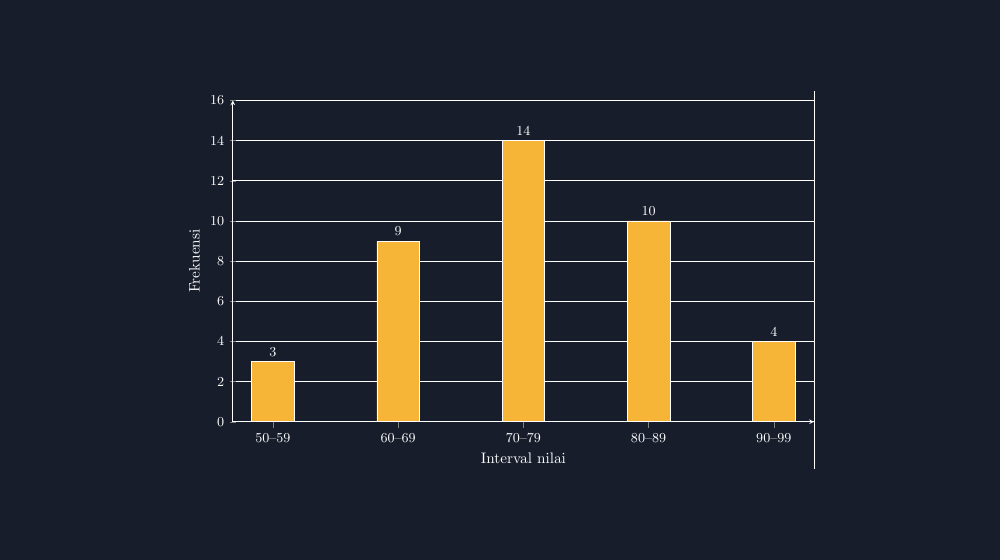

Ada satu momen setiap tahun ajaran yang sudah saya bisa hafal jalannya. Ketika kelas delapan masuk ke materi statistika — khususnya data berkelompok — dan saya minta mereka menggambar histogram dari tabel frekuensi, hampir selalu muncul gambar yang sama: lima batang berdiri dengan jarak renggang di antara mereka, persis seperti diagram batang biasa, hanya saja labelnya bukan kategori melainkan interval. Sisanya hanya soal estetika: diwarnai, diberi judul, dikumpulkan.

Dulu saya coret. "Ini histogram, bukan diagram batang," kata saya, lalu memberi contoh dari buku. Anak-anak mengubah gambar mereka, batangnya dirapatkan, dan selesai. Tahun berikutnya, miskonsepsi yang sama kembali. Batang-batang itu tetap renggang, seperti lantunan lagu yang tidak pernah benar-benar saya jelaskan kenapa harus berirama begitu.

Sampai suatu hari saya berhenti dan bertanya pada diri sendiri: apa yang sebenarnya *terlihat* dari histogram yang tidak bisa dilihat dari diagram batang biasa?

## Batang yang Menempel Punya Makna

Pertanyaan itu jawabannya sederhana, tapi jarang diucapkan dengan jelas di kelas. Pada diagram batang, sumbu mendatar berisi kategori — hari, jenis kelamin, minat. Kategori itu terpisah satu sama lain, tidak bersambung, jadi wajar batangnya juga terpisah. Tapi pada histogram, sumbu mendatar berisi **garis bilangan**. Interval 50–59 menyambung langsung ke 60–69; tidak ada jurang di antara angka 59 dan 60. Batang yang menempel adalah cara gambar itu mengatakan: "data ini bersambung, satu rentang menyambung ke rentang berikutnya."

Sejak saya sadar itu, saya berhenti menghukum gambar yang salah dan mulai menyuruh anak-anak *membaca* gambar mereka sendiri. "Kalau batangmu terpisah, apakah 59 terpisah dari 60?" Pertanyaan itu lebih panas daripada coretan merah di kertas. Ada anak yang menjawab "iya, beda kelompok," dan diskusi baru dimulai dari sana.

Tapi menjelaskan dengan papan tulis punya batas. Gambar histogram yang saya buat manual di kelas hampir selalu tidak konsisten: lebar batang tidak sama, jarak antar batang "kira-kira saja", sumbu tidak proporsional. Untuk materi yang intinya justru **konsistensi interval**, gambar yang asal-asalan adalah musuh dari materi itu sendiri.

## Membuat Gambar yang Tidak Berbohong

Karena itu saya berhenti menggambar histogram dengan tangan dan mulai memakai TikZ. Hasilnya seperti ini:


*Histogram nilai ulangan 40 siswa. Batang menempel karena intervalnya bersambung; frekuensi tertinggi ada di interval 70–79.*

Yang saya suka dari gambar seperti ini bukan keindahannya — meskipun untuk standar papan tulis saya, ini mewah — tapi kejujurannya. Lebar setiap batang sama persis, karena lebar setiap interval memang sama ($50\text{--}59$, $60\text{--}69$, dan seterusnya masing-masing menjangkau sepuluh nilai). Batangnya menempel, karena 59 dan 60 bertetangga di garis bilangan. Kalau suatu hari saya mengajarkan data berkelompok dengan interval tidak sama — misalnya 50–59, 60–64, 65–69 — maka gambar TikZ yang sama akan memaksa saya (dan siswa) memperlebar atau mempersempit batang sesuai lebar intervalnya. Gambar tidak bisa berkata dua.

Inti kode TikZ-nya sebenarnya pendek. Yang paling menentukan adalah `symbolic x coords` untuk label interval dan `bar width` yang menentukan seberapa lebar tiap batang:

```latex
\begin{axis}[
    ybar, bar width=28pt,
    symbolic x coords={a,b,c,d,e},
    xticklabels={50--59,60--69,70--79,80--89,90--99},
    ymin=0, ymax=16,
]
\addplot coordinates {(a,3) (b,9) (c,14) (d,10) (e,4)};
\end{axis}
```

Potongan kecil ini cukup untuk menghasilkan seluruh histogram di atas. Sisanya hanya mempercantik: warna, grid, label sumbu.

> 📎 **Berkas TikZ lengkap:** [tikz-histogram-data-berkelompok.tex](tex/tikz-histogram-data-berkelompok.tex) — siap kompilasi (butuh paket `pgfplots`).

## Ketika Batang Hilang dan Saya Belajar Sesuatu

Saya cerita jujur: versi pertama gambar untuk artikel ini gagal. Saya menulis `ybar=0pt` dengan koordinat simbolik, dan hasilnya sumbu muncul, grid muncul, label muncul — tapi batangnya menghilang seluruhnya. Setengah jam saya menatap log kompilasi sebelum sadar masalahnya ada pada kombinasi opsi yang saya pakai.

Lucunya, kegagalan ini justru jadi bahan refleksi untuk kelas. Ketika saya ceritakan ke siswa bahwa "Pak juga belajar dari gambar yang gagal," mereka tertawa, tapi ada yang mengangkat tangan dan bilang dia pernah mengalami hal serupa dengan aplikasi pengolah angka — grafiknya muncul tapi kosong karena dia salah memblok rentang data. Pengalaman gagal itu jembatan yang lebih baik daripada contoh sempurna yang seolah jatuh dari langit.

Saya jadi teringat artikel saya sebelumnya tentang [diagram batang](/tikz-statistika-diagram-batang/) dan [boxplot](/tikz-statistika-boxplot/). Ketiganya bagian dari satu cerita yang sama: statistika bukan sekadar menghitung, tapi menyajikan data dengan jujur. Histogram menambahkan satu ide yang tidak ada di diagram batang — bahwa data bisa *dikelompokkan*, dan pengelompokan itu sendiri adalah keputusan yang berdampak.

## Keputusan yang Tersembunyi di Balik Tabel

Dampak itu sering luput. Kalau saya mengubah interval dari 50–59 menjadi 50–54 dan 55–59, bentuk histogramnya bisa berubah total: puncak yang tadinya satu bisa jadi dua, atau sebaliknya. Anak-anak biasanya melihat histogram sebagai sesuatu yang "ada begitu saja" dari data. Padahal ada tangan manusia yang memilih lebar interval, dan pilihan itu menentukan cerita apa yang terbaca dari gambar.

Materi lanjutan yang biasanya saya lewatkan sekilas, dan belakangan saya sesali, adalah *frekuensi relatif* dan histogram berpersen. Tapi itu cerita lain. Untuk satu pertemuan pertama, cukup satu pesan yang ingin saya tanam:

**Histogram bukan diagram batang yang digabung paksa. Histogram adalah gambar dari garis bilangan yang dibagi-bagi.**

Setelah anak-anak bisa mengatakan kalimat itu dengan bahasa mereka sendiri — ada yang bilang "batangnya nyambung karena nilainya nyambung, Pak" — saya tahu materi itu sudah masuk. Selebihnya, gambar TikZ tinggal membantu mereka melihat apa yang sudah mereka pahami.

Dan entah kenapa, sejak batang-batang itu menempel, suara kelas saat diskusi statistika terdengar lebih hidup. Mungkin karena gambar yang jujur membuat pertanyaan yang jujur lebih mudah muncul.

## Anak yang Mengerjakan, dan Anak yang Menyalin

Ada satu hal kecil yang saya perhatikan sejak memakai gambar TikZ untuk bahan ajar: anak-anak menyalin gambar dari LKPD saya dengan lebih sungguh-sungguh. Ketika histogram yang mereka lihat rapi dan proporsional, gambar tiruan mereka cenderung ikut rapi. Gambar yang baik rupanya menular, sama seperti tulisan tangan guru di papan yang rapi membuat papan tulis kelas jarang kotor sembarangan.

Tapi yang paling penting bukan itu. Yang paling penting, gambar yang konsisten membebaskan saya dari debu yang tidak perlu. Saya tidak perlu lagi menghabiskan waktu menggambar ulang di kelas sambil meminta anak-anak menunggu. Waktu itu saya pakai untuk hal yang lebih mahal: mengajukan pertanyaan, memancing selisih pendapat, mendengarkan alasan anak yang keliru tapi masuk akal.

Karena pada akhirnya, statistika di kelas delapan bukan tentang menghafal istilah "interval kelas" atau "frekuensi". Ia tentang melihat sekumpulan angka kacau — empat puluh nilai ulangan yang tidak berpola — lalu mengaturnya menjadi bentuk yang bisa dibaca dan bisa diceritakan. Histogram adalah bentuk paling awal dari kecakapan itu. Dan seperti semua bentuk pertama, ia layak diperkenalkan dengan gambar yang tidak berbohong.

