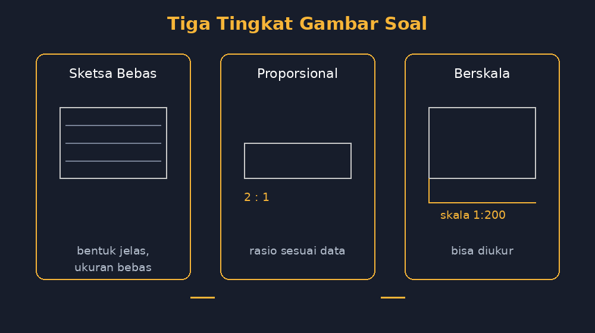

Minggu lalu saya membagikan lembar latihan soal cerita untuk kelas VII. Salah satu soalnya tentang tandon air: "Sebuah tandon berbentuk balok dengan panjang 2 meter, lebar 1 meter, dan tinggi 1,5 meter..." Di samping soal itu saya mencantumkan sketsa tandon — kebiasaan yang saya mulai sejak merasa soal cerita murni teks terlalu kejam untuk sebagian siswa.

Besoknya, seorang siswa mengangkat tangan dan bertanya, "Pak, di gambar tandonnya kelihatan lebih tinggi daripada lebar. Terus yang dua meter itu yang mana?" Saya lihat lembar soalnya. Benar. Sketsa yang saya buat asal-asalan — tandon digambar tinggi dan kurus, padahal panjangnya 2 meter dan tingginya hanya 1,5 meter. Gambar itu mengelabui. Bukan sengaja, tapi tetap saja mengelabui.

<!--more-->

## Gambar Samping Soal Sering Dianggap Hiasan

Kita para guru sering memandang gambar di samping soal sebagai hiasan. Yang penting datanya lengkap di kalimat, gambar cuma "biar tidak polos". Padahal bagi siswa, gambar sering dibaca **lebih dulu** daripada teksnya. Sebelum membaca kalimat, mata mereka sudah menangkap bentuk: tinggi atau lebar, besar atau kecil, berapa kira-kira perbandingannya.

Kalau gambar itu bertentangan dengan data di teks, siswa menghadapi konflik kecil yang melelahkan. Sebagian mempercayai gambar dan salah menetapkan mana yang mana. Sebagian lagi mempercayai teks tapi mulai curiga pada semua gambar — dan itu juga rugi, karena gambar yang baik justru salah satu penopang pemahaman soal cerita.

Sejak kejadian tandon itu, saya menerapkan prinsip sederhana: **gambar soal harus jujur pada ukuran dan informasinya**. Kalau di soal panjang 2 meter dan tinggi 1,5 meter, gambar harus memperlihatkan bahwa panjang memang lebih besar dari tinggi. Tidak perlu presisi sampai milimeter — tapi relasinya tidak boleh bohong.

## Kenapa TikZ?

Menggambar tangan di Word atau aplikasi gambar biasa bekerja, tapi ada dua masalah. Pertama, konsistensi: setiap kali saya memperbaiki soal, gambar harus diedit ulang dan sering kali tidak pernah diedit ulang. Kedua, proporsi: tangan saya tidak terlatih menjaga rasio 2 : 1,5 tetap 2 : 1,5.

TikZ menyelesaikan keduanya karena gambar **ditulis sebagai koordinat**. Kalau saya tulis tandon dengan panjang 4 cm dan tinggi 3 cm di kode, maka rasionya memang 4 : 3 — persis mengikuti data soal 2 meter : 1,5 meter. Ketika data soal berubah, saya tinggal mengubah satu angka di kode dan gambar mengikuti.

Ini kode tandon yang saya pakai sekarang:

```latex
\begin{tikzpicture}[scale=1]
  % tandon: panjang 4cm, lebar 2cm, tinggi 3cm (rasio 2 : 1 : 1,5)
  \draw[thick,fill=blue!10] (0,0) -- (4,0) -- (4,3) -- (0,3) -- cycle;
  \draw[thick] (0,3) -- (0.7,3.7) -- (4.7,3.7) -- (4,3);
  \draw[thick] (4,0) -- (4.7,0.7) -- (4.7,3.7);
  \draw[<->] (0,-0.4) -- (4,-0.4) node[midway, below] {$2$ m};
  \draw[<->] (-0.5,0) -- (-0.5,3) node[midway, left] {$1{,}5$ m};
\end{tikzpicture}
```

Perhatikan bahwa panjang digambar 4 cm dan tinggi 3 cm — dikali dua dari data soal supaya gambarnya cukup besar, tapi **rasionya tetap** 2 : 1,5. Anak panah ukuran juga ikut ditaruh, jadi siswa tidak perlu menebak.

## Level Ketelitian yang Berbeda untuk Tujuan yang Berbeda

Seiring waktu, saya menyadari bahwa "jujur" pada gambar soal punya beberapa tingkat. Tidak semua soal butuh gambar yang presisi penuh; yang penting kita sadar sedang berada di tingkat yang mana.



*Tiga tingkat gambar soal — dari kiri: sketsa bebas (hanya untuk soal tanpa data geometris), gambar proporsional (rasio sesuai data, tanpa skala tetap), dan gambar berskala (bisa diukur langsung dari kertas).*

**Tingkat pertama: sketsa bebas.** Untuk soal yang tidak melibatkan ukuran — misalnya soal cerita tentang jumlah buku di rak — bentuk gambar tidak menjanjikan apa pun, jadi boleh asal jelas. Di sini gambar hanya membantu siswa membayangkan situasi.

**Tingkat kedua: gambar proporsional.** Ini tingkat yang paling sering saya butuhkan, termasuk soal tandon tadi. Ukuran absolut tidak penting (tidak ada yang mengukur gambar dengan penggaris), tapi perbandingan antar bagian harus sesuai data. 2 : 1,5 tidak boleh terlihat seperti 1 : 2.

**Tingkat ketiga: gambar berskala.** Untuk soal skala peta atau denah, gambar bahkan boleh *diukur* siswa sebagai strategi pengecekan jawaban. Di sini TikZ unggul total: skala yang saya tulis di kode benar-benar terwujud di kertas.

Masalahnya, soal tandon saya dulu terjebak di antara tingkat: terlihat seperti gambar proporsional (ada ukuran di teksnya), tapi digambar dengan kebebasan sketsa. Itu daerah paling berbahaya.

## Ketika Gambar Justru Menjadi Bagian dari Soal

Setelah kebiasaan ini jalan, saya mulai bereksperimen: bagaimana kalau gambar tidak sekadar menolong, tapi jadi materi pengajaran itu sendiri?

Untuk materi perbandingan dan skala (kelas VII), saya membuat lembar soal yang gambarnya sengaja berskala. Satu soalnya begini: "Perhatikan denah kelas berikut. Panjang kelas sebenarnya 8 meter. Tentukan skala denah dan lebar kelas sebenarnya." Denahnya saya gambar dengan TikZ pada skala 1 : 200, jadi kelas 8 meter muncul sebagai persegi panjang 4 cm di kertas. Siswa yang penggarisnya jujur bisa menemukan jawabannya dengan mengukur — dan menakar hasil ukur itu sendiri sudah latihan numerasi.

```latex
\begin{tikzpicture}[scale=1]
  % denah kelas, skala 1:200 -> 8 m = 4 cm, 6 m = 3 cm
  \draw[thick,fill=yellow!20] (0,0) rectangle (4,3);
  \draw (0.5,2.5) node {papan tulis};
  \draw[<->] (0,-0.4) -- (4,-0.4) node[midway, below] {$?$};
  \draw[<->] (-0.5,0) -- (-0.5,3) node[midway, left] {$8$ m};
\end{tikzpicture}
```

Yang menarik: siswa tidak tahu gambarnya berskala. Mereka mengukur, menemukan 4 cm, lalu mulai berpikir — "4 cm mewakili 8 meter, berarti 1 cm mewakili 2 meter..." Konsep skala yang biasanya diajarkan lewat peta yang tidak bisa mereka verifikasi, kini bisa dicek langsung di tangan mereka sendiri. Gambar yang jujur secara teknis ternyata membuka pintu pengalaman belajar yang tidak bisa diberikan oleh teks saja.

## Rasa Aman Itu Terabaikan Sampai Rusak

Saya jadi berpikir: seberapa sering kita menyodorkan detail yang tidak kita periksa sendiri? Gambar soal adalah salah satunya, karena dia bekerja diam-diam. Tidak ada siswa yang protes "Pak, gambar ini tidak proporsional!" — mereka cuma diam-diam bingung, atau lebih buruk, diam-diam belajar dari gambar yang keliru.

Membuat gambar dengan TikZ memaksa saya memeriksa diri. Untuk menulis koordinat, saya harus memutuskan: berapa panjang, berapa tinggi, rasionya apa. Keputusan itu tidak bisa dihindari seperti saat menggambar bebas. Dalam arti tertentu, TikZ adalah alat yang membuat kecerobohan jadi sulit.

Bukan berarti semua guru harus pindah ke LaTeX besok juga. Tapi kalau Bapak/Ibu pernah mencurigai gambar soal sendiri — atau pernah ditanya siswa seperti saya ditanya tentang tandon itu — mungkin mulailah dari satu kebiasaan kecil: sebelum mencetak lembar soal, **ukurlah gambar sendiri dengan penggaris**. Kalau rasionya tidak sesuai data, itu tanda gambar perlu diperbaiki. TikZ hanyalah salah satu jalan untuk sampai ke sana; yang penting adalah kesediaan untuk memeriksa.

Soal yang baik itu jujur sampai ke pinggirannya — termasuk ke gambar kecil di sampingnya yang sering kita anggap cuma hiasan.

> 📎 **Berkas TikZ lengkap:** [tikz-ilustrasi-soal-cerita.tex](tex/tikz-ilustrasi-soal-cerita.tex) — siap kompilasi (butuh paket `tikz`).
