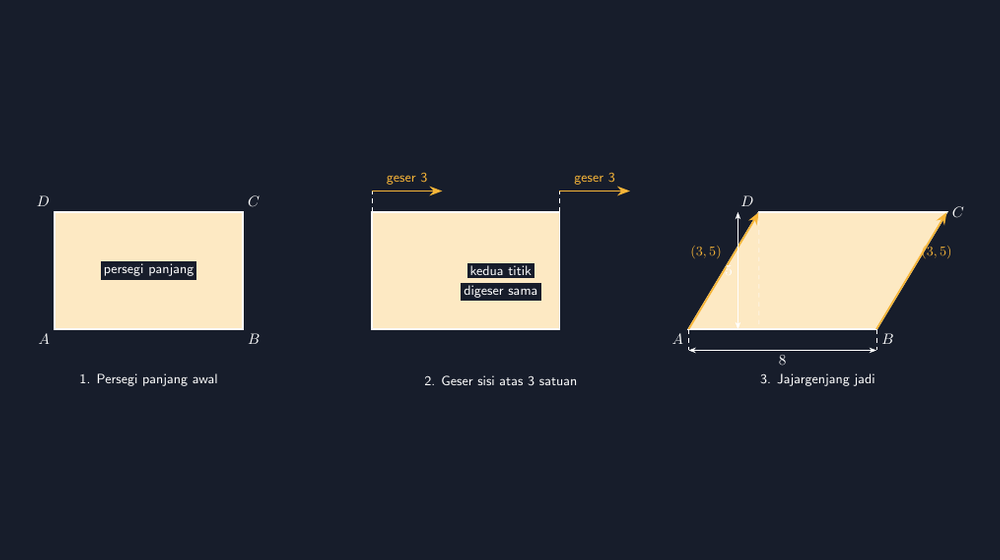

Minggu lalu saya mengajar luas jajargenjang di kelas VII. Seperti biasa, saya buka dengan pertanyaan: "Kalau jajargenjang ini dipotong sedikit di kiri dan ditempel di kanan, jadi bangun apa?" Anak-anak menjawab serempak, "Persegi panjang, Pak!" Bagus, konsep luasnya sampai.

Lalu saya menunjukkan gambar jajargenjang di lembar soal yang saya buat sendiri. Seorang siswa, saya sebut Nadia, mengukurnya dengan penggaris. "Pak, sisi kiri dan kanannya beda panjang. Yang atas 5 cm, yang bawah 6 cm. Terus kok disebut jajargenjang?"

Saya mengambil gambar itu dan mengukur sendiri. Nadia benar. Sisi kiri yang saya gambar miring agak landai, sisi kanan miring agak tegak. Panjangnya memang tidak sama. Di pikiran saya kedua sisi itu "sejajar dan sama panjang" karena memang niatnya begitu — tapi tangan saya yang menggambar dengan mata saja, tanpa koordinat, berbohong. Bangun itu bukan jajargenjang; dia cuma segiempat yang mirip.

<!--more-->

## Kenapa Jajargenjang Paling Sering "Gagal Diam-diam"

Trapesium saja sudah sulit digambar tangan — pernah saya ceritakan di artikel sebelumnya. Tapi trapesium punya satu keistimewaan yang menyelamatkannya: cukup satu pasang sisi yang benar-benar sejajar, dia sah. Jajargenjang tidak punya belas kasihan seperti itu. Syaratnya lebih ketat: **dua pasang** sisi harus sejajar, dan otomatis pasangan sejajar itu harus sama panjang pula.

Artinya, untuk menggambar jajargenjang yang jujur, ada dua "janji" yang harus ditepati sekaligus:

1. Sisi atas sejajar sisi bawah (keduanya punya kemiringan yang persis sama).
2. Sisi kiri sejajar sisi kanan — dan keduanya sama panjang.

Kalau saya menggambar bebas di pengolah kata, janji kedua inilah yang paling sering gagal. Mata saya mudah cocokkan arah kemiringan, tapi sulit cocokkan panjang. Hasilnya bangun yang terlihat hampir benar — dan justru yang hampir benar itu paling berbahaya, karena siswa tidak akan protes. Mereka hanya diam-diam menyimpulkan bahwa "jajargenjang itu sisi-sisinya kira-kira sama saja."

Kesimpulan keliru seperti itu tidak pernah muncul kalau siswa mengukur sendiri seperti Nadia. Makanya saya makin yakin: gambar soal matematika sebaiknya lahir dari koordinat, bukan dari tangan yang mengira-ngira.

## Satu Titik Perpindahan yang Menentukan Segalanya

Cara paling sederhana menggambar jajargenjang yang jujur adalah berpikir seperti cara kita menjelaskan luasnya: mulai dari persegi panjang, lalu geser satu sisi.

Misalnya saya punya persegi panjang dengan titik sudut di $A(0,0)$, $B(8,0)$, $C(8,5)$, dan $D(0,5)$. Untuk mengubahnya menjadi jajargenjang, saya geser titik $D$ dan $C$ sejauh 3 satuan ke kanan — dua-duanya, dengan jarak yang sama:

$$A(0,0), \quad B(8,0), \quad C(11,5), \quad D(3,5)$$

Perhatikan apa yang terjadi. Sisi bawah $AB$ tetap sepanjang 8. Sisi atas $DC$ juga sepanjang $11-3=8$. Sisi kiri $AD$ dan sisi kanan $BC$ keduanya punya kemiringan yang sama — naik 5, maju 3 — sehingga otomatis sama panjang dan sejajar. Semua janji terpenuhi bukan karena kehati-hatian tangan, tapi karena matematikanya memang begitu.

Bahkan sebelum menggambar, saya sudah bisa menghitung semua yang penting:

- Panjang sisi alas: $AB = 8$
- Tinggi jajargenjang: $t = 5$ (jarak vertikal antara dua sisi sejajar)
- Luas: $L = 8 \times 5 = 40$, persis luas persegi panjang asalnya.

Inilah bagian yang paling saya sukai. Konsep "potong kiri, tempel kanan" yang saya tanyakan di awal pelajaran itu secara teknis persis operasi menggeser titik ini. Gambar TikZ dan penjelasan luas akhirnya bercerita hal yang sama, bukan dua bahasa berbeda.


*Dari kiri ke kanan: persegi panjang asal, menggeser sisi atas 3 satuan ke kanan, dan jajargenjang final. Sisi miring kiri dan kanan identik karena keduanya digambar dari vektor yang sama, $(3,5)$.*

## Kode TikZ-nya

Inti gambar di atas hanya butuh koordinat dan satu perulangan kecil. Ini versi yang saya gunakan untuk panel ketiga:

```latex
\begin{tikzpicture}[scale=0.6]
  % titik sudut jajargenjang
  \coordinate (A) at (0,0);
  \coordinate (B) at (8,0);
  \coordinate (C) at (11,5);
  \coordinate (D) at (3,5);

  \fill[accent!25] (A) -- (B) -- (C) -- (D) -- cycle;
  \draw[very thick] (A) -- (B) -- (C) -- (D) -- cycle;

  % penanda vektor pergeseran pada sisi miring
  \draw[->, thick] (A) -- (D) node[midway, above left] {$(3,5)$};
  \draw[->, thick] (B) -- (C) node[midway, above right] {$(3,5)$};

  % label titik
  \node[below left] at (A) {$A$};
  \node[below right] at (B) {$B$};
  \node[right] at (C) {$C$};
  \node[above left] at (D) {$D$};

  % panjang alas
  \draw[<->] (0,-0.8) -- (8,-0.8) node[midway, below] {$8$};
  \draw[dashed] (0,0) -- (0,-0.8);
  \draw[dashed] (8,0) -- (8,-0.8);
\end{tikzpicture}
```

Yang membuat gambar ini bisa dipercaya bukan keahlian khusus, hanya satu kebiasaan: kedua sisi miring digambar dari **vektor yang sama**, $(3,5)$. Saya tidak pernah menggambar sisi kanan secara terpisah dari sisi kiri. Dari satu vektor yang sama, kesamaan panjang dan kesejajaran datang gratis — tidak mungkin tidak sama, karena memang hanya ada satu sisi miring di kode, dipakai dua kali.

Kebiasaan ini juga bagus diajarkan ke siswa yang mulai belajar GeoGebra atau yang penasaran dengan pemrograman gambar. Pesannya bukan "pakai software ini", tapi: kalau suatu sifat geometri itu penting, jangan digambar — *konstruksilah*. Biarkan sifat itu muncul dari definisi, bukan dari keberuntungan.

## Di Kelas: Membandingkan Gambar yang Jujur dan yang Tidak

Minggu ini saya mencoba hal kecil yang hasilnya menyenangkan. Setelah jajargenjang TikZ itu saya tampilkan, saya juga tampilkan gambar lama saya yang "gagal diam-diam" dulu — yang sisi kirinya 5 cm dan kanannya 6 cm. Saya minta siswa mencari tiga bedanya dengan penggaris.

Ternyata latihan mengukur ini jauh lebih hidup daripada sekadar mencocokkan sifat bangun di buku. Mereka menemukan sendiri: alasnya sama saja, tingginya sama, tapi satu pasang sisi miringnya tidak kembar. Lalu saya tanyakan, "Kalau sisi miringnya tidak sama, masih boleh disebut jajargenjang tidak?" Debat kecil pun terjadi, dan definisi jajargenjang akhirnya mereka rumuskan sendiri dengan kalimat masing-masing.

Saya jadi teringat prinsip yang makin lama makin mengakar di kepala saya: gambar dalam matematika itu bukan hiasan. Dia adalah bagian dari argumen. Gambar yang salah diam-diam mengajarkan sesuatu yang salah, bahkan ketika soal dan jawabannya benar semua.

> 📎 **Berkas TikZ lengkap:** [tikz-jajargenjang.tex](tex/tikz-jajargenjang.tex) — siap kompilasi (butuh paket `tikz`).

## Penutup

Jajargenjang adalah bangun yang sederhana, tapi justru kesederhanaannya yang membuat saya lalai — merasa cukup menggambar dengan mata. Nadia dan penggarisnya memberi saya pelajaran kecil yang saya bawa sampai sekarang: setiap kali saya menggambar bangun yang punya sifat khusus, saya wajib memastikan sifat itu benar-benar ada di gambar, bukan hanya di niat.

Dengan TikZ, pemastian itu cuma butuh satu kebiasaan: gambar sekali, pakai berulang. Satu vektor $(3,5)$, dua sisi miring yang tak mungkin berbeda. Dan dua garis yang tak pernah bertemu — itulah janji paling dasar dari sebuah jajargenjang, yang sekarang selalu saya tepati di kertas sebelum saya minta siswa mempercayainya.
