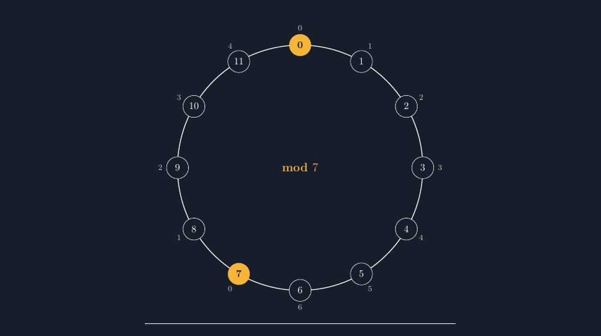

Materi aritmetika modulo masuk ke kelas saya lewat pintu yang tidak saya rencanakan. Bulan lalu, saat membahas hari dalam kalender, seorang siswa bertanya, "Pak, kalau hari ini Rabu, seratus hari lagi hari apa?" Sebagian anak mulai menghitung dengan jari di atas meja, sebagian lagi langsung membuka kalkulator dan mencoba membagi seratus dengan tujuh. Jawaban yang sama, dua jalan yang berbeda. Dan di titik itu saya sadar bahwa mereka sedang melakukan aritmetika modulo tanpa pernah diberi nama: $100 \div 7 = 14$ sisa $2$, jadi seratus hari lagi adalah dua hari setelah Rabu, yaitu Jumat.

<!--more-->

## Sisa yang Biasanya Dihafal

Di buku, aritmetika modulo biasanya muncul sebagai definisi: $a \bmod b$ adalah sisa pembagian $a$ oleh $b$. Lalu contoh: $17 \bmod 5 = 2$, karena $17 = 3 \times 5 + 2$. Sampai di sini, siswa yang tekun akan mencatat, dan siswa yang cepat akan menganggap ini cuma "sisa pembagian yang dikasih nama baru". Masalahnya, kalau modulo berhenti sebagai prosedur bagi sisa, siswa tidak pernah melihat sifat yang membuatnya berguna: bahwa bilangan-bilangan itu berputar dalam kelompok, dan bahwa angka $7$, $14$, dan $21$ semuanya jatuh di tempat yang sama.

Di kelas saya, kebiasaan buruk yang paling sering muncul adalah siswa menjawab sisa dengan menebak dari pilihan yang tersedia. Saat ulangan berisi soal seperti "$23 \bmod 4 = \ldots$" dengan pilihan 2, 3, 5, dan 7, banyak yang memilih 3 bukan karena perhitungannya, tapi karena mereka ingat soal serupa sebelumnya punya jawaban 3. Prosedur yang tidak dipahami asal-usulnya mudah sekali bergeser menjadi tebakan yang percaya diri.

## Menggambar Waktu yang Berputar

Cara yang saya pakai untuk membuat sisa itu terlihat adalah mengubah pertanyaannya: alih-alih membagi, kita berjalan mengelilingi lingkaran. Lingkaran jam biasa punya dua belas angka, dan jarum yang maju tiga belas kali berhenti di angka 1 — karena $13 \bmod 12 = 1$. Semua siswa paham ini secara intuitif; mereka hanya belum pernah diminta menyebutnya "modulo".

Untuk jam modulo 7, saya gambar lingkaran dengan dua belas titik (supaya sifat berulangnya kelihatan lebih jelas daripada tujuh titik saja), lalu di setiap titik saya tulis sisa pembagian nomornya oleh 7:

$$0 \bmod 7 = 0,\quad 1 \bmod 7 = 1,\quad \ldots,\quad 7 \bmod 7 = 0,\quad 8 \bmod 7 = 1,\quad \ldots$$

Hasilnya seperti gambar di bawah ini — dan di kelas, gambar ini yang paling sering membuat anak-anak diam sebentar sebelum akhirnya berkomentar.


*Jam modulo 7: dua belas titik, masing-masing diberi label sisa bagi 7. Titik 0 dan 7 disorot karena keduanya bersisa 0 — lingkaran sudah kembali ke awal.*

Reaksi yang paling berharga datang dari siswa yang melihat titik 0 dan titik 7 sama-sama disorot. "Pak, kok 7-nya balik ke 0?" Persis. Itulah inti modulo: setelah melewati $6$, bilangan berikutnya bukan lanjut ke $7$, $8$, dan seterusnya, tapi kembali ke $0$. Lingkaran membuat perputaran itu terlihat; di garis bilangan biasa, perputaran itu tersembunyi di balik tanda titik-titik yang tidak pernah berhenti.

Inti kode TikZ-nya sederhana. Setiap titik dihitung dari sudutnya, lalu labelnya dihitung dengan fungsi `mod` yang sudah tersedia di dalam `\pgfmath`:

```latex
\foreach \i in {0,...,11} {
  \pgfmathsetmacro{\ang}{90 - \i*30}
  \pgfmathtruncatemacro{\sisa}{mod(\i,7)}
  \node[circle] at (\ang:\R) {\i};
  \node[gray] at (\ang:\R+0.45) {\sisa};
}
```

Yang saya suka dari kode ini justru baris `\pgfmathtruncatemacro{\sisa}{mod(\i,7)}`: saya tidak menghitung sisa-sisa itu dengan tangan lalu mengetikkannya satu per satu. Sisa yang tampil di gambar dihitung oleh mesin, dengan definisi yang sama persis dengan yang saya ajarkan. Kalau besok saya ganti menjadi modulo 5, saya cukup mengubah satu angka, dan gambar langsung jujur pada definisi barunya. Ini kejujuran kecil yang selalu saya incar dalam setiap gambar soal: angka di gambar berasal dari aturan yang sama dengan angka di jawaban.

## Dari Jam ke Pertanyaan yang Lebih Besar

Setelah gambar jam ini masuk, kelas berubah arah dengan sendirinya. Pertanyaan seratus hari tadi bisa dijawab dengan berjalan di lingkaran: dari 0, melangkah 100 kali, dan setiap tujuh langkah kita kembali ke tempat semula. Yang penting hanya sisa langkahnya: $100 \bmod 7 = 2$, jadi kita berhenti di angka 2.

Dari sini, siswa yang penasaran mulai mengajukan pertanyaan yang biasanya tidak muncul di materi sisa pembagian. Salah satu anak bertanya, "Kalau nomornya 1000, cukup kali nggak jalan kelilingnya?" Pertanyaan itu membawa kami ke sifat yang lebih dalam: $1000 \bmod 7$ bisa dihitung tanpa membagi 1000 langsung, karena $1000 = 7 \times 142 + 6$ — dan di lingkaran, itu berarti enam langkah dari titik nol. Beberapa kelompok mencoba menghitung dengan "memecah" angka besar menjadi potongan tujuh-tujuhan, dan menemukan sendiri bahwa sisa dari jumlah sama dengan menjumlahkan sisa-sisanya lalu mengambil sisa lagi. Saya tidak menulis sifat itu di papan sebagai teorema; mereka menemukannya karena gambarnya memancing.

Ada juga diskusi singkat tentang kenapa jam digital pakai modulo 60 untuk menit, dan kenapa hari dalam seminggu "kembali lagi" setiap tujuh hari. Konteks sehari-hari seperti ini membuat siswa sadar bahwa perputaran bukan trik matematika, tapi cara dunia bekerja.

## Apa yang Saya Catat dari Sesi Ini

Tiga hal yang saya ambil dari pengalaman ini. Pertama, materi yang tampak "tinggal definisi dan contoh" biasanya hanya butuh satu gambar yang tepat untuk berubah menjadi materi yang bisa didiskusikan. Modulo di garis bilangan terlihat seperti prosedur; modulo di lingkaran terlihat seperti peristiwa.

Kedua, TikZ di sini bukan sekadar penggambar rapi. Fungsi `mod()` di dalam kode membuat gambar dan konsep berbagi definisi yang sama — dan itu penting saat siswa mengawasi konsistensi apa yang saya tampilkan. Rizky dulu pernah menangkap ketidakjujuran kecil di diagram piktogram; anak-anak memang mengawasi.

Ketiga, jangan buru-buru menamai semuanya. Di sesi itu saya baru menyebut kata "modulo" setelah siswa sendiri mengalami perputarannya di lingkaran. Nama yang datang setelah pengalaman terasa seperti hadiah; nama yang datang sebelum pengalaman terasa seperti tembok.

Kalau Bapak/Ibu ingin mencoba, mulailah dari pertanyaan kalender seperti milik saya: hari apa seratus hari lagi? Biarkan siswa menghitung dengan cara mereka dulu — dengan jari, dengan kalkulator, dengan tebakan — lalu tunjukkan jam modulo dan lihat mana yang akhirnya sadar bahwa dirinya sudah lama berhitung sisa.

> 📎 **Berkas TikZ lengkap:** [tikz-jam-modulo.tex](tex/tikz-jam-modulo.tex) — siap kompilasi (butuh paket `tikz`).
