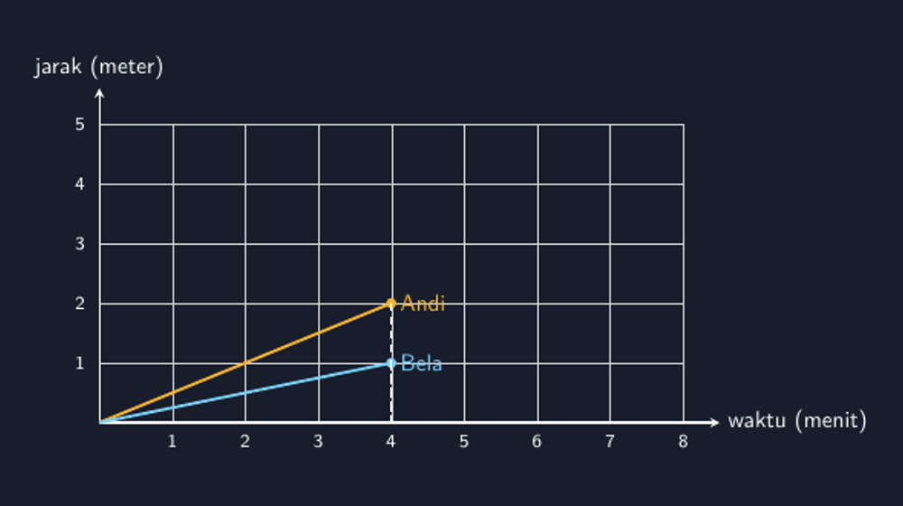

Ada satu soal yang hampir pasti muncul setiap kali kita membahas gerak lurus atau perbandingan: dua anak berangkat dari rumah yang sama menuju sekolah, satu berjalan cepat, satu berjalan lambat, lalu siswa diminta membaca grafik jarak-waktunya. Soal itu sederhana. Tetapi gambar pendampingnya sering tidak.

Saya masih ingat lembar kerja tahun lalu. Grafiknya saya buat buru-buru di pengolah kata: dua garis naik dari titik yang sama, yang satu agak curam, yang satu agak landai. Masalahnya, "agak curam" itu tidak punya makna angka. Garis anak yang "cepat" ternyata sampai di titik yang tidak pas dengan skala mana pun, dan siswa yang teliti langsung bingung. "Bu, kalau Andi sudah jalan empat menit, jaraknya kok tidak kena garis kotaknya?" Saya tidak bisa menjawab selain, "Iya, gambar Bapak kurang pas." Menyenangkan mengakuinya, tetapi memalukan.

Grafik jarak-waktu itu sebenarnya janji. Setiap titik di garis menjanjikan pasangan angka yang konsisten: di menit ke-empat, jaraknya memang sekian. Kalau gambar kita melanggar janjinya sendiri, siswa belajar hal yang salah tanpa sadar. Mereka belajar bahwa grafik itu hiasan, bukan peta. Dari situlah saya memutuskan menggambar ulang grafik-grafik ini dengan TikZ, seperti sudah saya lakukan untuk bidang koordinat dan grafik fungsi kuadrat di tulisan-tulisan sebelumnya.

<!--more-->

## Kecepatan yang Menjadi Kemiringan

Hal yang paling saya sukai dari grafik jarak-waktu adalah diam-diam ia menyimpan konsep yang sama dengan gradien garis yang kita ajarkan di aljabar. Kalau Andi menempuh 50 meter setiap menit, garis perjalanannya naik 50 setiap bergeser 1 ke kanan. Gradiennya memang 50:

$$v = \frac{\Delta s}{\Delta t}$$

Kecepatan dan gradien itu orang yang sama dengan dua nama. Sayangnya, di buku siswa keduanya sering diperkenalkan di bab yang berjauhan, sehingga siswa tidak pernah diajak melihat bahwa $v = 50$ m/menit berarti garisnya naik 50 unit untuk setiap 1 menit. Ketika saya mulai menggambar grafik yang jujur secara skala, koneksi ini baru terasa. Saya bisa menunjuk titik di menit keempat dan bertanya, "kenapa garis Andi lebih tinggi di sini?" dan jawabannya bukan "karena Andi cepat" yang mengambang, melainkan hitungan yang bisa dicek: $4 \times 50 = 200$.

Dua garis berikut adalah Andi dengan laju 50 meter per menit dan Bela dengan laju 25 meter per menit, keduanya berangkat dari rumah di titik nol:



Gambar ini saya buat dengan kode TikZ yang relatif ringkas. Yang penting di sini bukan kerumitan kodenya, melainkan kesetiaannya: setiap titik yang saya klaim di soal benar-benar jatuh pada perpotongan garis kisi.

## Kode yang Setia pada Skala

Bagian inti kodenya seperti ini:

```latex
\begin{tikzpicture}[x=1.1cm,y=0.9cm,>=stealth,font=\sffamily]
  \draw[gray!30,very thin] (0,0) grid[step=1] (8,5);
  \draw[white,thick,->] (0,0) -- (8.5,0) node[right]{waktu (menit)};
  \draw[white,thick,->] (0,0) -- (0,5.6) node[above]{jarak (meter)};
  \draw[aksen,very thick] (0,0) -- (4,2);   % Andi: 50 m/menit
  \draw[biru,very thick] (0,0) -- (4,1);    % Bela: 25 m/menit
\end{tikzpicture}
```

Ada satu keputusan kecil di kode itu yang bagi saya penting: skala sumbu vertikal. Kalau saya tulis jarak 200 meter di sumbu yang hanya setinggi 5 kotak, maka 1 kotak = 40 meter, dan gradien visualnya tidak lagi cocok dengan angka yang siswa hitung. Solusi paling sederhana adalah menaikkan garis sesuai proporsi: Andi di menit keempat berada di $\frac{200}{40} = 5$... dan di situlah jebakan. Kalau skala saya pilih 1 kotak = 40 meter, garis Andi menyentuh puncak kanvas dan tidak ada ruang untuk label. Karena itu saya mundur satu langkah: pakai skala 1 kotak = 50 meter, jadi Andi di titik $(4, 2)$ dan Bela di $(4, 1)$. Angka di soal tetap 50 dan 25 meter per menit, tetapi gambar tidak harus mengorbankan keterbacaannya.

Ini pelajaran kecil yang berulang terus dalam pekerjaan menggambar soal: proporsi visual dan angka soal harus direkonsiliasi secara sadar, bukan dibiarkan kebetulan. Sering kali cukup dengan memilih skala yang membuat kedua garis masuk nyaman ke kisi, lalu menuliskan skala itu jelas di bawah sumbu.

Satu hal lagi yang saya suka dari versi TikZ: garis putus-putus vertikal dari titik pandu ke sumbu horizontal. Tanpa itu, siswa sering membaca perpotongan garis dengan sumbu waktu secara miring — mata mereka mengikuti kemiringan garis, bukan tegak lurus. Garis bantu yang tepat tegak lurus sumbu membuat pembacaan "di menit keempat..." menjadi tidak bisa disalahartikan.

## Di Kelas: Membaca Grafik dengan Tangan

Cara saya memakai gambar ini di kelas sederhana. Grafiknya saya tampilkan (atau saya bagikan di lembar kerja), lalu siswa diminta menebak dulu siapa yang lebih cepat sebelum ada angka apa pun. Hampir semua langsung menjawab Andi, dan saat saya tanya "kenapa?", jawaban yang sering muncul adalah "garisnya lebih tinggi". Di titik itu saya berhenti sebentar. Garisnya lebih tinggi di mana? Kalau diukur di menit kesepuluh, kedua garis sudah keluar dari kotak gambar. Yang bisa dibandingkan secara adil adalah kemiringannya, dan kemiringan bisa dihitung.

Kemudian baru angka diberikan: Andi 50 meter per menit, Bela 25. Siswa menghitung jarak keduanya di menit keempat, dan titik-titik itu mereka tandai sendiri di grafik. Kalau titik mereka jatuh tepat di garis, ada kepuasan kecil yang bisa dilihat dari wajah mereka — gambar dan hitungan saling menguatkan. Kalau titik mereka tidak jatuh di garis, berarti ada yang salah di hitungan atau di gambar, dan keduanya sama-sama layak diperiksa. Kondisi "gambar bisa membuktikan hitungan salah" ini justru hal yang paling saya cari; ia mengajarkan bahwa gambar bukan tempelan, melainkan klaim yang bisa diuji.

Ada juga variasi yang sering saya pakai untuk soal lanjutan: garis yang datar di tengah (mereka berhenti di warung), atau garis yang turun (pulang). Grafik jarak-waktu adalah salah satu konteks di mana siswa paling cepat menangkap makna kemiringan nol dan kemiringan negatif, jauh sebelum mereka bertemu kata "gradien" di bab aljabar.

## Penutup: Gambar yang Bisa Dipercaya

Tidak ada yang revolusioner dari grafik dua garis ini. Tetapi pengalaman soal yang dulu gagal karena gambar asal membuat saya sadar: dalam lembar soal matematika, gambar yang tidak setia pada skala itu bukan hanya jelek secara estetika, ia mengajarkan miskonsepsi diam-diam. TikZ tidak membuat saya lebih pintar mengajar, tetapi ia membuat lembar kerja saya bisa dipercaya. Siswa yang teliti tidak lagi menemukan kontradiksi antara gambar dan angka.

Dan bagi saya pribadi, proses menggambar ulang grafik-grafik ini seperti mengulang pelajaran dari tulisan-tulisan saya sebelumnya: setiap kali saya memaksa gambar untuk jujur pada angka, saya sendiri yang pertama mengerti lebih dalam konsep yang sedang saya ajarkan. Kali ini pelajarannya: kecepatan adalah gradien yang menyamar dengan nama lain.

> 📎 **Berkas TikZ lengkap:** [jarak-waktu.tex](tex/jarak-waktu.tex) — siap kompilasi (butuh paket `tikz`).
