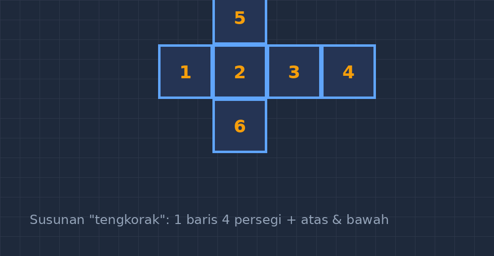
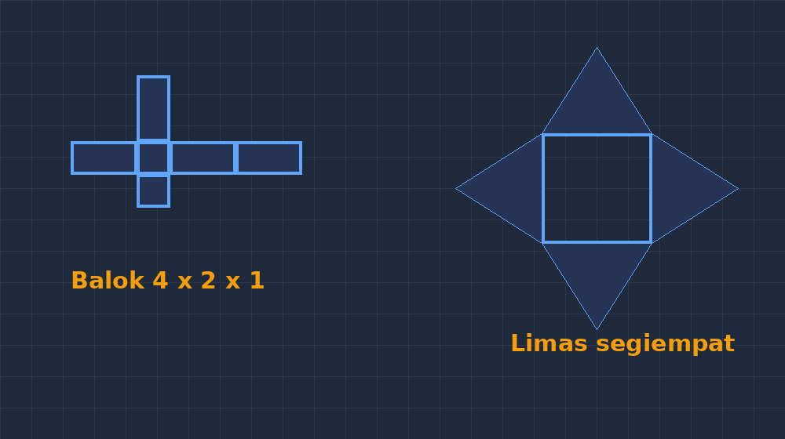

Beberapa tahun terakhir, soal tentang jaring-jaring selalu jadi momen yang menarik di kelas saya. Ada satu soal klasik yang saya suka pakai: "Manakah dari lima gambar berikut yang jika dilipat akan menjadi kubus?" Ternyata, anak-anak tidak selalu bisa menjawabnya hanya dengan melihat. Ada yang pilih asal, ada yang menghitung jumlah persegi saja, dan ada yang diam-diam melipat kertas di bawah meja — yang sebenarnya justru cara berpikir yang benar, hanya saja kurang "sah" di situasi ujian.

Masalahnya bukan pada anaknya. Masalahnya pada gambar soalnya. Kalau gambar jaring-jaring di soal digambar asal-asalan — persegi yang ukurannya tidak sama, sisi-sisi yang tidak sambung persis, atau jaring yang sebenarnya mustahil menjadi kubus tapi digambar seolah sah — murid akan kebingungan mencari polanya. Di titik itulah saya mulai serius menggambar semua soal jaring-jaring dengan TikZ.

<!--more-->

## Kenapa jaring-jaring gampang salah digambar

Jaring-jaring itu menuntut presisi yang tidak diminta gambar matematika lain. Kalau saya menggambar ilustrasi pohon untuk soal cerita, sedikit miring tidak apa-apa. Tapi jaring-jaring kubus? Enam persegi harus sama besar, sisi yang berdampingan harus bertemu tepat di satu titik, dan susunannya harus benar-benar bisa dilipat (atau, kalau memang soalnya soal jebakan, benar-benar tidak bisa).

Coba saja menggambar itu manual di Word atau di aplikasi gambar biasa. Saya pernah melakukannya — hasilnya butuh waktu lama, dan kalau mau mengubah susunan jaringnya, semuanya geser lagi dari awal. Dengan TikZ, susunan jaring tinggal didefinisikan sebagai daftar koordinat, dan sisanya dihitung komputer.

## Ide dasarnya: satu persegi, lalu dilipat (di kode)

Cara berpikir saya saat menulis kodenya persis seperti melipat kertas: mulai dari satu persegi satuan, lalu setiap persegi berikutnya "ditempel" di sisi tertentu. Saya definisikan satu persegi dengan perintah sederhana:

```latex
\newcommand{\kotak}[2]{
  \draw[fill=blue!10] (#1,#2) rectangle ++(1,1);
}
```

Dengan begitu, jaring kubus bentuk "tengkorak" (satu baris empat persegi, ditambah satu di atas dan satu di bawah kolom kedua) tinggal ditulis:

```latex
\kotak{0}{0} \kotak{1}{0} \kotak{2}{0} \kotak{3}{0}
\kotak{1}{1} \kotak{1}{-1}
```

Enam baris kode, enam persegi, semuanya rapi otomatis. Kalau saya mau mengganti susunan jaring untuk soal pilihan ganda, tinggal mengubah angka koordinatnya — tidak ada yang perlu digeser manual.


*Gambar: jaring kubus bentuk "tengkorak" — susunan yang paling sering muncul di soal.*

## Menambah label dan nomor sisi

Untuk soal "manakah yang bisa menjadi kubus", sering saya beri nomor pada tiap persegi supaya pembahasan di kelas lebih mudah: "Persegi nomor 3 akan bertemu dengan nomor 5 saat dilipat, jadi..." Menambahkannya di TikZ cuma butuh satu node di tengah tiap persegi:

```latex
\newcommand{\kotakn}[3]{
  \draw[fill=blue!10] (#1,#2) rectangle ++(1,1);
  \node at (#1+0.5,#2+0.5) {#3};
}
```

Kebiasaan kecil ini mengubah suasana diskusi di kelas. Sebelum ada nomor, murid menjelaskan pakai "yang ini" sambil menunjuk, dan teman-temannya tidak selalu melihat yang sama. Setelah ada nomor, penjelasan mereka jadi verbal dan terstruktur: "jaring ini bisa, karena sisi atas nomor 1 nempel ke sisi kanan nomor 6". Itu latihan komunikasi matematis yang tidak saya rencanakan sebelumnya, tapi ternyata efek samping yang bagus dari sekadar menggambar ulang soal.

## Balok dan limas: menyusutkan persegi jadi persegi panjang

Untuk balok, konsepnya sama saja, hanya dimensi persegi satuan diganti. Misalnya jaring balok dengan ukuran $4 \times 2 \times 1$:

```latex
\draw[fill=blue!10] (0,0) rectangle (2,1);
\draw[fill=blue!10] (2,0) rectangle (3,1);
\draw[fill=blue!10] (3,0) rectangle (5,1);
\draw[fill=blue!10] (5,0) rectangle (7,1);
\draw[fill=blue!10] (2,1) rectangle (3,3);
\draw[fill=blue!10] (2,-1) rectangle (3,0);
```

Limas segiempat lebih menantang karena jaringnya berbentuk segitiga-segitiga yang menempel di keempat sisi persegi alas. Di sini perhitungan koordinat puncak segitiga perlu sedikit trigonometri — dan justru ini yang saya suka: saat menyiapkan soalnya, saya sendiri harus menghitung ulang apakah tinggi segitiga pada jaring itu masuk akal untuk limas dengan tinggi tertentu. Menulis soal jadi ikut menguji pemahaman saya sendiri.


*Gambar: jaring balok $4\times2\times1$ dan jaring limas segiempat, keduanya dihasilkan dari koordinat yang dihitung, bukan ditebak.*

## Mengapa ini penting: gambar yang jujur melatih intuisi yang benar

Ada satu hal yang paling saya syukuri dari pindah ke TikZ: gambar-gambar saya jadi "jujur". Kalau di soal tertulis jaring yang tidak bisa menjadi kubus, maka di gambar pun memang tidak bisa — sisi-sisinya tidak akan pernah bertemu dengan rapi kalau dilipat, dan itu terlihat. Murid yang mengembangkan intuisi dari gambar yang jujur akan membawa intuisi itu ke soal yang berbeda, bahkan soal yang digambar orang lain.

Sebaliknya, gambar yang tidak konsisten melatih intuisi yang salah. Saya pernah menemukan soal latihan di lembar kerja yang jaringnya digambar sembarangan — ternyata jawaban kunci juga salah, karena pembuat soalnya cuma melihat gambar tanpa pernah melipatnya. Sejak itu saya lebih percaya diri membaca soal buatan orang lain juga: bila gambar jaringnya diragukan, saya bisa cepat menirukan jaringnya di TikZ dan melihat sendiri hasilnya dalam satu menit.

## Bagaimana siswa ikut serta

Tahun lalu saya mencoba sesuatu yang berbeda: setelah pembahasan, saya proyeksikan kode TikZ jaring-jaring di layar, dan kami "bermain" mengubah koordinat satu persegi — lalu memprediksi bersama, apakah susunan baru itu masih bisa menjadi kubus atau tidak, sebelum gambar jadinya ditampilkan. Menariknya, siswa yang biasanya pasif ikut teriak "yang pojok kanan harus tetap nempel!" — mereka berdebat tentang sisi mana yang akan bertemu. Yang semula pelajaran tentang jaring-jaring berubah jadi pelajaran tentang bagaimana sifat bangun ruang membatasi kemungkinan susunan bidang datar.

Saya tidak menuntut siswa belajar TikZ, tentu saja. Tapi menampilkan kode yang menghasilkan gambar memberi pesan implisit yang saya suka: gambar di soal matematika itu bukan hiasan, ia dibangun dari aturan — dan aturan itu bisa diperiksa.

## Penutup

Kalau Bapak/Ibu guru sering membuat soal geometri ruang sendiri, saya sarankan mencoba menggambar jaring-jaring dengan TikZ, walau perlahan. Mulai dari kubus saja — enam persegi, sepuluh baris kode. Setelah itu barokahnya terasa: soal berikutnya tinggal menyalin dan mengubah angka, dan yang terpenting, semua soal yang kita berikan kepada murid adalah gambar yang bisa dipercaya.

Dan seperti biasa, kalau ada teman-teman guru yang ingin file contohnya lengkap — kubus, balok, limas, sampai prisma segitiga — silakan sapa saya. Senang berbagi, karena soal yang baik memang seharusnya beredar.


---

> 📎 **Berkas TikZ lengkap:** [jaring-jaring-bangun-ruang.tex](tex/jaring-jaring-bangun-ruang.tex) — dokumen siap kompilasi (butuh paket `tikz`). Silakan ganti angka-angkanya untuk soal Anda sendiri.
