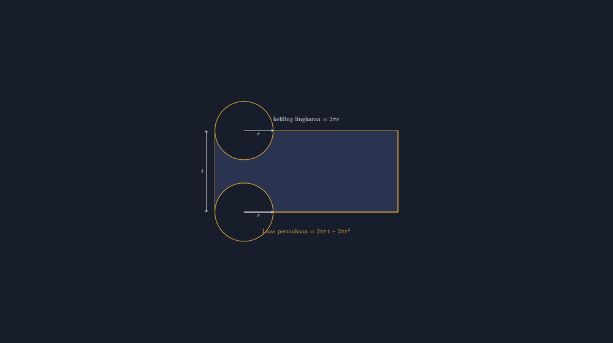

Di kelas IX, materi bangun ruang sisi lengkung biasanya dimulai dengan jaring-jaring. Tabung adalah yang paling ramah: satu persegi panjang dan dua lingkaran. Tampak mudah. Tapi justru di gambar yang tampak mudah itulah siswa paling sering "mengarang". Persegi panjang digambar dulu, lalu dua lingkaran ditempel di atas dan bawahnya, entah di posisi mana saja asal nempel. Kalau lingkaran menembus sisi panjang persegi panjang, atau malah tidak menyentuhnya sama sekali, saya tidak menghukum siswanya. Saya cuma bertanya: "Kalau benda ini benar-benar dilipat, tutupnya bakal nempel di mana?"

Pertanyaan itu jarang bisa dijawab kalau gambar tidak jujur. Jadi tulisan ini tentang cara saya menggambar jaring-jaring tabung yang bisa dipertanggungjawabkan — pakai TikZ, dengan aturan yang sama seperti yang saya minta dari siswa di kertas milimeter.



*Gambar 1. Dua lingkaran justru digambar **menempel di dalam** sisi panjang, menyinggung tepat di satu titik. Itu syarat lipatnya.*

## Aturan yang sering dilanggar

Jaring-jaring tabung punya tiga perjanjian yang tidak boleh dilanggar:

1. Lebar persegi panjang harus sama dengan keliling lingkaran, yaitu $2\pi r$.
2. Kedua lingkaran (tutup atas dan tutup bawah) harus **menyinggung** sisi panjang persegi panjang — menempel di satu titik, tidak menembus, tidak terpisah.
3. Lingkaran boleh ditempatkan di mana saja sepanjang sisi panjang, karena lipatan bisa mulai dari titik mana pun.

Aturan nomor 2 yang paling sering gagal di gambar tangan. Siswa suka menggambar lingkaran yang setengahnya menembus ke dalam persegi panjang, seolah tutupnya "menyatu" dengan selimut. Padahal saat dilipat, lingkaran yang menembus akan berlipat ganda di sisi yang sama — dan itu bukan tabung.

Justru karena itu jaring-jaring yang saya pakai di kelas (dan di gambar TikZ ini) menempatkan pusat lingkaran tepat **pada** sisi panjang: setengah lingkaran di dalam selimut, setengahnya menggantung di luar, menyinggung di satu titik. Ini pola yang paling sering muncul di buku, dan yang paling mudah dilipat siswa.

## Menyusun koordinatnya

Bagian tersulit di TikZ bukan menggambar lingkaran — TikZ jago soal itu — tapi menghitung agar lebarnya benar-benar $2\pi r$. Kalau saya menulis lebar persegi panjang asal-asalan, misalnya 8, sementara radius lingkaran 1,5 (berarti kelilingnya $9{,}42$), gambar akan berbohong diam-diam. Lipatannya tidak akan ketemu.

Jadi saya biarkan TikZ menghitungnya sendiri:

```latex
\def\r{1.5}
\pgfmathsetmacro{\w}{2*pi*\r}   % = 9.4248
\def\h{4.2}

% selimut: persegi panjang lebar w, tinggi h
\draw[thick] (-\w/2,-\h/2) rectangle (\w/2,\h/2);

% tutup atas dan bawah, menyinggung sisi panjang
\draw[thick] (-\w/2+\r, \h/2) circle (\r);
\draw[thick] (-\w/2+\r,-\h/2) circle (\r);
```

Perhatikan pusat lingkaran atas: $x = -\w/2 + \r$. Itu bukan angka karangan. Karena lingkaran harus **menyinggung** sisi panjang, pusatnya saya letakkan tepat pada garis sisi panjang itu ($y = \h/2$). Dengan posisi begini, lingkaran menyentuh persegi panjang di sepanjang busurnya yang berada di dalam — dan separuh lainnya "menggantung" di luar area selimut, siap dilipat ke atas.

Sama halnya dengan label $r$. Saya menggambar panah radius di dalam lingkaran, bukan sekadar menulis "r" di sebelahnya, supaya siswa melihat bahwa radius lingkaran jaring-jaring memang sama dengan radius tabungnya.

## Kenapa label keliling jadi penanda paling penting

Di papan tulis, saya selalu menulis di atas persegi panjang: *keliling lingkaran = $2\pi r$*. Bukan "panjang". Alasannya sederhana: ketika siswa lupa menghitung luas permukaan, mereka yang ingat bahwa lebar selimut itu keliling lingkaran bisa membangun ulang rumusnya sendiri:

$$L = 2\pi r\,t + 2\pi r^2$$

Bagian pertama adalah persegi panjang ($2\pi r \times t$), bagian kedua adalah dua lingkaran ($2 \times \pi r^2$). Rumus itu bukan hafalan, tapi pembacaan gambar. Dan gambar yang jujur — yang lebarnya benar-benar proporsional dengan keliling, yang lingkarnya benar-benar menyinggung — membuat pembacaan itu terjadi dengan sendirinya.

Sebaliknya, gambar yang bohong mengajarkan sesuatu yang lain: bahwa matematika boleh asal ada bentuknya. Saya sudah pernah membahas soal bangun datar yang digambar asal di tulisan sebelumnya tentang jaring-jaring balok, dan benang merahnya sama: **gambar adalah argumen**. Gambar tabung yang lingkarannya menembus selimut adalah argumen yang salah, betapapun rapi tulisan tangannya.

## Dua pola yang sama-sama benar

Menariknya, posisi lingkaran di sisi panjang bukan hal yang mutlak. Saya pernah memperlihatkan dua lembar jaring-jaring tabung ke kelas: satu dengan lingkaran di kiri atas dan kiri bawah, satu lagi dengan lingkaran di tengah. Beberapa anak langsung protes, "Itu beda, Pak!" Tapi ketika keduanya dilipat, keduanya jadi tabung yang persis sama.

Di situ saya bisa menunjukkan sesuatu yang jarang kesampaian saya jelaskan: **satu bangun ruang punya lebih dari satu jaring-jaring**. Untuk tabung, banyaknya tidak sedikit seperti kubus (yang punya sebelas), tapi prinsipnya sama — yang penting bukan bentuk jaringnya di lembar, melainkan hubungan antar sisi saat dilipat. Selama lingkaran menyinggung sisi panjang dan lebar persegi panjang benar, posisinya bebas.

TikZ justru membantu diskusi ini. Karena koordinat lingkaran saya tulis sebagai `(-\w/2+\r, \h/2)`, menggeser lingkaran tinggal mengubah satu angka: `(-\w/2+3*\r, \h/2)` misalnya, atau saya letakkan di tengah dengan `(0, \h/2)`. Dalam hitungan detik, saya bisa memproyeksikan tiga variasi jaring di layar dan meminta kelas memutuskan mana yang bisa dilipat. Kalau menggambar manual di papan, tiga versi itu akan memakan setengah jam dan yang ketiga pasti miring.

## Jebakan yang saya temui di lembar ulangan

Setelah beberapa tahun mengajarkan bab ini, saya mulai mencatat pola kesalahan yang berulang. Ada empat yang paling sering.

Pertama, **lebar dikira tinggi**. Sebagian siswa mengalikan $2\pi r$ dengan tinggi tabung lalu memakai hasilnya sebagai lebar persegi panjang — karena dalam soal, "tinggi selimut" dan "tinggi tabung" memang sama, dan otak yang buru-buru mengambil keduanya. Ujian terbaik untuk ini adalah meminta mereka memeriksa: kalau lebar selimut seharusnya keliling lingkaran, angkanya harus jauh lebih besar daripada tingginya untuk tabung yang pendek dan lebar.

Kedua, **radius dijadikan diameter**. Lingkaran digambar dua kali lipat ukurannya, sehingga tidak muat menyinggung sisi. Ini miskonsepsi lama yang sudah saya tulis di tulisan lain, tapi di jaring-jaring dia muncul dalam bentuk visual: lingkaran raksasa yang menjorok ke dalam persegi panjang.

Ketiga, **luas selimut dihitung dengan $\pi r^2$**. Siswa menghafal "rumus lingkaran" lalu menerapkannya ke persegi panjang. Di sini gambar jaring-jaring yang berlabel jelas — "keliling lingkaran = $2\pi r$" di sisi panjang, "t" di sisi pendek — bekerja sebagai pengingat yang lebih lembut daripada coretan merah saya.

Keempat, dan ini favorit saya: **lupa mengalikan dua untuk tutupnya**. Jawaban akhir kurang satu lingkaran. Kalau siswa terbiasa membaca gambar — satu lingkaran di atas, satu di bawah — kesalahan ini hampir mustahil terjadi, karena menghitung "dua lingkaran" itu menghitung gambar, bukan mengingat suku dalam rumus.

## Uji lipat di kelas

Cara saya menutup pelajaran ini sederhana: siswa memotong jaring-jaring dari kertas, lalu melipatnya. Kalau lingkarannya tidak menyinggung sisi panjang, saat dilipat tutupnya akan "melayang" — tidak bisa ditempel dengan rapi ke selimut. Kalau lebar persegi panjangnya tidak $2\pi r$, lingkaran terakhir akan bertabrakan dengan titik awal lipatan.

Dua kegagalan itu, menariknya, terasa langsung di tangan. Siswa tidak perlu saya coret pakai pena merah; tabung yang gagal melipat dirinya yang bicara. Dan setelah berhasil melipat satu kali, hampir tidak ada lagi yang menggambar lingkaran sembarangan di lembar ulangan.

Itulah sebabnya saya rela repot menulis `\pgfmathsetmacro{\w}{2*pi*\r}` di file TikZ, padahal bisa saja menulis angka mentah. Gambar yang dihitung, bukan dikira-kira, itu satu-satunya gambar yang boleh saya tampilkan di kelas.

> 📎 **Berkas TikZ lengkap:** [tikz-jaring-jaring-tabung.tex](tex/tikz-jaring-jaring-tabung.tex) — siap kompilasi (butuh paket `tikz`).
