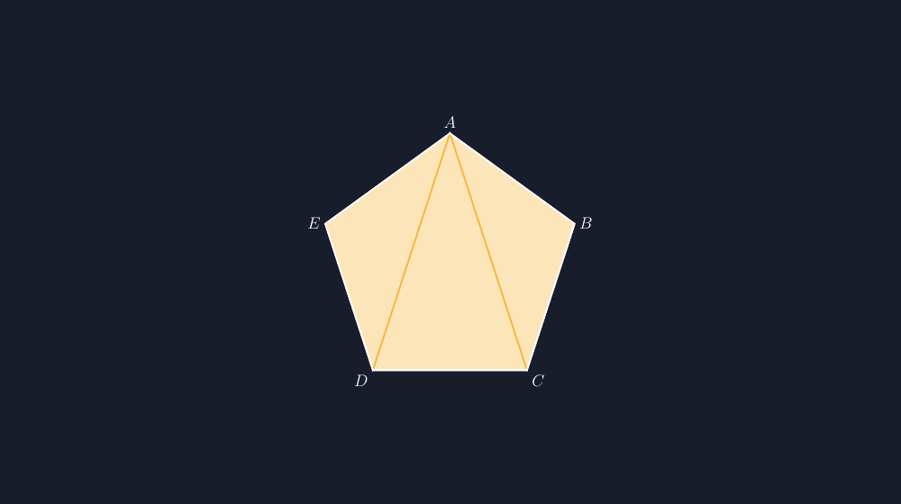

Di kelas VII, materi segi banyak sering berhenti di hafalan. Rumus jumlah sudut dalam segi banyak, $180°(n-2)$, dicatat, dipakai, lalu dilupakan. Tahun lalu saya mencoba hal berbeda: alih-alih memberi rumus dulu, saya mengajak siswa menemukannya sendiri lewat segitiga. Dan supaya gambar yang saya tunjukkan tidak menambah kebingungan, saya menggambarnya dengan TikZ.

<!--more-->

## Titik Awal: Pertanyaan dari Segitiga

Kelas itu sudah akrab dengan satu fakta: jumlah sudut dalam segitiga $180°$. Dari sana saya hanya melempar pertanyaan, "Kalau bangunnya bertambah sisinya, jumlah sudutnya jadi berapa?"

Saya gambar segiempat di papan, tarik satu garis dari satu titik sudut ke titik sudut yang tidak bertetangga, dan bangun itu terpecah jadi dua segitiga. Anak-anak langsung menghitung: $2 \times 180° = 360°$. Lalu pentagon. Saya tarik garis lagi, jadi tiga segitiga: $3 \times 180° = 540°$.

Masalahnya, gambar tangan saya di papan tidak selalu rapi. Garis bagi segi banyak sering miring, sudut-sudutnya tampak tidak sama, dan siswa yang duduk di belakang mulai menduga-duga apakah segitiga yang saya maksud benar-benar ada di dalam bangun itu. Di sinilah TikZ masuk: gambar yang digambar dari koordinat, bukan dari kira-kira.

## Menggambar yang Sama dengan TikZ

Berikut inti gambar yang saya pakai — sebuah segi lima yang dipecah dari titik sudut $A$:

```latex
\begin{tikzpicture}[scale=2]
  \coordinate (A) at (90:1.4);
  \coordinate (B) at (18:1.4);
  \coordinate (C) at (-54:1.4);
  \coordinate (D) at (-126:1.4);
  \coordinate (E) at (162:1.4);
  \draw[thick, fill=yellow!25] (A) -- (B) -- (C) -- (D) -- (E) -- cycle;
  \draw[red, thick] (A) -- (C);
  \draw[red, thick] (A) -- (D);
  \foreach \p/\pos in {A/above, B/right, C/below right, D/below left, E/left}
    \node[\pos] at (\p) {$\p$};
\end{tikzpicture}
```

Kenapa koordinatnya polarna, $(sudut:jarak)$? Karena segi lima beraturan lebih jujur digambar begitu: kelima titiknya berjarak sama dari pusat dan terpisah $72°$ satu sama lain. Kalau saya menaruh koordinat desimal asal-asalan, garis bagi yang saya tarik bisa "nyaris tapi tidak tepat" — persis jenis gambar yang dulu bikin siswa saya ragu.

Dari gambar itu siswa bisa membaca pola dengan mata kepala sendiri: segi lima menghasilkan tiga segitiga, dan semua segitiganya nyata terlihat, tidak tumpang tindih, tidak ada yang menghilang.

## Menemukan Rumusnya, Bukan Menerimanya

Setelah segiempat dan segi lima, tabel kecil di papan mulai terisi:

| Jumlah sisi ($n$) | Banyak segitiga | Jumlah sudut dalam |
|---|---|---|
| 3 | 1 | $180°$ |
| 4 | 2 | $360°$ |
| 5 | 3 | $540°$ |
| 6 | 4 | $720°$ |

Satu siswa, dari belakang, berseru, "Pak, segitiganya selalu dua kurangnya dari sisinya!" Itu momen yang tidak bisa saya buat dengan mencium hafalan. Dari sana rumus $180°(n-2)$ bukan lagi sihir yang turun dari langit, melainkan kesimpulan dari segitiga-segitiga yang mereka lihat sendiri.

Satu hal yang perlu saya waspadai: rumus ini berlaku untuk segi banyak *cembung*. Kalau bangunnya cekung, tarik segitiga dari satu titik tidak semulus itu. Saya singgung ini singkat saja di kelas VII — cukup supaya siswa tahu ada batasnya — tanpa masuk jauh ke kasus cekung.

## Ujian Pemahaman: Segi Banyak yang Sudutnya Sama

Kegunaan nyata dari gambar TikZ muncul saat latihan. Saya buat soal seperti ini:

> Sebuah segi banyak beraturan memiliki sudut dalam $150°$ sebesar berapa derajat? Berapa banyak sisinya?

Cara mengajarnya sama seperti menemukan rumus tadi. Kalau semua sudut dalam sama besar, jumlahnya tinggi dibagi: $\frac{180°(n-2)}{n} = 150°$. Dari situ $180n - 360 = 150n$, sehingga $30n = 360$ dan $n = 12$. Segi banyak beraturan bersisi dua belas — poligon dua belas — dan siswa bisa langsung menggambar drafnya dengan TikZ untuk memastikan jawabannya masuk akal.

Yang saya suka dari alur ini: rumus tidak dihafal dulu, baru dipakai. Rumus ditemukan dari segitiga yang tampak, lalu diuji pada kasus yang belum pernah dilihat siswa sebelumnya.

## Catatan Kecil untuk Gambar yang Jujur

Ada satu hal yang saya perhatikan sejak mulai menggambar soal geometri dengan TikZ: gambar yang kita buat jangan mengklaim sesuatu yang tidak benar. Kalau saya menandai sudut di setiap titik sudut segi lima beraturan dengan busur, kelima busurnya harus tampak sama besar — karena memang sama besar, dan TikZ yang digambar dari koordinat polar akan melakukannya dengan sendirinya.

Di papan tulis, "kira-kira sama besar" kadang cukup. Di lembar soal yang dibaca puluhan anak sekaligus, "kira-kira" bisa jadi sumber miskonsepsi. Siswa yang sudah terbiasa membaca gambar yang tidak konsisten akan belajar menduga-duga, bukan menghitung.

## Penutup

Materi segi banyak ini menjadi salah satu kelas yang paling enak saya lewati tahun ini. Kuncinya bukan pada TikZ-nya — itu hanya alat gambar — melainkan pada urutan: gambar dulu, temukan pola, baru rumus. Rumus $180°(n-2)$ yang tadinya paling sering terlupa justru jadi yang paling cepat diingat, karena siswa tahu dari mana angka itu datang.

Kalau Bapak/Ibu ingin mencoba, gambar segi lima di atas bisa langsung dikompilasi. Berkas lengkapnya saya lampirkan di bawah — tinggal dijalankan, tidak perlu menyusun preamble dari nol.

> 📎 **Berkas TikZ lengkap:** [tikz-jumlah-sudut-segi-banyak.tex](tex/tikz-jumlah-sudut-segi-banyak.tex) — siap kompilasi (butuh paket `tikz`).


*Segi lima beraturan dipecah dari titik $A$ menjadi tiga segitiga — sumber rumus $180°(n-2)$.*
