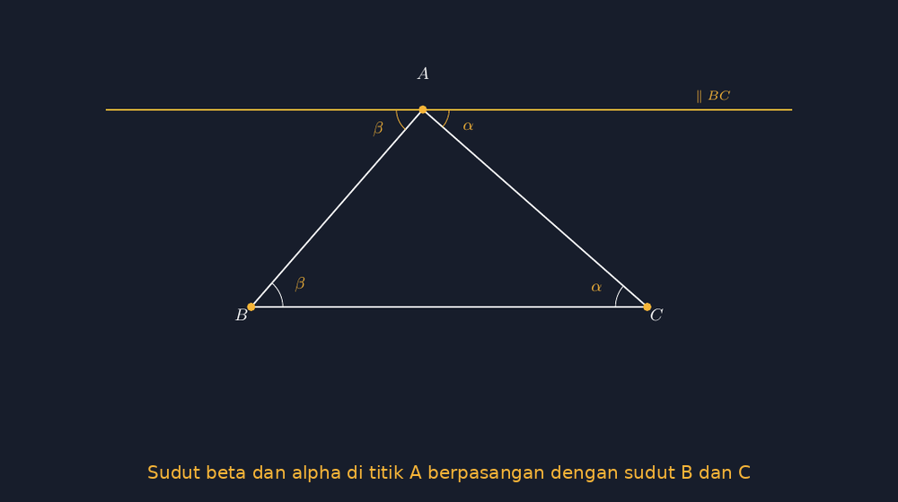

Ada satu saat di kelas VII yang tidak pernah saya lupa. Kami sedang mengukur sudut-sudut dalam segitiga dengan busur derajat, dan satu kelompok mengangkat tangan dengan wajah bingung. "Pak, punya kami cuma 177 derajat. Apakah segitiganya cacat?" Semua kelompok lain juga mendapat angka yang berbeda-beda: 178, 180, 182, satu bahkan 176. Di papan tulis saya menuliskan kalimat yang sudah dicetak rapi di buku paket, "Jumlah sudut dalam segitiga adalah 180 derajat." Dan anak-anak menatap dua hal yang tidak cocok: kalimat yang mantap, dan pengukuran mereka yang rancu.

<!--more-->

## Ketika pengukuran bilang tidak persis 180

Momen itu sebenarnya momen emas, bukan momen gagal. Karena justru di situ siswa belajar sesuatu yang lebih dalam daripada rumus: pengukuran selalu punya galat. Busur derajat yang dibaca sedikit miring, garis sisi yang di gambar tidak persis lurus, mata yang menakar di antara dua tanda — semuanya membuat hasil ukur mendekati tapi tidak pernah persis 180. Kalau saya buru-buru bilang "kalian yang salah ukur", mereka hanya akan menuruti buku. Kalau saya biarkan mereka bergumul sebentar, mereka mulai bertanya hal yang jauh lebih berharga: kenapa yakin jumlahnya tepat 180? Siapa yang membuktikannya?

Pertanyaan itulah yang ingin saya jawab bukan dengan ucapan, tapi dengan pengalaman. Dan pengalaman itu ternyata bisa digambar — di kertas, dengan gunting, dan nanti di layar dengan TikZ.

## Bukti dengan gunting: tiga sudut yang berpapasan

Cara klasiknya sederhana dan sudah ratusan tahun dipakai guru: minta siswa menggambar sembarang segitiga di kertas, memotong ketiga sudutnya dengan gunting, lalu menyusun ketiga potongan itu bertemu di satu titik. Hasilnya selalu sama: ketiga sudut yang "berpapasan" itu berjajar rapi membentuk garis lurus. Dan garis lurus, seperti yang sudah mereka tahu, berjumlah 180 derajat.

Aktivitas ini punya daya yang tidak dimiliki kalimat buku paket. Anak yang memotong sudutnya sendiri, menempelnya sendiri, dan melihat sendiri ketiga potongan itu membentuk lurusan, tidak perlu saya meyakinkan. Ia yang meyakinkan dirinya. Ada pula kejutan kecil yang selalu muncul: siswa yang menggambar segitiga paling jomplang — yang satu sudutnya hampir rata, yang lain tumpul — tetap mendapatkan lurusan yang sama. Sifat ini ternyata tidak peduli bentuk segitiganya. Jumlah sudut dalam segitiga adalah sifat yang tetap, dan bukti gunting membuat ketetapan itu terlihat.

Tapi aktivitas gunting punya kelemahan yang sama seperti busur derajat: ia meyakinkan, tapi tidak membuktikan dengan ketat. Potongan kertas bisa miring saat ditempel. Untuk langkah berikutnya — bukti yang bisa dipertanggungjawabkan — saya bawa kelas ke gambar yang rapi.

## Dari gunting ke gambar: menulis bukti dengan bantuan TikZ

Bukti standarnya seperti ini. Ambil segitiga $ABC$. Tarik garis melalui $A$ yang sejajar dengan sisi $BC$. Sekarang perhatikan sudut di kanan-atas $A$ — sebut saja $\alpha$. Sudut itu dan sudut di $C$ adalah sudut dalam berseberangan pada dua garis sejajar, jadi besarnya sama. Begitu pula sudut di kiri-atas $A$, sebut saja $\beta$: ia sama besar dengan sudut di $B$. Maka di titik $A$ kini berjajar tiga sudut sepanjang garis lurus: $\beta$, lalu sudut dalam segitiga di $A$ yang saya sebut $\gamma$, lalu $\alpha$. Karena $\beta$ dan $\alpha$ masing-masing mewakili sudut $B$ dan sudut $C$, jumlah ketiga sudut dalam segitiga itu tepat sama dengan $180^{\circ}$ — setengah putaran, sepanjang garis lurus.

Di kertas papan tulis, gambar seperti ini hampir selalu tidak sejajar sejajar — garis yang saya tarik sedikit menikung, sudut yang saya tandai tidak persis sebesar pasangannya, dan siswa yang kritis langsung berkomentar. Di sinilah TikZ mengambil alih. Karena TikZ menghitung sudutnya dari koordinat, bukan dari goresan tangan, gambar hasilnya jujur: garisnya benar-benar sejajar, dan sudut-sudut yang saya klaim sama besar memang tampak sama besar.

Berikut inti kode yang saya pakai (berkas lengkapnya saya lampirkan di bawah):

```latex
\usetikzlibrary{angles,quotes}
\begin{tikzpicture}[scale=1.2]
  \coordinate (A) at (2,2.2);
  \coordinate (B) at (0,0);
  \coordinate (C) at (5,0);
  \draw[thick] (A) -- (B) -- (C) -- cycle;
  \draw[thick, accent] (-1,2.2) -- (6,2.2);      % garis sejajar BC lewat A
  % sudut dalam segitiga
  \pic[draw, "$\alpha$", angle eccentricity=1.5] {angle = B--C--A};
  \pic[draw, "$\beta$",  angle eccentricity=1.5] {angle = A--B--C};
  \pic[draw, "$\gamma$", angle eccentricity=1.4] {angle = C--A--B};
\end{tikzpicture}
```

Ketika saya menampilkan gambar hasil kompile ini di kelas, ada siswa yang bertanya, "Pak, kalau segitiganya diganti, angkanya ikut berubah?" Jawabannya ya — dan itu justru pelajaran. Besar tiap sudut berubah, tapi jumlahnya tidak. Kalau saya mengganti koordinat $A$ di kode, dua sudut berubah besar, sudut ketiga menyesuaikan, dan jumlahnya tetap 180. Ketetapan itu tidak disebutkan, ia diam-diam menunjukkan dirinya. Untuk gambar lengkap beserta label sudut dan penjelasannya, silakan lihat gambar di bawah.


*Gambar 1. Bukti jumlah sudut segitiga: garis melalui $A$ sejajar dengan $BC$; sudut $\beta$ dan $\alpha$ di titik $A$ berpasangan dengan sudut di $B$ dan $C$, sehingga ketiganya berjajar sepanjang garis lurus.*

## Yang diwariskan aktivitas ini

Apa yang sebenarnya ditinggalkan aktivitas ini di kepala siswa? Menurut saya tiga hal. Pertama, mereka tahu bedanya pengukuran dan pembuktian: busur derajat memberi petunjuk, gunting memberi keyakinan, gambar sejajar memberi alasan. Kedua, mereka mengenal trik geometri yang akan dipakai berkali-kali lagi nanti: menarik garis bantu sejajar. Garis bantu itu seperti membuka jalan tikus — sekali terlihat, siswa mulai berani mencoba menarik garis bantu sendiri di soal lain. Ketiga, mereka melihat bahwa sifat geometri tidak perlu dihafal; ia bisa diperiksa, dibuktikan, dan dipertanggungjawabkan.

Saya juga belajar satu hal dari kegiatan ini. Jangan menaruh kalimat "jumlah sudut dalam segitiga adalah 180" di papan sebelum siswa bergumul dengan pengukuran yang tidak persis 180. Kalimat itu jauh lebih berarti setelah mereka mengalaminya sendiri. Pengalaman dulu, penamaan kemudian. Urutan ini yang membuat rumus tidak terasa seperti barang jadi yang diturunkan dari langit, tapi seperti kesimpulan yang mereka ambil sendiri.

Dan untuk saya pribadi, kegiatan ini adalah contoh kecil bagaimana TikZ bukan sekadar alat menggambar cantik. Ia alat kejujuran matematis: gambar yang dibuat dari koordinat tidak bisa bohong. Kalau sudut yang saya klaim sama besar ternyata tampak berbeda, berarti klaim saya yang salah, dan saya perbaiki sampai gambar jujur. Di kelas yang semakin akrab dengan gambar digital, kejujuran seperti ini yang ingin saya ajarkan terlebih dulu.

> 📎 **Berkas TikZ lengkap:** [tikz-jumlah-sudut-segitiga.tex](tex/tikz-jumlah-sudut-segitiga.tex) — siap kompilasi (butuh paket `tikz` dan `tikz-angles`).
