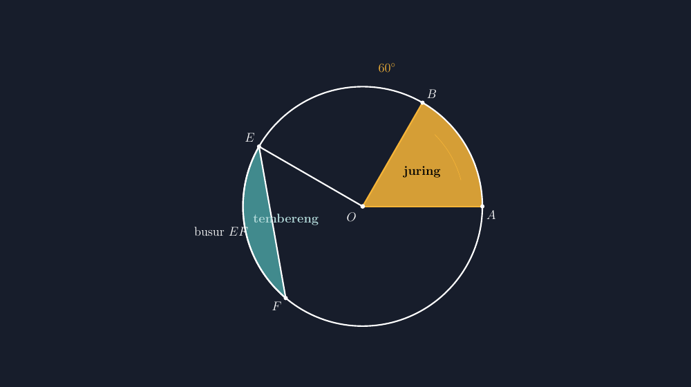

Ada satu pasang istilah yang setiap tahun selalu tertukar di kelas saya: juring dan tembereng. Bukan hanya salah sebut, anak-anak juga salah menggambarnya. Saat saya minta mereka mengarsir "juring yang diarsir" di buku paket, yang keluar kadang adalah potongan yang dibatasi tali busur — padahal itu tembereng. Sebaliknya, saat saya minta tembereng, muncul irisan dua jari-jari yang melengkung manis. Dua kata yang mirip bunyinya, dua bangun yang beda wujudnya.

Tahun ini saya mencoba jalan lain: daripada menjelaskan dengan gambar papan tulis yang menghadapi tuntutan tiga puluh pasang mata sekaligus, saya menggambarnya dengan TikZ, lalu menempelkannya di lembar kerja. Hasilnya lumayan. Artikel ini saya tulis untuk merekam bagaimana saya menggambarnya — sekaligus jadi catatan buat saya sendiri kalau nanti lupa koordinatnya.

<!--more-->

## Dua Potongan yang Beda Asal-Usulnya

Sebelum bicara kode, saya selalu mengingatkan diri sendiri tentang perbedaan mendasarnya. **Juring** adalah potongan lingkaran yang lahir dari *dua jari-jari*: $OA$ dan $OB$ membatasi sebuah daerah yang busurnya ikut keliling lingkaran. **Tembereng** lahir dari *satu tali busur*: garis $EF$ memotong lingkaran, dan daerah di antara tali busur itu dengan busurnya adalah tembereng.

Jadi kuncinya ada di jumlah garis lurus pembatasnya. Juring punya dua sisi lurus (dua jari-jari). Tembereng hanya satu (tali busur). Kalau anak bisa melihat itu, mereka tidak akan tertukar lagi.

Beginilah gambar yang saya tempel di lembar kerja:


*Juring $OAB$ (kuning) dibatasi dua jari-jari; tembereng $EF$ (hijau) dibatasi tali busur $EF$ dan busurnya.*

Dua bangun itu sengaja saya taruh di satu lingkaran yang sama. Satu gambar, dua istilah, satu perbandingan langsung. Warna berbeda membantu: kuning untuk juring, hijau untuk tembereng, dan label di tempat masing-masing.

## Menggambar Juring dengan TikZ

Perintah utamanya adalah `arc`. Ide dasarnya: berdiri di satu titik, gambar jari-jari pertama, lalu lengkungkan sebesar sudut pusat yang diinginkan, tutup kembali ke pusat. Untuk juring dengan sudut pusat $60^\circ$:

```latex
\coordinate (O) at (0,0);
\coordinate (A) at (4,0);
\coordinate (B) at (60:4);
\fill[yellow!80!orange, opacity=0.85] (O) -- (A) arc (0:60:4) -- cycle;
\draw (O) -- (A);
\draw (O) -- (B);
```

Baris `\fill` itu yang membuat daerahnya benar-benar juring: dari pusat $O$ ke $A$, busur dari $0^\circ$ sampai $60^\circ$, lalu `-- cycle` menutupnya kembali ke $O$. Kalau `cycle` itu lupa, yang terjadi adalah potongan yang bolong — dan anak akan bertanya kenapa ada "gigi bolong" di soalnya. Itu pelajaran yang saya pelajari cara sulit.

Yang saya suka dari menggambar begini: sudut pusatnya benar-benar $60^\circ$, bukan "kurang lebih". Ukurannya konsisten antar lembar soal. Kalau saya buat sepuluh varian soal luas juring, semuanya terlihat berasal dari keluarga gambar yang sama.

## Menggambar Tembereng dengan TikZ

Tembereng logikanya sedikit berbeda. Pembatasnya adalah busur (dari $150^\circ$ ke $230^\circ$, misalnya) lalu tali busur yang menghubungkan kedua ujungnya:

```latex
\coordinate (E) at (150:4);
\coordinate (F) at (230:4);
\fill[teal!70!white, opacity=0.8] (E) arc (150:230:4) -- cycle;
\draw (E) arc (150:230:4);
\draw (E) -- (F);
```

Perhatikan: di sini `-- cycle` menutup dari titik akhir busur ($F$) langsung ke titik awal ($E$). Garis lurus itu *adalah* tali busurnya. Jadi satu baris `-- cycle` sekaligus jadi pembatas dan jadi tali busur yang mau saya tunjukkan ke anak. Efisien, dan jujur secara geometri.

Kalau anak menanyakan "Bu, kok temberengnya kurus, juringnya gemuk?", itu justru pintu diskusi bagus. Tembereng $80^\circ$ memang lebih kecil luasnya daripada juring $80^\circ$ — karena juring mendapat tambahan segitiga $OEF$ yang tidak dimiliki tembereng. Rumusnya pun bicara begitu:

$$L_{\text{juring}} = \frac{\theta}{360^\circ} \cdot \pi r^2, \qquad L_{\text{tembereng}} = L_{\text{juring}} - L_{\Delta OEF}$$

Dengan gambar yang benar, rumus pengurangan itu tidak terasa seperti hafalan tambahan. Anak bisa *melihat* apa yang dikurangkan.

## Angka yang Sengaja Jujur

Saat menyusun soal, saya memilih sudut pusat yang bilangan cantik: $60^\circ$, $90^\circ$, $120^\circ$, $270^\circ$. Bukan karena saya takut angka jelek, tapi karena saya ingin perhatian anak habis untuk konsep, bukan untuk perkalian yang bikin frustrasi. $120^\circ$ dari $360^\circ$ itu sepertiga lingkaran penuh — anak bisa menebak dulu luasnya sepertiga dari $\pi r^2$, baru menghitung untuk memastikan. Kebiasaan menaksir dulu seperti itu (yang pernah saya tulis di artikel terdahulu) hanya bekal kalau gambarnya sendiri tidak menipu.

Ini juga alasan kenapa saya tidak puas dengan gambar lingkaran yang digambar asal-asalan. Kalau di gambar soal juring $90^\circ$ ternyata yang muncul adalah irisan yang terlihat seperti $140^\circ$, anak yang jeli akan bingung, dan anak yang tidak jeli belajar untuk tidak percaya pada gambar — dua-duanya hasil buruk. TikZ menyelesaikan masalah ini dengan satu prinsip: sudut yang saya tulis adalah sudut yang muncul.

## Di Luar Soal Hitungan

Sesuatu yang tak terduga: juring ternyata muncul lagi saat saya mengajarkan statistika. Diagram lingkaran (pie chart) itu kumpulan juring yang saling menyambung. Saat anak menggambar diagram lingkaran untuk data seleranya — misalnya komposisi kendaraan orang tua teman sekelas — mereka sebenarnya sedang menggambar serangkaian juring dengan sudut pusat hasil proporsi. Siswa yang sudah paham juring tidak perlu belajar ulang; mereka hanya perlu berlatih membagi sudut.

Sementara tembereng menemukan tempatnya di percakapan tentang "potongan pizza yang pinggiran" dan di soal-soal luas daerah arsiran ujian. Dua kata yang tadinya tertukar sekarang punya alamat visual yang jelas di kepala mereka.

Bahkan penggambarannya bisa dibuat terprogram. Kalau saya butuh sepuluh juring berbeda untuk bank soal, saya tinggal mengganti sudutnya dalam satu lingkaran perulangan LaTeX — gambar tetap konsisten, waktu saya tetap untuk mengoreksi.

## Menutup: Gambar sebagai Perjanjian

Saya makin percaya bahwa gambar di soal matematika itu semacam perjanjian dengan siswa: apa yang tertulis harus sama dengan apa yang terlihat. Juring yang bunyinya $60^\circ$ harus benar-benar terlihat $60^\circ$. Tembereng yang disebut "daerah antara tali busur dan busur" harus benar-benar dibatasi tali busur.

Dengan TikZ, perjanjian itu mudah ditepati. Dan buat saya, itu alasan utama repot-repot belajar sintaks `arc` yang agak jelimet: bukan demi keindahan, tapi demi kejujuran gambar.

> 📎 **Berkas TikZ lengkap:** [tikz-juring-tembereng.tex](tex/tikz-juring-tembereng.tex) — siap kompilasi (butuh paket `tikz`).
