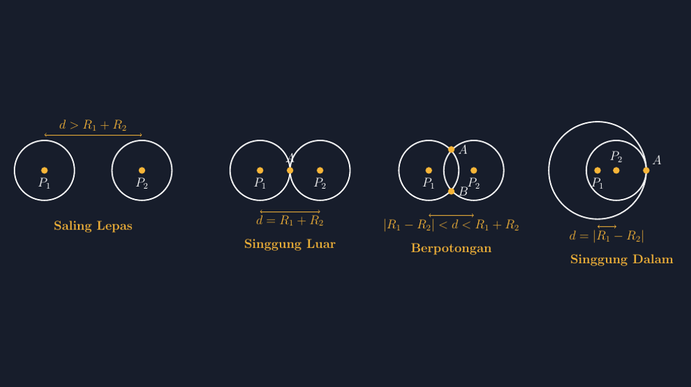

Ada satu bab di kelas VIII yang setiap tahun selalu membuat gambar di papan tulis saya berantakan: kedudukan dua lingkaran. Teorinya sederhana, hanya empat kasus. Tapi setiap kali saya menggambar cepat-cepat dengan kapur, hasilnya menipu. Lingkaran yang seharusnya bersinggungan di satu titik justru saling menembus sedikit. Lingkaran yang seharusnya berpotongan terlihat seperti bersinggungan. Siswa kemudian menghafal dari gambar yang tidak jujur itu, dan miskonsepsinya menetap bertahun-tahun.

<!--more-->

Malam itu saya akhirnya duduk dan menyerahkan pekerjaan ini pada TikZ. Seperti artikel-artikel saya sebelumnya tentang menggambar bangun geometri, prinsipnya tetap sama: gambar yang baik adalah gambar yang koordinatnya bisa dipertanggungjawabkan, bukan gambar yang "kira-kira mirip".

## Empat Kedudukan, Satu Kunci: Jarak Pusat

Sebelum menyentuh kode, kita sepakati dulu bahasanya. Dua lingkaran dengan pusat $P_1$ dan $P_2$, jari-jari $R_1$ dan $R_2$, dan jarak pusat $d$. Seluruh bab ini sesungguhnya hanya membahas satu pertanyaan: bagaimana $d$ dibandingkan dengan $R_1 + R_2$ dan $|R_1 - R_2|$?



Empat kasus itu adalah:

1. **Saling lepas**, bila $d > R_1 + R_2$.
2. **Bersinggungan luar**, bila $d = R_1 + R_2$.
3. **Berpotongan**, bila $|R_1 - R_2| < d < R_1 + R_2$.
4. **Bersinggungan dalam**, bila $d = |R_1 - R_2|$.

Ada satu kasus lagi yang sering terlupa: $d = 0$ dengan $R_1 \neq R_2$ (lingkaran di dalam lingkaran tanpa titik singgung) dan $d = 0$ dengan $R_1 = R_2$ (lingkaran berimpit). Di papan tulis kasus "berimpit" ini hampir tidak pernah saya gambar, dan jujur saja, itulah salah satu lubang kecil yang barulah saya tutup setelah membuat gambar digital.

## Menulis Kode yang Menghitung, Bukan Menaksir

Kuncinya satu: jangan pernah menaruh lingkaran dengan kira-kira. Saya tentukan dulu jari-jarinya, lalu **hitung** letak pusat lingkaran kedua dari syarat $d$ yang ingin ditunjukkan.

Untuk kasus bersinggungan luar dengan $R_1 = R_2 = 1{,}6$ satuan, pusat lingkaran kedua harus tepat di $d = 3{,}2$ dari pusat pertama:

```latex
\begin{tikzpicture}[scale=0.62]
  \draw (0,0) circle (1.6);
  \draw (3.2,0) circle (1.6);   % 0 + 3.2 = R1 + R2
  \fill (1.6,0) circle (2.2pt); % titik singgung A
  \node[above=4pt] at (1.6,0) {$A$};
\end{tikzpicture}
```

Perhatikan angka `3.2` itu. Ia bukan angka yang saya pilih supaya gambarnya "kelihatan bagus" — ia adalah hasil dari $R_1 + R_2$. Kalau besok saya mengubah jari-jari menjadi 1,8, maka angka pusat harus ikut berubah menjadi 3,6. Inilah yang saya suka dari TikZ: gambar memaksa saya jujur pada matematikanya. Ketika kodenya benar, tidak mungkin gambar menipu.

Untuk kasus berpotongan, saya butuh koordinat dua titik potong $A$ dan $B$. Di sinilah TikZ punya senjata yang tidak dimiliki kapur: intersection. Tapi supaya artikel ini tetap ringkas, cara paling sederhana adalah menghitung manual. Dengan $R_1 = R_2 = 1{,}6$ dan $d = 2{,}4$, titik potong jatuh di tengah-tengah kedua pusat, dengan tinggi $t = \sqrt{R^2 - (d/2)^2} = \sqrt{2{,}56 - 1{,}44} = \sqrt{1{,}12} \approx 1{,}118$:

```latex
\begin{tikzpicture}[scale=0.62]
  \draw (0,0) circle (1.6);
  \draw (2.4,0) circle (1.6);
  \fill (1.2, 1.118) circle (2.2pt) node[right=3pt] {$A$};
  \fill (1.2,-1.118) circle (2.2pt) node[right=3pt] {$B$};
\end{tikzpicture}
```

Angka $1{,}118$ itu bukan hasil mata, melainkan hasil Pythagoras pada segitiga yang dibentuk pusat lingkaran dan titik potong. Saya bahkan sempat menghitungnya bersama siswa di kelas — mereka terkejut bahwa "menggambar" ternyata memakai teorema Pythagoras yang baru saja mereka pelajari. Momen seperti itu emas: siswa melihat teorema dipakai untuk sesuatu yang nyata, yaitu memastikan gambar tidak bohong.

## Kasus yang Paling Sering Tertukar: Singgung Dalam

Kalau ada satu gambar yang paling sering digambar salah, saya pikir itu bersinggungan dalam. Gambar yang benar menuntut lingkaran kecil berada **di dalam** lingkaran besar, menyinggung di satu titik, dengan pusat keduanya segaris menuju titik singgung. Dengan $R_1 = 2{,}6$ dan $R_2 = 1{,}6$, maka $d = |R_1 - R_2| = 1{,}0$:

```latex
\begin{tikzpicture}[scale=0.62]
  \draw (0,0) circle (2.6);
  \draw (1.0,0) circle (1.6);   % 2.6 - 1.6 = 1.0 dari pusat besar
  \fill (2.6,0) circle (2.2pt); % titik singgung di 0 + R1
\end{tikzpicture}
```

Di kelas, saya biasa menunjuk titik singgungnya dan bertanya: "kalau $d$-nya sedikit ditambah, jadi apa?" Siswa harus sampai pada kesimpulan sendiri bahwa gambar berubah menjadi berpotongan. Pertanyaan itu mustahil diajukan lewat gambar kapur yang mentok-mentok; tapi lewat gambar TikZ yang presisi, pergeseran satu-satu persepuluh satuan jadi sesuatu yang bisa dibayangkan.

## Gim di LKPD, Bukan Sekadar di Papan

Gambar-gambar di artikel ini akhirnya saya jadikan lembar kerja. Saya cetak empat kasus tanpa keterangan, dan tugas siswa adalah **menyusun syarat jaraknya**: gambar mana yang $d = R_1 + R_2$, mana yang $d > R_1 + R_2$, dan seterusnya. Beberapa kelompok bahkan mengukur jarak pusat dengan penggaris dari gambar, lalu membandingkannya dengan jumlah jari-jari yang mereka ukur juga. Ketika hasil pengukuran mereka cocok dengan teorinya, ada satu semacam "aah" yang tidak bisa dibeli dengan ceramah.

Satu hal yang menyenangkan: karena gambar dibuat dari angka yang jujur, pengukuran siswa memang akan cocok. Kalau gambar saya asal-asalan, kegiatan mengukur ini justru menjadi bumerang — siswa akan menemukan bahwa "teorinya tidak cocok dengan gambar", dan kesimpulan yang keliru itulah yang mereka simpan.

## Menutup: Gambar sebagai Guru Kedua

Setiap kali menyelesaikan satu rangkaian gambar geometri dengan TikZ, saya semakin yakin bahwa yang belajar bukan hanya siswa. Saya sendiri dipaksa menghitung ulang, memastikan setiap koordinat punya dasar, dan menemukan lubang-lubang kecil dalam pemahaman saya — seperti kasus lingkaran berimpit yang bertahun-tahun tidak pernah muncul di papan tulis saya.

Bagi rekan guru yang ingin mencoba: mulailah dari satu kasus saja, yang bersinggungan luar. Kodenya pendek, efeknya langsung terlihat, dan sekali kalian merasakan bagaimana "gambar yang tidak bisa bohong" mengubah suasana diskusi, kasus-kasus berikutnya akan menyusul dengan sendirinya.

> 📎 **Berkas TikZ lengkap:** [tikz-kedudukan-dua-lingkaran.tex](tex/tikz-kedudukan-dua-lingkaran.tex) — siap kompilasi (butuh paket `tikz`).
