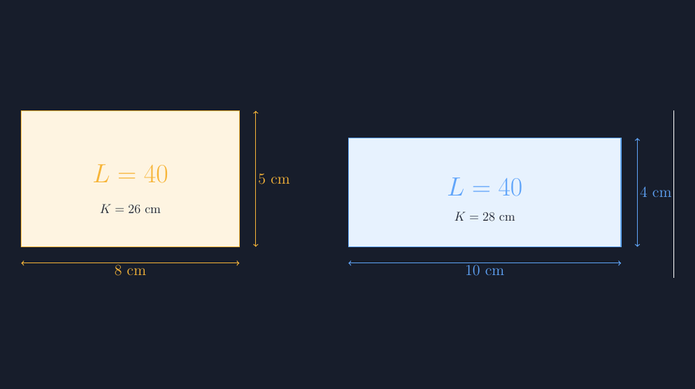

Kamis pekan lalu, di kelas VII, saya memberikan soal yang terlihat sangat sederhana: "Gambarlah dua persegi panjang yang luasnya sama, yaitu 40 cm persegi." Saya pikir anak-anak akan selesai dalam lima menit. Ternyata yang muncul lebih dulu bukan jawaban, melainkan kebingungan yang justru menyegarkan hati saya. Rani mengangkat tangan, "Pak, kalau luasnya sama, berarti kelilingnya juga sama dong, Pak?"

Pertanyaan itu bukan pertanyaan bodoh. Itu pertanyaan yang jujur dari anak yang selama ini diajarkan dua kata — keliling dan luas — selalu berdampingan di halaman buku yang sama, tanpa pernah diberi kesempatan untuk bertengkar.

<!--more-->

## Miskonsepsi yang Bersembunyi di Balik Dua Rumus

Kalau saya renungkan, tidak mengherankan muncul kebingungan semacam itu. Sejak SD, siswa membaca dua rumus ini hampir di halaman yang sama:

$$K = 2(p + l) \qquad \text{dan} \qquad L = p \times l$$

Dua rumus, dua nama, dua kata yang dihafal berdampingan. Yang jarang dilakukan — termasuk oleh saya sendiri di tahun-tahun awal mengajar — adalah membiarkan keduanya hidup secara terpisah: mencoba mengubah ukuran persegi panjang dan melihat apa yang terjadi pada masing-masing rumus. Keliling dan luas di buku selalu tampil seperti saudara kembar, padahal sifat mereka benar-benar berbeda. Keliling adalah jarak yang dilalui semut yang berjalan mengelilingi tepi pagar. Luas adalah banyaknya ubin yang menutupi halaman. Semut bisa berjalan jauh di halaman yang sempit, dan halaman luas bisa punya pagar pendek.

Tapi kalimat semacam itu, bagi siswa kelas VII, masih terlalu abstrak. Mereka butuh melihat. Bukan membayangkan, bukan mendengar cerita, tapi benar-benar melihat dua gambar di depan mata, berdampingan, dengan angka yang bisa mereka cek sendiri.

## Dua Gambar yang Berbicara

Dari situ saya membuat satu gambar sederhana untuk dipajang di layar: dua persegi panjang, keduanya bersisi bilangan bulat, keduanya berluas tepat 40 cm persegi. Yang pertama berukuran $8 \times 5$, yang kedua berukuran $10 \times 4$.



Ketika gambar ini muncul di layar, kelas hening sejenak. Lalu ada yang berbisik, "Oh, beda toh, Pak." Dan memang beda: keliling yang pertama adalah $2(8+5) = 26$ cm, sedangkan yang kedua $2(10+4) = 28$ cm. Dua centimeter lebih panjang pagar untuk halaman yang luasnya sama persis. Anak-anak lalu mulai mencari pasangan lain: $20 \times 2$ yang kelilingnya 44, dan akhirnya sampai pada persegi $8 \times 5$ vs persegi panjang yang makin "kurus" — makin kurus, makin panjang kelilingnya, dengan luas yang tidak berubah.

Untuk gambar seperti ini saya tidak lagi menggambar manual di kertas atau mengandalkan gambar asal dari internet. Saya tulis dengan TikZ, dan potongan kodenya cukup sederhana:

```latex
\draw[thick,aksen,fill=aksen!15] (0,0) rectangle (8,5);
\draw[aksen,thick,<->] (0,-0.6) -- (8,-0.6)
  node[midway,below]{8 cm};
\draw[aksen,thick,<->] (8.6,0) -- (8.6,5)
  node[midway,right]{5 cm};
\node[aksen] at (4,2.7) {\Huge $L = 40$};
\node[bgcol] at (4,1.4) {\large $K = 26$ cm};
```

Baris `rectangle (8,5)` langsung berkata apa adanya: sisi horizontal 8 satuan, sisi vertikal 5 satuan. Tidak ada kemungkinan gambar yang "kira-kira" — kalau saya salah menulis angka, angka pada label dan bentuk gambarnya akan langsung berantakan dan ketahuan. Ketika saya menggambar dengan tangan di papan, kadang persegi panjang $8 \times 5$ dan $10 \times 4$ yang saya buat hampir tidak terlihat bedanya, dan siswa yang jeli justru bingung, "Pak, kok sama aja?" Dengan TikZ, proporsi gambar adalah bagian dari kejujuran materi. Kalau $10 \times 4$ lebih panjang dan lebih pipih dari $8 \times 5$, di gambar harus benar-benar terlihat demikian.

## Menyusuri Semua Kemungkinan dengan Kelas

Setelah dua gambar itu dipahami, kami lanjutkan bersama-sama. Tugas berikutnya sederhana: cari semua pasangan bilangan bulat yang luasnya 40, dan hitung kelilingnya masing-masing. Anak-anak bekerja berpasangan, dan di papan tulis kami kumpulkan hasilnya:

$1 \times 40$ → $K = 82$ cm. $2 \times 20$ → $K = 44$ cm. $4 \times 10$ → $K = 28$ cm. $5 \times 8$ → $K = 26$ cm.

Empat pasangan, empat keliling, satu luas yang sama. Lalu saya lempar pertanyaan lanjutan: "Kalau kelilingnya harus sama, misalnya semua 28 cm, apakah luasnya pasti sama?" Dan di sinilah kejutan kedua muncul: $4 \times 10$ kelilingnya 28, tapi ada juga persegi panjang $6 \times 8$ yang kelilingnya juga $2(6+8) = 28$ cm — sedangkan luasnya $48$, bukan $40$. Siswa yang tadi pagi bertanya "kalau luasnya sama berarti kelilingnya sama?" sekarang sendiri yang menjawab, "Ternyata sebaliknya juga nggak berlaku, Pak."

Pola yang mereka temukan sendiri itu lebih melekat daripada penjelasan apa pun: semakin "kurus dan panjang" persegi panjangnya, semakin boros kelilingnya; bentuk yang paling hemat pagar untuk luas tertentu adalah yang paling mendekati persegi. Nanti, jauh di kelas IX atau di SMA, penemuan ini akan mereka jumpai lagi sebagai soal optimasi. Tapi hari itu, di kelas VII, mereka menemukannya dengan menghitung dan melihat, bukan dengan menurunkan turunan fungsi.

## Kenapa Gambarnya Harus Dibuat Sendiri

Ada pertanyaan yang mungkin muncul di kepala Bapak/Ibu rekan guru: memangnya perlu? Bukannya bisa pakai gambar dari buku paket?

Saya pernah memakai gambar buatan pihak lain, dan yang terjadi adalah penyesuaian yang melelahkan: warnanya tidak cocok dengan selera kelas saya, ukuran hurufnya terlalu kecil ketika diproyeksikan, labelnya dalam bahasa yang tidak persis sama dengan istilah yang saya pakai. Setiap gambar "pinjaman" selalu ada bagian yang tidak saya kendalikan. Dengan TikZ, semua pilihan ada di tangan saya: warna aksen kuning yang sama dengan tema materi lain saya, ukuran huruf yang cukup besar untuk dibaca dari bangku paling belakang, dan angka yang persis sama dengan angka di soal.

Ada satu manfaat lagi yang tidak saya duga sebelumnya. Karena kodenya berupa teks, saya bisa menyimpan berkasnya, menyalinnya tahun depan, mengganti angka $8$ dan $5$ menjadi $6$ dan $7$ dalam hitungan detik untuk membuat variasi soal latihan. Variasi soal yang dulu butuh satu jam menggambar ulang, sekarang butuh dua kali ganti angka dan satu kali kompilasi.

## Penutup: Dua Kata yang Akhirnya Berpisah

Sore itu, setelah bel pulang berbunyi, Rani masih sempat berhenti di depan meja saya. "Pak, jadi keliling itu jalannya semut, luas itu ubin-ubinnya ya?" Saya hanya mengangguk sambil senyum. Dua kata yang bertahun-tahun dihafal berdampingan akhirnya mendapat tempat masing-masing di kepalanya.

Bagi saya, ini pelajaran kecil yang berulang setiap tahun: miskonsepsi tidak pernah hilang dengan mengulang rumus lebih keras. Ia hilang ketika siswa diberi kesempatan melihat dua kemungkinan yang bertentangan dengan dugaannya, berdampingan, dengan angka yang bisa dia cek sendiri. Dan tugas saya, sebagai guru sekaligus orang yang betah mengetik kode gambar di malam hari, adalah memastikan gambar itu jujur — sejujur matematikanya sendiri.

> 📎 **Berkas TikZ lengkap:** [tikz-keliling-luas-persegi-panjang.tex](tex/tikz-keliling-luas-persegi-panjang.tex) — siap kompilasi (butuh paket `tikz`).
