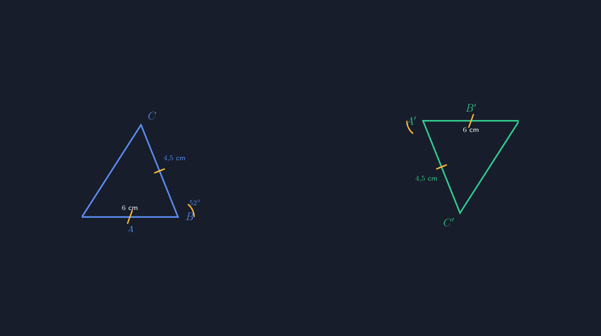

Di kelas IX pekan lalu, kami membahas kekongruenan. Saya menggambar dua segitiga di papan: satu menghadap ke atas, satu saya putar agak miring ke kanan. Lalu saya bertanya, "Dua segitiga ini sama atau tidak?" Hampir seluruh kelas menjawab sama, tapi ketika saya minta alasan, jawabannya berhenti di "bentuknya kelihatan sama, Pak." Persis di titik itu matematika kelas IX mulai berbeda dari kelas-kelas sebelumnya: kelihatan sama tidak lagi cukup. Yang dicari adalah jaminan, dan jaminan itu punya nama — syarat kekongruenan.

Masalahnya, syarat kekongruenan justru sering diajarkan sebagai daftar hafalan. Sas, Sas, Asa, As, Sasa. Lima singkatan yang dihafal lebih cepat daripada dipahami. Saya sendiri dulu menghafalnya begitu, dan saya tahu persis apa akibatnya: murid bisa mengisi tabel "bangun mana yang kongruen dengan alasan apa" dengan benar, tetapi ketika saya tumpuk dua segitiga yang sama ukurannya dengan posisi berbeda di kertas buram, mereka ragu apakah dua bangun itu masih boleh disebut kongruen. Ada celah antara hafalan dan pengertian, dan celah itu terasa banget kalau kita sedang berdiri di depan kelas.

<!--more-->

## Kesalahan pertama: kongruen dianggap "sama bentuk"

Miskonsepsi yang paling sering saya temui tentang kekongruenan sebenarnya sederhana: murid mencampuradukkan kongruen dengan sebangun. Dua segitiga yang sudut-sudutnya sama besar tetapi sisinya beda ukuran memang sebangun, tapi tidak kongruen. Di papan tulis, dua bangun seperti itu terlihat "sama bentuknya", dan kata "sama" itulah yang menipu.

Karena itu tahun ini saya mencoba jalur lain. Sebelum menyebut istilah kongruen, saya membagikan kertas berpetak dan meminta setiap kelompok menggambar segitiga dengan sisi 6 cm dan 4,5 cm, dengan sudut 52 derajat di antara keduanya. Lima kelompok, lima gambar. Ketika kertas-kertas itu disalin ke papan dan ditumpuk informasinya, semua kelompok mendapat segitiga dengan ukuran yang persis sama walau posisinya boleh dibedakan. Dari situ kami sampai pada kesimpulan bersama: kalau dua sisi dan sudut apitnya sama, bangunnya sudah terkunci, tidak ada kebebasan tersisa. Informasi yang cukup untuk mengunci bentuk dan ukuran itulah yang nanti dinamakan syarat kekongruenan.

Gambarnya kira-kira begini:



Gambar di atas saya buat ulang secara digital, dan di sinilah TikZ masuk. Yang saya suka dari menggambar kekongruenan dengan TikZ bukan sekadar hasilnya rapi, tetapi bahwa gambar seperti ini memaksa saya jujur pada data. Kalau saya menulis di kode bahwa sisi itu 6 cm dan sudutnya 52 derajat, koordinat segitiga harus benar-benar mengikuti angka itu — dan kalau saya mengklaim dua segitiga kongruen, segitiga keduanya memang harus salinan persis dari yang pertama, cukup diputar atau digeser. Tidak ada ruang untuk menggambar "asal mirip" seperti waktu saya menggambar manual di papan dengan tangan yang gemetar menjelang jam istirahat.

Potongan kodenya untuk segitiga pertama seperti ini:

```latex
\coordinate (A) at (0,0);
\coordinate (B) at (3.6933,0);
\coordinate (C) at (2.2724,3.5460);
\draw[tri1] (A) -- (B) -- (C) -- cycle;
% tanda satu garis pada AB
\draw[tickmark] (1.75,-0.26) -- (1.94,0.26);
% busur sudut B
\draw[anglemark] (B) ++(52:0.62) arc[start angle=52, end angle=0, radius=0.62];
```

Angka 3,6933 itu bukan angka sakti; itu hasil $6\cos 52^\circ$. Panjang $AB$ saya pasangkan 6 cm, sudut apitnya 52 derajat, sehingga koordinat $B$ dihitung dari trigonometri, bukan ditebak. Dan untuk segitiga keduanya saya tidak menggambar ulang dengan angka baru — cukup satu perintah:

```latex
\begin{scope}[rotate around={180:(8.4,1.85)}]
  % ... salinan persis segitiga pertama ...
\end{scope}
```

Dengan `rotate around`, segitiga kedua adalah segitiga pertama yang diputar 180 derajat terhadap satu titik. Ukurannya mustahil berubah, dan justru itulah pesannya: kekongruenan adalah soal transformasi yang mempertahankan ukuran. Murid yang melihat gambar seperti ini secara tidak langsung menyerap ide bahwa memutar atau menggeser bangun tidak mengubah kongruennya — ide yang nanti akan mereka butuhkan lagi pas Transformasi Geometri.

## Tanda kaki dan busur: bahasa gambar yang perlu diajarkan

Ada satu hal lain yang sering luput: murid tidak otomatis paham bahwa satu garis kecil pada dua sisi berarti "kedua sisi ini sama panjang". Notasi kaki ayam, busur sudut, tanda dua garis — itu semua bahasa gambar yang harus diperkenalkan dan dilatih. Saya pernah memberi soal dengan notasi lengkap dan separuh kelas membacanya sebagai hiasan.

Menggambar notasi itu dengan tangan di papan selalu berakhir janggal; tanda kakinya miring tidak karuan. Di TikZ, tanda itu presisi dan konsisten:

```latex
% satu tanda pada AB, dua tanda pada BC
\draw[tickmark] (1.75,-0.26) -- (1.94,0.26);
\draw[tickmark] ($(Mbc)!0.12cm!90:(B)$) -- ($(Mbc)!0.12cm!90:(C)$);
\draw[tickmark] ($(Mbc)!0.22cm!90:(B)$) -- ($(Mbc)!0.22cm!90:(C)$);
```

Perintah `($(Mbc)!0.12cm!90:(B)$)` mungkin terlihat menakutkan, tapi maknanya sederhana: ambil titik tengah sisi, geser 0,12 cm tegak lurus terhadap sisi itu. Hasilnya tanda kaki yang selalu tegak lurus pada sisi yang ditandainya, di segitiga mana pun, dengan kemiringan apa pun. Sama untuk busur sudut — busurnya digambar pada jarak tetap dari titik sudut, jadi dua sudut yang sama besar memang terlihat ditandai dengan cara yang sama.

Konsistensi kecil begini yang membuat gambar soal bisa dipercaya. Murid yang terbiasa dengan gambar yang jujur akan lebih berani menggantungkan penalarannya pada gambar; murid yang sering kecewa sama gambar soal akan belajar untuk tidak percaya, dan itu bukan kebiasaan yang kita inginkan di kelas matematika.

## Syarat-syaratnya sendiri jadi cerita, bukan daftar

Setelah kegiatan penguncian segitiga tadi, syarat-syarat kekongruenan tidak lagi saya sampaikan sebagai daftar yang turun dari langit. Sas, Sas, Asa, As — masing-masing saya bingkai sebagai pertanyaan: informasi secukup apa yang membuat segitiga tidak punya kebebasan lagi?

Tiga sisi? Jelas terkunci, tidak ada yang bisa digerakkan. Dua sisi dan sudut apitnya? Terkunci juga, seperti yang kelima kelompok tadi buktikan. Dua sudut dan sisi apitnya? Kalau dua sudut sudah ditetapkan, sudut ketiga tinggal mengikuti jumlah $180^\circ$, jadi sisi apit sudah "mengunci" segalanya. Yang menarik justru kasus yang gagal: dua sisi dan sudut yang **tidak** diapit keduanya. Di situ segitiga masih punya dua bentuk yang mungkin — kasus dua segitiga yang tidak kongruen tapi memenuhi "syarat" yang sama. Kasus ini jarang dibahas tuntas, padahal justru di sini murid paling bisa merasakan makna kata *syarat*: bukan semua kombinasi informasi cukup untuk mengunci bangun.

Kasus sisi-sudut-sisi-tanpa-apit itu, kalau mau digambar di TikZ, menghasilkan dua segitiga yang berbeda bentuk dari data yang sama persis. Saya belum sempat membuat gambarnya untuk latihan tahun ini, tapi sudah saya catat untuk pertemuan berikutnya — satu gambar yang menunjukkan dua segitiga "hampir kongruen" dari data yang sama mungkin lebih meyakinkan daripada sepuluh menit penjelasan verbal.

## Penutup: dari menghafal singkatan ke memahami mengapa

Kekongruenan sering dianggap bab yang ringan, semacam jeda sebelum materi yang lebih berat. Tapi setelah beberapa tahun mengajarnya, saya makin yakin bab ini penting justru karena menanamkan kebiasaan berpikir yang kelak dipakai di mana-mana: berhati-hati membedakan yang "kelihatan sama" dari yang "terbukti sama". Itu kebiasaan yang juga berguna jauh di luar matematika.

Untuk Bapak/Ibu yang ingin mencoba menggambar kekongruenan dengan TikZ, saran saya satu: mulailah dari satu segitiga dengan koordinat yang dihitung dari data soal, bukan ditebak. Begitu segitiga pertamanya jujur pada angka, segitiga keduanya tinggal salinan — dan justru di situ letak kekuatannya, karena kongruen memang artinya salinan persis.

> 📎 **Berkas TikZ lengkap:** [tikz-keongruenan.tex](tex/tikz-keongruenan.tex) — siap kompilasi (butuh paket `tikz`).
