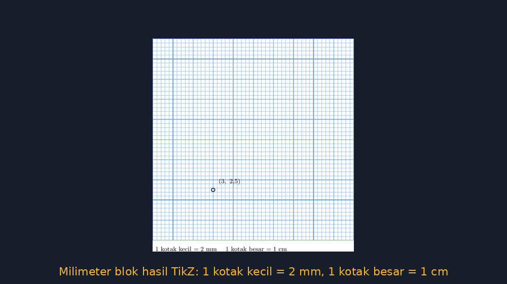

Minggu lalu saya butuh kertas grafik untuk menggambar diagram batang nilai ulangan kelas VIII. Bapak/Ibu tahu bagaimana kondisi kertas grafik di sekolah kami: stoknya habis sejak bulan September, dan yang tersisa di lemari adalah beberapa lembar milimeter blok bekas kegiatan PTK tahun 2019 yang pinggirnya sudah menguning. Saya sempat berencana ke kios alat tulis di pasar, lalu ingat bahwa bapak saya dulu sebenarnya punya solusi yang lebih tua dari semua teknologi: menarik garisnya sendiri dengan penggaris.

Hanya saja, pengalaman saya menarik garis dengan tangan di depan kelas tidak pernah berakhir rapi. Garis pertama masih tegak, garis kedua mulai condong, dan di garis kedua puluh jarak antar kotaknya sudah tidak bisa dipertanggungjawabkan. Siswa yang jeli pasti berkomentar. Akhirnya saya membuka laptop, dan seperti biasa, jawabannya adalah TikZ.

<!--more-->

## Kenapa Kertas Grafik Punya Aturan yang Sama Kerasnya dengan Soal

Kalau Bapak/Ibu mengikuti tulisan-tulisan saya sebelumnya, mungkin sudah akrab dengan prinsip yang saya pegang sejak artikel tentang bidang koordinat: gambar yang saya berikan ke siswa tidak boleh mengarang jarak. Di kertas grafik, prinsip ini justru menjadi intinya. Seluruh kegunaan milimeter blok bertumpu pada satu janji sederhana, yaitu jarak antar garis tebal sama dengan jarak antar garis tipis yang ada di dalamnya, dan janji itu berlaku sampai ke tepi kertas.

Kalau janji itu retak sedikit saja, siswa yang menandai titik $(3,\ 2{,}5)$ akan merasa titiknya "naik" tanpa sebab. Saya pernah melihatnya sendiri. Pada suatu ulangan, sebagian siswa menggambar diagramnya di kertas grafik bekas dengan garis yang agak bergelombang karena terlipat. Hasil diagram mereka tampak "miring" padahal penandaan titiknya benar. Anak-anak itu panik karena merasa bersalah pada diri sendiri, padahal yang salah adalah kertasnya. Sejak saat itu saya tidak lagi menganggap kertas grafik sekadar pelengkap; dia adalah instrumen ukur, dan instrumen ukur boleh saja rusak, tapi tidak bo bohong.

## Ide Dasarnya Sederhana, Detailnya yang Bekerja

Struktur milimeter blok sebenarnya cuma dua lapis garis: garis tipis tiap $1\ \text{mm}$ (atau di versi kelas saya, tiap $2\ \text{mm}$ biar tidak terlalu padat saat dicetak di printer sekolah), lalu garis lebih tebal tiap $5\ \text{mm}$, dan garis paling tebal tiap $1\ \text{cm}$. Semua biru muda khas kertas grafik supaya tinta pensil siswa menang di atasnya.

Di TikZ, lapisan itu bisa dibangun dengan dua perulangan sederhana:

```latex
\foreach \x in {0,1,...,20}
  \draw[grafiktipis] (\x,0) -- (\x,14);
\foreach \y in {0,1,...,14}
  \draw[grafiktipis] (0,\y) -- (20,\y);
\foreach \x in {0,5,10,15,20}
  \draw[grafiktebal] (\x,0) -- (\x,14);
\foreach \y in {0,5,10}
  \draw[grafiktebal] (0,\y) -- (20,\y);
```

Di sinilah saya jatuh cinta lagi pada TikZ, karena perulangan `\foreach` itu adalah janji matematika yang dibaca komputer: dari 0 sampai 20, setiap satu satuan, garis vertikal, sampai selesai. Tidak ada garis yang lelah, tidak ada garis yang sedikit condong karena saya menggambar sambil memegang spidol. Kalau ukuran kotaknya harus diubah, saya cukup mengubah satu angka, dan seluruh kertas menyesuaikan diri secara konsisten. Inilah perbedaan mendasar antara menggambar dan menghitung gambar: menghitung gambar itu proporsional sampai ke tepi.

## Soal Warna: Biru yang Tidak Menang Atas Pensil

Satu detail yang hampir saya lewatkan adalah warna. Kertas grafik komersial memakai biru sangat muda karena alasan praktis: saat siswa menggambar dengan pensil hitam, garis biru itu tampak seperti latar, bukan konten. Percobaan pertama saya memakai warna biru yang kepekat, dan hasil cetaknya tampak seperti kertas garis bergaris-garis rapat yang menyilaukan. Diagram batang siswa tenggelam di dalamnya.

Solusinya di TikZ mudah, tinggal mendefinisikan warna sendiri dengan tingkat transparansi atau campuran putih:

```latex
\definecolor{birugrafik}{RGB}{170,200,235}
```

Tapi kesannya jauh lebih besar daripada satu baris kodenya. Media itu berbicara ke siswa sebelum konten kita sempat bicara. Kertas grafik yang garisnya ramai menyuruh siswa untuk takut pada kertas itu sendiri; kertas grafik yang garisnya tahu diri menyuruh siswa untuk mulai menggambar. Saya makin yakin bahwa pekerjaan mendesain bahan ajar bukan soal estetika, melainkan soal mengatur siapa yang berbicara paling keras di halaman itu.

## Lipatan Kecil di Pinggir Lembar

Ada satu manfaat yang tidak saya duga: karena kertasnya buatan sendiri, saya bisa menambahkan hal-hal kecil yang di kertas komersial tidak mungkin. Misalnya, di pinggir kanan bawah saya tuliskan skala kotaknya secara eksplisit: "1 kotak kecil = 2 mm, 1 kotak besar = 1 cm". Tampak sepele, tapi kebiasaan siswa membaca kertas grafik biasanya berhenti pada "kotaknya sama besar semua", tanpa pernah ditanya satu kotak itu mewakili berapa. Dengan mencantumkan skala di kertasnya, pertanyaan "satu kotak itu berapa" berhenti menjadi pertanyaan yang harus dijawab lisan setiap kali, dan mulai menjadi pertanyaan yang dijawab kertas itu sendiri.

Saya juga mulai menyiapkan dua versi: versi polos untuk menggambar bebas, dan versi yang sudah berlabel sumbu untuk latihan diagram tertentu. File `.tex`-nya hanya satu, tinggal mengganti satu parameter apakah sumbu digambar atau tidak. Ini yang saya tidak bisa dapat dari kertas yang dibeli sekantong.


*Kertas grafik hasil kompilasi TikZ: 1 kotak kecil = 2 mm, 1 kotak besar = 1 cm, dengan satu titik contoh.*

## Yang Saya Belajar Lagi

Pekerjaan menggambar milimeter blok ini terlihat sangat teknis, dan memang begitu. Tapi pengalaman dengan alat-alat sederhana seperti ini selalu mengajar saya sesuatu yang lebih besar. Kertas grafik yang saya gambar sendiri adalah instrumen yang saya tahu persis kenapa dia begini bentuknya. Garis tebalnya tebal karena memang begitu saya putuskan. Warnanya pudar karena saya pernah mencoba yang pekat dan melihat siswa tenggelam di dalamnya.

Ketika media berasal dari keputusan yang bisa saya jelaskan, saya jadi lebih berani mempergunakannya di kelas. Dan ketika siswa bertanya "Pak, ini kotaknya kenapa 2 mm, bukan 1 mm?", jawabannya bukan "karena begitulah adanya", melainkan cerita tentang printer sekolah yang tinta hitamnya sering habis dan garis terlalu rapat yang membuat mata siswa cepat lelah. Anak-anak suka cerita seperti itu. Di situ mereka belajar bahwa media itu bukan benda yang turun dari langit, melainkan hasil dari keputusan-keputusan kecil yang bisa mereka sendiri pertanyakan dan, siapa tahu kelak, buat ulang.

> 📎 **Berkas TikZ lengkap:** [tex/tikz-kertas-grafik-milimeter.tex](tex/tikz-kertas-grafik-milimeter.tex) — siap kompilasi (butuh paket `tikz`).
