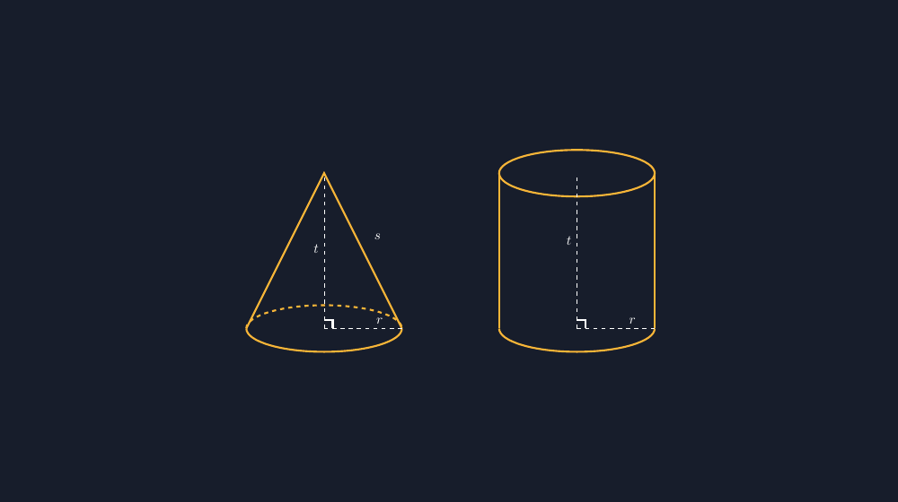

Bapak/Ibu yang juga sering mengetik soal matematika, mungkin pernah mengalami hal yang sama seperti saya. Kalau soalnya cuma butuh angka — "Sebuah kerucut berjari-jari 7 cm dan tinggi 12 cm..." — kita bisa lewat begitu saja tanpa gambar. Tapi begitu ada siswa yang bertanya, "Pak, kerucutnya mana?" saya jadi sadar sesuatu: selama ini murid saya menghitung volume benda yang tidak pernah mereka lihat, setidaknya tidak di lembar soal itu.

Makanya sejak beberapa bulan terakhir saya konsisten menggambar ulang soal-soal geometri saya dengan TikZ. Bidang koordinat sudah, bangun datar sudah, garis bilangan sudah. Nah, minggu lalu giliran yang menurut saya paling jahil: **kerucut dan silinder**.

<!--more-->

## Kenapa kerucut dan silinder lebih sulit?

Bangun datar itu jujur. Kalau saya bilang "gambar segitiga siku-siku dengan sisi miring 10 cm", TikZ tinggal menaruh koordinat dan garis lurusnya tinggal ditarik. Tidak ada ruang untuk bohong.

Kerucut dan silinder beda. Dua-duanya punya sisi lengkung, dan di kertas — media dua dimensi — lengkungan itu harus *disimulasikan*. Alas yang sebenarnya lingkaran harus digambar sebagai **elips**, karena kita melihatnya dari sudut yang agak miring. Di sinilah banyak gambar soal yang pernah saya buat dulu jadi tidak jujur: elipsnya terlalu pipih atau terlalu buncit, sehingga kesannya seolah-olah kita melihat alas hampir dari samping. Untuk siswa SMP yang baru pertama kali berkenalan dengan bangun sisi lengkung, kesan visual semacam itu bisa menyesatkan.

Jadi target saya sederhana: gambar kerucut dan silinder yang *proporsinya masuk akal*, dengan garis bantu yang bisa saya kontrol, dan label $r$, $t$, dan $s$ (garis pelukis kerucut) yang letaknya tepat.

## Silinder: dua elips dan dua garis

Kunci menggambar silinder di TikZ cuma tiga bahan: elips atas, elips bawah, dan dua garis vertikal penghubung. Elips di TikZ didefinisikan dengan radius horizontal dan radius vertikal. Misalnya radius horizontal 2 cm dan radius vertikal 0.6 cm:

```latex
\draw (0,0) ellipse (2 and 0.6);
\draw (0,4) ellipse (2 and 0.6);
\draw (-2,0) -- (-2,4);
\draw (2,0) -- (2,4);
```

Masalahnya, gambar seperti itu terlihat seperti silinder "kaca" — kedua elips terlihat utuh. Secara matematis memang benar, tapi secara gambar teknik, elips bawah yang berada di belakang biasanya digambar **setengah saja** (hanya bagian depan), karena bagian belakangnya tertutup badan silinder. Di TikZ, trik yang saya pakai: gambar elips bawah memakai arc dari $-180^\\circ$ sampai $0^\\circ$ saja:

```latex
\draw (-2,0) arc[start angle=180, end angle=360,
                 x radius=2, y radius=0.6];
```

Hasilnya bagian bawah silinder jadi utuh terasa — pembaca tahu itu ada alasnya, tapi tidak ada garis yang "menembus" badan silinder. Detail kecil seperti ini yang bikin gambar soal terasa rapi meski siswa mungkin tidak bisa menjelaskan kenapa.

## Kerucut: puncak, elips, dan dua garis singgung

Kerucut lebih menarik lagi. Strukturnya: satu titik puncak, satu elips alas, dan dua garis dari puncak yang menyinggung sisi kiri dan kanan elips. Yang jadi pertanyaan: garis itu harus berhenti di mana? Kalau saya tarik sampai titik ujung elips $(2,0)$ dan $(-2,0)$, gambarnya jadi terlihat benar untuk kasus standar ini:

```latex
\draw (-2,0) -- (0,4) -- (2,0);      % garis pelukis
\draw (-2,0) arc[start angle=180, end angle=360,
                 x radius=2, y radius=0.6];  % alas depan
\draw[dashed] (-2,0) arc[start angle=180, end angle=0,
                 x radius=2, y radius=0.6];  % alas belakang
```

Perhatikan bahwa garis pelukis dan elips bertemu tepat di ujung kiri dan kanan elips. Untuk puncak yang tidak terlalu tinggi, sebenarnya ada perhitungan garis singgung yang lebih presisi — tetapi untuk kebutuhan soal SMP, titik ujung elips itu sudah menghasilkan gambar yang terlihat benar dan, yang lebih penting, *konsisten* setiap kali saya pakai ulang templatenya.

Untuk jari-jari dan tinggi, saya gambar garis bantu putus-putus di dalam: dari pusat alas ke tepi (jari-jari $r$), dan dari pusat alas ke puncak (tinggi $t$), lengkap dengan tanda siku di sudut yang dibentuknya. Tanda siku ini sering saya lupakan dulu, padahal justru itulah yang membuat siswa ingat hubungan $r$, $t$, dan $s$ dalam segitiga siku-siku di dalam kerucut.



## Template, bukan karya seni

Bapak/Ibu, jangan bayangkan saya menggambar ulang dari nol setiap membuat soal. Justru kekuatan TikZ ada di templatenya. Kode kerucut di atas saya simpan sebagai *standalone* dan tinggal saya ubah angkanya kalau soal butuh jari-jari 10 cm atau tinggi 24 cm. Semua gambar soal bangun sisi lengkung saya sekarang berasal dari satu template yang sama — jadi gaya gambarnya seragam di seluruh paket soal, dari ulangan harian sampai asesmen akhir.

Kalau Bapak/Ibu mau mencoba, file `.tex` lengkap yang bisa langsung dikompilasi saya sertakan di bawah. Isinya persis kode yang menghasilkan gambar di artikel ini — bukan potongan yang sudah saya poles berlebihan.

## Dua kali gagal sebelum benar

Supaya adil, saya perlu cerita juga bahwa template ini tidak langsung jadi. Render pertama saya punya dua cacat yang baru saya sadari setelah gambarnya selesai dan saya tatap lama.

Pertama, elips bawah silinder saya gambar utuh. Hasilnya aneh: ada garis yang seolah menembus badan silinder, dan kesannya silinder itu "transparan". Siswa yang terbiasa dengan gambar buku pelajaran akan langsung merasa ada yang tidak pas, meski tidak bisa menyebutnya. Solusinya sederhana — arc setengah seperti di atas — tapi saya butuh kegagalan dulu untuk menyadarinya.

Kedua, label $t$ di silinder saya taruh terlalu ke kanan, sampai menimpa dinding silinder. Label yang menabrak garis itu masalah kecil yang efeknya besar: gambar langsung terlihat "buatan amatir". Sekarang saya punya kebiasaan baru: setelah kompilasi, gambar saya buka dan saya lihat dulu sebagai pembaca biasa — bukan sebagai pembuat kode — sebelum gambar itu masuk ke paket soal. Sering kali lima detik melihat bisa menangkap hal yang sepuluh menit membaca kode tidak menemukan.

Kalau Bapak/Ibu baru mulai dengan TikZ, dua kegagalan ini barangkali berguna lebih dari segala tips: kesalahan di gambar geometri jarang terlihat di kode, hampir selalu terlihat di hasil render.

## Penutup: gambar yang jujur itu bentuk penghormatan

Malam itu, setelah paket soal bangun ruang selesai saya ketik ulang, saya teringat satu siswa di kelas yang dulu bertanya, "Pak, ini kok bentuknya aneh? Kerucut kan bukan kayak gini." Ia benar. Gambar yang asal-asalan bukan cuma kurang estetis — ia mengajarkan sesuatu yang salah secara diam-diam.

Menggambar dengan TikZ memang butuh investasi waktu di awal. Tapi setiap elips yang proporsinya benar, setiap garis bantu yang berhenti di tempat yang semestinya, adalah bentuk penghormatan saya pada murid-murid yang akan membaca lembar itu besok pagi. Dan seperti biasa, template-nya sekarang jadi milik kelas saya — siap dipakai lagi tahun depan, tanpa perlu pusing menggambar ulang.

> 📎 **Berkas TikZ lengkap:** [kerucut-silinder.tex](tex/kerucut-silinder.tex) — siap kompilasi (butuh paket `tikz`).
