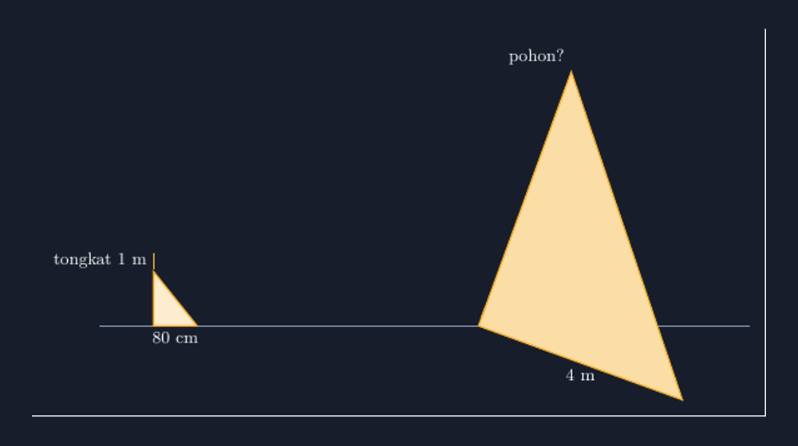

Kalau ditanya bab matematika SMP mana yang paling "bergantung pada gambar", jawaban saya pasti kesebangunan. Bab ini hampir tidak bisa diajarkan tanpa gambar: soal tentang menara dan bayangannya, tentang pohon dan tongkat, tentang dua segitiga yang katanya sebangun. Dan justru karena itu, bab ini juga bab yang paling sering saya "khianati" oleh gambar buatan saya sendiri.

<!--more-->

## Gambar yang Bohong

Beberapa tahun lalu saya memberi soal klasik: sebuah tongkat setinggi 1 meter bayangannya 80 cm, di saat yang sama bayangan sebuah pohon 4 meter. Berapa tinggi pohon? Soal standar, jawaban 5 meter, dan mayoritas kelas saya menjawabnya benar. Tapi ketika saya menampilkan gambar soal yang saya buat asal-asalan di word processor — segitiga kecil dan segitiga besar yang saya tarik-tarik pakai mouse — ada seorang siswa yang mengangkat tangan.

"Pak, kok pohonnya tidak lima kali tongkatnya? Di gambar cuma dua kali, kurang lebih."

Saya menatap gambar itu. Dia benar. Segitiga yang saya gambar tidak setia pada rasio 1 : 5. Lalu saya merasa harus menjawab, dan jawaban saya saat itu — "ya gambar cuma sketsa, yang penting hitungannya" — saya sadari sekarang adalah jawaban yang lemah. Karena di bab kesebangunan, gambar bukan hiasan. Gambar adalah wujud dari pernyataan "kedua bangun ini punya perbandingan sisi yang sama". Kalau gambar itu sendiri tidak sebangun, saya sedang menunjukkan contoh tandingan untuk teori yang sedang saya ajarkan.

Makanya, ketika saya menggambar soal kesebangunan sekarang, saya pelit dengan gambar yang tidak akurat. Dan seperti tulisan-tulisan saya sebelumnya tentang TikZ, jawabannya adalah menggambar yang bisa dipercaya. Inilah bentuk gambar yang sekarang saya pakai — segitiga pohonnya sengaja saya putar, alasannya menyusul:


*Dua segitiga sebangun dengan rasio 1 : 5 — segitiga besar sengaja diputar 20 derajat supaya siswa mencocokkan lewat sudut, bukan lewat posisi.*

## Kesebangunan Itu Soal Skala, Bukan Kesan Mata

Sebelum masuk kode, ada hal kecil yang ingin saya luruskan — sesuatu yang sering terlewat. Dua segitiga dikatakan sebangun jika sudut-sudut yang bersesuaian sama besar, atau — ekuivalennya — perbandingan sisi-sisi yang bersesuaian sama. Yang menarik: kesebangunan tidak peduli orientasi. Segitiga yang satu bisa berputar, terbalik, atau dicermin, dan tetap sebangun. Ini berbeda dengan kongruensi yang lebih keras lagi.

Miskonsepsi yang paling sering saya temui di kelas adalah siswa mencocokkan sisi berdasarkan "posisi" saja: sisi yang di bawah dicocokkan dengan sisi yang di bawah, sisi miring dengan sisi miring. Padahal pada gambar di mana salah satu segitiga diputar, pencocokan posisi bisa total salah. Misalnya dua segitiga dengan sudut yang sama tapi sisi miring yang satu ternyata berpasangan dengan sisi tegak yang lain.

Makanya, ketika saya menggambar soal kesebangunan sekarang, saya sengaja kadang memutar salah satu segitiganya. Bukan untuk menyulitkan, tapi supaya gambar melatih kebiasaan yang benar: mencocokkan lewat sudut dan perbandingan, bukan lewat arah mata. Dan TikZ memungkinkan saya melakukannya dengan rasio yang benar-benar presisi.

## Menulis Segitiga Sebangun dengan TikZ

Ide dasarnya sederhana: tentukan titik-titik segitiga pertama dengan koordinat nyata, lalu segitiga keduanya adalah hasil peregangan dari faktor skala yang sama. Kalau faktor skalanya $k$, maka segitiga kedua adalah segitiga pertama yang "dikalikan" $k$. Dengan begitu, kejujuran rasio dijamin secara matematis — bukan dititipkan pada ketelitian tangan.

Berikut inti gambarnya untuk soal tongkat dan pohon, dengan segitiga pohon diputar agar siswa tidak bisa mengandalkan posisi:

```latex
\begin{tikzpicture}[scale=1.1]
  % Segitiga tongkat: tinggi 1, bayangan 0.8
  \coordinate (A) at (0,0);
  \coordinate (B) at (0,1);
  \coordinate (C) at (0.8,0);
  \draw[thick, fill=accent!25] (A) -- (B) -- (C) -- cycle;
  \node[left] at (B) {\small tongkat 1 m};
  \node[below] at (C) {\small 80 cm};

  % Segitiga pohon: dikalikan k = 5, lalu diputar -20 derajat
  \begin{scope}[rotate around={-20:(6,0)}]
    \coordinate (P) at (6,0);
    \coordinate (Q) at ($(P)+(0,5)$);
    \coordinate (R) at ($(P)+(4,0)$);
    \draw[thick, fill=accent!45] (P) -- (Q) -- (R) -- cycle;
    \node[left] at (Q) {\small pohon?};
    \node[below] at (R) {\small 4 m};
  \end{scope}
\end{tikzpicture}
```

Perhatikan satu hal: saya tidak "menggambar segitiga besar yang kelihatannya lima kali". Saya mengalikan. $(P)+(0,5)$ artinya tinggi pohon benar-benar lima kali tinggi tongkat, dan $(P)+(4,0)$ artinya bayangannya benar-benar lima kali bayangan tongkat. Kalau siswa mau mengukur gambar itu dengan penggaris (dan percayalah, ada saja yang melakukannya), ukurannya akan jujur.

Ini inti pesan saya untuk rekan guru yang mulai menyentuh TikZ: pada bab kesebangunan, faktor skala di TikZ bukan sekadar cara praktis — dia adalah model dari konsep yang sedang diajarkan. Saat Anda menulis `scale=5` atau mengalikan koordinat dengan 5, Anda sedang mengoperasionalkan definisi kesebangunan itu sendiri. Gambar dan materi jadi satu kesatuan, bukan dua hal yang kebetulan ditaruh berdampingan.

## Menggambar yang Memutar, Tanpa Kehilangan Kebenaran

Bagian yang saya suka dari alur ini adalah perintah `rotate around`. Seperti sudah saya singgung, kesebangunan tidak peduli orientasi — dan itulah justru hal yang ingin dilatih. Dengan memutar segitiga besar 20 derajat di sekitar titik pangkalnya, gambar tetap memuat semua informasi yang benar: rasio sisi tidak berubah oleh rotasi. Tapi ketergantungan siswa pada "yang bawah cocok dengan yang bawah" langsung teruji.

Di kelas, gambar yang diputar ini menjadi pembuka diskusi yang bagus. Saya bertanya, "segitiga mana yang cocok dengan sisi miring segitiga kecil?" Sebagian anak menjawab sisi miring yang besar — dan itu justru kesempatan untuk menunjukkan bahwa sudut yang menentukan pencocokan, bukan kemiringan. Segitiga kecil punya sudut siku-siku di kiri bawah; segitiga besar yang diputar punya sudut siku-siku di tempat yang berputar. Dari sudut itulah pasangan sisi dicari: sisi di hadapan sudut yang sama.

Ada juga manfaat kecil tapi nyata: karena koordinatnya eksplisit, saya bisa membuat varian soal dengan cepat. Mau ubah bayangan pohon jadi 6 meter? Tinggal ganti satu angka. Mau buat versi di mana siswa harus mencari bayangan, bukan tinggi? Ganti mana yang diketahui dan mana yang ditanya. Satu file sumber, banyak lembar soal yang semuanya jujur pada skalanya.

## Verifikasi Kecil yang Menyelamatkan

Satu kebiasaan yang saya anjurkan: setelah selesai menggambar, ukur ulang gambar jadinya. Bukan dengan mata — dengan perhitungan. Panjang sisi di TikZ bisa diperiksa lewat koordinatnya sendiri; kalau saya menulis tinggi 5 dan bayangan 4, maka sisi miringnya seharusnya $\sqrt{25+16} = \sqrt{41} \approx 6{,}4$ satuan. Kalau hasil render terlihat berbeda dari itu, ada yang salah — biasanya karena saya lupa segitiga kedua tidak dalam scope yang sama, atau faktor skalanya keliru.

Kebiasaan kecil ini ternyata juga bagus diajarkan ke siswa yang mulai belajar menggambar digital: kejujuran gambar bisa dicek, bukan sekadar dirasakan. Itu pelajaran matematika yang tidak tertulis di silabus, tapi melekat.

## Penutup: Gambar sebagai Janji

Setiap kali saya menaruh gambar segitiga sebangun di papan atau di lembar soal, saya sebenarnya membuat janji ke siswa: "bangun yang saya tunjukkan ini benar-benar memiliki perbandingan sisi yang sama." Dulu janji itu sering saya langgar tanpa sengaja, hanya karena menggambar dengan tangan atau mouse itu sulit. Dengan TikZ, janji itu bisa ditepati secara otomatis — tinggal menuliskan faktor skalanya, dan matematika mengurus sisanya.

Gambar yang jujur tidak membuat soal kesebangunan jadi lebih mudah. Tapi dia membuat kebingungan siswa jadi jujur juga: kalau mereka salah, mereka salah di matematikanya, bukan di gambar saya. Bagi saya itu perbedaan yang cukup besar untuk terus menulis kode TikZ setiap kali bab ini tiba di kalender akademik.

> 📎 **Berkas TikZ lengkap:** [tikz-kesebangunan-segitiga.tex](tex/tikz-kesebangunan-segitiga.tex) — siap kompilasi (butuh paket `tikz`).
