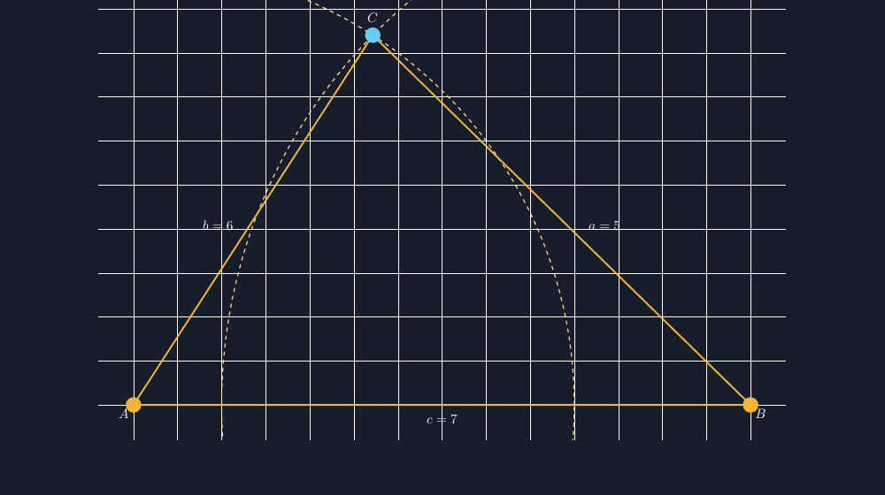

Kursi belakang di kelas VII B sudah bertahun-tahun goyang. Kakinya empat, tapi salah satunya sedikit lebih pendek, dan setiap kali anak yang duduk di situ bergeser, kursinya berdenting seperti lonceng kecil. Suatu pagi, sambil meminjam selotip untuk perbaikan darurat, saya iseng bertanya, "Kalau kursi ini kakinya tiga, kira-kira masih goyang nggak?" Dan kelas itu — yang biasanya butuh waktu lama untuk menyala — langsung berdebat. Ada yang bilang stabil, ada yang bilang malah mudah terguling. Pertanyaan sederhana, tapi ia membawa kita ke salah satu sifat paling istimewa dari segitiga.

<!--more-->

## Empat kaki boleh goyang, tiga kaki tidak

Percobaannya bisa dilakukan dengan kursi asli, tapi lebih aman dengan tiga pensil dan selembar buku. Tiga titik tumpu — berapa pun bentuk segitiganya — selalu menentukan satu bidang yang datar. Empat titik? Tidak selalu. Kalau keempatnya tidak persis pada satu bidang, salah satu kaki melayang. Itulah denting kursi tua kita: kaki keempat yang berharap menyentuh lantai.

Sifat geometrinya: tiga titik yang tidak segaris selalu koplanar dan membentuk segitiga yang kaku. Kalau panjang ketiga sisinya sudah tetap, bentuk segitiganya tidak bisa diubah tanpa merusak sisi itu sendiri. Bandingkan dengan persegi empat batang bingkai yang disambung engsel: tekan sudutnya sedikit, dan persegi itu menyender jadi belah ketupat. Persegi punya satu derajat kebebasan yang tidak dimiliki segitiga — dan itulah kenapa rangka atap, menara transmisi, dan penyangga papan nama sekolah semua penuh "segitiga" di dalamnya, bukan persegi.

Dari sini kelas melaju dengan sendirinya: kalau sisinya yang menentukan, bisakah kita membangun segitiga hanya dari tiga panjang? Jawabannya tidak selalu — dan di sinilah hubungan segitiga yang paling sering dihafal tanpa dimengerti muncul: jumlah dua sisi terpendek harus lebih panjang dari sisi terpanjang. Siswa yang pernah mencoba membangun "segitiga" 2, 3, dan 7 dari stik es krim akan mengingat kenapa aturan itu ada: stik-stik itu tidak pernah bertemu di satu titik.

## Menggambar segitiga yang bisa dibangun

Karena sisi menentukan bentuk, saya ingin siswa melihat sendiri bahwa menggambar segitiga dari tiga sisi adalah pekerjaan jangka, bukan tebakan. Ini inti dari gambar yang saya pakai di kelas — membangun segitiga dengan sisi $a=5$, $b=6$, dan $c=7$, lengkap dengan langkah langkah busurnya:

```latex
% sisi c = AB digambar dulu
\draw[thick] (0,0) -- (7,0) node[midway,below] {$c=7$};
% busur jangka dari A berjari-jari 5 (sisi a)
\draw[dashed] circle at (A) ...;
% busur dari B berjari-jari 6 (sisi b); perpotongan = titik C
```

Hasil rendernya seperti di bawah. Dua busur putus-putus itu adalah jejak jangka: dari titik $A$ dengan jari-jari $5$, dari titik $B$ dengan jari-jari $6$, dan titik temu keduanya — tunggal di atas garis, tunggal di bawah — adalah satu-satunya tempat $C$ boleh berada.



Yang membuat gambar TikZ ini berbeda dari sketsa manual: busurnya benar-benar berjari-jari sebesar angkanya. Kalau saya menggambar manual di papan, jangka kapur saya tidak pernah setia pada jari-jarinya, dan siswa menggambar ikut-ikutan dengan kesalahan yang sama. Di sini mereka bisa menarik penggaris ke gambar dan memverifikasi sendiri: jarak dari $A$ ke $C$ memang lima satuan kotak. Gambar yang bisa diperiksa siswa mengurangi beban saya untuk terus berkata "percayalah pada gambar Pak Guru."

## Dari konstruksi ke ukuran sudut

Ada hadiah kecil dari konstruksi ini yang biasa saya perlihatkan di akhir: setelah segitiganya berdiri, sudut-sudutnya jadi tetap — dan ketiganya bisa dihitung dengan trigonometri yang sudah mereka kenal. Misalnya sudut di $C$, menghadap sisi $c=7$, bisa dicari lewat aturan kosinus:

$$c^2 = a^2 + b^2 - 2ab\cos C \quad\Rightarrow\quad \cos C = \frac{5^2+6^2-7^2}{2\cdot 5\cdot 6} = \frac{12}{60} = 0{,}2$$

Jadi $C \approx 78{,}46^\circ$. Lalu saya tarik garis dari $C$ tegak lurus ke sisi $AB$ — garis tinggi $t_C \approx 4{,}96$ — dan inilah momen yang saya tunggu: kita bisa menghitung luas segitiga ini tanpa tahu rumus setengah kali alas kali tinggi di awal, karena tingginya sendiri baru saja ditemukan lewat perhitungan. $L = \tfrac{1}{2}\cdot 7\cdot 4{,}96 \approx 17{,}35$ satuan luas. Angka yang sama muncul jika siswa menghitung dengan rumus Heron — dan ketika dua jalan yang berbeda tiba di angka yang sama, kelas biasanya hening sesaat dengan cara yang bagus.

Untuk siswa yang butuh tantangan, saya minta mereka mengulang konstruksi dengan $a=5$, $b=6$, $c=10$. Busur-busurnya hampir tidak berpotongan, dan ketika akhirnya gagal, mereka menemukan sendiri kenapa $5+6$ kalah dari $10$. Kegagalan yang direncanakan ini jauh lebih melekat daripada aturan yang saya tulis di papan.

## Kembali ke kursi yang goyang

Hari itu juga, kursi tua kelas VII B saya perbaiki — dan bukan dengan menambah kayu penggembok persegi, melainkan dengan pasak segitiga kecil di sambungan kakinya. Sambil mengukurnya, saya ulangi pertanyaan pagi tadi. Kali ini jawabannya datang serempak dan yakin: tiga kaki, satu bidang, bentuk terkunci. Salah satu siswa menambahkan dengan matanya berbinar, "Berarti penyangga atap rumah saya itu segitiga semua karena memang nggak bisa goyang, Pak?"

Ya. Dan esoknya, ketika saya menampilkan gambar konstruksi busur di layar dan meminta mereka membuktikan sendiri bahwa $C$ memang satu-satunya titik yang mungkin, mereka tidak lagi bertanya "buat apa". Mereka sudah bertemu kursi yang goyang, pensil yang tumbang, dan stik es krim yang tak bertemu di satu titik — segitiga bukan lagi bentuk di bab tertentu; ia jawaban atas pertanyaan tentang kenapa banyak benda di dunia ini berdiri kokoh. Bagi saya, pelajaran yang berakhir seperti itu layak disebut selesai.

> 📎 **Berkas TikZ lengkap:** [konstruksi-segitiga-5-6-7.tex](tex/konstruksi-segitiga-5-6-7.tex) — siap kompilasi (butuh paket `tikz` dan pustaka `calc`).
