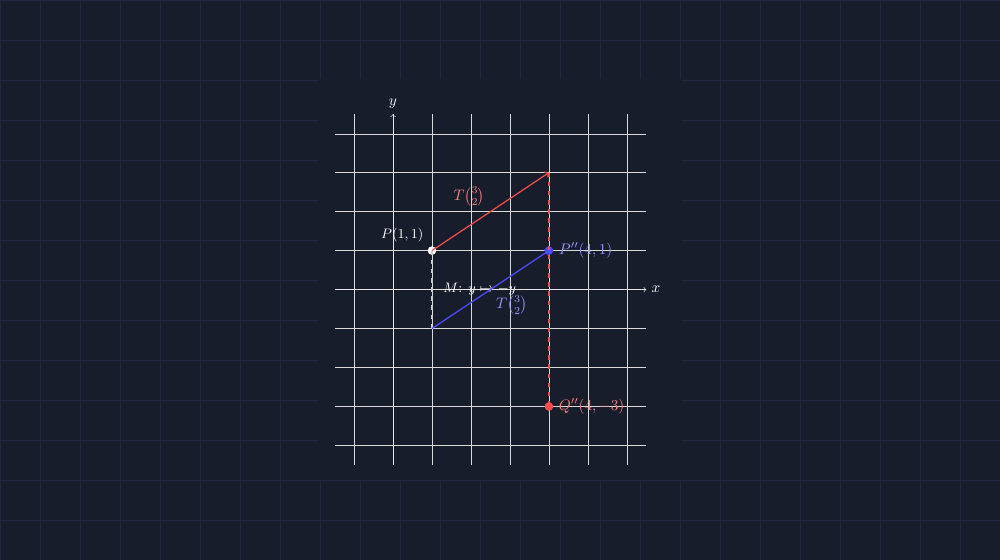
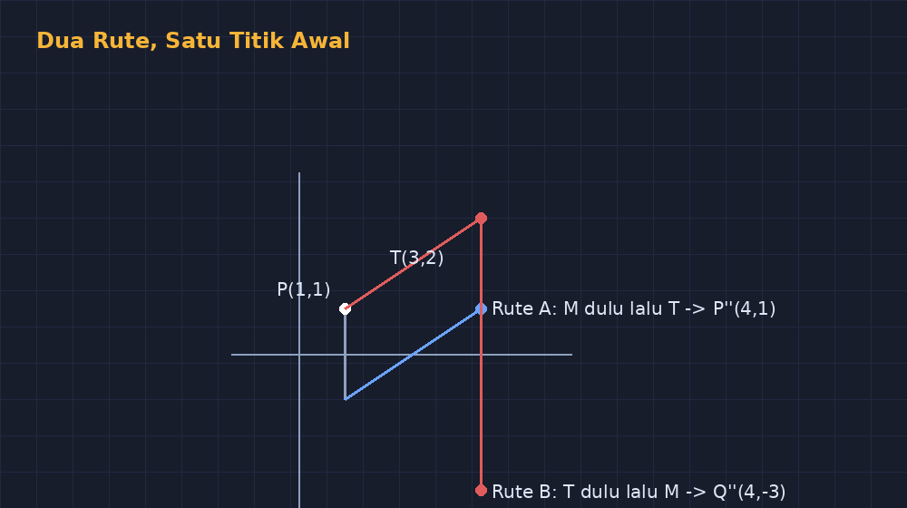

Ada satu topik di kelas VIII yang selalu saya tunggu-tunggu dengan perasaan campur aduk: komposisi transformasi. Perasaan campurnya bukan karena materinya sulit secara teknis — translasi, refleksi, rotasi sudah pernah kita bahas satu per satu. Yang bikin hati was-was adalah urutannya. Karena di komposisi, urutan penerapan transformasi itu *tidak boleh dipertukarkan*, dan siswa nyaris selalu menabrak tembok ini tanpa sadar.

Kasus yang paling sering: siswa mengerjakan $(T \circ M)(P)$ seolah-olah sama dengan $(M \circ T)(P)$. Angka akhirnya beda, tapi mereka tidak melihat *di mana* letak bedanya. Jawaban salah itu terasa seperti datang dari langit — padahal kalau kita gambar titik-titik perantara di bidang koordinat, bedanya terlihat jelas seperti dua jalur jalan yang bercabang.

Minggu lalu saya memutuskan tidak lagi menjelaskan dengan dua baris notasi di papan. Saya menggambar dulu, dengan TikZ, dua diagram yang berdampingan.

<!--more-->

## Satu titik, dua rute

Saya pakai kasus paling sederhana: satu titik $P(1, 1)$, lalu dua transformasi — translasi $T$ oleh vektor $\binom{3}{0}$ dan refleksi $M$ terhadap sumbu-$X$.

Jalur pertama, translasi dulu lalu refleksi:
$$(T \circ M)(P) \quad \text{seharusnya dibaca: refleksi dulu, baru translasi}$$

Tunggu — justru di sinilah jebakan notasi terbesar. Lambang $(T \circ M)(P)$ dibaca *kanan ke kiri*: $M$ dulu, baru $T$. Siswa yang membacanya dari kiri (seperti membaca kalimat Indonesia) akan mengerjakan terbalik. Dua kali saya menemukan anak yang sudah lancar berhitung tetap salah karena membaca komposisi seperti membaca resep yang tertulis mundur.

Mari kita hitung keduanya dengan jujur.

Jalur A — refleksi dulu, baru translasi:
$$P(1,1) \xrightarrow{M} P'(1,-1) \xrightarrow{T\,\binom{3}{0}} P''(4,-1)$$

Jalur B — translasi dulu, baru refleksi:
$$P(1,1) \xrightarrow{T\,\binom{3}{0}} Q'(4,1) \xrightarrow{M} Q''(4,-1)$$

Kebetulan di contoh khusus ini kedua jalur berakhir di titik yang sama, karena vektornya horizontal dan sumbu refleksinya horizontal — dua transformasi ini *saling tepat sambung* untuk kasus ini. Nah, kalau saya berhenti di sini, siswa akan menyimpulkan bahwa urutan memang boleh dibalik. Itu kesimpulan yang keliru, dan berbahaya. Jadi saya pilih contoh kedua yang tidak "berkompromi": translasi dengan vektor miring, $\binom{3}{2}$.

Jalur A — refleksi dulu, baru translasi:
$$P(1,1) \xrightarrow{M} P'(1,-1) \xrightarrow{T\,\binom{3}{2}} P''(4,1)$$

Jalur B — translasi dulu, baru refleksi:
$$P(1,1) \xrightarrow{T\,\binom{3}{2}} Q'(4,3) \xrightarrow{M} Q''(4,-3)$$

Sekarang hasil akhirnya benar-benar berbeda: $(4,1)$ lawan $(4,-3)$. Dan yang paling penting — siswa bisa *melihat* letak perbedaannya: di jalur B, titik perantara $Q'(4,3)$ jauh di atas, lalu dipantulkan jauh ke bawah. Di jalur A, titik dipantulkan dulu ke bawah, lalu digeser. Jarak tempuh dan arahnya lain, walau langkahnya "sama".


*Titik yang sama, dua urutan, dua hasil akhir. Garis putus-putus menandai refleksi terhadap sumbu-$X$.*

## Menggambar dua jalur sekaligus dengan TikZ

Dua diagram ini tidak boleh asal digambar. Kalau koordinat di gambar tidak persis sama dengan hasil hitung di papan, siswa akan bingung — dan beralasan, dan gambar yang tidak jujur justru menanamkan miskonsepsi lagi. Karena itu saya menghitung dulu, lalu menyalin angka yang sama persis ke kode TikZ:

```latex
\begin{tikzpicture}[scale=0.8]
  % sumbu
  \draw[gray!40, very thin] (-1.5,-4.5) grid (6.5,4.5);
  \draw[->] (-1.5,0) -- (6.5,0) node[right] {$x$};
  \draw[->] (0,-4.5) -- (0,4.5) node[above] {$y$};
  % titik awal
  \fill (1,1) circle (2.5pt) node[above left] {$P(1,1)$};
  % jalur A: M dulu, lalu T
  \draw[dashed, thick] (1,1) -- (1,-1);
  \draw[->, thick, blue] (1,-1) -- (4,1)
        node[midway, below right] {$T\binom{3}{2}$};
  \fill[blue] (4,1) circle (2.5pt) node[right] {$P''(4,1)$};
  % jalur B: T dulu, lalu M
  \draw[->, thick, red!70!black] (1,1) -- (4,3)
        node[midway, above left] {$T\binom{3}{2}$};
  \draw[dashed, thick, red!70!black] (4,3) -- (4,-3);
  \fill[red!70!black] (4,-3) circle (2.5pt) node[right] {$Q''(4,-3)$};
\end{tikzpicture}
```

Perhatikan saya menaruh kedua jalur di *satu* bidang koordinat, bukan dua gambar terpisah. Dalam satu kanvas, siswa bisa membandingkan langsung: garis biru dan garis merah bercabang dari titik yang sama, lalu berakhir di dua tempat yang berbeda. Perbandingan yang ditempatkan bersebelahan selalu lebih kuat daripada dua ilustrasi terpisah yang harus diingat-ingat.

## Aktivitas kelas: tebak urutannya

Diagram ini justru jadi bahan aktivitas. Saya menampilkan hasil akhir saja — dua titik berwarna — lalu menutupi titik-titik perantara, dan meminta siswa menebak: mana jalur yang refleksinya dulu, mana yang translasinya dulu? Anak-anak jadi berdebat: "yang merah translasinya dulu, Bu/Pak, karena garisnya miring dulu sebelum turun!" Argumen seperti itu adalah bukti mereka benar-benar membaca pergerakan titik, bukan sekadar menghafal definisi.


*Perbandingan dua rute dalam satu bidang: cabang biru (refleksi dulu) dan cabang merah (translasi dulu).*

Berkas TikZ lengkapnya saya sertakan — termasuk versi berlabel untuk dua rute, siap dikompilasi.

> 📎 **Berkas TikZ lengkap:** [tikz-komposisi-transformasi.tex](tex/tikz-komposisi-transformasi.tex) — siap kompilasi (butuh paket `tikz`).

## Refleksi kecil di akhir hari

Yang membuat saya tetap semangat menggambar soal dan diagram dengan TikZ bukan rasa senang melihat gambar rapi. Tetapi karena materi seperti komposisi transformasi *tidak bisa* diajarkan hanya dengan kalimat. "Urutan mempengaruhi hasil" adalah kalimat yang benar tapi tumpul. Yang tajam adalah melihat dua panah bercabang dari satu titik dan mendarat di dua tempat yang berbeda — itu pengalaman visual yang menempel jauh lebih lama.

Dan jujur saja: menulis kode untuk diagram ini kurang lebih lima belas menit, termasuk waktu saya salah menaruh label $T\binom{3}{2}$ di jalur yang keliru (untung terlihat langsung saat kompilasi). Limabelas menit itu, dibanding ratusan siswa yang akan melihat gambar ini tahun ini dan tahun depan, itu hitungan yang layak. Apalagi kalau gambar yang sama besok dipakai lagi di kelas VIII-B tanpa saya perlu menggambar ulang di papan — cukup proyektor dan satu file yang koordinatnya bisa saya percaya.
