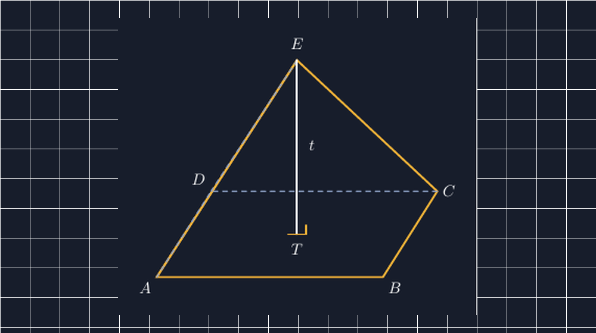

Kemarin sore saya hendak mencetak satu lembar soal bangun ruang untuk kelas VIII. Di lembar itu ada gambar limas segiempat yang sudah saya pakai beberapa tahun: segiempat alas, empat rusuk tegak yang bertemu di puncak, dan sebuah garis putus-putus dari puncak ke bawah yang saya beri label $t$. Saking seringnya memakai gambar yang sama, saya tidak pernah mempermasalahkannya. Tapi malam itu, ketika saya menyalin ulang gambar itu ke TikZ agar lebih rapi, tangan saya berhenti di tengah jalan.

Garis tinggi itu, saya sadari, selama ini saya gambar jatuhnya ke tengah rusuk depan. Padahal kalau dipikir sejenak, tinggi limas itu garis yang tegak lurus terhadap alas, dan kaki tegak lurusnya harus menapak di satu titik di bidang alas. Titik mana? Kalau limasnya bercatur di pusat alas, titik itu adalah pusat alasnya sendiri — bukan tengah rusuk.

<!--more-->

## Kesalahan yang Sering Saya Buat Sendiri

Saya jujur saja: bertahun-tahun saya menggambar limas untuk soal volume dengan tinggi yang jatuhnya "asal ke bawah". Di lembar soal, itu masih bisa dimaklumi; siswa cukup memakai angka $t$ yang diberikan. Tapi ketika gambar itu dipakai untuk menjelaskan *mengapa* rumus volume limas sepertiga volume prisma, kejenuhan itu jadi masalah. Saya menunjuk garis tinggi, siswa mengikuti garis tinggi, dan semua berpura-pura paham bahwa garis itu memang tegak lurus alas.

Keesokan paginya saya membawa gambar lama saya ke kelas, sengaja tanpa saya perbaiki dulu. Saya tanya, "Ada yang janggal dari gambar ini?" Awalnya hening. Lalu seorang siswa di baris kedua berkata pelan, "Bu, garis putus-putusnya kok miring ke depan? Katanya tinggi." Pertanyaan itu saya balas dengan pertanyaan lagi: "Kalau tinggi limas, dia harus jatuh di titik mana di alas?"

Diskusinya berjalan lebih panjang dari yang saya duga. Ada yang menjawab tengah alas, ada yang menjawab "di bawah puncak", dan seorang siswa menangkap sesuatu yang lebih dalam: "Di bawah puncak" dan "di pusat alas" itu sama saja kalau limasnya bercatur — tapi tidak sama kalau puncaknya digeser. Momen itu adalah momen yang tidak akan saya dapat kalau saya terus menggambar limas yang "cukup benar".

## Titik Proyeksi: Kata yang Ternyata Perlu

Di SMP, kita jarang menyebut kata "proyeksi". Tapi konsepnya sesederhana bayangan matahari: kalau puncak limas disinari cahaya lurus dari atas, titik di alas yang kena bayangan itulah titik proyeksinya. Tinggi limas adalah ruas garis dari puncak ke titik itu, dan garis itu harus membentuk sudut siku-siku dengan bidang alas.

Untuk limas yang alasnya segiempat dan puncaknya tepat di atas pusat alas, titik proyeksi jatuh di perpotongan diagonal-diagonal alas. Itu sebabnya pada gambar TikZ yang saya buat, saya taruh titik $T$ persis di pusat alas, lalu tarik garis dari puncak $E$ ke $T$ dengan tanda siku-siku kecil di kaki garisnya:

```latex
% titik proyeksi puncak ke alas = pusat alas
\coordinate (T) at (3.1,0.95);
% tinggi limas: tegak lurus alas, dari puncak ke titik proyeksi T
\draw[white,very thick] (E) -- (T);
```

Koordinat $(3.1,\,0.95)$ itu bukan angka asal. Alas limas saya gambar sebagai segiempat dengan titik $A(0,0)$, $B(5,0)$, $C(6.2,1.9)$, dan $D(1.2,1.9)$ — dua rusuk sejajar yang digeser agar terlihat tiga dimensi. Pusat alasnya ada di tengah-tengah keempat titik itu, dan dari sana saya hitung sendiri sampai mendapat $(3.1,0.95)$. TikZ tidak akan mengoreksi saya kalau saya salah menaruh titik; dia hanya menggambar apa yang saya perintahkan. Justru di situ nilainya: menggambar dengan TikZ memaksa saya jujur pada geometri yang saya ajarkan.



## Sisi yang Tersembunyi Jujur Dibedakan

Satu hal lagi yang dulu sering saya abaikan: rusuk-rusuk yang tersembunyi di belakang bangun. Di gambar tangan saya dulu, semua rusuk digambar sama tebalnya, dan siswa kadang bingung rusuk mana yang "di depan" dan mana yang "di belakang". Dalam TikZ, membedakannya hanya soal dua perintah — rusuk terlihat saya gambar tebal dengan warna aksen, rusuk tersembunyi putus-putus:

```latex
% rusuk yang terlihat
\draw[acc,very thick] (A) -- (B) -- (C) -- (E) -- cycle;
\draw[acc,very thick] (E) -- (A);
% rusuk tersembunyi
\draw[line,dashed,thick] (C) -- (D) -- (A);
\draw[line,dashed,thick] (E) -- (D);
```

Ini terdengar sepele, tapi efeknya di kelas nyata. Ketika saya meminta siswa menuliskan sisi alas limas, siswa yang melihat gambar dengan rusuk tersembunyi yang jelas langsung paham bahwa alasnya $ABCD$ — segiempat yang ditutup garis putus-putus itu. Gambar yang jujur menghemat penjelasan.

## Ruas Tinggi yang Sama di Semua Soal

Setelah gambar jadi, soal-soal di lembar itu jadi lebih bisa "dibaca". Misalnya soal klasik: alas limas persegi dengan sisi $6$ cm dan tinggi limas $4$ cm. Dengan gambar yang benar, siswa bisa melihat sendiri bahwa $t = 4$ adalah jarak dari $E$ ke $T$, bukan panjang rusuk tegak $EA$. Panjang rusuk tegak itu malah lebih panjang — dan inilah miskonsepsi kecil yang sering lolos: siswa mengira garis dari puncak ke sudut alas adalah tinggi.

$$V = \frac{1}{3} \times L_{alas} \times t = \frac{1}{3} \times 36 \times 4 = 48 \text{ cm}^3$$

Satu siswa sempat bertanya, "Bu, kalau puncak limasnya digeser ke samping, tingginya berubah tidak?" Pertanyaan bagus. Tingginya tetap, selama jarak tegak lurusnya ke bidang alas sama — hanya titik jatuhnya di alas yang berpindah. Saya tidak berencana membahas limas miring di kelas VIII, tapi pertanyaan itu terbuka justru karena gambar kita jujur pada konsep tinggi sebagai jarak tegak lurus, bukan sekadar garis vertikal yang kita taruh di tengah-tengah karena kelihatan rapi.

## Gambar yang Bisa Dipercaya, Kelas yang Berani Bertanya

Saya makin yakin bahwa gambar geometri di lembar soal itu bukan hiasan. Dia adalah pernyataan matematis, dan kalau pernyataannya salah — atau setengah benar — siswa akan menyerap kesalahan itu tanpa suara. Limas yang tingginya jatuh di tempat yang salah mungkin tidak menggagalkan perhitungan volume hari ini, tapi ia menanam gambaran batin yang keliru tentang apa itu "tinggi bangun ruang".

Yang menarik, perbaikan kecil ini juga mengubah suasana kelas. Ketika saya terbuka mengakui bahwa gambar lama saya keliru, siswa jadi lebih berani mengoreksi — dan mengoreksi bukan hanya gambar, tapi juga langkah pengerjaan temannya, bahkan kalimat saya di papan tulis. Ada rasa kepemilikan yang tumbuh: kelas ini bukan tempat menerima gambar jadi, tapi tempat memeriksa apakah gambar itu pantas dipercaya.

Kalau Bapak/Ibu ingin mencoba, file TikZ lengkapnya saya sertakan di bawah. Cukup ubah koordinat titik-titik alasnya, dan sisanya — pusat alas, titik proyeksi, garis tinggi — bisa disesuaikan sendiri. Justru di situ latihannya: bukan menyalin gambar saya, tapi memeriksa apakah titik $T$ di gambar Bapak/Ibu benar-benar jatuh di pusat alas.

> 📎 **Berkas TikZ lengkap:** [tikz-limas-segiempat.tex](tex/tikz-limas-segiempat.tex) — siap kompilasi (butuh paket `tikz`).
