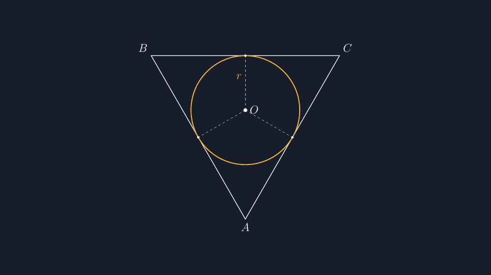

Ada satu gambar yang hampir pasti muncul setiap saya mengajar bangun datar di kelas tujuh atau delapan: segitiga dengan sebuah lingkaran di dalamnya. Gambar itu muncul di soal tentang luas, muncul di soal tentang keliling, dan muncul lagi ketika kita bicara jarak titik ke garis. Dan selama bertahun-tahun, saya menggambar lingkaran itu dengan cara yang sama seperti guru-guru sebelum saya: asal masuk ke dalam segitiga, tidak menabrak, kelihatannya menyentuh sisi-sisinya.

<!--more-->

## Gambar yang Menipu dengan Mata

Masalahnya, "kelihatannya menyentuh" itu bukan sesuatu yang bisa diajarkan. Anak-anak yang teliti akan mengukur dengan mata — dan mata mereka sering lebih jujur daripada tangan saya. Suatu kali, saat membahas soal lingkaran dalam segitiga siku-siku, seorang siswa di baris kedua mengangkat tangan dengan wajah ragu-ragu.

"Pak, lingkarannya kok kayak nyempil di kiri? Di kanan dia kayak nembus garisnya."

Saya lihat papan tulis saya. Benar. Lingkaran yang saya gambar bebas itu sebenarnya sudah menembus sisi miring sedikit, dan di sisi kiri dia malah menyisakan celah. Untuk sebagian anak, detail seperti itu tidak berarti apa-apa. Tapi untuk anak yang tepat sedang berjuang membangun intuisi tentang apa itu jari-jari lingkaran dalam, gambar yang tidak jujur bisa menanam pemahaman yang salah: bahwa jarak dari pusat ke tiap sisi itu boleh berbeda-beda.

Padahal justru itu inti materi. Titik pusat lingkaran dalam adalah titik yang berjarak sama terhadap ketiga sisi. Bukan kira-kira sama. Sama. Kalau gambar saya tidak menunjukkan kesamaan itu, saya sedang menggambar lawan dari pengertian yang saya ajarkan.

## Apa yang Sebenarnya Harus Digambar

Lingkaran dalam segitiga punya tiga ciri yang harus tampak sekaligus dalam gambar:

1. Lingkarannya berada di dalam segitiga dan menyinggung ketiga sisi di tepat satu titik per sisi.
2. Titik pusatnya (biasanya dinamai $O$, titik incenter) terletak pada perpotongan tiga garis bagi sudut segitiga.
3. Jari-jarinya, $r$, selalu tegak lurus terhadap sisi di setiap titik singgung — dan ketiganya sama panjang.

Ciri ketiga ini yang paling sering hilang di gambar tangan. Kita menggambar lingkaran, lalu menarik segmen dari pusat ke sisi, tapi tanpa penggaris dan setrika sudut yang presisi, segmen itu jarang benar-benar tegak lurus dan jarang benar-benar sama panjang satu sama lain. Di papan tulis, semua itu toleransi. Di lembar soal yang dicetak dan dibaca seratus anak, toleransi itu jadi pesan.

\begin{figure}

*Titik pusat $O$ berjarak sama — yaitu $r$ — terhadap ketiga sisi. Tiga titik singgung, tiga jari-jari, satu panjang.*
\end{figure}

## Konstruksinya di TikZ

Cara paling jujur untuk menggambar lingkaran dalam segitiga justru bukan mulai dari segitiganya, tapi mulai dari lingkarannya. Kita tentukan dulu lingkaran satuan dengan pusat $O$ di titik asal, lalu pilih tiga titik singgung pada lingkaran itu. Setiap sisi segitiga kemudian adalah garis singgung lingkaran melalui titik singgungnya — garis yang tegak lurus jari-jari di titik itu.

Dengan memilih titik singgung di sudut $90^\circ$, $210^\circ$, dan $330^\circ$ (jarak sama, $120^\circ$ per putaran), kita mendapatkan segitiga sama sisi. Tapi konstruksinya bekerja untuk segitiga apa pun: pilih titik singgung di sudut lain, dan garis-garis singgungnya akan bertemu membentuk segitiga lain. Lingkarannya tidak pernah berbohong, karena memang lingkaran itu dulu yang ada.

Berikut inti kodenya:

```latex
\def\R{1}
\coordinate (O) at (0,0);
\coordinate (Ta) at (0,1);        % titik singgung 90
\coordinate (Tb) at (-0.8660,-0.5); % 210
\coordinate (Tc) at (0.8660,-0.5);  % 330
% titik sudut = perpotongan garis singgung
\coordinate (A) at (0,-2);
\coordinate (B) at (-1.7320,1);
\coordinate (C) at (1.7320,1);
\draw[thick] (A) -- (B) -- (C) -- cycle;
\draw[very thick, accent] (O) circle (\R);
% jari-jari ke titik singgung (otomatis tegak lurus sisi)
\draw[dashed] (O) -- (Ta);
\draw[dashed] (O) -- (Tb);
\draw[dashed] (O) -- (Tc);
```

Dari mana angka-angka itu berasal? Garis singgung lingkaran $x^2+y^2=R^2$ di titik $(R\cos\theta, R\sin\theta)$ memenuhi persamaan

$$x\cos\theta + y\sin\theta = R.$$

Untuk titik singgung di $\theta = 210^\circ$, misalnya, persamaannya menjadi $-\tfrac{1}{2}x - \tfrac{\sqrt{3}}{2}y = 1$. Perpotongan dua garis singgung yang bertetangga menghasilkan satu titik sudut segitiga. Di sinilah saya sering merasa TikZ bukan sekadar alat gambar — dia memaksa saya menghitung ulang geometri yang sejak lama saya anggap sudah saya pahami. Ketika angka koordinatnya tidak cocok dengan bayangan saya, yang salah biasanya bayangan saya, bukan angkanya.

Ini pula yang membuat saya menyukai urutan konstruksi "lingkaran dulu, segitiga kemudian". Kalau kita mulai dari segitiga dengan sudut yang asal, lalu mencoba menjejalkan lingkaran ke dalamnya, kita sedang mengerjakan masalah yang jauh lebih sulit — mencari titik yang berjarak sama ke tiga garis miring. Mulai dari lingkaran, masalah itu lenyap: tegak lurus jari-jari sudah dijamin oleh definisi garis singgung.

## Yang Bisa Ditambahkan Ketika Materi Naik Kelas

Ketika materi ini muncul lagi di kelas sembilan atau di pengayaan, saya biasanya menambahkan dua garis bagi sudut dari satu titik sudut, misalnya dari $A$ ke titik pusat $O$. Anak-anak bisa memverifikasi sendiri bahwa garis itu membagi dua sudut $A$ menjadi sama besar — dan tiba-tiba hubungan antara "garis bagi sudut" dan "titik yang berjarak sama ke dua sisi" yang mereka hafal di bab sudut, terhubung dengan gambar lingkaran yang selama ini mereka anggap sekadar hiasan soal.

Untuk segitiga siku-siku dengan sisi $a$, $b$, dan miring $c$, ada juga rumus praktis jari-jari lingkaran dalam yang sering saya cantumkan di penjelasan:

$$r = \frac{a+b-c}{2}.$$

Rumus ini menyenangkan bagi siswa karena terlihat "ajaib" — kok bisa jari-jari dihitung hanya dari panjang sisi? Dan justru karena terlihat ajaib, gambar yang jujur menjadi penting: rumus itu bisa mereka yakini lebih dulu lewat mata, bahwa lingkaran itu benar-benar menyentuh di ketiga sisi dengan jari-jari yang sama, sebelum mereka percaya pada aljabarnya.

## Gambar Kecil, Kebiasaan Besar

Saya tidak tahu berapa banyak anak yang benar-benar memperhatikan bahwa lingkaran dalam segitiga di lembar soal mereka sekarang digambar dengan presisi. Mungkin sebagian besar tidak. Tapi setiap kali saya menghindari satu gambar yang menembus sisi, saya sedang menjaga satu hal kecil yang menurut saya penting: bahwa matematika itu konsisten, sampai ke gambar terkecilnya.

Dan jujur saja, bagi saya sendiri, menggambar lingkaran dalam segitiga dengan TikZ terasa seperti menutup utang kecil. Bertahun-tahun saya menggambar lingkaran itu asal-asalan di papan tulis, dan setiap kali ada anak yang menyadarinya, saya tertawa dan bilang "iya, papan tulisnya memang tidak rapi." Sekarang gambar yang sama bisa saya buat rapi sekali jalan, dipakai ulang di slide, di modul, di soal ujian — dan tidak ada lagi anak yang perlu berdebat dengan lingkaran saya.

> 📎 **Berkas TikZ lengkap:** [tikz-lingkaran-dalam-segitiga-titik-garis-tinggi.tex](tex/tikz-lingkaran-dalam-segitiga-titik-garis-tinggi.tex) — siap kompilasi (butuh paket `tikz`).
