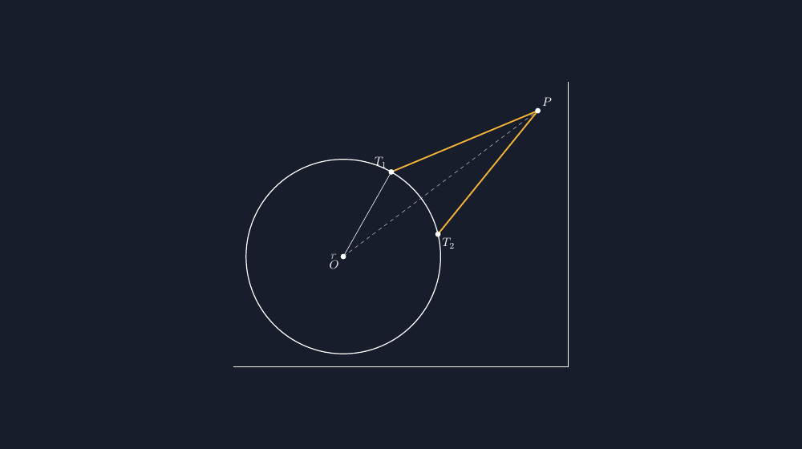

Dari semua bangun datar yang saya gambar di papan tulis, lingkaran adalah yang paling sering saya gambar kurang sempurna. Pakai benang dan paku, hasilnya lumayan; pakai tangan saja, hasilnya seperti kentang yang dimasak setengah matang. Anak-anak sudah biasa melihat lingkaran papan tulis saya yang tidak persis lingkaran, dan sampai di situ tidak masalah. Masalah mulai ketika kita bicara garis singgung — karena garis singgung menuntut presisi yang tidak bisa dipalsukan.

<!--more-->

## Kenapa Garis Singgung Paling Peka pada Gambar yang Asal

Materi lingkaran di kelas delapan punya satu titik rawan yang jarang saya sadari di tahun-tahun awal mengajar: posisi titik singgung. Kalau saya gambar lingkaran asal-asalan lalu menarik sebuah garis yang "seakan-akan" menyinggung lingkaran itu, siswa akan mengukur dengan mata. Dan mata mereka cukup jujur untuk bilang, "Pak, sepertinya garisnya masuk sedikit ke dalam."

Dan mereka benar. Ketika garis yang seharusnya menyinggung justru memotong lingkaran sedikit, konsep "$d > r$" atau "jarak titik ke pusat lebih besar dari jari-jari" jadi terasa mengada-ada. Anak tidak akan percaya pada definisi jika gambar yang mendampinginya mendustakan definisi itu.

Di sinilah TikZ berperan. Saya tidak perlu menebak di mana titik singgung berada — TikZ menghitungnya untuk saya, dan saya tinggal menarik garis dari titik luar ke titik singgung yang dihitung presisi oleh sistem koordinat.

## Kode Dasar: Lingkaran dan Titik Singgungnya

TikZ punya cara yang elegan untuk titik singgung: koordinat `(tangent cs: ...)`. Saya tidak perlu tahu di mana titik singgung berada secara angka — cukup kasih tahu TikZ titik pusat, titik luar, dan ia yang mencari.

```latex
\begin{tikzpicture}[scale=1]
  % Lingkaran pusat O, jari-jari 2
  \coordinate (O) at (0,0);
  \coordinate (P) at (4,3); % titik di luar lingkaran
  \draw[thick] (O) circle (2);

  % Titik singgung dihitung otomatis oleh TikZ
  \coordinate (A) at (tangent cs: O--P, R=2);
  \draw[thick, yellow!80!black] (P) -- (A);

  \fill (O) circle (1.5pt) node[below left] {$O$};
  \fill (P) circle (1.5pt) node[above right] {$P$};
  \fill (A) circle (1.5pt) node[below right] {$A$};
\end{tikzpicture}
```

Baris `(tangent cs: O--P, R=2)` adalah kunci dari semuanya. Ia bilang: "carikan saya titik pada lingkaran berpusat di $O$ dengan jari-jari 2, sehingga garis dari $P$ melewati titik itu menyinggung lingkaran." TikZ melakukan trigonometrinya sendiri, dan saya tidak perlu menghitung sudutnya di kertas buramah dulu.

Hasilnya? Garis singgung yang benar-benar menyinggung, bukan garis yang "dipaksa" terlihat seperti menyinggung.

## Segitiga Siku-siku yang Tersembunyi

Ada satu momen aha di kelas yang saya suka ulang setiap tahun: ketika siswa menyadari bahwa segitiga $OAP$ pada gambar garis singgung adalah segitiga siku-siku. Sisi $OA$ adalah jari-jari, sisi $AP$ adalah garis singgung, dan sisi miringnya $OP$.

$$OA^2 + AP^2 = OP^2$$

Ketika gambar dibuat dengan TikZ, segitiga ini tampak seperti segitiga siku-siku yang *benar-benar* siku-siku — bukan segitiga yang mirip siku-siku tapi sebenarnya sudutnya $88^\circ$. Kalau saya gambar dengan garis yang sedikit tidak menyinggung, segitiganya jadi segitiga sembarang dan anak akan ragu kenapa teorema Pythagoras "tidak berlaku" di gambar mereka.

Baris tambahan yang sering saya selipkan untuk memperjelas siku-sikunya:

```latex
\draw[yellow!80!black, thick] (O) -- (A);
\draw[yellow!80!black, thick] (A) -- (P);
\draw[dashed] (O) -- (P);
\pic [draw, angle radius=8pt] {right angle = O--A--P};
```

Tanda siku di titik singgung itu penting. Anak-anak butuh melihat bahwa $OA \perp AP$ — bukan dihitung, tapi *terlihat*.

## Dua Garis Singgung dari Titik yang Sama

Ada satu kasus lagi yang sering saya butuhkan di soal: dari satu titik luar, ada *dua* garis singgung yang bisa ditarik. Di papan tulis, menggambar keduanya sekaligus dengan rapi itu pekerjaan yang melelahkan — tangan kanan saya tidak selalu seakurat tangan kiri, dan biasanya satu garis bagus sementara garis satunya sedikit meleset.

TikZ menyelesaikan ini dengan bantuan paket tambahan. Kalau di header dokumen saya tulis:

```latex
\usepackage{tikz}
\usetikzlibrary{calc}
```

Saya bisa menarik dua garis singgung dengan pendekatan sedikit berbeda — menghitung titik singgung secara manual lewat trigonometri, atau tetap pakai koordinat tangent untuk masing-masing sisi. Cara paling jujur dan simpel adalah membuat dua koordinat tangent dengan menambahkan sedikit rotasi, atau menghitung titik singgung dengan bantuan `calc`.

Sebagai contoh yang selalu saya pakai di lembar kerja:

```latex
\begin{tikzpicture}[scale=1.2]
  \coordinate (O) at (0,0);
  \coordinate (P) at (4,2);
  \draw[thick] (O) circle (2);
  % Dua titik singgung: urutan O--P dan P--O memilih sisi yang berbeda
  \coordinate (T1) at (tangent cs: O--P, R=2);
  \coordinate (T2) at (tangent cs: P--O, R=2);
  \draw[thick, yellow!80!black] (P) -- (T1);
  \draw[thick, yellow!80!black] (P) -- (T2);
  \fill (O) circle (1.5pt) node[below left] {$O$};
  \fill (P) circle (1.5pt) node[above] {$P$};
  \fill (T1) circle (1.5pt) node[below right] {$T_1$};
  \fill (T2) circle (1.5pt) node[above right] {$T_2$};
\end{tikzpicture}
```

Trik kecilnya ada pada matematika di baliknya. Kalau $P$ berjarak $d$ dari pusat, maka $\sin\beta = r/d$ — dan titik singgung terletak pada sudut $\alpha \pm \beta$, dengan $\alpha$ adalah sudut arah $P$ dari pusat. Untuk $O=(0,0)$, $r=2$, dan $P=(4,3)$, jaraknya $d=5$, sehingga $\beta = \arcsin\tfrac{2}{5} \approx 23{,}58^\circ$ dan $\alpha \approx 36{,}87^\circ$. Dua titik singgungnya tinggal dihitung dan ditulis sebagai koordinat biasa:

```latex
\begin{tikzpicture}[scale=1.2]
  \coordinate (O) at (0,0);
  \coordinate (P) at (4,3);
  \draw[thick] (O) circle (2);
  % sudut arah P: 36.87 deg; beta = arcsin(2/5) = 23.58 deg
  \coordinate (T1) at (0.986,1.741);  % sudut 60.45 deg
  \coordinate (T2) at (1.946,0.460);  % sudut 13.29 deg
  \draw[thick, yellow!80!black] (P) -- (T1);
  \draw[thick, yellow!80!black] (P) -- (T2);
  \fill (O) circle (1.5pt) node[below left] {$O$};
  \fill (P) circle (1.5pt) node[above right] {$P$};
  \fill (T1) circle (1.5pt) node[above left] {$T_1$};
  \fill (T2) circle (1.5pt) node[below right] {$T_2$};
\end{tikzpicture}
```

Saya pernah mencoba mencari jalan pintas — menulis koordinat tangent dua kali dengan urutan terbalik — dan hasilnya garis yang justru menembus lingkaran. Sejak itu saya kembali ke jalan yang jujur: hitung $\beta$, hitung sudutnya, tulis koordinatnya. Tiga baris trigonometri di kertas buram, dan dua garis singgung berdiri presisi di lembar kerja.

## Kesalahan yang Saya Hindari Sekarang

Kalau dulu saya sering tergoda menggambar lingkaran lalu "menempelkan" garis singgung di tempat yang terlihat pas, sekarang saya punya daftar pendek yang saya periksa setiap kali membuat soal lingkaran:

1. Apakah garis benar-benar *menyinggung*, bukan memotong? Di TikZ ini otomatis kalau pakai `tangent cs`.
2. Apakah jarak $OP$ lebih besar dari jari-jari? Kalau tidak, titik singgung tidak ada dan TikZ akan memberi peringatan atau hasil aneh.
3. Apakah sudut siku di titik singgung terlihat jelas? Kalau gambar terlalu kecil, sudut siku akan susah dibaca.

Nomor dua ini sering saya lewatkan di awal. Titik $P$ terlalu dekat dengan lingkaran, garis singgungnya jadi hampir sejajar jari-jari, dan ilustrasinya jadi tidak informatif. Sekarang saya selalu menaruh $P$ cukup jauh — biasanya jaraknya satu setengah sampai dua kali jari-jari — supaya segitiga $OAP$ proporsional dan mudah dibaca.


*Dua garis singgung dari titik $P$, dengan jari-jari $OT_1$ dan tanda siku di titik singgung.*

## Penutup: Gambar yang Bisa Dipercaya Mata

Anak-anak di kelas saya tidak mengukur gambar dengan penggaris — mereka mengukurnya dengan intuisi. Dan intuisi itu cukup tajam untuk menangkap gambar yang tidak jujur. Lingkaran papan tulis saya boleh tidak sempurna; itu bahkan bisa jadi bahan tertawa bersama. Tapi lembar soal yang saya cetak, atau slide yang saya tampilkan, harus gambar yang bisa dipercaya.

TikZ membuat standar itu murah dipenuhi. Tiga baris kode `tangent cs` menghemat saya dari menebak posisi titik singgung, dan menghemat siswa dari kebingungan "kenapa garisnya masuk sedikit ke dalam". Untuk materi yang menuntut presisi seperti garis singgung, alat gambar yang presisi bukan kemewahan — itu bagian dari kejujuran mengajar.

> 📎 **Berkas TikZ lengkap:** [tikz-lingkaran-garis-singgung.tex](tex/tikz-lingkaran-garis-singgung.tex) — siap kompilasi (butuh paket `tikz`).
