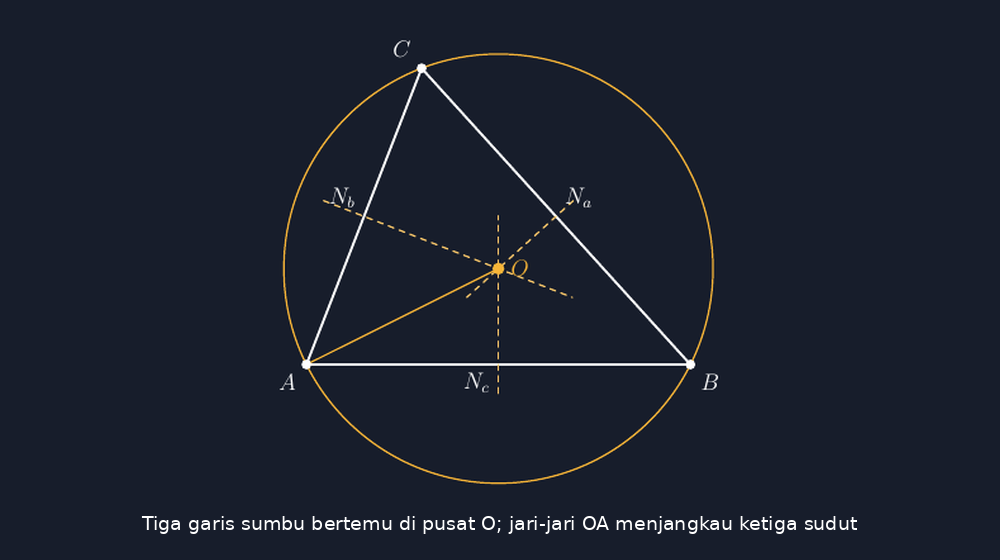
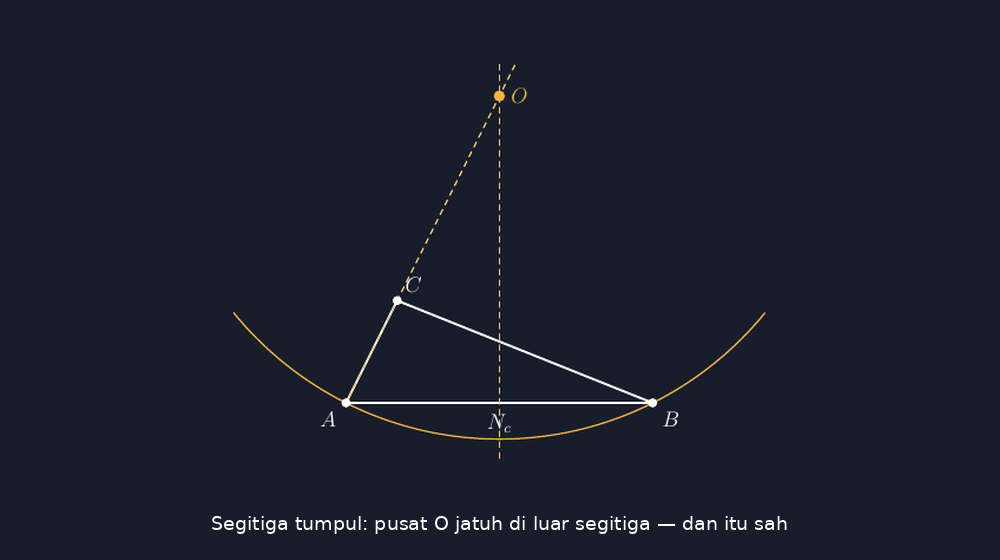

Beberapa minggu setelah artikel saya tentang lingkaran dalam segitiga terbit, seorang rekan guru mengirim pesan pendek: "Kalau lingkarannya di dalam sudah kamu tulis, yang di luar kapan?" Pertanyaan itu bikin saya tersenyum, karena justru beberapa hari sebelumnya saya baru saja mengalami sendiri betapa "di luarnya" itu tidak sederhana.

<!--more-->

## Soal yang Saya Gambar Asal

Materi itu datang saat membahas soal untuk kelas delapan: tiga titik $A$, $B$, dan $C$ tidak segaris, dan siswa diminta menentukan letak menara agar berjarak sama ke ketiga titik. Soal klasik tentang titik yang berjarak sama dari ketiga sudut segitiga — pusat lingkaran luar, atau *circumcenter*.

Saya menggambar soal itu di papan tulis dengan cara yang sudah biasa: segitiga, lalu sebuah lingkaran yang saya harap lewat ketiga titik sudutnya. Hasilnya seperti biasa juga — lingkaran itu lewat di dekat $A$, menyisakan celah kecil di $B$, dan menembus sedikit di sekitar $C$. Seorang siswa yang duduk di pojok kiri, yang ternyata punya mata paling tajam di kelas itu, berkomentar pelan:

"Pak, lingkarannya kayak belum janjian sama segitiganya."

Kalimatnya tidak baku, tapi tepat sekali. Lingkaran dan segitiga itu memang belum "janjian". Dan janji yang dimaksud bukan perkara untung-untungan: jari-jari dari pusat lingkaran luar harus benar-benar sama ke ketiga titik sudut. Bukan kira-kira. Sama.

## Apa yang Harus Tampak dalam Gambar

Berbeda dengan lingkaran dalam yang berjarak sama dari ketiga *sisi*, lingkaran luar berjarak sama dari ketiga *titik sudut*. Pusatnya ditemukan lewat garis sumbu sisi — garis yang tegak lurus satu sisi dan melalui titik tengah sisi itu. Tiga garis sumbu itu selalu bertemu di satu titik, dan titik itulah pusat lingkaran yang lewat ketiga sudut.



Ada tiga hal yang menurut saya harus tampak sekaligus kalau gambar ini mau dipakai mengajar:

Pertama, lingkaran benar-benar lewat ketiga titik sudut — bukan lewat "dekat" ketiga titik sudut. Kedua, garis sumbu sisi digambar sebagai garis, bukan sekadar tarikan asal yang kebetulan bertemu di tengah. Ketiga, jari-jari yang digambar (saya pilih $OA$) tampak sebagai segmen dari pusat ke sudut, supaya hubungan "jarak sama ke tiga sudut" terlihat, bukan cuma dibaca.

Untuk segitiga di atas, koordinat yang saya pakai adalah $A(0,0)$, $B(7,0)$, dan $C(2.1,5.4)$. Titik pusatnya bisa dihitung dari dua garis sumbu: karena $AB$ mendatar, garis sumbunya adalah garis vertikal $x = 3.5$. Menyamakan jarak ke $A$ dan ke $C$ menghasilkan persamaan

$$3.5^2 + y^2 = (3.5-2.1)^2 + (y-5.4)^2$$

yang memberi $y \approx 1.747$. Jari-jarinya kemudian tinggal dihitung: $R \approx 3.912$. Di TikZ, semua angka itu masuk sebagai fakta, bukan perkiraan:

```latex
\coordinate (A) at (0,0);
\coordinate (B) at (7,0);
\coordinate (C) at (2.1,5.4);
\coordinate (O) at (3.5,1.74722);

\draw[aksen, thick] (O) circle (3.91188);
\draw[white, very thick] (A) -- (B) -- (C) -- cycle;

% garis sumbu sisi, melewati pusat O
\draw[aksen!75, thick, dashed]
  ($(Mab)!-0.30!(O)$) -- ($(Mab)!1.55!(O)$);
```

Potongan terakhir memakai pustaka `calc`: sintaks `($(Mab)!-0.30!(O)$)` artinya garis ditarik sedikit melewati $M_{ab}$ dan sedikit melewati $O$, supaya garis sumbu tampak sebagai garis penuh yang menembus pusat — bukan dua potongan terpisah yang kebetulan sejajar.

## Ketika Pusatnya Kabur ke Luar

Bagian yang paling sering bikin gambar soal jujur tidak akurat justru kasus kedua ini. Dalam banyak gambar buku, lingkaran luar digambar dengan pusat "di sekitar tengah segitiga" — dan itu hanya benar untuk segitiga lancip dan siku-siku. Untuk segitiga tumpul, pusat lingkaran luar jatuh di *luar* segitiga. Semakin tumpul, semakin jauh dia kabur.



Saya pernah menemukan soal serupa di lembar latihan yang pusat lingkaran luarnya digambar di dalam segitiga padahal segitiganya tumpul. Anak-anak yang menghafal "letak pusat lingkaran luar = di dalam" akan membawa miskonsepsi itu ke materi berikutnya. Padahal letak pusat itu sendiri adalah informasi: kalau dia di luar, berarti sudutnya tumpul — dua fakta yang saling menceritakan.

Di TikZ, kasus ini tidak butuh trik apa pun. Cukup koordinat yang jujur: $A(0,0)$, $B(6,0)$, $C(1,2)$ menghasilkan pusat di $(3,6)$ — jelas di atas segitiga. Yang butuh perhatian malah urusan tampilan: lingkarannya jadi besar, dan kalau tidak di-`clip`, gambar akan makan tempat di lembar soal. Saya potong dengan koordinat tetap supaya bagian paling penting (titik sudut, pusat, dan dua garis sumbu) tetap terlihat:

```latex
\clip (-2.2,-1.6) rectangle (8.2,7.2);
\draw[aksen, thick] (O) circle (6.70820);
```

## Kenapa Tidak Sekadar "Kira-Kira Bulat"

Rekan guru kadang bertanya: bukannya lebih cepat gambar lingkaran asal-asal dan selesai? Pertanyaan yang wajar — dan jawaban saya sekarang sama seperti saat membahas lingkaran dalam.

Gambar yang tidak akurat diam-diam mengajarkan sesuatu yang salah. Anak yang melihat lingkaran "kira-kira lewat" tiga titik akan menumbuhkan intuisi bahwa jarak sama itu perkara longgar. Ketika nanti dia bertemu definisi formal — himpunan semua titik yang berjarak sama dari $A$, $B$, dan $C$ — dia sudah punya bayangan mental yang tidak cocok dengan definisinya. Memperbaiki intuisi jauh lebih susah daripada membangunnya dari awal.

Sedikit menuliskan koordinat yang dihitung dengan benar, sekali, lalu menyimpan filenya — itu investasi yang bisa dipakai tahun demi tahun. Jurnal mengajar saya di aplikasi Teach sekarang tinggal mencatat "soal lingkaran luar, pakai gambar lama, tinggal cetak" — dan gambar itu tidak perlu saya gambar ulang dengan tangan yang hari itu mungkin kurang stabil.

## Penutup: Janji yang Ditepati Gambar

Kembali ke komentar siswa saya: lingkaran dan segitiga memang harus "janjian". TikZ hanyalah cara memastikan janji itu ditepati di setiap lembar soal, bukan hanya di lembar yang kebetulan saya gambar dengan teliti.

Kalau Bapak/Ibu mau mencoba, mulailah dari satu segitiga sederhana dengan $AB$ mendatar — garis sumbunya langsung terlihat sebagai garis vertikal, dan perhitungannya bisa dikerjakan sambil ngobrol. Sisanya tinggal mengikuti pola yang sama.

> 📎 **Berkas TikZ lengkap:** [tikz-lingkaran-luar-segitiga.tex](tex/tikz-lingkaran-luar-segitiga.tex) — siap kompilasi (butuh paket `tikz`).
