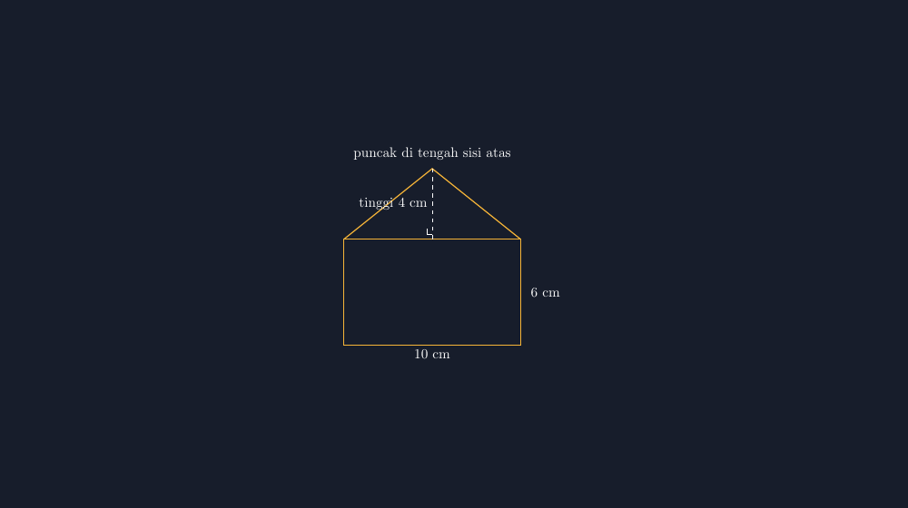

Ada satu soal yang tiap tahun selalu memakan korban. Bukan soal sulit, malah terlihat mudah: menghitung luas bangun gabungan, misalnya perumahan mini yang dibangun dari persegi panjang dan setengah lingkaran di salah satu sisinya. Setiap kelas, saya selalu menemukan siswa yang jawabannya tidak masuk akal — ada yang lebih besar dari luas seluruh halaman soal, ada yang aneh-aneh angkanya.

Saya mulai mengendus penyebabnya bukan dari jawaban, tapi dari gambar yang mereka buat sendiri di kertas buram. Dan di situ masalahnya terlihat: **gambar mereka menipu mereka sendiri**.

<!--more-->

## Dimana Kesalahannya Sebelum Menghitung

Contoh klasiknya begini. Sebuah persegi panjang bersisi 10 cm dan 6 cm, ditempelkan segitiga sama kaki di sisi atasnya dengan tinggi 4 cm. Siswa diminta menghitung luas total.

Siswa yang menggambar asal-asalan biasanya buntu di satu pertanyaan: *sisi segitiga yang mana yang menempel?* Kalau dia mengira sisi miring segitiga (sisi kapalnya) yang tempel di persegi panjang, dia akan menghitung luas segitiga dengan alas 10 cm — padahal tinggi 4 cm itu diukur tegak lurus dari alas, dan alasnya justru sisi yang tak terlihat karena menempel.

$$L_{\text{total}} = L_{\text{persegi panjang}} + L_{\text{segitiga}} = (10 \times 6) + \left(\tfrac{1}{2} \times 10 \times 4\right) = 60 + 20 = 80 \text{ cm}^2.$$

Tapi siswa yang salah tempel bisa dapat $\tfrac{1}{2} \times 4 \times 4$ atau kombinasi aneh lainnya. Kesalahannya bukan di operasi hitung — semua bisa mengalikan dua angka. Kesalahannya di **pemahaman gambar**: sisi mana yang bertemu sisi mana.

## Gambar Jujur Tidak Bisa Digambar Asal

Di titik ini saya mengambil keputusan yang sama seperti di banyak artikel sebelumnya: kalau masalahnya di gambar, maka gambar yang saya tunjukkan di papan atau di lembar soal harus benar-benar bisa dipertanggungjawabkan. Tangan saya di papan tulis memang cukup akurat untuk segitiga sederhana, tapi untuk bangun gabungan dengan banyak sisi, garis bantu, dan label, papan tulis sering kehilangan presisi — apalagi kalau saya harus menghapus sebagian untuk memberi ruang.

Maka saya gambar dengan TikZ. Ide dasarnya sederhana: setiap bangun digambar di koordinat yang **benar-benar sesuai ukurannya**, bukan sekadar bentuk. Kalau persegi panjangnya 10 cm × 6 cm, saya gambar dengan proporsi 10:6. Kalau segitiganya tingginya 4 cm di atas sisi alas 10 cm, puncaknya saya taruh tepat di titik tengah sisi atas persegi panjang, naik 4 satuan.

```latex
\begin{tikzpicture}[scale=0.45]
  % persegi panjang 10 x 6
  \draw[thick] (0,0) -- (10,0) -- (10,6) -- (0,6) -- cycle;
  % segitiga sama kaki di sisi atas: alas 10, tinggi 4
  \draw[thick] (0,6) -- (5,10) -- (10,6);
  % garis bantu tinggi segitiga
  \draw[dashed] (5,10) -- (5,6);
  \draw (5,6.3) -- (4.7,6.3) -- (4.7,6.6);
  % label sisi
  \node[below] at (5,0) {10 cm};
  \node[right] at (10.3,3) {6 cm};
  \node[above] at (5,10.2) {puncak di tengah sisi atas};
  \node[left] at (5,8) {tinggi 4 cm};
\end{tikzpicture}
```

Perhatikan garis putus-putus dari puncak ke sisi atas persegi panjang. Garis kecil ini yang sering hilang di gambar siswa — dan justru garis itulah yang menunjukkan bahwa tinggi segitiga diukur ke **alas**, bukan ke sisi miring. Dalam TikZ, garis ini bukan hiasan; dia konsekuensi logis dari koordinat yang saya tulis: puncak di $(5,10)$, kaki garis bantu di $(5,6)$, jaraknya memang 4 satuan.

## Ketika Siswa Ditunjukkan Gambar yang Konsisten

Efeknya di kelas terasa di pertanyaan yang berubah. Dulu, setelah saya tunjukkan contoh, pertanyaan yang muncul biasanya "Bu, rumusnya mana yang dipakai?" Sekarang, dengan gambar yang jelas, pertanyaan yang muncul justru soal gambar itu sendiri: "Lho, kenapa garis tingginya diturunkan ke situ, Bu? Bukannya ke sisi miring?"

Itu pertanyaan yang saya tunggu bertahun-tahun. Karena kalau siswa sampai bertanya begitu, artinya dia melihat ada pilihan yang harus diputuskan — dan keputusan itulah inti dari bangun gabungan, bukan penjumlahan dua luas. Setelah keputusan itu dipahami, rumusnya cuma formalitas.

Saya jadi punya kebiasaan baru: soal bangun gabungan di ulangan tidak saya kirim sebagai gambar jadi saja. Kadang saya minta siswa menyalin gambar itu ke kertasnya dengan ukuran yang kira-kira proporsional. Yang menyalin dengan tepat biasanya langsung menemukan sisi mana yang tempel; yang menyalin asal justru sering menyadari gambarnya tidak konsisten — dan itu latihan yang tidak ternilai: siswa mulai mengaudit gambar sendiri.



*Gambar 1. Persegi panjang 10 cm × 6 cm dengan segitiga sama kaki (alas 10 cm, tinggi 4 cm) di sisi atasnya. Garis putus-putus menunjukkan tinggi segitiga yang diukur tegak lurus ke alasnya — detail yang paling sering hilang di gambar siswa.*

## Variasi yang Saya Simpan untuk Kelas Lain

Dari satu pola dasar itu saya kembangkan beberapa variasi. Ada bangun gabungan rumah (persegi panjang + segitiga seperti di atas), ada gabungan persegi panjang dengan setengah lingkaran di sisinya (seperti tikungan jalan mini), dan ada gabungan dua persegi panjang yang membentuk huruf T atau L — bentuk yang paling sering mengelabui siswa karena sisinya tidak semua kelihatan.

Untuk bentuk L misalnya, saya selalu gambar garis bantu putus-putus yang memperpanjang sisi-sisi yang bertemu, sehingga siswa bisa melihat bahwa sisi dalam yang tadinya tersembunyi sekarang punya panjang yang bisa dituliskan. Tanpa garis bantu itu, siswa sering menghitung keliling (bukan luas) dengan sisi yang salah.

Saya juga menambahkan satu kebiasaan kecil di gambar TikZ: setiap sisi yang diketahui panjangnya saya beri label, dan sisi yang *tidak* diketahui sengaja saya biarkan tanpa label. Jadi siswa yang ingin menghitung sesuatu harus tahu sisi mana yang punya informasi dan sisi mana yang harus dicari. Ini melatih mereka membedakan data yang diberikan dan data yang bisa diturunkan — keterampilan yang nantinya mereka pakai di semua bab, bukan cuma bangun gabungan.

## Penutup: Gambar yang Bisa Dipercaya, Hitungan yang Bisa Dipercaya

Saya berhenti menganggap bangun gabungan sebagai materi tentang penjumlahan luas. Sekarang saya menganggapnya materi tentang **membaca gambar**: mana bagian satu, mana bagian dua, mana sisi yang tempel, mana tinggi yang diukur ke mana. Setelah gambar dibaca dengan benar, luasnya cuma soal berhitung yang sudah dikuasai sejak kelas sebelumnya.

TikZ berperan di sini bukan sebagai alat yang keren, tapi sebagai penjaga kejujuran. Gambar yang dibuat dengan koordinat yang benar tidak mungkin menipu — kalau tinggi segitiga 4 cm, jaraknya di gambar memang 4 satuan, tidak bisa berbohong. Dan ketika siswa melihat gambar yang jujur, mereka belajar sesuatu yang lebih luas dari sekadar bangun gabungan: bahwa gambar dalam soal matematika bukan hiasan, tapi bagian dari informasi yang harus dibaca dengan hati-hati.

Untuk Bapak/Ibu guru yang ingin mencoba, berikut berkas TikZ lengkap yang siap dikompilasi. Silakan dimodifikasi sesuai soal di kelas masing-masing.

> 📎 **Berkas TikZ lengkap:** [tikz-luas-bangun-gabungan.tex](tex/tikz-luas-bangun-gabungan.tex) — siap kompilasi (butuh paket `tikz`).

Semoga gambar yang jujur di lembar soal Bapak/Ibu menghasilkan jawaban yang bisa dipercaya di kelas.
