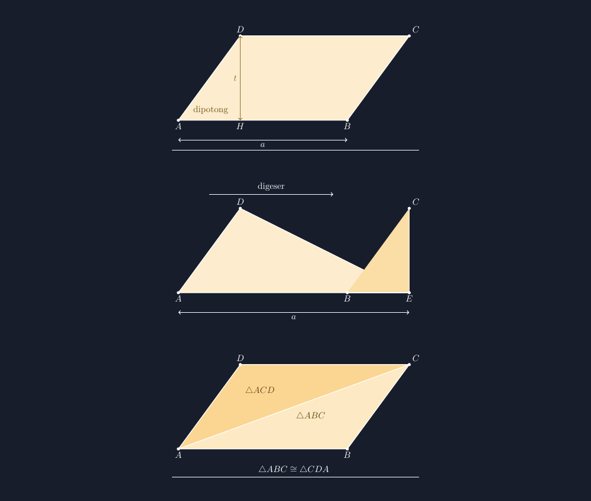

Di kelas VII, rumus luas jajargenjang adalah salah satu rumus yang paling cepat "sampai" dan paling cepat mati. Cepat sampai karena bentuknya ringan: $L = a \times t$, dua huruf saja, lebih pendek dari rumus trapesium. Cepat mati karena dua huruf itu mudah sekali terlepas dari maknanya. Tahun lalu, saat saya memberi soal jajargenjang dengan alas 12 cm dan sisi miring 9 cm, hampir seperempat kelas menghitung $12 \times 9$. Mereka tidak sembarangan — mereka hafal bahwa "luas itu alas dikali sisi miring". Angka 12 dan 9 tersedia, jadi dikalikan.

<!--more-->

## Dua angka yang tersedia, bukan dua angka yang diperlukan

Kesalahan itu bukan kesalahan hitung. Kesalahannya lebih dalam: rumusnya tersimpan di kepala mereka sebagai operasi antar-angka, bukan sebagai cerita tentang bangun. Alas itu ada, sisi miring itu juga ada, kalau rumusnya "dikalikan" ya dua-duanya yang dikalikan.

Waktu itu saya koreksi seperti biasa: memberi tanda, menulis $t = 8$ cm di pinggir, memberi tahu bahwa tinggi jajargenjang diukur tegak lurus dari alas, bukan sepanjang sisi miringnya. Tapi malam itu, menata ulang jurnal mengajar saya, saya sadar koreksi seperti itu baru mengobati gejalanya. Anak-anak memakai sisi miring karena mereka tidak pernah benar-benar *melihat* mengapa alas dikali tinggi — dan bukan alas dikali apa pun yang kebetulan panjang. Rumus itu datang ke hidup mereka sudah jadi, tanpa asal-usul.

Musim ini saya coba jalan lain: jangan menyerahkan rumus lebih dulu. Biarkan rumus itu ditemukan, dan yang menemukan bukan saya.

## Memotong segitiga sisi, menggesernya

Saya buka pelajaran dengan menggambar jajargenjang besar di papan. Titik-titiknya saya sebut: $A$ kiri bawah, $B$ kanan bawah, $C$ kanan atas, $D$ kiri atas. Lalu saya tarik garis tinggi dari $D$ tegak lurus ke alas, bertemu di titik $H$. Di sisi kiri, di luar "badan" persegi panjang yang sebenarnya, ada segitiga $\triangle ADH$ yang mencuat.


*Tiga tahap yang kami jalani di kelas: jajargenjang dengan segitiga sisi yang ditandai, segitiga yang digeser ke kanan hingga menjadi persegi panjang utuh, dan cara pandang kedua lewat diagonal — dua segitiga kongruen yang beralas sama.*

Pertanyaan saya sederhana: "Kalau segitiga ini dipotong dan dipindah, jadi bangun apa?" Karena sudah terbiasa dengan materi luas trapesium beberapa minggu sebelumnya, jawaban itu keluar cepat: persegi panjang. Bagian yang benar. Tapi saya tidak berhenti di jawaban cepat itu, karena di situlah letak lubangnya. Saya minta mereka menjawab pertanyaan yang lebih keras: *kenapa luasnya tidak berubah?*

Diskusi kelompok yang saya dengar malam itu berputar di sekitar satu kalimat yang akhirnya diucapkan seorang siswa, saya sebut Rafi: "Bangunnya doang yang beda, Pak. Potongannya sama." Itu intinya, dan itu keluar dari mereka, bukan dari saya. Memotong dan menggeser tidak menambah atau mengurangi apa pun — hanya memindahkan. Jadi luas jajargenjang sama dengan luas persegi panjang yang alasnya $a$ dan tingginya $t$:

$$L = a \times t$$

Dan sekarang setiap kata di rumus itu punya wajah. $a$ adalah alas yang tidak pernah berubah panjang saat dipotong-menggeser. $t$ adalah jarak tegak lurus antara dua sisi sejajar — jarak, bukan sisi miring. Sisi miring bahkan tidak ikut dalam rumus sama sekali, dan setelah menemukan rumusnya sendiri, anak-anak bisa melihat *kenapa* dia tidak ikut: dia hanya jadi kemiringan dinding, bukan lantai yang dihitung.

## Soal jebakan yang dulu, yang sekarang

Pekan berikutnya saya keluarkan lagi soal serupa: alas 12 cm, sisi miring 9 cm, tinggi 8 cm — dan kali ini tingginya saya cantumkan, supaya pilhan yang salah tersedia juga. Kelas sebelumnya pasti memakan umpan $12 \times 9$. Kelas yang menemukan rumusnya sendiri, hampir semuanya lewat. Bukan karena mereka lebih pintar. Karena $t$ bagi mereka bukan huruf asing di rumus, tapi garis putus-putus yang mereka lihat sendiri tumbuh dari $D$ ke $H$ di papan.

Ada juga cerita kecil yang saya sukai. Seorang siswa bertanya, "Pak, kalau jajargenjangnya digambar miring banget, tingginya ke mana?" Pertanyaan itu memicu latihan menggambar singkat: mereka mencoba menggambar jajargenjang dengan kemiringan makin landai dan menyadari sendiri bahwa tingginya makin pendek, padahal alas tetap. Luasnya ikut menyusut. Kalau luas cuma "alas dikali sesuatu", sesuatu itu pastilah yang berubah-ubah saat bangun direbahkan — dan jelas bukan sisi miringnya, yang malah makin panjang saat bangun makin rebah.

## Menggambar ketiga tahapnya dengan TikZ

Seperti biasa, gambar untuk lembar kerja saya buat dengan TikZ supaya proporsinya jujur. Inti gambar tahap pertama hanya segiempat dari empat koordinat, ditambah garis tinggi yang putus-putus:

```latex
\begin{tikzpicture}[scale=1.1]
  \coordinate (A) at (0,0);
  \coordinate (B) at (6,0);
  \coordinate (C) at (8.2,3);
  \coordinate (D) at (2.2,3);
  \fill[color=aksen!25] (A) -- (B) -- (C) -- (D) -- cycle;
  \draw[thick] (A) -- (B) -- (C) -- (D) -- cycle;
  \draw[dashed,thick] (D) -- (2.2,0) node[below] {$H$};
  \draw[<->,thick,color=aksen!60!black] (2.2,0) -- (2.2,3)
        node[midway,left] {$t$};
  \draw[<->,thick] (0,-0.7) -- (6,-0.7) node[midway,below] {$a$};
\end{tikzpicture}
```

Yang membuat gambar ini jujur adalah koordinatnya: $D$ dan $C$ sama-sama di ketinggian 3, jadi tingginya benar-benar 3 di mana pun diukur; panjang $AB$ dan $DC$ sama persis 6, karena $8.2 - 2.2 = 6$. Kalau saya menggambar bebas dengan tangan, sisi miring kiri dan kanan hampir pasti tidak akan sama panjang, dan siswa yang teliti seperti pernah saya ceritakan di artikel jajargenjang sebelumnya akan menemukannya lebih dulu daripada saya.

Tahap kedua — segitiga yang digeser — tinggal digambar sebagai trapesium sisa ditambah segitiga di posisi barunya. Sekali lagi koordinat yang bekerja: segitiga hasil geser adalah bayangan $\triangle ADH$ yang digeser sejauh 6 satuan, sehingga $A$ tiba di $B$ dan $H$ tiba di titik baru $E$. Tidak ada yang dikira-kira.

## Cara pandang kedua: diagonal dan dua segitiga kembar

Ada satu jalur lain yang saya tampilkan belakangan, dan beberapa siswa justru lebih suka ini: tarik diagonal $AC$. Jajargenjang terbelah menjadi $\triangle ABC$ dan $\triangle CDA$. Kedua segitiga itu kongruen — siswa bisa membuktikannya dengan sisi-sisi yang sama panjang, materi kesebangunan dan kekongruenan yang sudah mereka punya. Maka luas jajargenjang adalah dua kali luas segitiga beralas $a$ dan bertinggi $t$:

$$L = 2 \times \tfrac{1}{2} \, a \, t = a \times t$$

Sampai di sini rumusnya sama, tapi ceritanya berbeda. Dan justru karena dua cerita yang berbeda tiba di rumus yang sama, siswa melihat bahwa rumus itu bukan karangan yang kebetulan benar — dia mengikuti struktur bangunnya sendiri.

## Yang saya catat untuk diri sendiri

Pelajaran terbesar dari dua kali mengajar materi ini bukan tentang jajargenjang. Rumus yang saya *berikan* akan dipakai selama soalnya mirip dengan latihan. Rumus yang siswa *temukan* lewat memotong dan menggeser akan tetap hidup di kepala mereka bahkan saat soalnya menyamar — sisi miring yang besar dan menggoda, tinggi yang tidak langsung terlihat. Biaya menemukan memang lebih mahal: pelajaran itu habis dua jam, bukan sepuluh menit. Tapi dua jam itu yang membedakan anak yang menghitung $12 \times 9$ karena angkanya tersedia, dengan anak yang berhenti sejenak dan bertanya, "yang dikali alas itu yang mana?"

> 📎 **Berkas TikZ lengkap:** [tikz-luas-jajargenjang-memotong.tex](tex/tikz-luas-jajargenjang-memotong.tex) — siap kompilasi (butuh paket `tikz`).
