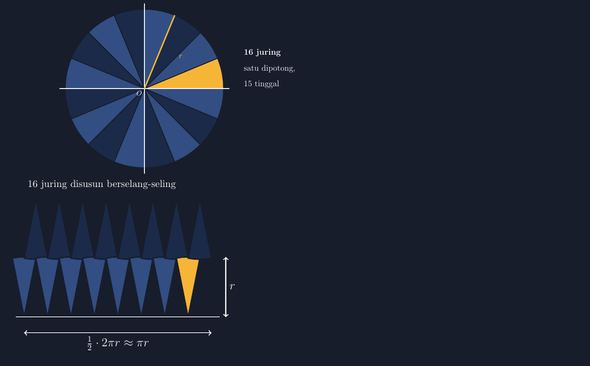

Kalau Bapak/Ibu guru matematika SMP menanyakan rumus luas lingkaran, hampir semua murid akan menjawab serempak: $L = \pi r^2$. Cepat, yakin, dan tidak butuh pikir. Tetapi cobalah balik pertanyaannya satu tingkat: "Dari mana rumus itu datang?" Suasana kelas biasanya langsung berubah. Anak-anak saling pandang, ada yang pura-pura mencari tulisan di buku, dan akhirnya satu suara berani menjawab, "Ya begitulah, Bu, di buku tertulis begitu." Itulah yang saya alami di kelas VII.B bulan lalu, ketika memulai bab lingkaran. Rumusnya sudah hafal semua; asal-usulnya tidak ada yang tahu.

<!--more-->

## Hafalan yang Retak di Ujungnya

Sebenarnya saya paham kenapa begitu. Rumus luas lingkaran tidak seperti luas persegi panjang yang bisa ditemukan dengan menghitung kotak-kotak satuan di atas kertas berpetak. Lingkaran itu lengkung; tidak ada kotak satuan yang rapi menempel mengikuti tepinya. Jadi sejak dulu, rumus itu memang biasanya diserahkan begitu saja sebagai "perjanjian" — angka $\pi$ dikali $r$ dikali $r$, selesai, hafalkan.

Masalahnya, hafalan semacam ini retak tepat di ujung penggunaannya. Di ulangan, murid menghitung luas lingkaran jari-jari 14 cm dengan lancar. Tetapi ketika saya memberi soal sedikit dibalik — luasnya 616 cm², cari jari-jarinya — hampir setengah kelas macet. Mereka tidak punya gambaran apa yang sebenarnya mereka hitung. Bagi mereka $\pi r^2$ hanyalah rangkaian lambang, bukan luas dari sesuatu.

Maka di pertemuan berikutnya saya membawa gunting, karton bekas, dan jarum pentul. Hari itu kita tidak langsung menghitung. Hari itu kita memotong lingkaran.

## Memotong Lingkaran Menjadi Kipas

Kegiatannya sederhana tapi butuh ketelitian. Setiap kelompok mendapat lingkaran karton berjari-jari 10 cm. Pertama, mereka menandai pusatnya — titik tempat ujung jangka bertemu. Lalu lingkaran dibagi menjadi 16 juring sama besar. Caranya tidak perlu canggih: karena $360° : 16 = 22{,}5°$, mereka memakai busur derajat, menandai setiap 22,5°, lalu menarik garis dari pusat ke tepi. Hasilnya seperti kipas lipat: 16 potongan kue, satu juring penuh di mana-mana.



Setelah semua juring terpotong, bagian yang paling saya suka: menyusun ulang. Potongan-potongan itu disusun berjajar di meja, tapi tidak dengan arah yang sama — juring pertama diletakkan menghadap atas, juring kedua menghadap bawah, ketiga atas lagi, dan seterusnya, berselang-seling. Pola ini yang sering terlewat; kalau semua juring disusun searah, hasilnya tidak membentuk apa-apa yang dikenali. Tetapi begitu disusun berselang-seling, sesuatu yang ajaib muncul di atas meja kelompok: bentuk yang hampir seperti persegi panjang.

## "Bu, Ini Kok Seperti Persegi Panjang?"

Di titik ini ada satu juring yang nasibnya berbeda. Karena lingkaran punya jumlah juring genap (16), juring-juring tersisa setelah disusun akan menyisakan satu potongan yang tidak punya pasangan — dia menghadap ke satu arah sendirian di ujung susunan. Juring inilah yang kita potong lagi, tepat di tengah, menjadi dua bagian sama besar. Satu bagian ditempelkan di ujung kiri susunan, satu lagi di ujung kanan. Sekarang susunannya benar-benar tampak seperti persegi panjang — dengan dua tepi bergerigi halus, seperti gigi gergaji kecil.

Saat itu juga ada yang berseru dari kelompok dekat jendela, "Bu, ini kok mirip persegi panjang?" Dan justru ketidaksempurnaan bentuk itulah yang saya ambil sebagai bahan diskusi. Gerigi di tepi atas dan bawah itu tidak akan hilang, tidak peduli seberapa teliti kita memotong. Tetapi bayangkan kalau kita memotong lingkaran menjadi 32 juring. Geriginya jadi lebih halus. 64 juring? Lebih halus lagi. Semakin banyak potongan, semakin jauh gerigi-gerigi itu saling mengisi, dan susunan kita semakin mendekati persegi panjang yang sejati. Murid-murid yang tadinya skeptis akhirnya mengiyakan: bentuk ini "menuju" persegi panjang, meskipun tidak pernah persis menjadi persegi panjang. Sebuah pengalaman pertama menyentuh gagasan limit, tanpa saya perlu menyebut kata itu.

## Menghitung Panjang dan Lebar Susunan

Baru setelah bentuknya diterima, kita berhitung. Persegi panjang-itu punya tinggi sama dengan jari-jari lingkaran, karena sisi lurus setiap juring — dari pusat ke tepi — panjangnya $r$. Itu mudah dilihat langsung dari karton.

Yang menarik adalah panjangnya. Tepi bawah susunan tersusun dari busur-busur juring yang menghadap bawah. Busur setengah juring — sebab tiap juring sekarang setengahnya di atas, setengahnya di bawah — panjangnya $\frac{1}{2} \cdot \frac{2\pi r}{16}$. Ada 16 busur setengah juring di tepi bawah, jadi panjang susunan:

$$\text{panjang} = 16 \times \frac{1}{2} \times \frac{2\pi r}{16} = \pi r$$

Persis setengah keliling lingkaran. Ketika hasil $\pi r$ ini muncul di papan tulis, ada beberapa murid yang berdecak — mereka mengenali $\pi r$ sebagai setengah dari $2\pi r$ yang biasa mereka pakai untuk keliling. Koneksi itu terjadi sendiri, tanpa saya pancing dengan pertanyaan ujian.

Maka luas susunan, yang sama persis dengan luas lingkaran aslinya (kita hanya memindah-mindah potongan, tidak menambah atau mengurangi apa pun), adalah:

$$L = \text{panjang} \times \text{lebar} = \pi r \times r = \pi r^2$$

Rumus yang selama ini dihafal akhirnya punya cerita. Dan cerita itu mereka alami dengan tangan sendiri: memotong, menyusun, mengukur, menghitung.

## Menggambar Ulang Prosesnya dengan TikZ

Pengalaman kelas itu saya ikat menjadi media yang bisa dipakai ulang tahun depan. Di kertas karton, susunan juring akan selalu terlihat kasar — memang itu justru bagian dari pesannya. Tetapi untuk dipajang di slide atau lembar kerja, saya gambar ulang prosesnya dengan TikZ supaya bersih dan tetap jujur pada bentuknya.

Bagian pertama adalah lingkaran yang dibagi 16 juring. Kuncinya satu siklus `foreach`: setiap juring adalah sektor dari sudut $\frac{360°}{16} = 22{,}5°$, digambar dengan perintah `arc`, lalu diberi warna berselang-seling supaya batas antarjuring terlihat. Satu juring saya beri warna aksen berbeda — juring itulah yang dalam cerita kelas dipotong dua di tengah.

Bagian kedua, dan ini bagian yang paling menantang, menyusun juring-juring menjadi kipas mendekati persegi panjang. Posisi setiap juring harus dihitung, bukan ditebak: tiap juring pada dasarnya segitiga dengan tinggi hampir $r\cos 11{,}25°$ dan lebar dasar $r \sin 11{,}25°$, dan busurnya melengkung ke atas dan ke bawah secara bergantian. Jadi dalam `foreach` saya pakai trigonometri langsung — `\sin` dan `\cos` pada TikZ — untuk menempatkan puncak tiap juring. Berikut inti bagiannya:

```latex
\foreach \k in {0,1,...,7}{
  \pgfmathsetmacro{\xu}{2*\k*\R*\s}     % puncak juring yang menghadap atas
  \pgfmathsetmacro{\xd}{(2*\k+1)*\R*\s} % puncak juring yang menghadap bawah
  \fill[biru!55!black]
    (\xu,0) -- ++(90-\half:\R) arc(90-\half:90+\half:\R) -- cycle;
  \fill[biru!30!black]
    (\xd,2*\R*\c) -- ++(-90-\half:\R) arc(-90-\half:-90+\half:\R) -- cycle;
}
```

Ketelitian geometri di TikZ justru menguntungkan pembelajaran. Saya tidak bisa menggambar susunan ini "asal mirip" — kalau lebar dasar juring tidak dihitung dengan $\sin 11{,}25°$, juring-juring akan saling menabrak atau malah bolong. Gambar yang jujur memaksa saya menghitung dengan benar, dan murid yang membacanya menerima susunan yang konsisten dengan cerita "semakin banyak potongan, semakin halus geriginya" yang kita bangun di kelas.

Berkas lengkapnya saya sertakan di bawah — bisa langsung dikompilasi dan diubah-ubah: ganti jumlah juring, ganti warna, lihat sendiri bagaimana gerigi susunan berubah.

> 📎 **Berkas TikZ lengkap:** [figur.tex](tex/figur.tex) — siap kompilasi (butuh paket `tikz`).

## Catatan Penutup: Rumus yang Punya Cerita

Kembali ke pertanyaan murid yang membuka tulisan ini. Setelah kegiatan memotong juring itu, saya memberikan soal balik yang dulu membuat setengah kelas macet: luas 616 cm², cari jari-jarinya. Kali ini tidak ada yang macet lebih dari beberapa menit. Bukan karena murid jadi lebih pandai berhitung, tapi karena sekarang mereka tahu bahwa $\pi r^2$ bukan mantra — dia panjang setengah keliling dikali lebar sejari-jari, hasil dari meja kerja yang pernah berantakan penuh potongan karton.

Saya jadi berpikir, berapa banyak rumus SMP lain yang kita serahkan sebagai perjanjian tanpa cerita? Volume tabung? Luas selimut kerucut? Setiap kali saya berhasil mengubah salah satunya dari "hafalkan" menjadi "lihat sendiri", ada rasa lega yang sulit dijelaskan — seperti melunasi utang yang sudah lama tersimpan. Memotong lingkaran menjadi kipas adalah satu pelunasan kecil di kelas VII.B. Bulan depan, giliran kerucut.
