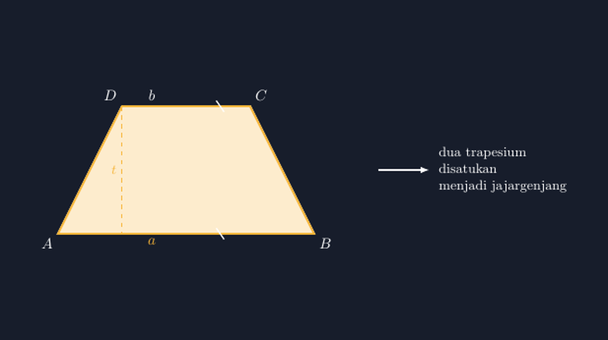

Rumus luas trapesium mungkin salah satu rumus yang paling banyak dihafal buta di kelas tujuh. Setengah dikali jumlah sisi sejajar dikali tinggi. Anak-anak melafalkannya dengan lancar, seperti hafalan doa sebelum makan. Tapi ketika saya bertanya sebaliknya — "dari mana setengahnya itu?" — kelas yang tadi riuh langsung hening. Ada yang menjawab asal-asalan, "karena rumusnya memang gitu, Pak."

Tahun ini saya tidak mau mengulang kejadian itu. Saya ingin rumus itu *ditemukan*, bukan *diterima*. Dan seperti biasa, kalau butuh gambar yang jujur di slide dan di lembar kerja, saya pergi ke TikZ.

## Mulai dari Potongan Kertas

Persiapan saya sederhana: kertas manila, gunting, dan penggaris. Setiap kelompok mendapat satu trapesium kertas yang saya buat malam sebelumnya — sisi sejajarnya 10 cm dan 6 cm, tingginya 8 cm. Tugas pertama mereka bukan menghitung, tapi menggambar salinan trapesium itu di kertas manila, memotongnya, lalu memutar salinannya 180 derajat dan menyandingkannya pada trapesium asli.

Awalnya ada yang menyusun salinannya terbalik-terbalik, lalu menyebut itu sudah jadi jajargenjang. Saya biarkan. Diskusi di kelompok jadi hidup justru karena kesalahan itu. "Eh, sisi miringnya nggak nyambung," kata seorang anak sambil memutar-mutar potongannya sampai kedua sisi miring bertemu dan menjadi satu garis lurus yang sejajar dengan alas.

Ketika salinan diputar 180 derajat dan disandingkan tepat di sisi miring trapesium asli, dua bangun itu bergabung menjadi sebuah jajargenjang. Alas jajargenjang itu adalah jumlah kedua sisi sejajar trapesium: $a + b$. Tingginya tetap $t$. Dan jajargenjang terdiri atas dua trapesium yang *persis sama*.

$$L_{\text{jajargenjang}} = (a+b) \times t$$

Momen itu yang saya tunggu-tunggu. Kalau jajargenjang terdiri dari dua trapesium identik, maka satu trapesium adalah setengahnya:

$$L_{\text{trapesium}} = \tfrac{1}{2}(a+b)\,t$$

Tidak ada yang perlu dihafal. Rumus itu tumbuh dari potongan kertas yang mereka pegang sendiri.


*Dua trapesium kongruen disandingkan — salinan diputar 180° — menjadi satu jajargenjang dengan alas $(a+b)$ dan tinggi $t$. Diagram ini saya render dari berkas TikZ yang saya lampirkan di bawah.*

## Kenapa Gambar Harus Jujur

Setelah sesi kertas, giliran saya membuat bahan digital. Untuk slide dan lembar kerja, saya ingin gambar yang menunjukkan proses itu dengan jujur: trapesium aslinya, salinan yang diputar, dan jajargenjang hasil gabungannya. TikZ memangkas semua godaan untuk menggambar asal terlihat bagus.

Yang saya suka dari TikZ di sini adalah konsep *rotate around*. Salinan trapesium tidak perlu saya hitung ulang koordinatnya satu per satu — saya cukup memutar seluruh bangun 180 derajat terhadap titik tengah sisi miring:

```latex
\begin{scope}[rotate around={180:(3,1.5)}]
  \draw[very thick, fill=white!10] (A) -- (B) -- (C) -- (D) -- cycle;
\end{scope}
```

Dengan begitu, secara geometris *dijamin* salinannya kongruen dengan aslinya. Kalau saya menggambar salinannya dengan tangan di PowerPoint, hampir pasti hasilnya sedikit meleset — dan meleset itu bisa jadi sumber miskonsepsi baru: anak akan melihat dua bangun yang "hampir sama" dan bertanya kenapa gabungannya tidak rapi.

Koordinat trapesium saya definisikan sekali:

```latex
\coordinate (A) at (0,0);
\coordinate (B) at (6,0);
\coordinate (C) at (4.5,3);
\coordinate (D) at (1.5,3);
```

Sisi sejajar bawahnya $a = 6$, atasnya $b = 3$, tingginya $t = 3$. Cukup sederhana untuk dipahami siswa, cukup jujur untuk dibedah. Penanda sisi sejajar (garis kecil di tengah alas dan di tengah sisi atas) saya tambahkan dengan bantuan pustaka `calc`, supaya terlihat bahwa keduanya memang perannya sama.

Di kelas, gambar ini saya tunjukkan *setelah* mereka berhasil dengan kertas. Jadi TikZ tidak menggantikan pengalaman tangan — ia memantapkannya. Anak yang sudah merasakan potongan kertas bergabung akan langsung "ah, itu tadi punya kita" ketika melihat versi digitalnya.

## Verifikasi ke Eksak

Setelah rumus ditemukan, kami uji dengan angka dari trapesium kertas tadi: $a = 10$, $b = 6$, $t = 8$. Jajargenjang gabungannya berukuran alas $(10+6) = 16$ dan tinggi $8$, luasnya $128$ cm persegi. Maka satu trapesium: $64$ cm persegi. Cek dengan rumus: $\tfrac{1}{2}(10+6)(8) = 64$. Cocok. Angka yang sama, dua jalan yang berbeda — dan siswa yang tadi pasang muka ketika saya menolak memberi rumus, sekarang bercerita ke teman sebangkunya tentang "trapesium kembar".

Saya sempatkan juga membahas jalan kedua: memotong trapesium menjadi satu segitiga dan satu jajargenjang kecil, lalu menjumlahkan luasnya. Hasilnya sama. Ini penting — matematika bukan tentang satu jalan lurus, tapi tentang jaringan jalan yang bermuara di tempat yang sama.

## Yang Saya Catat dari Jam Itu

Tiga hal yang membuat pertemuan ini, menurut saya, berhasil.

Pertama, rumus lahir dari *benda* sebelum lahir di *papan*. Urutan ini membalik kebiasaan lama saya yang menulis rumus lebih dulu lalu mencari contoh.

Kedua, TikZ memainkan peran yang tepat: bukan bintang utama, tapi saksi yang jujur. Ia tidak menjelaskan apa pun kepada siswa; ia hanya memastikan bahwa apa yang tampak di layar *benar-benar* konsisten dengan yang mereka lakukan dengan tangan. Dalam artikel-artikel sebelumnya saya sering menulis bahwa gambar soal tidak boleh mengelabui — prinsip yang sama berlaku di sini, bahkan lebih ketat, karena gambar ini justru *adalah* pembuktiannya.

Ketiga, dan ini yang paling saya syukuri: tidak ada satu pun anak yang bertanya "Pak, boleh pakai rumus lusu (luas trapesium)?" di ulangan berikutnya. Mereka menulis rumusnya sambil menggambar dua trapesium kecil di pinggir kertas. Kalau mereka lupa, mereka tahu cara menemukannya lagi.

Itulah sebetulnya ukuran keberhasilan yang paling jujur bagi saya: bukan skor ulangan yang naik, tapi hilangnya rasa takut saat rumus terlupakan. Sebab bagi anak yang pernah *menurunkan*, rumus bukan lagi hafalan — ia adalah kesimpulan yang bisa diangkut ulang kapan saja.

> 📎 **Berkas TikZ lengkap:** [luas-trapesium.tex](tex/luas-trapesium.tex) — siap kompilasi (butuh paket `tikz`, `amsmath`, dan pustaka `calc` serta `arrows.meta`).
