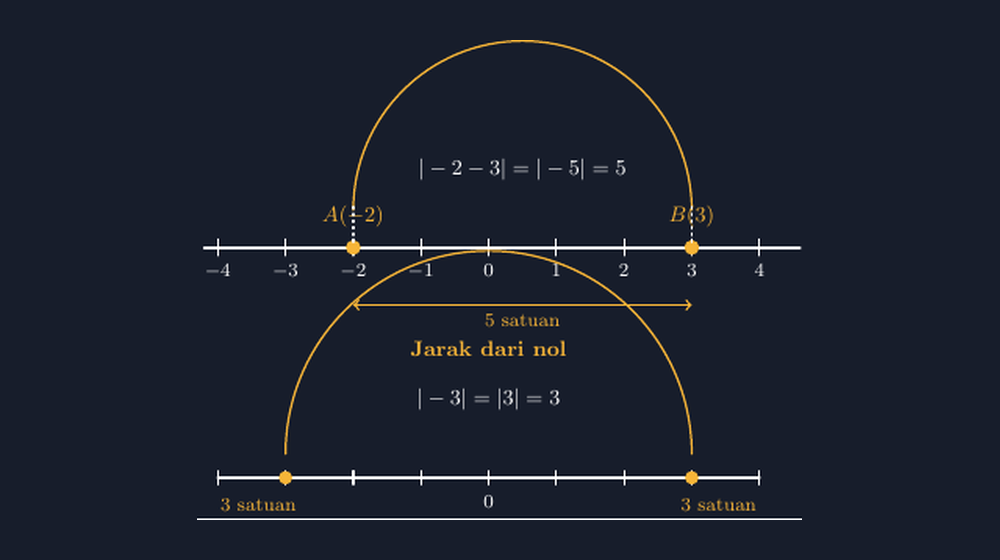

Ada satu notasi yang selalu membuat kelas VII saya terpecah menjadi dua kubu setiap tahun: tanda garis vertikal di kiri dan kanan sebuah bilangan. Kubu pertama menganggapnya tempelan ancaman — "kalau ada garisnya, jawabannya pasti positif" — dan langsung menghapus tanda minus tanpa mikir. Kubu kedua justru bingung kenapa garis itu ada sama sekali, padahal menurut mereka minus sudah cukup lama hidup dengan damai di pelajaran bilangan bulat.

Tahun lalu, saat masuk materi nilai mutlak, saya mencoba cara lain. Sebelum menyebut kata "nilai mutlak" dan sebelum menulis satu pun notasi $|\,x\,|$, saya menggambar garis bilangan besar di papan. Panjang, sampai ke dua ujung papan. Lalu saya tanyai satu titik: berapa jarak titik $-3$ dari nol?

Anak-anak menjawab serempak: tiga. Saya pindah titik ke $3$: berapa jaraknya dari nol? Juga tiga. Nah, di sini jaraknya sama, saya bilang, padahal bilangannya beda tanda. Bilangan yang menyatakan "berapa jauh" itu, tanpa peduli ke arah mana, itulah yang nanti kita tulis dengan garis-garis vertikal itu.

Tiga itu, saya tulis di papan: $|-3| = 3$. Lalu di sebelahnya: $|3| = 3$. Baru setelah itu notasinya muncul — dan entah kenapa, kali ini tidak ada lagi yang menganggapnya tempelan ancaman. Garis vertikal itu bukan tombol hapus-minus; dia cuma tanya satu hal: seberapa jauh kamu dari nol?



*Gambar 1. Nilai mutlak sebagai jarak: $|-3|$ dan $|3|$ sama-sama 3 satuan dari nol, dan jarak antara $A(-2)$ dan $B(3)$ dihitung lewat $|-2-3|$.*

## Masalah Muncul Saat Titiknya Bukan Nol

Bagian pertama biasanya lancar-lancar saja. Kesulitan datang ketika saya ajuk soal berikut: berapa jarak antara titik $-2$ dan titik $3$ di garis bilangan?

Sebagian anak langsung menghitung $3 - (-2) = 5$. Bagus. Tapi tidak sedikit yang menjawab $1$ — mereka mengurangi nilainya saja, $3 - 2$, seolah tanda minus di $-2$ tidak punya arti posisi. Dan sebagian lagi buntu sama sekali, karena soalnya tidak bilang "dari nol", padahal di kepala mereka nilai mutlak identik dengan jarak-dari-nol.

Di sinilah saya menyadari bahwa soal jarak antara dua titik sebenarnya butuh satu lompatan konsep: jarak itu bisa dihitung dari selisih. Jarak antara $a$ dan $b$ adalah $|a - b|$. Kalau $a = -2$ dan $b = 3$, maka $|-2 - 3| = |-5| = 5$. Angka minus di dalam garis itu bukan tanda bahwa hasilnya aneh — dia hanya mencatat kalau selisihnya negatif, dan yang kita ambil ya tinggal besarnya.

Tahun itu saya mencoba memvisualisasikan langkah ini di lembar kerja, dan di situlah saya kembali bertemu rekan lama saya: TikZ. Karena kalau saya gambar garis bilangan asal-asalan di pengolah kata — titik $-2$ dan titik $3$ yang jaraknya tidak proporsional — saya sudah terlalu sering dikoreksi murid-murid saya sendiri. Gambar yang bilangnya "jarak 5 satuan" tapi tampaknya cuma dua petak, itu bohong yang terlalu jelas.

## Menggambar yang Jujur pada Jarak

Ide gambar TikZ-nya sederhana: satu garis bilangan dengan titik $A(-2)$ dan $B(3)$, busur yang menghubungkan keduanya di atas, dan panah "5 satuan" di bawah. Di panel kedua, versi jarak-dari-nol: dua titik $-3$ dan $3$ yang sama-sama 3 satuan dari $0$.

Bagian yang paling saya jaga adalah proporsi. Titik $-2$ dan $3$ di gambar harus benar-benar berjarak 5 satuan dari skala yang sama dengan angka $-4$ sampai $4$ di bawahnya. Di TikZ ini praktis gratis: kita tinggal menaruh titik di koordinat yang benar.

```latex
\begin{tikzpicture}[line cap=round, line join=round]
  \draw[white, very thick] (-4.2,0) -- (4.6,0);
  \foreach \x in {-4,...,4}
    \draw[white, thick] (\x,0.12) -- (\x,-0.12)
      node[below, text=white, font=\footnotesize] {$\x$};
  % titik A(-2) dan B(3)
  \fill[aksen] (-2,0) circle (0.11)
    node[above=5pt, text=aksen, font=\small] {$A(-2)$};
  \fill[aksen] (3,0) circle (0.11)
    node[above=5pt, text=aksen, font=\small] {$B(3)$};
  % busur jarak dan panah
  \draw[aksen, thick] (-2,0.55)
    arc[start angle=180, end angle=0, radius=2.5];
  \node[text=white, font=\small] at (0.5,1.15) {$|-2-3| = |-5| = 5$};
  \draw[aksen, <->, thick] (-2,-0.85) -- (3,-0.85)
    node[midway, below, text=aksen, font=\footnotesize] {5 satuan};
\end{tikzpicture}
```

Perhatikan satu hal kecil tapi penting: busurnya saya buat dengan `arc[start angle=180, end angle=0, radius=2.5]` mulai dari titik $-2$. Jari-jari 2.5 berarti ujung busur otomatis jatuh tepat di $-2 + 5 = 3$. Saya tidak menggambar busur "kira-kira sampai di situ" — dia *harus* berakhir di $B$ karena matematikanya memang begitu. Kalau besok saya ubah $B$ menjadi $4$, saya cukup mengubah satu angka dan seluruh gambar menyesuaikan diri: busur, panah, label $|{-2}-4| = 6$. Inilah keuntungan yang tidak pernah saya dapat dari gambar titik-dan-seret.

Satu lagi: panah "5 satuan" di bawah garis sengaja saya pisahkan dari busur di atas. Anak-anak perlu melihat dua hal yang berbeda — busur itu menunjukkan *selisih* yang dihitung lewat notasi, panah di bawah menunjukkan *jarak fisik* yang bisa dihitung petaknya. Kalau keduanya digabung, notasi $|a-b|$ dan pengalaman menghitung jalan di garis bilangan malah tercampur jadi satu simbol yang ambigu.

## Dari Gambar ke Kebiasaan

Lembar kerja itu saya pakai dengan cara yang sederhana. Setelah gambar dipajang, saya minta siswa menghitung jarak beberapa pasang titik — bukan dengan rumus dulu, tapi dengan menghitung petak. $-2$ ke $3$? Lima petak. $-5$ ke $-1$? Empat petak. Baru setelah lima-enam pasangan, saya tanya: ada yang menemukan cara cepat tanpa menghitung petak satu-satu?

Biasanya butuh beberapa menit sebelum seseorang bilang, "Pak, kok kayak kurang-kurang aja ya? Besarnya dikurang yang kecil." Ya, memang. $|3 - (-2)|$, besar dikurangi kecil. Dan kalau urutannya kebalik, $|-2 - 3|$, hasil selisihnya negatif — tapi nilai mutlaknya menyelamatkan: besarnya tetap sama. Jarak dari Punggur ke Lampung Tengah sama saja dengan jarak dari Lampung Tengah ke Punggur; arah berubah, jarak tidak.

Contoh perjalanan Lampung itu biasanya membuat kelas mengerti. Arah itu penting kalau kita bicara *perpindahan*; jarak itu tidak peduli arah. Nilai mutlak persis alat untuk membuang arah dan menyisakan besarnya. Baru di sini hafalan "hasil nilai mutlak pasti tak negatif" berubah dari aturan asal menjadi sesuatu yang masuk akal: wajar jarak tidak bisa negatif — mana mungkin kamu berjarak minus lima kilometer dari rumah.

## Yang Saya Pelajari dari Materi Kecil Ini

Nilai mutlak di SMP memang materi pendek — kadang selesai dalam satu-dua pertemuan. Tapi justru karena pendek, notasi $|x|$ sering berlalu begitu saja, ditelan sebagai aturan tanpa cerita. Dan hutang pemahaman itu tidak langsung ditagih di kelas VII; dia ditagih nanti, diam-diam, di kelas IX ketika siswa bertemu $|2x - 1| = 5$ dan tidak paham kenapa persamaan itu punya dua jawaban. Kalau $|x - 1|$ dipahami sebagai "jarak $x$ dari titik 1", maka $|2x-1| = 5$ langsung terbaca: cari $x$ yang berjarak $2{,}5$ dari $0{,}5$ — ya dua titik itu, di kiri dan kanan. Sekali makna jaraknya terpasang, soal-soal yang tadinya terasa trik malah terasa wajar.

Jadi kalau Bapak/Ibu Guru pernah merasa aneh kenapa murid begitu cepat menghapus tanda minus di dalam garis vertikal, mungkin coba jalannya dibalik: jangan mulai dari notasi, mulai dari titik di garis bilangan dan pertanyaan "berapa jauh". Notasi itu seharusnya datang paling akhir, sebagai singkatan dari sesuatu yang sudah lama mereka pahami.

Dan seperti biasa, TikZ membantu saya menjaga kejujuran gambar. Gambar yang jaraknya sesuai skala, titiknya di koordinat yang benar, dan busurnya berakhir tepat di titik yang disebut — itu gambar yang bisa dipertanggungjawabkan di depan murid-murid yang jeli. Sebab di kelas, gambar yang salah sering diajarkan lebih lama daripada penjelasan yang benar.

> 📎 **Berkas TikZ lengkap:** [nilai-mutlak-garis-bilangan.tex](tex/nilai-mutlak-garis-bilangan.tex) — siap kompilasi (butuh paket `tikz` dan `amsmath`).
