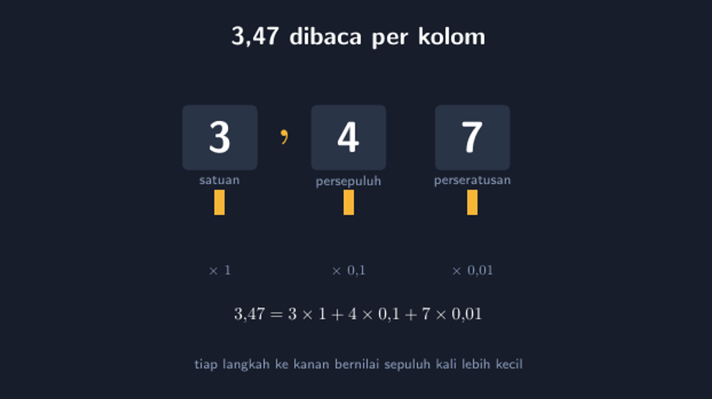

Ada satu momen di kelas VII semester ini yang tidak akan saya lupa cepat. Saya menulis $3{,}47$ di papan, lalu bertanya, "Angka 4 ini nilainya berapa?" Jawaban yang paling ramai: "Empat puluh." Yang kedua paling ramai: "Empat." Tidak ada yang menjawab empat persepuluh di kelompok pertama yang saya tanya. Padahal di bilangan bulat, mereka lancar sekali menyebut nilai tempat — ratusan, puluhan, satuan. Begitu muncul koma, seluruh kamus nilai tempat itu seolah terhapus dari kepala mereka.

<!--more-->

Saya perhatikan polanya lebih dalam sedikit. Siswa memang hafal urutan: satu, sepuluh, seratus — ke kiri. Tapi ke kanan koma, urutan itu tidak punya "bunyi" yang akrab. Persepuluh dan perseratusan terasa seperti istilah yang hanya hidup di buku. Ditambah lagi, di kehidupan sehari-hari mereka justru sering bertemu desimal: harga di warung ditulis $3{,}5$ ribu, berat badan di timbangan pak Nyoman di kantin berbunyi $38{,}6$. Jadi bukan kenaifan — mereka hanya tidak pernah diminta membedah angka di kanan koma dengan serius.

## Papan nilai tempat yang biasa saya pakai, dan kelemahannya

Cara klasik yang saya pakai bertahun-tahun adalah tabel nilai tempat: kolom-kolom berjajar dari kiri ke kanan, dengan kepala kolom bertuliskan satuan, persepuluh, perseratusan. Siswa mengisi angka ke dalam kolom. Berfungsi, tapi ada celah yang lama tidak saya sadari: tabel itu menaruh *label* di atas angka, bukan *nilai* di bawahnya. Siswa bisa pasang angka 4 di kolom persepuluh tanpa pernah berpikir bahwa itu artinya $4 \times 0{,}1$. Label jadi tempat "menitipkan" angka, bukan penjelasan.

Maka tahun ini saya coba ubah orientasinya. Alih-alih hanya menamai kolom, saya gambar ulang tabelnya dengan dua informasi sekaligus: nama nilai tempat di bawah tiap kotak, dan faktor pengali di bawahnya lagi. Tiap digit digantungi penjelasannya sendiri. Inilah yang akhirnya jadi gambar di bawah — dan tentu saja, supaya bisa saya cetak di lembar kerja dan tayangkan di slide, saya buat dengan TikZ.



Gambar sederhana, tapi justru kesederhanaannya yang saya suka. Tiga kotak, satu koma kuning, lalu di bawah tiap kotak ada panah kecil dan kalimat pengalinya: $\times\ 1$, $\times\ 0{,}1$, dan $\times\ 0{,}01$. Saat saya tayangkan, satu siswa berkomentar, "Jadi 7 itu bukan tujuh ya, Pak, tapi tujuh perseratusan." Ya, memang begitulah. Dan komentar itu saya biarkan menggantung sejenak supaya kelas lain sempat mencernanya.

## Kode TikZ-nya: jujur pada struktur

Prinsip yang saya pegang saat menggambar dengan TikZ sama dengan saat saya menggambar bangun datar: gambar harus setia pada matematikanya. Kalau saya mengklaim tiap langkah ke kanan bernilai sepuluh kali lebih kecil, jarak antarkotak tidak boleh melanggar logika itu. Karena nilai tempat desimal adalah soal susunan, saya pakai koordinat eksplisit — bukan tumpukan node yang posisinya ditebak.

Inti dari gambar itu kurang lebih begini:

```latex
\begin{tikzpicture}[x=1cm,y=1cm,font=\sffamily]
  \tikzstyle{cell}=[draw=soft,fill=soft,minimum width=1.5cm,
                    minimum height=1.3cm,rounded corners=3pt]
  \node[cell,label={[lbl]below:satuan}] (u) at (1.8,1.6)
       {\Huge\bfseries\color{white}3};
  \node[acc,font=\Huge\bfseries] at (3.1,1.6) {,};
  \node[cell,label={[lbl]below:persepuluh}] (d) at (4.4,1.6)
       {\Huge\bfseries\color{white}4};
  \node[cell,label={[lbl]below:perseratusan}] (c) at (6.9,1.6)
       {\Huge\bfseries\color{white}7};
  \draw[acc,line width=6pt]
       ($(u.south)+(0,-0.9)$) -- ++(0,0.5);
  \node[lbl] at (1.8,-1.1) {$\times\ 1$};
  \node[lbl] at (4.4,-1.1) {$\times\ 0{,}1$};
  \node[lbl] at (6.9,-1.1) {$\times\ 0{,}01$};
\end{tikzpicture}
```

Beberapa hal kecil di kode itu yang saya banggakan, meskipun kelihatan sepele. Koma saya render sebagai node tersendiri dengan warna aksen kuning — sengaja, karena di kelas itu persisnya titik yang paling sering diabaikan. Koma diberi warna supaya mata siswa berhenti sejenak di situ. Baris $\times\ 1$, $\times\ 0{,}1$, $\times\ 0{,}01$ saya tulis pakai mode matematika, bukan teks biasa, supaya angkanya punya bentuk yang konsisten dengan notasi di papan tulis.

Koordinatnya juga saya pilih dengan sengaja: kotak digit 3 di $x=1{,}8$, koma di $x=3{,}1$, kotak 4 di $x=4{,}4$, kotak 7 di $x=6{,}9$. Jaraknya tidak seragam? Betul — karena saya menyisakan ruang untuk koma, dan jarak antar kotak saya sesuaikan supaya label "persepuluh" dan "perseratusan" tidak bertabrakan. Menggambar dengan TikZ memang menuntut keputusan seperti ini satu per satu, dan justru di situ nilainya: setiap keputusan posisi adalah keputusan matematika-juga-tipografi.

## Dari gambar ke penalaran siswa

Gambar di atas bukan tujuan akhir, melainkan batu loncatan. Setelah siswa terbiasa membaca gambar itu, saya pindah ke pertanyaan yang lebih menantang. Misalnya: "Mana yang lebih besar, $0{,}7$ atau $0{,}25$?" Kalau membaca gambar di atas dengan benar, jawabannya jadi bukan tebakan: $0{,}7$ adalah $7 \times 0{,}01 \times 10 = 7 \times 0{,}1$, sedangkan $0{,}25$ hanya $25 \times 0{,}01$. Anak yang sudah melihat nilai tempat sebagai *perkalian* tidak akan tergoda menyimpulkan bahwa angka lebih banyak berarti lebih besar — miskonsepsi klasik yang biasanya baru muncul jauh setelah tabel nilai tempat selesai dibahas.

Dengan struktur yang sama, saya juga bisa memperkenalkan pembulatan secara visual. Digit 4 di kolom persepuluh, kalau digeser satu langkah ke kiri, nilainya berubah sepuluh kali lipat. Begitu siswa melihat bahwa geser posisi sama dengan geser nilai, soal "bulatkan $3{,}47$ ke satu desimal" tidak lagi menjadi ritual menghafal aturan "lima naik, empat turun". Mereka bisa melihat sendiri bahwa yang berpindah hanyalah 4, dan digit 7 di belakangnya yang menentukan arah pindahnya.

## Kenapa tetap TikZ, bukan gambar jadi

Sebetulnya saya bisa saja mengambil gambar tabel nilai tempat dari internet, atau membuatnya sekali di aplikasi gambar lalu memakainya selamanya. Tapi pengalaman saya selama setahun lebih menggambar media dengan TikZ: yang bikin gambar ini bernilai bukan sekali jadi, tapi bisa diubah. Kalau tahun depan saya ingin memakai contoh $12{,}05$ atau $0{,}375$, tinggal menambah node dan menggeser koordinat. Kalau saya ingin versi tanpa warna untuk lembar kerja yang dicetak hitam-putih, tinggal mengganti definisi warna.

Apalagi kalau berbicara soal kejujuran visual: gambar nilai tempat punya konsekuensi matematis yang halus. Jarak antar kotak, lebar bar di bawah digit, posisi koma — semua itu dibaca siswa walau tidak disadari. Gambar yang asal jadi bisa diam-diam menanamkan ide yang salah, misalnya bahwa koma itu "pemisah rapi" alih-alih "penanda pergeseran nilai sepuluh kali". Dengan TikZ, saya yang menentukan setiap jaraknya, dan setiap jaraknya saya bisa pertanggungjawabkan.

## Penutup: satu titik yang jadi pintu

Koma di bilangan desimal adalah satu tanda kecil yang bekerja sangat besar. Ia memisahkan dua dunia yang arah nilai berlawanan: ke kiri makin besar sepuluh kali, ke kanan makin kecil sepuluh kali. Siswa yang hanya menghafal nama kolom akan berhenti di hafalan itu. Siswa yang pernah melihat gambar di mana tiap digit digantungi faktor pengalinya — dan pernah mengucapkannya dengan suara sendiri, seperti siswa saya sore itu — punya satu langkah lebih dalam pemahaman.

Kalau Bapak/Ibu ingin memakai gambar serupa, silakan ambil berkas lengkapnya di bawah, ganti angkanya sesuai kebutuhan kelas, dan sesuaikan koordinatnya. Satu jaminan kecil dari saya: begitu terbiasa menggambar nilai tempat dengan TikZ, tabel nilai tempat di buku paket tidak akan lagi terasa seperti kisi-kisi hafalan, tapi seperti peta yang bisa dibaca.

> 📎 **Berkas TikZ lengkap:** [tikz-nilai-tempat-desimal.tex](tex/tikz-nilai-tempat-desimal.tex) — siap kompilasi (butuh paket `tikz`).
