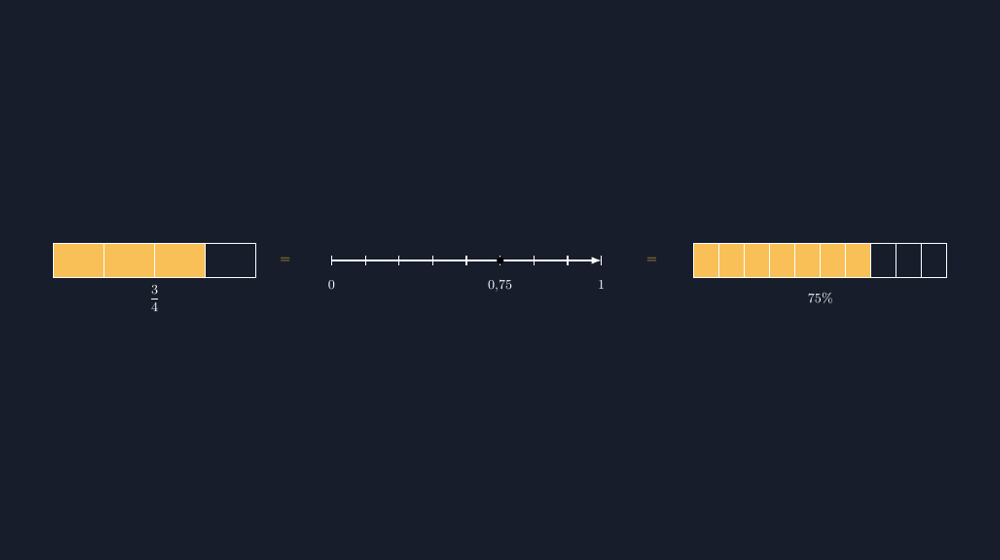

Ada satu momen yang saya masih ingat sampai sekarang. Saat membahas soal diskon di kelas delapan, saya menulis di papan: diskon 25% artinya kita membayar 75% dari harga. Seorang anak mengangkat tangan dan berkata, "Bu, kok tiba-tiba jadi pecahan? Tadi persen, sekarang $\frac{3}{4}$?" Dia tidak sedang bercanda. Di kepala dia, persen itu satu jenis bilangan, pecahan jenis lain, desimal jenis lain lagi -- tiga makhluk berbeda yang kebetulan sering saling menggantikan di papan tulis.

<!--more-->

## Akar masalahnya: tiga bab yang diajarkan terpisah

Kalau kita lihat buku paket, pecahan biasanya diajarkan di kelas tujuh, desimal menyusul, lalu persen muncul sebagai subbab kecil di akhir. Ketiganya memang punya bahasanya sendiri: pecahan pakai garis pembilang-penyebut, desimal pakai tanda koma, persen pakai simbol %. Siswa yang rajin menghafal akan berakhir dengan tiga laci terpisah di kepala, plus satu set trik konversi untuk memindahkan barang antarlaci: bagi seratus, kali seratus, geser komanya dua.

Masalahnya, trik konversi tidak menjawab pertanyaan yang paling mendasar: *kenapa* bisa saling diganti? Anak-anak kita sering bisa menghitung $0{,}75 = 75\%$ dengan lancar tanpa pernah benar-benar melihat bahwa ketiganya adalah bilangan yang sama, cuma ditulis dengan kemasan berbeda.

Dan di sinilah saya jadi berpikir soal gambar. Kalau tiga representasi itu punya satu makna yang sama, seharusnya ada satu gambar yang menunjukkan ketiganya sekaligus, tanpa trik hitung, tanpa hafalan.

## Satu gambar, tiga kemasan

Gambar yang saya buat dengan TikZ itu sederhana, tapi saya sengaja membuatnya seperti itu. Ada tiga bagian yang dihubungkan tanda sama dengan:



*Kiri: satu kesatuan dibagi empat, tiga bagian terarsir. Tengah: titik pada 0,75 dari jarak 0 ke 1. Kanan: 75 dari 100 kotak kecil terarsir.*

Kuncinya, ketiga bagian gambar itu *membagi sesuatu yang sama besar*. Batang pecahan membagi satu batang penuh menjadi 4 bagian sama besar dan mengambil 3. Garis bilangan membagi jarak dari 0 ke 1 dan menandai titik di 0,75 -- anak bisa langsung membandingkan, titik itu lebih dekat ke 1 daripada ke 0. Pita persen membagi satu pita menjadi 100 kotak kecil dan mengarsir 75 di antaranya.

Lalu yang terarsir di ketiganya itu, kalau diukur, *luasnya sama*. Itulah inti kesetaraan yang sulit dijelaskan dengan kata-kata: $\frac{3}{4}$, $0{,}75$, dan $75\%$ bukan tiga bilangan yang kebetulan besarnya mirip. Mereka bilangan yang sama, cuma jumlah potongan yang dipakai untuk menyebutnya berbeda -- empat potongan, sepuluh potongan, seratus potongan.

## Kenapa TikZ, bukan gambar tangan

Sejujurnya, gambar seperti ini bisa saja saya gambar dengan spidol di papan. Tapi ada dua alasan kenapa saya lebih memilih TikZ untuk bahan cetak.

Pertama, presisi. Kalau pita persen digambar dengan tangan, kotaknya bisa beda-beda ukuran, dan justru itu yang berbahaya: siswa yang teliti akan curiga kalau "75 kotak" itu tidak benar-benar 75 bagian yang sama besar. TikZ tidak mengenal istilah "kira-kira sama besar". Setiap kotak di pita itu hasil perhitungan koordinat yang sama, jadi gambar jujur pada klaim matematisnya. Ini prinsip yang sama yang saya pegang sejak artikel pertama tentang bidang koordinat: gambar boleh sederhana, tapi tidak boleh mengarang.

Kedua, kode itu bisa dipakai ulang dan dimodifikasi. Anak berikutnya yang bertanya soal $\frac{2}{5}$? Tinggal ganti jumlah bagian yang terarsir. Soal $\frac{7}{8}$? Ganti lagi. Satu templat, banyak soal, dan konsistensinya terjamin.

Bagian inti dari kode TikZ-nya seperti ini:

```latex
% Batang pecahan: 4 bagian, 3 terarsir
\foreach \i in {0,1,2,3}{
  \ifnum\i<3 \fill[acc!85] (\i*1.2,0) rectangle ++(1.2,0.8); \fi
  \draw[white] (\i*1.2,0) rectangle ++(1.2,0.8);
}

% Garis bilangan: titik di 0,75
\fill[acc] (4,0) circle (2.4pt);
\node[below=7pt] at (4,-0.1) {$0{,}75$};

% Pita persen: 10 kotak terlihat, 7 terarsir (mewakili 75 dari 100)
\foreach \i in {0,...,9}{
  \ifnum\i<7 \fill[acc!85] (\i*0.6,0) rectangle ++(0.6,0.8); \fi
  \draw[white] (\i*0.6,0) rectangle ++(0.6,0.8);
}
```

Ada satu detail di kode ini yang mungkin kelihatan aneh: pita persen hanya menggambar 10 kotak, bukan 100. Ini keputusan yang saya pikirkan matang-matang. Menggambar 100 kotak di lebar kertas itu bisa, tapi kotaknya jadi kecil sekali dan siswa lebih pusing menghitungnya daripada memahaminya. Jadi saya buat 10 kotak -- tiap kotak mewakili 10% -- dan labelnya tetap $75\%$. Saat mengajar, saya jelaskan ini terbuka ke siswa: "kita pakai kelipatan supaya mudah dilihat; kalau mau seratus, tinggal bagi tiap kotak jadi sepuluh lagi." Menurut saya justru itu latihan berpikir yang bagus.

Yang perlu dijaga justru di bagian lain: garis bilangan harus dibagi 8 bagian supaya titik 0,75 jatuh persis di antara tanda ke-6 dan ke-7... eh, bukan -- supaya jatuh persis di tanda ke-6 jika kita mulai menghitung dari 0 dengan jarak 0,125 per tanda. Di sinilah saya berterima kasih pada TikZ: `$0.75 \times 8 = 6$` berarti titik di koordinat `4` (dari skala 8 tanda sepanjang 5,3 cm). Kalau pakai gambar tangan, "kira-kira di situ" adalah standar; dengan TikZ, "di sana, persis" adalah standar.

## Bagaimana gambar ini dipakai di kelas

Cara saya memakai gambar ini biasanya seperti ini: saya tunjukkan gambar tanpa angka di labelnya dulu, lalu tanya, "tunjukkan bagian mana yang terarsir di gambar ketiga?" Ketika siswa bilang "tiga dari empat" untuk gambar pertama, saya minta dia menaksir posisi titik di garis bilangan sebelum saya kasih tahu letaknya. Ketegangan kecil antara "menaksir" dan "memastikan" itu, dari pengalaman saya, lebih membekas daripada langsung diberi tahu.

Setelah ketiga bagian gambar terbaca, baru pertanyaan pemantik ditampilkan: "kalau gambar pertama bilang $\frac{3}{4}$ dan gambar ketiga bilang $75\%$, apakah keduanya bilangan yang sama atau kebetulan mirip?" Jawaban yang saya harap bukan "ya, Bu" -- tapi argumen: karena yang terarsir sama besar, karena titik di garis bilangan sama tempatnya, karena porsinya sama. Kesetaraan yang dibuktikan dari gambar, bukan dari rumus konversi yang dihafal.

Menariknya, dari gambar ini siswa juga bisa menemukan sendiri kenapa $0{,}75$ dan $75\%$ punya hubungan yang begitu langsung: karena persen memang artinya "per seratus", dan desimal dengan dua angka di belakang koma juga menyebut bilangan dalam potongan seperseratus. Tanda koma dan tanda % itu, kalau mau, hanya dua cara penulisan untuk bilangan dengan penyebut seratus yang sama. Siswa yang menemukan ini sendiri jarang lagi tertukar di soal berikutnya.

## Penutup: satu gambar untuk menjembatani tiga laci

Kesetaraan pecahan-desimal-persen ini kelihatan seperti materi kecil, bahkan sering dilewati begitu saja karena dianggap sudah "bisa". Tapi pengalaman saya bilang sebaliknya: justru jembatan kecil antarlaci inilah yang menentukan lancar atau tidaknya materi lanjutan seperti operasi campuran, diskon, bunga, sampai statistika yang penuh angka desimal dan persen.

Gambar TikZ seperti ini bukan pengganti diskusi di kelas -- diskusinya tetap tugas saya. Tapi gambar memberi kita sesuatu yang sulit diberikan kata-kata: bukti visual bahwa tiga wajah yang kelihatan berbeda itu sebenarnya satu bilangan yang sama. Dan untuk anak yang dulu bertanya "kok tiba-tiba jadi pecahan?", jawabannya sekarang bisa ditunjukkan, bukan cuma dijelaskan.

Jika Bapak/Ibu mau mencoba, kodenya lengkap dan siap kompilasi. Selamat menggambar.

> 📎 **Berkas TikZ lengkap:** [tikz-pecahan-desimal-persen.tex](tex/tikz-pecahan-desimal-persen.tex) — siap kompilasi (butuh paket `tikz` dan `amsmath`).
